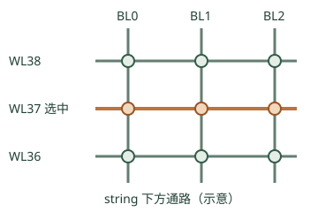

# NAND 基础：从电荷到 page 和 block

上级：[HBF Wiki](./README.md)

NAND flash 用存储单元中的电荷状态影响晶体管的阈值电压。读取时，外围电路施加参考电压，观察通路的响应，再把它判定为数字数据。要理解 HBF，先区分单元状态、阵列读取粒度和堆叠封装。

这里是通用 NAND 教学模型。实际器件的电压、判决、并行度和版图由厂商决定，不能从示意图直接推导 HBF 的电路参数。参考 [Western Digital，Flash 101 and Flash Management](https://documents.sandisk.com/content/dam/asset-library/en_us/assets/public/western-digital/collateral/white-paper/white-paper-sandisk-flash101-management.pdf) 和 [KIOXIA，NAND 耐久性技术说明](https://americas.kioxia.com/content/dam/kioxia/en-us/business/memory/mlc-nand/asset/KIOXIA_TBW_WAF_NAND_Endurance_Technical_Brief.pdf)。

## cell 怎样表示数据

存储结构可以采用浮栅或电荷俘获层等不同实现。编程和擦除改变存储电荷，进而改变 cell 的阈值电压。读取时，感测电路比较目标 cell 在给定读取条件下的响应。

SLC 使用两个可区分的状态，通常表示每 cell 1 bit。MLC、TLC 和 QLC 分别使用更多状态来编码更多 bit；实际阈值分布、参考电压和纠错策略随器件变化。状态越多，需要区分的阈值区间通常越多，但不能只凭这一点算出具体产品的延迟或寿命。

**本专题没有将某种 cell 编码指定为所有 HBF 的要求。** 截至本专题核查日，OCP v0.7 和所检查的 Sandisk 2025 fact sheet 不足以证实“首代 HBF 已确定为 SLC”这一说法。用 SLC 举例时，SLC 是假设，不是产品规格。

## string、wordline 和 bitline

在 NAND string 中，多个 cell 沿同一电流路径串联。wordline（WL）控制选定位置附近的 cell；bitline（BL）连接感测路径。3D NAND 把许多 WL 层沿垂直方向组织，垂直 string 穿过这些层。

图中每条竖线代表一条简化的 string 路径，每条横线代表一个 WL 层上的控制关系。WL37 在多条 string 上各控制一个示意 cell。该图省略选择管、实际互连和完整三维形状；线条交叉也不表示把 WL 与导电通路直接短接。

以读取某个 WL 上的目标 cell 为概念例子：

1. 选通需要观察的 string 和目标 WL，并对目标施加读取条件。
2. 对同一 string 上未选中的相关 cell 施加通过条件，让它们尽量不阻断感测通路。
3. 感测电路观察 BL 的电流或电压响应，形成判决结果。
4. 多个可并行感测的单元产生一组数据，结果保存在感测电路或 page buffer 中。

读出过程还受选择晶体管、阵列切分和外围电路限制。上面的顺序帮助理解因果关系，不是某个 HBF 真实电压波形。多 bit/cell 的逻辑 page、物理 WL 与多次判决之间也不必是一对一关系。

在常用的教学符号中，目标 WL 的参考条件可写成 Vread；相关未选 WL 的通过条件可写成 Vpass。Vpass 的作用是让未选 cell 尽量不妨碍对目标状态的判断。重复施加读取条件也可能造成读干扰，因此读密集不等于没有可靠性管理。

## page 与 block 分别做什么

| 概念 | 常见作用 | 需要避免的简化 |
| --- | --- | --- |
| page | 读取和编程相关的数据组织单位 | host 请求、物理感测范围和逻辑 page 不一定同义 |
| page buffer | 保存和传递阵列感测或编程相关的数据 | 容量、共享方式和并行能力取决于实现 |
| block | NAND 中常见的擦除单位 | 修改少量数据也可能影响更大的擦除单位 |
| plane / bank | 阵列组织与可能的并行资源边界 | 名称与独立性要看器件，不能假定不同 block 都能并行 |

若系统要改写一个已编程 page，而 NAND 要求先擦除所在 block，就需要处理该 block 内其他仍有效的数据。通常的 SSD 控制器可以搬迁有效数据、擦除旧 block，再更新映射；HBF 的职责划分需要单独查看[第 6 篇](./06-write-and-reliability.md)。

OCP HBF v0.7 指出 4 KiB NAND page，并给出 4 KiB 的 base-die 到 core-die 逻辑单位示例。这是该版本的接口和组织描述，不应扩展成所有 NAND 产品都采用 4 KiB page。[OCP v0.7，第 4.1、4.6 节](https://www.opencompute.org/documents/ocp-hbf-architecture-specification-v0-7-0-final-pdf/)

## 用 4 KiB 检查数据量

4 KiB 等于 4096 B，即 32768 bit。假设一个教学阵列以 SLC 方式每 cell 保存 1 bit，则仅表示这 32768 个数据 bit 至少需要 32768 个数据 cell。实际阵列还可能保存 ECC、冗余或其他信息。它们如何组织、能否一次并行感测，不能从这个算术结果推出。

同样，host 请求 64 B 时，并不意味着 NAND 一定只感测 64 B。实际行为取决于设备的内部读取粒度和缓存状态。即使已经读到 page buffer，还需要考虑内部传输、纠错、调度和接口返回。

## 编程、擦除与覆盖

编程改变 cell 的存储电荷状态。擦除将一个擦除单位恢复到可重新编程的状态；常见 NAND 的擦除单位是 block。具体注入、释放或复合电荷的物理方法因器件结构而异。

例如，一个 block 内有 A、B 两个仍有效的 page。若系统需要改写 A，且该器件要求先擦除整个 block，就必须先保护或迁移 B，再安排擦除和重新写入。只保留“写 A”这一个逻辑操作，会遗漏后台搬迁、寿命消耗和失败恢复。不同设备把这些工作分配给 host、固件或控制器的方式不同。

## 两种“堆叠”不是同一件事

**3D NAND 的 WL 层数**是单颗 NAND die 内部的阵列结构。**HBF 的 die stack 高度**是封装中堆叠了多少颗 NAND die。每颗 die 内部可以有多层 WL；多个 die 再与 base die 堆叠。不能把“16-die stack”理解成只有 16 层存储单元。

下一篇把这些 NAND 资源放进 [HBF 的 base die 和接口](./03-architecture.md)。
