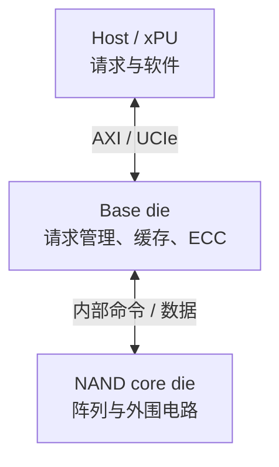

# HBF 结构：core die、base die 和接口

上级：[HBF Wiki](./README.md)

HBF 的核心结构可以分为三部分：保存数据的 NAND core die、处理请求和控制的 base die，以及连接它们的堆叠互连。host/xPU 通过封装内接口访问 HBF。下面以 [OCP HBF v0.7，第 4–5 节](https://www.opencompute.org/documents/ocp-hbf-architecture-specification-v0-7-0-final-pdf/)为准描述功能边界。

## 数据经过哪些模块

图是功能示意。它不规定具体 die 的物理连线、ECC 与传输的重叠方式，也不表示所有数据都经过图中每一种可选资源。

| 模块 | 输入 | 主要职责 | 输出 |
| --- | --- | --- | --- |
| host/xPU | 程序请求、地址、布局与配置 | 形成事务，配置和使用 HBF 地址空间，处理软件可见状态 | 请求、数据消费与恢复动作 |
| host channel | 事务与数据 | 提供 host 到 HBF 的独立接口资源 | 传输后的事务或响应 |
| base die | host 事务和 core die 响应 | 接口处理、调度、缓存、ECC、状态及内部控制 | core die 请求、host 数据与状态 |
| core die | 阵列操作请求 | 执行 NAND 读取、编程、擦除等内部操作 | 读取数据、完成或错误状态 |
| 堆叠互连 | die 间信号 | 连接 base die 和 core die | 命令、数据及状态信号 |

OCP v0.7 的 base die 功能清单包括 ECC 编解码、core die 数据传输调度和读取计数。规范还描述 TSV 冗余管理。具体厂商的内部实现、资源共享与参数仍需查产品资料。

## Channel、die 和 bank 是不同维度

v0.7 的架构描述支持最多 16 个独立 host channel。每个 channel 提供自己的接口和地址空间；规范示例中的请求不会通过一个 channel 去访问另一个 channel 的存储空间。部分管理、测试和电源资源则是共享的。不能把接口独立直接解释为整个系统的功率、热或所有内部资源都完全独立。

channel 是访问接口的划分；die 是物理芯片；bank 或 plane 是内部资源的组织名称。**16 个 channel 不等于每个 channel 恰好对应一颗 die，也不能由 16-die stack 直接推出 16 倍有效带宽。** 具体映射和并行度必须看规范配置及器件实现。

## UCIe 与 AXI 各负责什么

UCIe 提供 die-to-die 的接口架构；AXI 描述上层事务接口。OCP v0.7 将 AXI 事务映射到 UCIe host interface。协议事务、链路传输和 NAND 内部命令处于不同层级：一条 xPU 读取不会把 WL、BL 电压直接发送给应用程序。

该版本的示例使用独立的 host channel；每个 UCIe channel 内可以有一个或多个**虚拟 AXI 接口**。虚拟接口的数量不是物理 UCIe channel 的数量。host 的全局地址分配、channel 局部地址和内部 bank/die 映射，也需要分别理解。详见[地址映射与性能](./05-mapping-and-performance.md)。

## 可选的 scratchpad

OCP v0.7 还描述了可选的 base-die SRAM scratchpad。它由 host 软件管理，断电后不保持数据；它不是 NAND page，也不是所有 HBF 产品都必须提供的功能。其大小、延迟和可用性应以产品规格为准。不要把它当成 HBF NAND 的默认缓存命中保证。

下一篇沿着[一次 4 KiB 读取](./04-read-walkthrough.md)观察这些模块如何协作。
