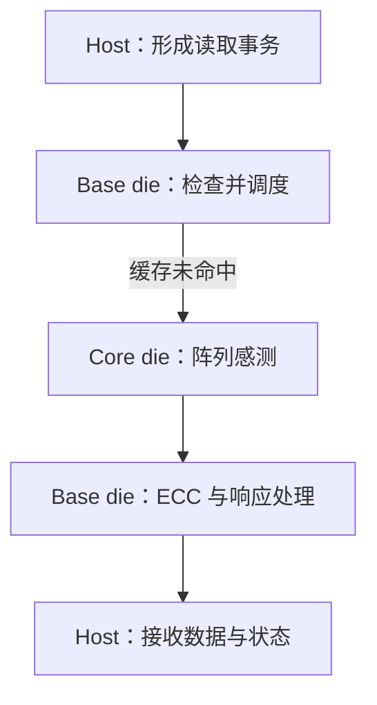

# 一次 4 KiB 读取：从请求到数据返回

上级：[HBF Wiki](./README.md)

假设 xPU 需要读取已经写入 HBF 的一段 4 KiB 权重。本文沿请求和数据两个方向追踪。目标是识别每个阶段的职责与等待条件，不是声称某一产品严格执行下面的微操作顺序。

## 前提和观察边界

- 目标数据已有效写入；请求地址按 4 KiB 对齐，并位于一个 host channel 的地址空间。
- 假设访问 NAND 区域，base die 的相关缓存未命中；没有错误、重试或刷新干扰。
- 讨论一次完整的 4 KiB 逻辑数据读取。host 接口可以把它表达为多个更小的事务。
- 不指定实际 die、plane、WL、地址位布局和具体延迟。数据从返回接口到计算单元的后续搬运也因系统而异。

这些前提为了让路径清楚。改变其中任何一项，都可能改变经过的资源和完成时间。

## 1. xPU 生成读取，并选择 host channel

应用或计算单元需要一段地址范围。host 的内存系统根据自身地址转换、数据布局和 channel 分配形成对 HBF 的访问。OCP v0.7 区分 host 全局地址与 UCIe channel 局部地址；channel 选择和地址分配不应全部归给 base die。

对于该版本，host 读地址以 64 B 为粒度，并受对齐和 4 KiB page 边界约束。完整 4 KiB 含 64 个 64 B 单位。规范描述了用多个读取命令获取它，或在产品支持时使用 burst。上层的“读 4 KiB”因此不必等于一条物理接口事务。[OCP v0.7，第 4.1、4.6、5.3 节](https://www.opencompute.org/documents/ocp-hbf-architecture-specification-v0-7-0-final-pdf/)

在本例中，假设 host 已把这段范围分配给 channel 5。这个编号只是例子；没有提供地址位，就不能据此还原真实映射。

## 2. Base die 接收和调度请求

请求经 UCIe 到达 base die。base die 处理事务和顺序约束，将 channel 局部地址映射到它管理的 NAND 资源，并检查能否由缓存满足。本例假设缓存未命中，因此需要发起 core die 读取。

OCP v0.7 描述每 bank 的缓存，并规定同一 bank 的 sense 请求顺序。不同 AXI ID 的读取完成可能乱序，同一 ID 内有顺序约束。能否合并、重叠和重排，要同时看地址、ID、bank 状态和具体产品支持。

## 3. Core die 执行阵列感测

base die 向所选 core die 资源发出内部读取。可以用“die → bank/plane → block → page”帮助理解层次，但这不是 host 必须逐字段发送的命令，也不是公开资料对每个产品的固定微架构描述。

在一般 NAND 概念模型中，目标 WL 使用读取条件，相关未选中的 cell 使用通过条件。感测电路观察 BL 的响应，得到一组数字判决，并暂存在阵列相关的 page buffer 中。具体读取电压、判决次数、并行单元数以及 page 与 WL 的关系需要器件资料。

这里要区分两个缓冲：**NAND 感测相关的 page buffer**属于阵列读取过程；**OCP 所描述的 base-die bank cache buffer**用于 base die 一侧的数据缓存。它们的物理实现和资源关系不能只凭名称判定。

## 4. 数据、ECC 结果和响应返回

读取数据经过内部数据通路到达 base die；base die 执行规范描述的 ECC 和状态处理，并将请求的数据与响应经 host 接口返回。ECC 的确切流水位置、与传输能否重叠，以及成功响应的全部条件，要以具体实现和协议为准。

若出现可纠正错误、不可纠正错误或重试，路径会增加处理和等待。错误不应被模拟成无条件的成功数据。可靠性处理见[第 6 篇](./06-write-and-reliability.md)。

图只表示本例的依赖关系。它省略分段、缓存命中、重试、队列和其他请求，不规定真实电路必须等待整个 page 完成后才开始下一阶段。

## 5. 延迟在哪里产生，哪些部分能重叠

对于一个请求，从 host 发出到 host 接收完成的时间可能包含：host 排队、接口传输、base die 排队、阵列感测、数据返回和 ECC 等。**不能未经条件说明，就把各模块的峰值延迟简单相加**：某些工作可能重叠；其他工作则有严格依赖。逐阶段相加只有在各项被定义为不重叠的实际时间区间时才成立。

对于多个请求，若它们使用独立的 bank、缓存和通路，硬件也允许并行，则一个请求等待感测时，另一个请求可能传输数据。若命中同一 bank、受顺序约束或共享瓶颈，重叠就会减少。单个请求的延迟与多个请求的总带宽因此是不同的问题。

下一篇用具体地址示例说明[如何让请求分布到可并行的资源](./05-mapping-and-performance.md)。
