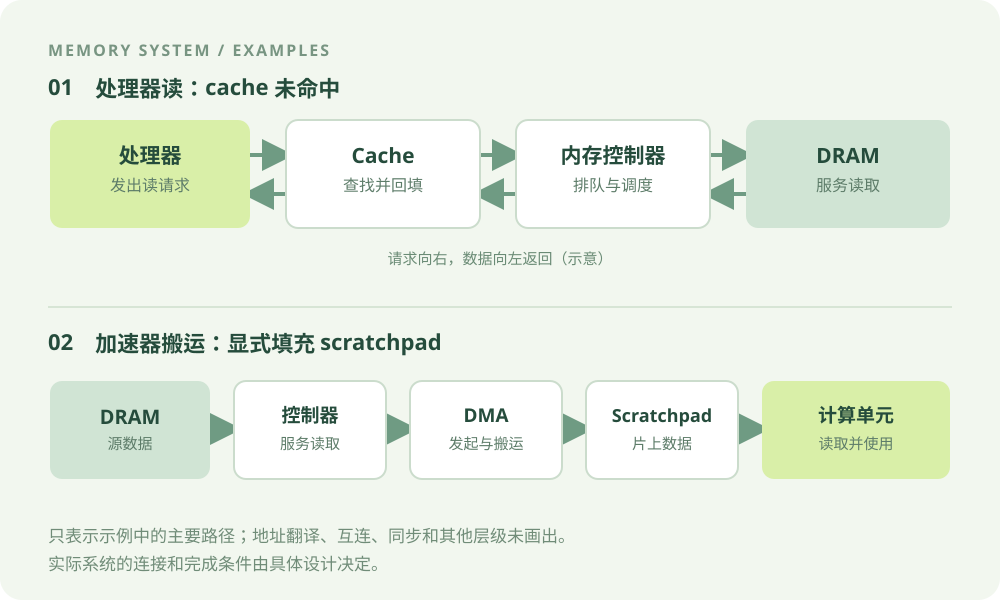

# RAM 存储系统概览：数据如何从存储走到计算

上级：[RAM 专题主页](../README.md)

相关：[SRAM 6T cell](../02-sram-foundations/6t-cell-bistable-storage.md) · [存储层次与系统角色](../07-system-architecture/memory-hierarchy-as-system.md) · [学习路线](./learning-roadmap.md)

计算单元需要持续取得数据，也需要保存计算结果。存储系统的任务，是在容量、访问时间、带宽、能耗和成本等约束下，提供这些数据。

一次读取并不只涉及一颗存储单元。请求可能经过 cache、片上互连和内存控制器，最后由存储阵列服务。每一层有自己的输入、输出和资源限制。本篇先建立这张全景图，再进入 SRAM、DRAM 和控制器的细节。

## 1. RAM 是什么？

RAM 是 random-access memory，通常译为随机存取存储器。它允许根据地址访问存储位置，不需要像顺序介质那样，从开头依次经过所有更早位置。这个名称本身**不保证所有地址的访问时间相同**，也不保证任意时刻都能无冲突地访问任意位置。

本专题主要讨论两类常见 RAM：

- **SRAM**：常见的 6T cell 用交叉耦合电路维持状态。保持数据需要满足供电等条件，但不需要 DRAM 式周期刷新。
- **DRAM**：常见的 1T1C cell 用电容电荷表示状态。读取与恢复、周期刷新和 bank 状态会影响访问过程。

这里讨论的是易失性 SRAM 和 DRAM。是否掉电保持由具体存储技术和设计决定，不能仅从“随机存取”这个名字推断。

## 2. 先看两条数据路径

点击图可查看大图。图中是两个简化例子，并非所有芯片都采用相同连接。

### 路径 A：处理器读取，cache 未命中

假设处理器请求的数据不在参与查找的 cache 中，所需数据位于 DRAM。请求会向下游传递；内存控制器接收并调度访问；数据返回后，可按该系统的策略回填 cache，再交给处理器。

这里的 **cache** 是系统角色和管理机制。它通常包含用 SRAM 实现的数据阵列，但还需要 tag、命中判断、替换及其他控制逻辑。cache 命中时不一定需要访问 DRAM。

### 路径 B：DMA 将数据搬入 scratchpad

在另一个假设系统中，软件或硬件调度 DMA 从 DRAM 读取一块数据，将其写入片上的 scratchpad；计算单元在数据准备好后从 scratchpad 读取。scratchpad 是显式管理的数据存放区域，常以 SRAM 实现。

DMA 是发起和执行搬运的模块；内存控制器负责对 DRAM 请求进行调度。具体连接可能经过 NoC、其他 buffer 或不同的控制器。计算何时可以使用数据，还取决于 DMA 完成事件、同步和可见性契约，不能只凭“已发出请求”判断。

## 3. 逐步看一次 cache miss

下面只研究一笔读请求。假设地址翻译已经完成；只有一个 cache 层参与示例，且该层未命中；目标数据位于 DRAM。还假设没有其他请求争用、不需要脏块写回或一致性处理，并且本例在完整回填后才向处理器返回所需数据。

<!-- ram-overview-demo -->

在这些假设下，过程可以分成六个逻辑阶段：

1. **发出读取**：处理器向 cache 提交地址和读请求。
2. **查找未命中**：cache 没有可用于满足该请求的数据，向下游发起读取。
3. **控制器接收**：内存控制器接收请求，并按队列、地址映射和时序约束安排访问。
4. **DRAM 服务**：目标 DRAM 阵列执行所需操作。具体命令取决于目标 bank 的当前状态和协议约束。
5. **数据返回并回填**：数据经返回路径到达 cache，本例假设完整块回填后才继续。
6. **请求得到响应**：处理器取得所需数据。数据返回与指令退休是不同边界，后者由处理器实现决定。

这些阶段不是等长周期，也不意味着真实系统必须完全串行。其他设计可能有多级 cache、并发请求、提前返回所需字节、额外一致性动作或不同的回填策略。[MIT 的 cache 与存储层次课程](https://ocw.mit.edu/courses/6-004-computation-structures-spring-2017/pages/c14/c14s1/)给出了 cache 命中、未命中与数据回填的基础模型。

## 4. 不要把不同层的名字混在一起

| 要回答的问题 | 所属维度 | 示例 |
| --- | --- | --- |
| 单个 bit 如何保存？ | 存储单元 | 6T SRAM cell、1T1C DRAM cell |
| 单元怎样组成可访问资源？ | 阵列与组织 | SRAM bank、DRAM bank、row buffer |
| 存储资源在系统中做什么？ | 系统角色 | cache、scratchpad、register file、主存 |
| 控制器如何与 DRAM 交换命令和数据？ | 接口与协议 | DDR、LPDDR、GDDR、HBM 接口 |
| 存储器如何与计算芯片集成？ | 封装与系统集成 | DIMM、PoP、堆叠 die、2.5D interposer |

这些维度可以组合，但不是完全独立的自由选项。例如，HBM 不只是一个系统角色：它是一类基于堆叠 DRAM 的内存及其接口体系；具体系统再决定它承担什么角色、如何集成。Micron 的 [HBM2E 技术说明](https://assets.micron.com/adobe/assets/urn%3Aaaid%3Aaem%3A275edf31-79e3-4b6c-8bbd-a233babe9281/original/as/micron-hbm2e-memory-wp.pdf)展示了一种堆叠 DRAM 与系统级封装方案。

比较两种方案时，先说明正在比较哪一维，再给出工作负载、目标和约束。例如：“在同一工作负载下比较两种外存方案的容量、有效带宽和成本”，比只问“HBM 和 DDR 哪个更先进”更容易得到可验证的结论。

## 5. SRAM 和 DRAM 的基本差异

| 问题 | 常见 SRAM | 常见 DRAM |
| --- | --- | --- |
| 如何保存状态？ | 6T cell 中的交叉耦合电路维持两个稳定状态。 | 1T1C cell 用电容上的电荷表示状态。 |
| 维持数据需要什么？ | 满足供电、保持电压和噪声等条件；无需 DRAM 式周期刷新。 | 除供电等条件外，还须按器件要求刷新。 |
| 读操作有什么边界？ | 通过位线和感测电路读取；读扰动不能使 cell 翻转。 | 常见 DRAM 的 ACT 包含感测与恢复；访问受行状态和时序约束。 |
| 常见系统用途 | cache 数据阵列、scratchpad、片上 buffer 等。 | 主存或设备内存等大容量存储层。 |

这些是常见设计取向，不是普遍的速度或面积定律。实际延迟、密度、能耗和成本还取决于工艺、容量、外围电路、接口、封装及工作点。register file 也可能采用其他电路实现，不能仅凭它的系统角色断定一定使用某种 SRAM cell。

## 6. 用同一边界比较延迟和带宽

**延迟**描述一笔请求从指定起点到指定终点经过的时间。例如，从控制器接收读请求，到请求数据对该控制器的上游接口可见。换一个起点或终点，数值就可能不同。

**带宽**描述某段时间内经过指定接口的数据量。必须说明方向、观察窗口和计数内容，例如是否只计算有效 payload。峰值带宽是给定接口配置下的理论上界；实际观测值还会受请求、冲突、调度和测量窗口影响。

例如，假设某单向数据通道最多传输 `16 B/cycle`。在一个长度为 10 个周期的观察窗口内，通道实际传输了 64 B 有效数据，则：

  窗口平均有效带宽 = 64 B / 10 cycle = <strong>6.4 B/cycle</strong>
  相对峰值利用率 = 6.4 / 16 = <strong>40%</strong>

这里的 `6.4 B/cycle` 只描述这个窗口，不自动等于长期稳态带宽。它也不能单独说明空闲周期由 refresh、bank 冲突、请求不足还是其他原因造成。定位原因需要更多状态或事件。

## 7. 对建模有什么启示？

先选定问题，再决定模型需要保留哪些细节。

- 如果只做粗略容量或平均性能估算，可以把一部分内部过程折叠成经过校准的参数，但应说明它无法回答哪些冲突或尾延迟问题。
- 如果要解释共享资源等待，需要明确请求的接纳、排队、服务和响应边界，以及相关端口、bank 或链路的占用规则。
- 如果要研究 DRAM 命令调度，需要进一步定义地址映射、bank/row 状态、命令时序和 refresh 规则。需要哪些状态取决于目标协议和模型范围。

一个简化的事件视角可以是：

<ol class="ram-event-sequence" aria-label="简化的请求处理过程">
  <li>请求接纳</li>
  <li>等待资源</li>
  <li>存储服务</li>
  <li>数据返回</li>
  <li>响应可见</li>
</ol>

这只是依赖关系，不表示每个阶段都独占一个周期，也不假设所有阶段不能重叠。器件参数、时钟域、观察点和模型假设应一起记录。架构模型的结果不能单独证明电路稳定性或真实芯片性能。

## 8. 接下来怎么读？

本章后续文章按问题逐步展开：

1. [为什么存储器是体系结构里最难的部分](./problem-statement.md)：观察约束如何跨层耦合。
2. [速度、容量、成本、功耗四角矛盾的根源](./memory-hierarchy-tension.md)：区分不同目标及其代价。
3. [同样是 RAM，为什么 SRAM 和 DRAM 走向了完全不同的工程路径](./sram-dram-divergence.md)：从存储方式推导组织差异。
4. [学习路径与各章节依赖关系](./learning-roadmap.md)：按目标选择后续章节。
5. [RAM 家族的分类与命名体系](./taxonomy.md)：进一步区分单元、角色、接口和封装。

如果想先深入一颗 SRAM 单元，可以直接阅读 [6T SRAM cell：它如何保存、读取和写入 1 bit](../02-sram-foundations/6t-cell-bistable-storage.md)。如果当前目标是 DRAM 建模，可以转到 [DRAM 基础](../04-dram-foundations/README.md)和 [Memory Controller](../06-memory-controller/README.md)。
