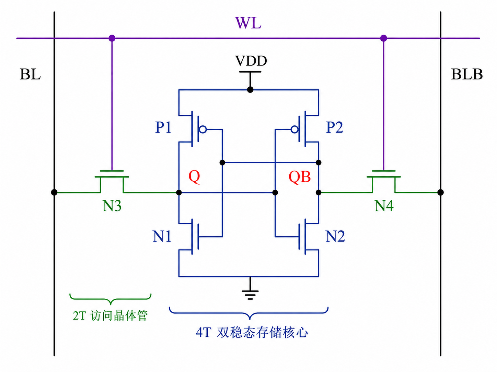

# 6T cell：双稳态、读扰动与写入

上级：[SRAM 基础](./README.md)
相关：[字线、位线、读出放大器](./wordline-bitline-sense-amp.md)、[DRAM 1T1C cell](../04-dram-foundations/1t1c-cell-destructive-read.md)

## 结构与保持

6T SRAM cell 通常由两个交叉耦合 CMOS 反相器（四个晶体管）和两个访问晶体管组成。内部节点 `Q`、`QB` 在稳定状态下分别接近高、低电平，或低、高电平。每个反相器的输出驱动另一个反相器的输入；正反馈维持状态。保持需要供电，`WL` 关闭时访问晶体管将内部节点与共享位线隔离。

## 读：利用位线差分，避免翻转

假设 `Q=1, QB=0`，并且 `BL/BLB` 已按具体宏的读方案预充。`WL` 导通两个访问晶体管后，低节点 `QB` 通过对应访问晶体管接到一侧位线；该位线经 cell 的下拉路径轻微放电，另一侧维持较高电压。sense amp 根据位线差分判决。它不需要等待一侧降到完整逻辑 0。

此连接也会使低节点受到位线电荷扰动而上升。若扰动与噪声足以跨越另一反相器的翻转边界，正反馈可能使状态错误翻转。读成功要求位线差分足够判决，同时 `Q/QB` 保持原状态。

## 写：用位线驱动覆盖旧状态

仍以 `Q=1, QB=0` 为初态。要写成 `Q=0, QB=1`，写驱动使连接 `Q` 的位线为低、另一侧为高，再使能 `WL`。访问路径拉低 `Q`；当反相器跨越翻转区间后，交叉耦合正反馈推动两个节点达到新稳定状态。`WL` 关闭后新状态还须能保持。具体驱动与字线相位由宏电路决定。

读路径希望 cell 足够强，以抵抗预充位线造成的扰动；写路径又需要访问晶体管和驱动足够强，以改变旧状态。`cell ratio` 等器件强度比、PVT、供电噪声和失配共同影响这些边界。静态噪声裕量（SNM）可用于描述特定条件下的保持或读稳定性；不能从逻辑拓扑单独推断工作电压。

6T 是常见折中，并非唯一 SRAM 单元。不同 5T、8T 或多端口拓扑可以改变读写隔离和面积，但也需要各自的外围与稳定性分析。

## 建模启示

架构仿真一般不计算连续的 `Q/QB` 波形，应从选定宏和工作点取得读写可见时间、端口接纳间隔、冲突规则与能耗。保持电压和可访问电压需分别校准。低于有效范围时模型应拒绝或标记该工作点，而不是声称已验证 bitcell 稳定。接口边沿示例见[访问时序](./read-write-cycle-timing.md)。
