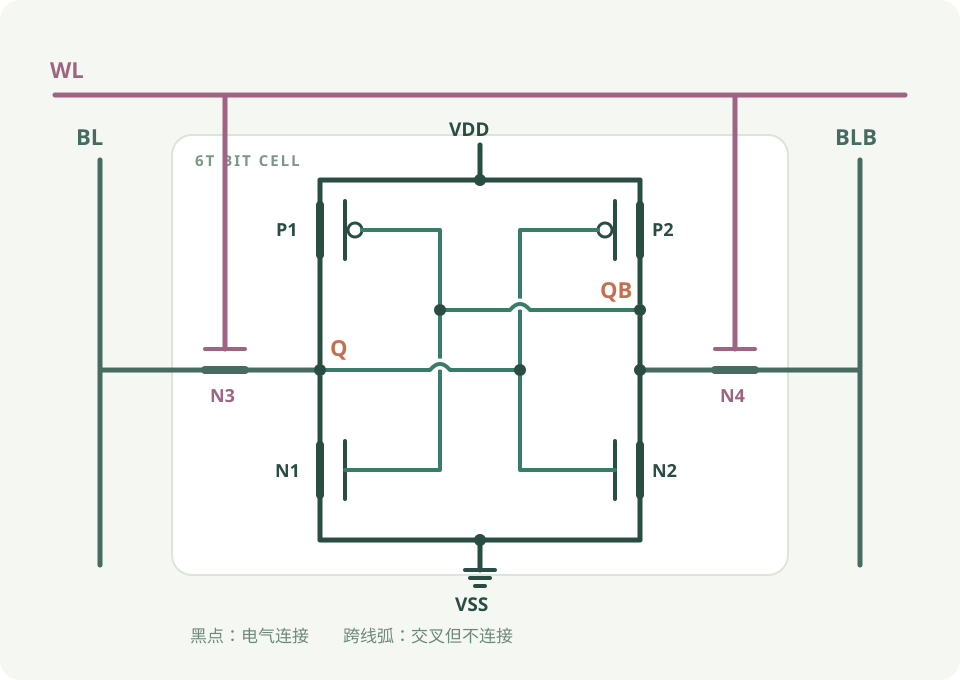

# 6T SRAM cell：它如何保存、读取和写入 1 bit

上级：[SRAM 基础](./README.md)

相关：[字线、位线与读出放大器](./wordline-bitline-sense-amp.md) · [SRAM 一次访问的时序](./read-write-cycle-timing.md) · [DRAM 的 1T1C cell](../04-dram-foundations/1t1c-cell-destructive-read.md)

一个 6T SRAM cell 用六个晶体管保存 1 bit。四个晶体管构成两个交叉耦合的反相器，维持内部状态；另外两个晶体管受字线控制，将内部节点接到位线，用于读写。

理解它的关键是区分两个过程：**读操作希望观察状态而不改变它；写操作则要让外部驱动足以改变原状态。**两者使用同一对访问晶体管，因此会形成设计权衡。

本文以一种常见的 **6T、差分位线、读前高电平预充**方案为例。图解展示逻辑阶段，不代表器件的实际电压、波形或时间比例。不同 SRAM 宏可以采用不同的外围电路和控制时序。

## 1. 先认识六个晶体管

[](../img/6t-sram-cell.svg)

点击结构图可查看大图。

| 器件或信号 | 职责 |
| --- | --- |
| `P1`、`N1` | 构成左侧 CMOS 反相器。输入为 `QB`，输出为 `Q`。 |
| `P2`、`N2` | 构成右侧 CMOS 反相器。输入为 `Q`，输出为 `QB`。 |
| `N3`、`N4` | 访问 nMOS。`N3` 连接 `BL` 与 `Q`；`N4` 连接 `BLB` 与 `QB`。 |
| `WL` | 字线，同时控制 `N3` 和 `N4` 的栅极。低电平关闭访问路径，高电平使其导通。 |
| `BL`、`BLB` | 一对位线，由阵列外围的预充、感测或写驱动电路控制。 |
| `VDD`、`VSS` | cell 的电源和低电位参考。图中省略晶体管的体端、寄生参数和外围电路。 |

图中黑点表示电气连接；带跨线弧的交叉处不连接。两个反相器的输出分别驱动对方的输入。图中的访问管只是六个晶体管中的两个，sense amp 和写驱动不计入这个 6T cell。

## 2. 保持：两个反相器互相维持状态

在稳定状态下，`Q` 与 `QB` 分别接近高、低电平，或低、高电平。这里约定把 `Q` 的值当作保存的数据。这个命名只是本文的约定。

例如，假设 `Q = 1，QB = 0`，且 `WL = 0`：

| 器件 | 栅极由谁控制 | 该稳定状态下的作用 |
| --- | --- | --- |
| `P1` / `N1` | `QB = 0` | `P1` 导通，`N1` 关闭；左反相器将 `Q` 拉向 `VDD`。 |
| `P2` / `N2` | `Q = 1` | `P2` 关闭，`N2` 导通；右反相器将 `QB` 拉向 `VSS`。 |
| `N3` / `N4` | `WL = 0` | 访问路径关闭，cell 与位线隔离。 |

这样，低 `QB` 帮助维持高 `Q`；高 `Q` 又帮助维持低 `QB`。如果两个节点处于相反状态，也有对应的反馈路径。这就是两个稳定状态的来源。

这里的 `1` 和 `0` 是电压接近相应电源轨的逻辑表示，不表示真实电路中的电压精确等于 `VDD` 或 `VSS`。在读扰动和写入翻转期间，`Q`、`QB` 都是连续变化的模拟电压，不必在每个瞬间严格互补。

SRAM 不需要像 DRAM 那样为维持数据而定期刷新，但保持状态仍需要满足供电、温度和噪声等条件。关闭电源或低于 cell 的保持条件时，不能假定数据继续保留。

## 3. 读：先建立位线差分，再感测

继续假设 `Q = 1，QB = 0`。下面只描述一种常见读方案：先将两条位线预充到接近 `VDD`，再通过位线差分判断数据。

<!-- sram-read-demo -->

### 步骤一：预充并均衡

`WL` 保持低电平。外围预充电路将 `BL` 和 `BLB` 拉到接近相同的高电平。本例假设预充和均衡结束后，外围释放预充路径，再开始选通 cell。

由于访问管关闭，预充时位线不通过 `N3/N4` 直接连接存储节点。预充电平、释放时机和具体实现由 SRAM 宏决定。

### 步骤二：打开字线，形成差分

`WL` 升高后，`N3` 和 `N4` 导通。在初始状态下，`Q` 为高，右侧反相器中的下拉管 `N2` 导通；`QB` 为低。于是，连接 `QB` 的 `BLB` 可以沿下面的路径放电：

```text
BLB → N4（访问管）→ QB → N2（下拉管）→ VSS
```

`BLB` 开始下降，另一侧 `BL` 相对较高。二者之间形成差分。实际的下降幅度和速度受位线电容、器件电流、泄漏及外围时序影响。

### 步骤三：感测，并结束访问

当位线差分达到所用 sense amp 的判决要求，且感测使能时机满足设计条件时，sense amp 将模拟差分转换为数字结果。本例中 `BL` 较高、`BLB` 较低，对应 `Q = 1`。感测不需要等待 `BLB` 降到完整的逻辑 0。

读出后，控制电路关闭 `WL`，并按宏的时序准备下一次访问。cell 在成功读取后仍保存原状态。SRAM 读操作并不以破坏 cell 状态为目标，但这不等于任意条件下都不会发生读失败。

### 为什么读也可能改变数据？

`BLB` 原来接近高电平，`QB` 原来接近低电平。`N4` 导通后，位线会通过访问路径扰动 `QB`，使它升高；`N2` 同时尝试把 `QB` 拉低。如果扰动与噪声使交叉耦合电路越过稳定边界，正反馈就可能推动 cell 翻转。这称为 **read disturb，读扰动**。

因此，读成功至少有两个不同的条件：

1. 位线差分和感测时机足以使 sense amp 正确判决。
2. 读期间以及结束后，cell 仍保持原状态。

满足其中一个条件，不能自动证明另一个也满足。静态噪声裕量可以帮助评估指定条件下的稳定性；实际读访问还需考虑时序、寄生参数、噪声和器件失配。

## 4. 写：让外部驱动改变旧状态

仍从 `Q = 1，QB = 0` 开始。这次希望写入 `Q = 0，QB = 1`。示例假设读预充路径已关闭，写驱动可以建立目标位线差分。

<!-- sram-write-demo -->

### 步骤一：准备目标数据

写驱动将 `BL` 拉低，将 `BLB` 拉高。此时 `WL` 仍为低，cell 与位线隔离，因此它暂时保持旧值。

```text
初始 cell：Q = 1，QB = 0
目标位线：BL = 0，BLB = 1
目标 cell：Q = 0，QB = 1
```

具体的写驱动、预充关闭和字线相位由宏电路决定；上面的顺序是本文的教学假设。

### 步骤二：打开字线，与旧状态竞争

`WL` 升高，`N3` 和 `N4` 导通。低电平 `BL` 经 `N3` 拉低 `Q`。与此同时，由于 `QB` 起初为低，`P1` 仍在尝试把 `Q` 拉高。这是写入初期的竞争。

如果写驱动、访问管和字线脉宽不足以推动节点越过动态翻转边界，cell 可能保留旧值，或者在访问结束后回到旧值。

### 步骤三：反馈推动新状态建立

随着 `Q` 下降，右侧反相器的响应使 `QB` 上升。上升的 `QB` 又改变左侧反相器的驱动：`P1` 逐渐关闭，`N1` 逐渐导通。交叉耦合反馈进一步推动 `Q` 降低、`QB` 升高，最终建立新状态。

高电平位线也通过 `N4` 影响 `QB`，但 nMOS 传递高电平的能力受栅源电压等条件限制。不能仅凭 `BLB = 1` 就断言它会单独把 `QB` 拉到完整的 `VDD`；成功翻转后，cell 内的上拉路径参与建立并保持高节点。

当新状态建立并满足宏规定的时序后，关闭 `WL`。在持续供电且保持条件满足时，cell 保存 `Q = 0，QB = 1`。反向写入 `Q = 1` 时，位线极性与相应的左右路径互换。

## 5. 读稳定性与可写入性为什么需要折中？

读时，预充位线会扰动低节点。该侧的下拉管需要足够有效地维持低电位；否则，读操作可能翻转 cell。写时，访问路径和写驱动又需要能够克服原状态的维持作用。把访问管做得更强，可能有利于写入，却也可能增加读取时的低节点扰动。

一种常见的一阶设计参数是 **cell ratio**。对本文 `QB = 0` 的读例子，可以用下拉管 `N2` 与访问管 `N4` 的相对强度来讨论这一比值。它有助于解释趋势，但不是充分的成功判据：器件电流随端电压变化，寄生参数、字线和位线电压、PVT、噪声及失配也会改变结果。

**保持稳定性、读稳定性和写入能力需要分别评估。**例如，可以在明确偏置和噪声注入方式的条件下比较 hold SNM 与 read SNM；写入能力则需使用明确定义的写裕量、写入时间或失败条件。不同论文或工具对裕量的定义可能不同，不能只比较名称或单个数字。

## 6. 从 cell 到架构模型

一个 cell 只保存 1 bit。实际 SRAM 宏还包含大量 cell、字线和位线，以及译码、预充、sense amp、写驱动和输出电路。多行 cell 可以共享位线；读写需要遵守整个宏的时序和端口约束。[MIT 的 SRAM 阵列课程](https://ocw.mit.edu/courses/6-004-computation-structures-spring-2017/pages/c14/c14s1/)给出了 cell、字线、位线和外围的组织示例。

架构仿真通常不逐个计算 `Q/QB` 的连续波形。它应从选定宏及工作点获取读写可见时间、端口接纳间隔、冲突规则和能耗，并明确输入采样及输出可见边界。保持电压与可访问电压也需要分别确认。宏接口示例见 [SRAM 一次访问的时序](./read-write-cycle-timing.md)。

如果要验证 cell 能否稳定读取和可靠写入，需要针对目标电路、寄生参数与工作条件做电路仿真或实测。本文的示意图和动画不能替代这些验证。

## 延伸阅读

- [David Harris：SRAM 课程讲义](https://pages.hmc.edu/harris/class/e158/lect15-sram.pdf)：6T cell、读写过程和设计权衡。
- [Stanford EE371：RAM 稳定性与感测条件](https://web.stanford.edu/class/archive/ee/ee371/ee371.1066/lectures/Old/lect_10_2up.pdf)：结合位线差分、耦合噪声与工作条件讨论存储单元。
- [OpenRAM 控制时序](https://github.com/VLSIDA/OpenRAM/blob/stable/docs/source/control_logic.md)：一个同步 SRAM 实现的外围控制流程；不代表所有 SRAM 宏。
