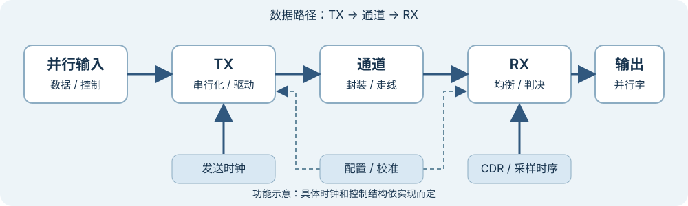

# 一组数据怎样经过 TX、通道和 RX？

上级：[全局链路](./README.md)

一条链路的目标是让接收端得到按约定顺序排列的数据。发送端处理待发送数据，通道承载电信号，接收端根据受损信号和时间参考作出判决。

*图：功能示意。窄屏可左右滑动，点击可查看原图。TX 均衡可与驱动合并；RX 采样、DFE 和 CDR 可能相互耦合。图不规定具体芯片内部的模块边界。*

## 沿路径观察

| 位置 | 输入 | 输出 / 职责 |
| --- | --- | --- |
| TX 数字接口 | 并行字与时钟 | 按约定位序提供待发送数据 |
| 串行化和驱动 | 并行位、发送时钟及配置 | 产生按时间排列的电信号；可调整发送波形 |
| 通道 | TX 输出波形 | 信号经过封装、走线等后发生延迟、损耗和可能的反射 |
| RX 前端与采样 | 受损信号、采样时刻和门限 | 均衡并产生符号判决；CDR 根据数据调整采样时序 |
| 解串与对齐 | 连续判决结果 | 将位分组，并按接口要求交给上层 |

例如，把 `0xB2000000` 作为 32 bit 输入字，约定最高位先发。前 8 位是 `10110010`。在专题的 10 Gb/s NRZ 假设下，这 8 位占 8 个 UI，即 `800 ps`；未计路径延迟、编码或空闲。

按时间顺序看，TX 先按约定装载输入字，再依次输出这些位。通道输出在不同时间点的值会受当前及附近符号影响。RX 需要在合适时刻比较信号和门限，得到一串判决；随后才能按照约定的边界把判决重新组合成字。图中没有给出从输入到输出的完整延迟，也没有假设接收结果一定正确。

每一段都有自己的成功条件：输入接口要满足装载时序；TX 和通道要提供 RX 可以处理的信号；RX 的采样条件和字边界要正确。某一个环节正确，不能单独证明整条路径已达到目标误码率。

## 数据和控制要分开看

数据沿 TX → 通道 → RX 前进。发送时钟提供 TX 所需的时序。RX 的时钟数据恢复（CDR）根据接收信号调整采样时刻。配置和训练逻辑还可能改变 TX / RX 参数。这些控制路径不等于有效载荷的数据路径。

具体产品的实现可以不同。例如，[AMD Versal GTY 接收器手册](https://docs.amd.com/r/en-US/am002-versal-gty-transceivers/Receiver)把接收前端、均衡、CDR、对齐和缓冲列为不同功能。它是指定器件的实例，不是所有 PHY 的固定结构。

## 接下来怎么读

看[PHY、SerDes 与协议是什么关系？](./phy-serdes-protocol.md)，再区分[位宽、线速率、符号率与时钟怎样换算？](./rates-clocks-and-ui.md)。
