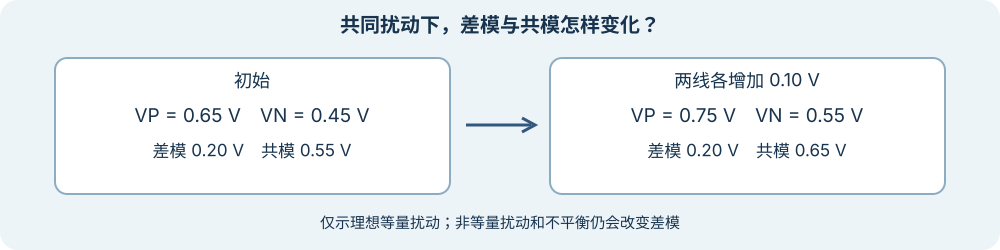

# 差分信号、共模与回流

上级：[电信号与通道](./README.md)

差分接收器主要依据两根输入导体之间的电压差判决。设两根线相对于同一参考点的电压为 `VP`、`VN`：

`Vdiff = VP − VN`；`Vcm = (VP + VN) / 2`。

前者是差模电压，后者是共模电压。发送器和接收器仍有各自允许的共模范围；仅知道差值不能证明输入合规。

*图：理想代数示例。窄屏可左右滑动，点击可查看原图；真实链路中的噪声不一定相同。*

## 理想共同扰动与不平衡

假设 `VP = 0.65 V`、`VN = 0.45 V`，则 `Vdiff = 0.20 V`，`Vcm = 0.55 V`。若两线都增加 `0.10 V`，差模仍为 `0.20 V`，共模变成 `0.65 V`。若只有 P 增加 `0.10 V`，差模变成 `0.30 V`：扰动已进入差模。

真实线路可能有阻抗、耦合或长度不平衡，接收器的共模抑制能力也有限。因此差分能帮助抑制一部分共同扰动，却不能消除所有串扰、反射或噪声。[TI 的高速差分连接说明](https://www.ti.com/lit/an/slla104a/slla104a.pdf)讨论了平衡和终端。

在一个简化 NRZ 约定中，正差模可以表示 1，负差模可以表示 0。具体极性取决于接口约定，不能仅凭导体标名推断比特含义。如果 P、N 交换，差模符号会反转；某些器件提供极性反转配置，但是否自动识别应查具体实现。

共模也不是“没有用的电压”。即使差模仍为 `0.20 V`，两根线同时变化后也可能超出接收器允许的输入共模范围。因此需要同时核对差模幅度、共模、终端和输入限制。

## 电流需要闭合路径

P、N 导体及周围参考结构共同影响电流分布。差模电流、共模电流及高频回流的实际路径取决于几何、参考平面和频率。不能简单认为“差分线没有回流问题”。过孔和参考平面不连续会改变路径与阻抗；参见[封装内的信号完整性](../../../FAB/wiki/06-cross-cutting-engineering/signal-integrity-in-package.md)。

## 接下来怎么读

看[时序偏差、抖动和采样窗口](./timing-skew-and-jitter.md)。
