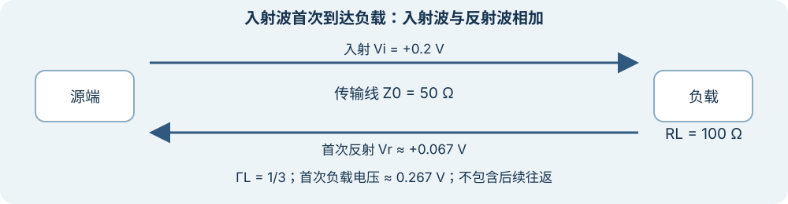

# 特性阻抗、终端与反射

上级：[电信号与通道](./README.md)

当信号边沿相对线路传播时间足够快时，不能只把整条线当作一个集中电容。波沿传输线传播，遇到阻抗变化时，一部分可能返回。连接器、过孔、负载和封装都可能形成不连续。[TI 的反射说明](https://www.ti.com/document-viewer/lit/html/SSZTAX3/GUID-2D2CAEAA-D7FA-43E3-8CAD-78D810632034)给出了这一物理机制。

## 末端第一次反射

假设均匀、无损单端传输线的特性阻抗 `Z0 = 50 Ω`，纯电阻负载 `RL = 100 Ω`，入射阶跃 `Vi = 0.2 V`。在负载处：

`ΓL = (RL − Z0) / (RL + Z0) = 1/3`

第一次到达时，负载处入射和反射电压相加，为 `Vi × (1 + ΓL) ≈ 0.267 V`。若 `RL = Z0`，该理想负载处的反射系数为零。这个例子不包括源端反射、损耗和后续往返。

*图：理想单端线路的首次到达；窄屏可左右滑动，点击可查看原图。箭头表示波的传播方向。*

再看两个边界：理想开路时 `ΓL = +1`，负载处第一次电压阶跃为入射值的两倍；理想短路时 `ΓL = −1`，负载端电压相加为零。反射波还会向源端传播，源端不匹配时可能再反射。因此“第一次到达”的结果不能直接用来预测之后所有时刻的电压。

`Vi` 是此例已经进入传输线的入射波幅度，不是任意驱动器的开路输出电压。若从驱动器参数开始算，还要包含源端阻抗和分压条件。

示例沿用[封装信号完整性](../../../FAB/wiki/06-cross-cutting-engineering/signal-integrity-in-package.md)中的参考条件。差分链路需要使用对应的差分阻抗、参考面和模型，不能把单端 `50 Ω` 与差分 `100 Ω` 不加条件地混为同一参数。

## 终端不是一个孤立数字

驱动器、封装、线路与接收器共同决定实际波形。端接过小会增加负载电流，端接与线路不匹配会引起反射；实际取舍还受功耗、摆幅、带宽和协议约束。直流导通只能证明存在连接，不能证明高速波形可判决。

## 接下来怎么读

看[怎样读损耗、dB 和 S 参数？](./loss-db-and-s-parameters.md)。
