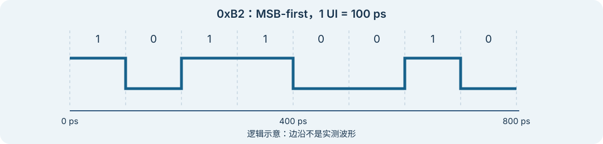

# 并行字怎样变成串行流？

上级：[发送端](./README.md)

串行化器的输入是一组并行位、控制信号和时钟；输出是一条按约定位序排列的串行位流。实现需要保证：输入字在被装载时有效，输出位在各自规定的时间窗口内产生。

## 从一个字开始

取 `0xB2000000`，按 MSB-first 输出。第一个字节 `0xB2` 的位序是 `10110010`。假设每个 UI 输出一位，UI 为 `100 ps`：

*图：逻辑时间示意。窄屏可左右滑动，点击可查看原图；边沿和电平未按真实电路波形建模。*

前 8 位占 `800 ps`，完整 32 位字占 `3.2 ns`。并行输入时钟 `312.5 MHz` 的周期也是 `3.2 ns`。这依赖每周期一个字、无空闲、无附加开销的假设。

## 并行输出如何切换

一种理解方式是：先保存并行字，再按选择信号依次选出各位。实际实现可以分级复用、使用多个相位，或采用其他电路。高位先发只是此例约定；真实接口的位序、控制位和有效信号需查相应手册。

若输入位产生在另一时钟域，不能只把导线接上。需要按设计约束处理装载时序、跨域、缓冲及有效数据边界。

假设连续输入两个字。发送第一个字的 32 个符号期间，下一字必须在设计规定的装载时刻准备好。若上层没有新数据，输出能否暂停、发送空闲序列或采取其他动作，取决于协议与实现；不能让本例的“每周期都有字”变成默认事实。

内部位宽也不一定等于上层位宽。例如，数字逻辑可以先重组数据，再交给物理收发器。每个边界都应说明位序、时钟、有效条件和处理空闲的规则；只有位宽没有这些约定，无法唯一恢复原始数据。

## 接下来怎么读

看[PLL、分频与多相时钟怎样工作？](./clock-pll-and-multiphase.md)。
