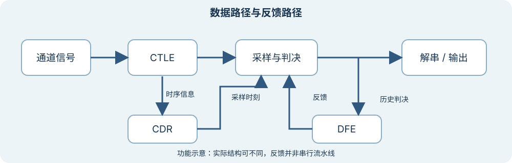

# 接收端有哪些数据与反馈路径？

上级：[接收端](./README.md)

接收端输入是经过通道后的电信号和本地参考条件。输出是按接口组织的数字数据与状态。它通常需要处理信号幅度、采样时刻和字边界，但具体模块及其顺序因实现而异。

*图：功能关系示意。窄屏可左右滑动，点击可查看原图；不同实现可能把采样器、DFE 和 CDR 的电路合并，或采用 ADC 和 DSP。*

| 功能 | 输入 | 输出 / 作用 |
| --- | --- | --- |
| 前端 / CTLE | 受损电信号 | 在规定范围内接收并调整不同频率分量 |
| 采样与判决 | 信号、时刻、门限 | 产生离散的符号判决 |
| CDR | 接收数据相关的时序信息和本地时钟 | 调整采样相位 / 频率，使采样与数据匹配 |
| DFE | 已判决的历史符号及系数 | 估计并抵消一部分历史符号带来的 ISI |
| 解串与对齐 | 连续判决和边界信息 | 形成上层可以消费的并行字 |

这张表不是要求每个接收器都具有这些独立模块。[AMD 的 Versal GTY 接收器手册](https://docs.amd.com/r/en-US/am002-versal-gty-transceivers/Receiver)展示了一个实际产品的功能组织。

先看数据：信号经过输入端后到达采样与判决位置，再形成并行输出。再看反馈：DFE 依赖过去判决；CDR 利用数据相关信息调整采样。初始化或自适应控制还可能更改均衡参数。这些关系会跨越多个符号间隔，因此不能把图当成每个方框只经过一次的静态流水线。

一个接收器的可用状态也可能分层报告：参考时钟存在、CDR 锁定、字边界对齐和协议链路建立是不同条件。具体状态信号及先后关系以器件和协议为准。

## 接下来怎么读

从[接收前端与 CTLE 做什么？](./analog-frontend-and-ctle.md)开始，再看采样和反馈。
