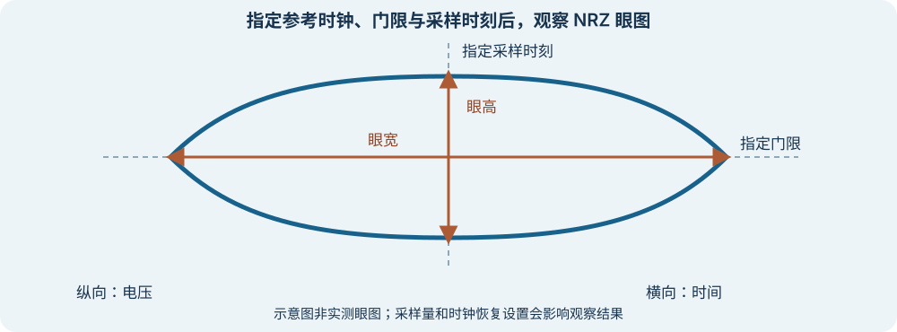

# 怎样理解眼图和抖动？

上级：[信号与指标](./README.md)

眼图把许多符号周期的波形按所选时钟参考叠加。中间空出的区域帮助观察判决余量。眼图不是一条单独的传输曲线，也不是对所有未来比特的保证。

图仅说明测量位置，不代表仪器截图或实测结果。窄屏可左右滑动；点击可查看原图。

## 眼高和眼宽在哪里测？

- **眼高**：在指定采样时刻，观察上下波形之间可供判决的电压间隔。门限位置、噪声与观察范围影响可用余量。
- **眼宽**：在指定电压门限处，观察可供判决的时间间隔。它可以用时间或 UI 表示，但两者换算必须使用对应符号率。
- **抖动**：实际边沿相对所选理想时刻或时钟参考的时间偏差。报告时需要说明参考时钟、统计方法、观察时间以及包含的抖动成分。

例如，假设一张 NRZ 示意眼图在某门限处的左右边界分别为 `25 ps` 与 `75 ps`，则这一口径下的眼宽是 `50 ps`。若该链路的 UI 为 `100 ps`，眼宽即 `0.5 UI`。仅凭这一个数不能确定 BER；若图中已包含某种抖动，也不能不检查口径就再次扣除它。

PAM4 有多个相邻电平间的判决区域。应分别检查对应眼图与门限，不能只报告最漂亮的一只眼。[Tektronix：PAM4 信号测试、分析与调试](https://download.tek.com/document/PAM4-Signaling-in-High-Speed-Serial-Technology_55W-60273.pdf)

## 为什么同一信号会得到不同结果？

仪器使用的时钟参考或时钟恢复模型会影响波形对齐。CDR 的带宽不同，可能跟踪或保留不同频率的相位变化。于是同一输入信号在不同设置下可能得到不同眼图或抖动值。[Tektronix：Clock Recovery Primer](https://download.tek.com/document/65W_26023_0_Letter.pdf)

比较结果时，至少记录参考面、通道和探头、信号速率与调制、测试码型、时钟恢复设置、采样量和测量算法。眼图显示的是所收集样本及仪器处理的结果；很少发生的尾部错误可能没有出现在有限样本里。

## 抖动的来源和统计口径

某些抖动与数据历史有关，例如通道的 ISI 会让边沿位置随前后符号变化。其他扰动可能呈周期性；噪声等也可能引入随机变化。实际信号通常包含多种成分，分类和分解结果依赖模型与仪器方法。

均方根（RMS）值和峰峰值描述不同统计量。有限时间内测得的峰峰值也会随观察长度和所见样本变化。不能直接把不同口径的数值相加，或不说明分布与外推方法就由 RMS 得出极低误码率处的抖动。

## 接下来怎么读

读[BER、置信度与 FEC 怎样关联？](./ber-confidence-and-fec.md)，学习如何解释有限时间内观察到的错误。
