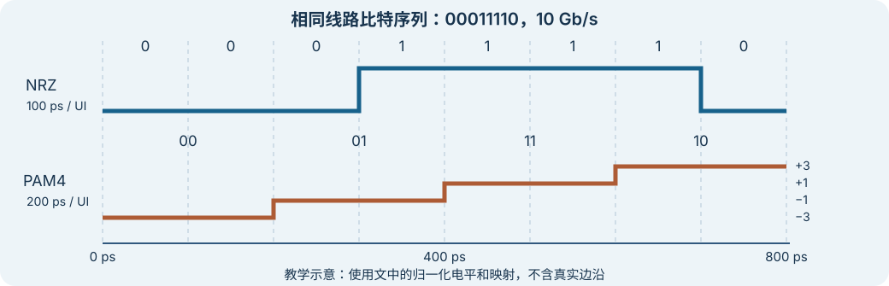

# NRZ 与 PAM4：比特怎样映射到符号？

上级：[信号与指标](./README.md)

调制规定如何用信号状态表示信息。这里的**符号**是一个符号周期内选出的信号状态；符号率的单位是 `Bd`，即每秒符号数。一个 UI 是一个符号周期。在本文比较中，UI 等于符号率的倒数。

NRZ 用两个电平表示每个符号的 `1 bit`。PAM4 使用四个电平，每个符号可表示 `2 bit`。因此，在线路比特率相同、且比较对象都是调制器输入比特时，PAM4 的符号率是 NRZ 的一半。线路编码和 FEC 的额外比特要另外计算。[Keysight：信号参数](https://helpfiles.keysight.com/scopes/FlexDCA-UG/Content/Topics/Quick-Start/FlexDCA-fact-6.htm)

## 同一串比特的教学例子

沿用第一阶段的 `10 Gb/s`，但这里只比较调制输入，不包含编码开销。假设 NRZ 的 `0 / 1` 映射到 `−3 / +3`；PAM4 使用表中一种示例映射。真实接口的位序、电平、码型和映射应查对应规范。

| 比特对 | `00` | `01` | `11` | `10` |
| --- | --- | --- | --- | --- |
| PAM4 归一化电平 | `−3` | `−1` | `+1` | `+3` |

这个例子使用格雷映射：相邻电平的比特对只差一位。若只误判到相邻电平，就会错一位；若跨越多个电平，可能错更多位。映射本身不是纠错码。

对比特序列 `00011110`，NRZ 依次发送 8 个符号；PAM4 按 `00 01 11 10` 分组，发送 4 个符号。两者都在 `800 ps` 内发送完。

| 项目 | NRZ | PAM4 |
| --- | --- | --- |
| 每符号比特数 | 1 | 2 |
| 符号率 | `10 GBd` | `5 GBd` |
| 一个 UI | `100 ps` | `200 ps` |
| 判决电平间隔 | 两个电平间为 6 | 相邻电平间为 2 |

图是教学示意，不含边沿时间、噪声和通道损耗。窄屏可左右滑动；点击可查看原图。连续的相同符号不产生电平跳变。

## 较低符号率的代价

在上述理想比较中，两种调制的最外电平相同，PAM4 相邻电平的间距是 NRZ 的三分之一。PAM4 需要区分四个电平，通常要考虑三个判决门限；NRZ 的二电平判决通常只需一个门限。通道损耗、噪声和判决误差会影响可用余量。

`20 log10(1/3) ≈ −9.54 dB` 只描述这个等外摆幅例子中的电压间距比。它不能直接作为任意系统的信噪比损失或 BER 差距。实际比较还取决于发射摆幅、噪声、接收器、均衡、FEC 和测量口径。[TI：PAM4 基础](https://www.ti.com/lit/an/snaa325a/snaa325a.pdf)

## 接下来怎么读

读[线路编码与加扰解决什么问题？](./coding-and-scrambling.md)，区分比特如何组织和信号如何表示。
