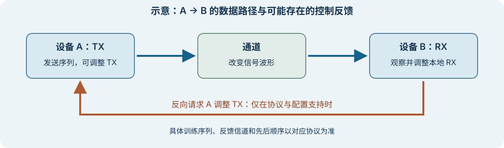

# 训练与自适应：谁观察，谁调整？

上级：[初始化与链路训练](./README.md)

训练是按特定接口规则，让链路进入所需工作条件的过程。它可能包括发送训练序列、测量质量、交换请求和调整均衡。**自适应**是根据观察调整参数的机制，可以发生在训练期间，也可能在运行时继续。并非每条链路都具有相同的训练消息或反馈路径。

## 数据路径与控制路径

图是概念示意。反向请求仅在相关协议和配置支持时存在，不表示所有链路都有相同信令。窄屏可左右滑动；点击可查看原图。

完整双向链路还包含 B→A 的数据方向；那个方向的接收观察与发送参数需要分别考虑。两方向的通道和调整结果不一定相同。

在这条 A→B 方向的示意链路中：

1. A 的 TX 向通道发送规定序列；B 的 RX 接收受通道影响的信号。
2. B 可根据本地可观察信息调整自身 RX 参数。具体是 CTLE、DFE 还是其他参数，由实现决定。
3. 如果协议支持，B 还可通过规定的反向通信要求 A 调整 TX 参数。请求、响应、取值范围和超时以该协议为准。
4. 满足指定条件后，两端进入下一状态。训练完成只表示该流程的条件已满足，不自动证明目标长期 BER 或所有工况均合格。

CDR 跟踪采样相位也是反馈过程，但它与双端交换 TX 系数不是同一个动作。训练序列、普通数据以及不同速率下的调整策略可能不同。

## 一次参数尝试的教学例子

假设 A 有一个可取 `0、1、2` 的抽象 TX 参数；B 每次用相同的 `1000 bit` 已知序列计数，并在观察期间保持自身设置不变。初始参数是 `0`。B 发出调整请求，A 响应后再测量：

| 当前参数 | 本次观察到的错误数 | B 的下一次示例请求 |
| ---: | ---: | --- |
| `0` | 12 | 增加到 `1` |
| `1` | 2 | 增加到 `2` |
| `2` | 4 | 回到 `1` |

这只能说明在这三次有限观察中，参数 `1` 的错误数最少。它不证明参数 `1` 对所有码型、环境或长时间运行都是最优，也不证明任何目标 BER。真实协议可能用不同指标、增减请求、范围限制和完成条件；有的还要处理对端未响应或参数已经到达边界。上表不是 10GBASE-KR 或 PCIe 规定的算法。

## 10GBASE-KR 的器件实例

[TI TLK10031 数据手册](https://www.ti.com/lit/ds/symlink/tlk10031.pdf)第 7.3.14—7.3.15 节描述其 10GBASE-KR / 1GBASE-KX 模式：自动协商可选择双方支持的工作模式；选择 KR 时，接收侧依据训练过程请求对端调整发送均衡系数。手册也描述自动与手动控制等配置。

在这个实例中，系数请求和接收就绪状态有指定的字段与流程。它说明一种双端协作，不能推广成所有以太网链路或 PCIe 的训练顺序。训练失败、系数达到范围限制或信号条件改变时，应查看该器件与协议的状态记录，再判断下一步。

## 接下来怎么读

读[多 lane 为什么需要对齐？](./lane-alignment.md)，了解各 lane 已各自恢复数据后，还需要解决什么。
