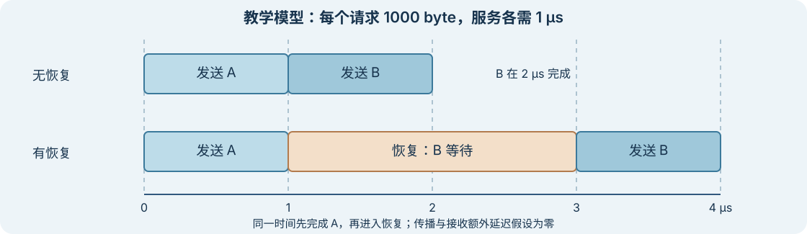

# 走一遍有恢复停顿的链路模型

上级：[建模：怎样把链路放进系统模型？](./README.md)

下面构造一个单方向、单资源的事件模型，比较没有停顿和指定恢复停顿的结果。所有数值都是教学假设，不是某协议、器件或实测链路的参数。

## 输入与规则

| 项目 | 本例假设 |
| --- | --- |
| 线路与编码 | 单 lane、NRZ、`10 Gb/s` 线路比特率，`8b/10b` 数据编码；服务数据时除编码外没有头部或其他协议开销 |
| 数据与队列 | `t = 0` 接受 A、B 两个各 `1000 byte` 的有效数据请求，A 先服务；总容量 `2000 byte`，包含正在服务和等待的数据 |
| 服务 | 链路 `UP` 时独占发送资源按队列顺序服务；传播及接收额外延迟假设为 0；服务完成时交付数据并释放其占用 |
| 恢复 | 对照场景无恢复；另一场景在 `0.5 μs` 收到恢复请求，约定等当前请求 A 完成后生效，`RECOVERING` 持续 `2 μs`，期间不开始 B |
| 同时事件 | `1 μs` 时先完成 A、交付并释放容量，再进入恢复，然后才考虑启动 B |
| 错误与功率 | 不注入误码、丢失或重试；`UP` 且忙时 `200 mW`，`RECOVERING` 时 `80 mW`，两值含相同选定模块 |

`8b/10b` 的数据效率为 `8/10`，因此此例持续服务速率是 `8 Gb/s = 1 GB/s`。每个 `1000 byte` 请求的串行化时间为 `1 μs`。没有固定头部或其他开销，才可以直接使用这个换算。

图是上述事件契约的教学示意。窄屏可左右滑动；点击可查看原图。

## 一步步计算

| 时刻 | 无恢复场景 | 有恢复场景 |
| --- | --- | --- |
| `0 μs` | A 开始，B 等待；占用 `2000 byte` | 同左 |
| `1 μs` | A 完成并释放 `1000 byte`；B 开始 | A 完成并释放 `1000 byte`；进入恢复，B 等待 |
| `2 μs` | B 完成；队列占用归零 | 恢复仍在进行；B 仍占用 `1000 byte` |
| `3 μs` | 已完成 | 恢复结束；B 开始 |
| `4 μs` | 已完成 | B 完成；队列占用归零 |

无恢复时，A、B 分别在 `1 μs`、`2 μs` 完成。有恢复时，它们分别在 `1 μs`、`4 μs` 完成。观察从 `0` 到 `4 μs` 的有恢复场景，共交付 `2000 byte`，平均有效吞吐为 `0.5 GB/s`。这个平均值包含恢复期间；不能再把同一停顿作为额外效率损失重复扣除。

在相同 `4 μs` 窗口，两个忙碌区间共 `2 μs`，恢复 `2 μs`：

`E = 200 mW × 2 μs + 80 mW × 2 μs = 0.56 μJ`。

平均功率为 `0.14 W`；除以交付的 `16000 bit`，为 `35 pJ/有效 bit`。这里只覆盖表中指定模块和时间；没有额外计入链路空闲、应用、封装或其他共享电路。

## 这个结果依赖什么？

如果恢复可以中断 A、重传数据，或者新请求在队列满时被丢弃，时间线会改变。如果传播不为零，交付与发送资源释放也可能不在同一时刻。要比较这些场景，必须先给出新的事件规则和参数，而不是仅改一个延迟数。

本例不模拟波形、CDR、眼图、物理误码、完整协议状态、硬件时钟或真实功耗。它只验证所列假设下的算术与事件顺序。更多单位与公式见[符号、单位和参考面](../10-reference/symbols-and-units.md)。

## 接下来怎么读

回到 [SerDes Wiki：从比特到可恢复的信号](../README.md)，或用[第三阶段自测：设计、系统与模型](../10-reference/phase3-self-check.md)检查这些边界。
