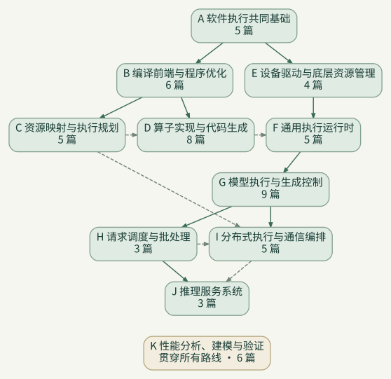

# 编译器与运行时系统系列重构计划书

版本：v1.0 · 2026-11-28

仓库：[microarch-flow/wiki](https://github.com/microarch-flow/wiki)

网站：[从硅到系统](https://microarch-flow.github.io/wiki/)

状态：十四个知识域、十一条阅读路线和 59 篇初版文章基线已确认；独立目录、系列入口及专题导读已建立，正文逐篇编写与核验发布。

本文件用于跨会话协作。以仓库中的现行版本为准，记录知识边界、文章归属、依赖关系、迁移范围和实际完成进度。计划书不作为博客正文。

## 一、重构目标与已确认的决定

- 将「编译器与系统软件」和现有「推理运行时」合并为「编译器与运行时系统」，统一解释计算语义如何成为可执行计划、设备任务和对外推理服务。
- 覆盖通用编译器的核心原理，同时重点介绍 AI 编译器的模型表示、映射、数据搬运、内核实现，以及软硬件执行契约、设备驱动、通用运行时和推理服务。不扩展成完整的编程语言理论、操作系统或云计算课程。
- 按计算微架构的重构方法：知识域决定覆盖与主讲责任，认知依赖决定阅读路径，具体问题及因果关系决定文章组织。保留十四个知识域，实际组织为 A–K 十一个专题。
- 59 篇为初版基线（53 篇常规、6 篇深化或案例）；深化仍属于初版范围，不是每位读者的必修内容。写作过程中依据知识密度和认知目标决定拆分、合并，并同步更新计划与依赖。
- 编译器、运行时的职责按决策对象及抽象层次划分，不简单按离线和在线区分。JIT 触发是运行时工作，JIT 的实际分析、变换和代码生成仍属于编译。
- 保留旧推理运行时全部有效知识和证据。本轮不修改旧版正文，也不提前改变其他系列的知识归属、现有公开链接与锚点。

## 二、新旧目录、阅读入口与发布

- 新版源码：[series/compiler-runtime/](../series/compiler-runtime/README.md)。各专题以 README.md 为实际导读，包含宏观定位、贯穿算例、边界、知识关系图、文章计划及主要前置知识。
- 旧版源码：[series/inference-runtime/](../series/inference-runtime/README.md)。在新版稳定前保持旧正文和既有地址；旧版 29 篇正文、术语表、约定、公式复算及教学事件模型仍可用。
- 初期保持八个主系列不变；在现有推理运行时系列下提供独立新版导读入口，旧版页面继续可读。新正文可以逐篇或逐批发布，不必等待 59 篇全部完成。
- 未写正文在导读中只显示纯文本计划，标明「未发布」。不生成空白文章或无效链接。实际编写时使用稳定编号和下表计划文件名；完成发布且核验后，为导读条目添加链接并更新状态。
- 图解优先采用静态 SVG，知识关系图的 Graphviz 源文件与 SVG 同置于各目录 assets/，便于后续调整。
- 新版稳定后再由用户确认旧目录归档、退役或删除；届时完整复核旧 URL、锚点、站内链接、搜索及讨论路径，迁移或索引仍有价值的进阶资料。

| 专题 | 目录 | 常规 | 深化 | 合计 |
| --- | --- | ---: | ---: | ---: |
| A · 软件执行共同基础 | [01-foundations/](../series/compiler-runtime/01-foundations/README.md) | 5 | 0 | 5 |
| B · 编译前端与程序优化 | [02-frontend-and-optimization/](../series/compiler-runtime/02-frontend-and-optimization/README.md) | 6 | 0 | 6 |
| C · 资源映射与执行规划 | [03-mapping-and-planning/](../series/compiler-runtime/03-mapping-and-planning/README.md) | 5 | 0 | 5 |
| D · 算子实现与代码生成 | [04-code-generation/](../series/compiler-runtime/04-code-generation/README.md) | 6 | 2 | 8 |
| E · 设备驱动与底层资源管理 | [05-device-driver/](../series/compiler-runtime/05-device-driver/README.md) | 4 | 0 | 4 |
| F · 通用执行运行时 | [06-execution-runtime/](../series/compiler-runtime/06-execution-runtime/README.md) | 5 | 0 | 5 |
| G · 模型执行与生成控制 | [07-model-execution/](../series/compiler-runtime/07-model-execution/README.md) | 6 | 3 | 9 |
| H · 请求调度与批处理 | [08-request-scheduling/](../series/compiler-runtime/08-request-scheduling/README.md) | 3 | 0 | 3 |
| I · 分布式执行与通信编排 | [09-distributed-execution/](../series/compiler-runtime/09-distributed-execution/README.md) | 5 | 0 | 5 |
| J · 推理服务系统 | [10-serving/](../series/compiler-runtime/10-serving/README.md) | 3 | 0 | 3 |
| K · 性能分析、建模与验证 | [11-performance/](../series/compiler-runtime/11-performance/README.md) | 5 | 1 | 6 |
| 合计 |  | 53 | 6 | 59 |

## 三、知识域、知识归属与边界

本系列保留已确认的十四个知识域，用它们检查知识覆盖与职责边界；实际正文按 A–K 十一个专题组织，共 59 篇初版文章。知识域、阅读路线、文章编号不要求一一对应。

- **核心知识**：本知识域承担主要解释责任，按需要完整展开其原理、机制、约束、实现与案例。
- **关联知识**：本系列中其他知识域负责深入解释，本域仅引入理解当前问题所需的前置认知、接口、条件或结论，并建立链接。
- **外部知识**：其他 Wiki 系列或更广专业领域负责解释，本系列只在必要时说明其与软件执行的接口及约束。

上述分类回答“由谁主讲”。它区别于单篇文章内部的核心、支撑、深化三层认知组织：一个属于本系列的核心知识，未必是每篇文章或每条路线的必修知识。

| 知识域 | 核心知识 | 关联知识（域编号） | 外部知识及边界 | 主要承载文章 |
| --- | --- | --- | --- | --- |
| 01. 程序语义与中间表示 | 程序语义、值/变量/函数/状态、副作用；类型、张量、Shape/Stride/Layout 的表达；数据流、控制流、计算图、AST/CFG/SSA、Use-Def Chain；Graph/Tensor/Loop/Instruction IR、多层 IR 的抽象与设计 | 前端构造（02）、分析与优化（03）、硬件目标契约（04）、Lowering（06） | 模型与算子数学、编程语言设计理论、硬件运算结构 | A01–A03、B02；D01 衔接分层 IR |
| 02. 编译前端与计算图捕获 | 词法、语法、语义检查；AST 构造、符号表、作用域、类型检查与推断、初始 IR；框架模型导入、Tracing/Export/Graph Capture、动态 Shape 与控制流捕获、Graph Break、Guard 生成和前端回退 | 程序表示（01）、优化（03）、运行时 Guard 检查及 JIT 触发（08） | 通用语言教程、模型训练方法、AI 框架的完整实现 | B01、B03 |
| 03. 程序分析与编译优化 | 数据流/控制流分析、支配关系、依赖、Alias、活跃性、Shape 与类型信息传播、符号约束；常量折叠/传播、CSE、DCE、控制流化简；图重写、算子分解与融合、循环变换的合法性、数值语义和副作用、Pass/Pipeline | IR（01）、映射与方案选择（05）、目标变换实现（06）、正确性检验（14） | 数值分析、模型量化算法、硬件依赖检测/冒险处理 | B04–B06；B02 提供 SSA、支配与 Use-Def 基础 |
| 04. 硬件编程模型与执行契约 | 软件可见的 ISA/ABI/调用约定、地址空间、内存语义与顺序/可见性；标量、向量、SIMT、张量、任务/命令式编程模型；线程/线程组/设备资源抽象；Kernel 参数、布局/对齐、同步/任务完成语义、代码对象/命令描述符的产消契约及设备能力描述 | 映射（05）、产物生成（06）、驱动（07）、任务执行（08） | 指令译码与流水线、硬件线程/阵列调度、物理内存排序机制、存储部件与互连协议；具体 ISA/芯片实例按需查阅 | A04–A05；D04 与 E、F 解释契约的具体使用 |
| 05. 资源映射与静态执行规划 | 硬件资源与任务抽象、算子划分、计算分解、张量分块、时空映射/Placement、数据布局与驻留、尾块和容量约束；跨算子/跨计算单元任务依赖、静态调度、Buffer 分配及生命周期复用、DMA/通信规划与计算重叠；可行性与合法性、代价模型、搜索空间、Auto-tuning、Pareto、Shape 专门化与计划表达 | 依赖和变换合法性（03）、执行契约（04）、内核实现（06）、运行时动态执行（08）、分布式编排（12）、性能评价（14） | 阵列结构与硬件 Dataflow、计算供数机制、存储容量/带宽、NoC 的实际路由与流控 | C01–C05 |
| 06. 算子实现、降低与代码生成 | 分层 Lowering、Dialect Conversion、Bufferization、显式内存操作、循环代码生成；向量化、边界处理、指令选择、寄存器分配、机器指令调度、Kernel 生成与库调用、融合 Kernel、归约/Attention 内核、低精度与 Packing/格式转换、汇编/目标代码/链接与可执行产物生成 | 变换分析（03）、目标契约（04）、静态策略与代价（05）、加载与执行（08）、正确性/调优验证（14） | 运算电路、物理向量与存储访问机制、算子的数学推导与量化误差模型；不扩大到完整通用链接器工程 | D01–D08 |
| 07. 设备驱动与底层资源管理 | 用户态与内核态接口、设备发现/初始化、驱动与固件、设备上下文及隔离；设备内存申请、映射、固定/释放、DMA 映射与权限；Command Buffer、描述符、队列、Doorbell、完成队列、中断/轮询、错误与复位回收 | 硬件与软件契约（04）、通用运行时的调用（08） | PCIe/BAR/MMIO 的实际事务、MMU/IOMMU/TLB 和缓存一致性的硬件机制、DMA 内部结构；不扩展为完整 OS 知识体系 | E01–E04 |
| 08. 通用执行运行时 | 模块/可执行物加载、执行上下文、参数绑定、Kernel Dispatch、资源准备；Stream/Event/Fence、异步提交与完成、动态依赖与任务编排、Host-Device 搬运、内存池/Buffer 生命周期与异步回收；运行任务图 Capture/Replay；动态 Shape 检查、可执行变体选择、JIT 触发、产物缓存与回退、错误传播 | 执行契约（04）、静态计划（05）、编译与产物（06）、驱动（07）、模型执行（09） | 硬件指令发射/线程调度、物理 Cache/存储/互连实现 | F01–F05 |
| 09. 模型执行与状态管理 | 模型加载、权重准备、模型实例与请求实例、执行后端；不同模型类型的运行时执行差异、Prefill/Decode；Weight、Activation、Workspace、KV Cache 的所有权与生命周期、单设备容量预算；KV 逻辑分页/块表、分配回收、前缀身份/复用、引用计数/COW、分层存储、卸载/迁移与恢复 | 算子内核（06）、内存池与动态执行（08）、生成状态（10）、请求调度（11）、分布式状态（12） | Transformer/Attention/SSM/扩散等模型数学、量化算法、物理 SRAM/DRAM/HBM 及地址翻译；逻辑 KV block 不等于硬件页 | G01–G02、G04–G07 |
| 10. 生成与解码控制 | 自回归控制循环、Logits 处理、Token 选择、采样执行与 RNG 状态、序列状态与停止条件、增量解码；约束状态和 Mask、投机解码中 Draft/Verify 的执行编排、候选状态提交/回滚、Token 输出顺序 | KV 生命周期（09）、请求调度（11）、服务输出（13） | Tokenizer 算法、采样分布数学、投机解码的概率正确性、生成模型原理 | G03、G08–G09；G02 建立单请求生成基础 |
| 11. 请求调度与批处理 | 引擎内准入、排队及调度迭代、固定/动态/Continuous Batching、批次工作清单与 Padding/Packed Batch 的语义边界、Chunked Prefill、Token/KV/显存预算、优先级/公平、抢占及暂停恢复、时延与吞吐权衡 | 变体选择（08）、模型状态（09）、生成进度（10）、多设备协作（12）、服务级路由/准入（13）、性能反馈（14） | CPU/GPU 硬件指令/线程调度、通用 OS 进程调度 | H01–H03 |
| 12. 分布式执行与通信编排 | 多设备执行、Rank/Process/Device/通信组；DP/TP/PP/EP/CP 的软件任务与状态划分、跨设备数据布局与依赖、集合通信调用/顺序/参与者一致性、P2P 交接、流水线微批与气泡、计算通信重叠；MoE Dispatch/Combine、PD 分离及 KV 交接、混合并行与负载平衡 | 静态映射（05）、异步执行（08）、模型状态（09）、请求调度（11）、副本管理（13）、性能验证（14） | 模型结构及数学等价性；互连协议、物理拓扑、路由/流控、通信传输的实际实现，存储及 DMA 硬件机制 | I01–I05 |
| 13. 推理服务与生命周期管理 | 请求接入/服务协议语义、流式输出、服务级准入/拒绝/背压、路由与实例选择、模型/版本/副本部署、预热与排空；多租户和配额、负载均衡、弹性扩缩与容量管理；取消/超时/重试、故障检测恢复、跨层资源回收、SLO 策略 | 通用执行（08）、模型状态（09）、生成控制（10）、引擎内调度（11）、分布式执行（12）、性能指标与验证（14） | 通用分布式系统、网络协议、容器与 Kubernetes 完整原理；只深入推理服务需要的机制 | J01–J03 |
| 14. 性能分析、建模与验证 | 延迟/吞吐/利用率/Goodput/TTFT/TPOT/ITL/SLO 的边界和统计；Microbenchmark、开环/闭环负载、Profiler、Trace、关键路径与瓶颈归因；容量/排队/事件模型、条件估算、校准与敏感性；参考实现、差分测试、容差、状态不变量、故障注入、回归与实验复现、固定版本框架案例 | 所有被测机制；变换合法性（03）、代价/搜索（05）、内核（06）、任务事件（08）、服务策略（13） | 硬件性能计数器的产生机制、周期精确模拟器、存储/互连内部模型、模型质量评测的数学方法 | K01–K06；各专题随机制引入相应分析 |

### 容易重叠的知识点及唯一主讲职责

同名术语在不同抽象层次可能描述不同机制。归属依据是观察对象、决策职责和解释深度，而非某个术语是否出现。

| 知识点 | 分层归属与边界 |
| --- | --- |
| 数据依赖、控制流与程序状态 | A01/A02 建立语义及表达；B02 讲 CFG/SSA、支配关系；B04/B05 讲程序分析；C03 依据分析结果规划任务；F02 依据实际事件推进任务。处理器的硬件依赖检测、指令发射与乱序执行归计算微架构。 |
| 张量 Shape、Stride、Layout | A03 讲逻辑索引与物理表示的关系；B03 捕获动态形状与生成约束/Guard；B06 分析形状与变换合法性；C02/C05 决定布局和专门化规划；D01/D05/D08 实现布局、地址计算和数据转换；F05 按实际输入选择版本；H01 决定本轮请求及 Token 的工作清单。 |
| 编程模型、ISA、ABI 与执行产物 | A04/A05 提供共同的软件可见契约；D02–D04 负责机器指令、目标代码、链接与产物生成；E 解释驱动如何使用设备接口；F01 根据产物的入口和元数据加载调用；硬件如何执行这些指令或任务归计算微架构。 |
| 算子融合、循环变换与量化部署 | B06 确定变换能否保持约定语义；C 选择方案并评估收益、容量与代价；D 实现融合/分块/低精度 Kernel 和格式转换。模型量化的数学及精度算法归算法与模型，数值格式和运算电路归计算微架构；G04 只讨论模型及 KV 低精度状态的容量、生命周期与质量边界。 |
| 多层次调度 | C03 负责编译侧静态任务/数据搬运计划；D03 负责目标机器指令调度；E03/E04 负责设备命令提交及完成状态；F02/F04 负责通用执行运行时的任务与资源依赖；H 负责引擎内部请求与批次选择；I 负责跨设备执行/通信；J 负责实例选择与服务级治理。硬件仲裁、发射和内部调度归计算微架构，通用 OS 调度不是本系列核心。 |
| 内存管理和 Buffer 复用 | C04 规划静态地址/Buffer 生命周期及干涉；D01 讲 Bufferization 并生成访问操作；E02 建立设备地址映射和权限；F03 负责动态分配、池化及异步安全复用；G04/G05/G06/G07 负责模型状态的预算、逻辑分页、共享及迁移；I05 负责跨设备状态交接。真实存储介质、缓存、控制器及硬件地址转换由相邻系列主讲。 |
| DMA、数据供给与完成语义 | A05 区分接纳、完成、结果可用及可回收；C03 选择搬运任务与重叠方案；E03/E04 解释命令提交、通知及底层资源释放；F02/F03 依据事件编排搬运与计算，保证 Buffer 复用安全。DMA 内部地址生成、事务、在途请求和硬件缓冲归计算微架构，传输协议归互连。 |
| 图捕获、执行图及 JIT | B03 的 Graph Capture 面向程序语义与 IR；F04 的运行时 Graph Capture/Replay 面向实际设备任务序列，不是重新理解模型语义。JIT 的编译分析及生成工作归 B–D，F05 负责触发、缓存、Guard 检查、变体选择和回退。 |
| Attention、KV Cache 与分页 | 算法与模型解释 Attention 数学与历史状态的必要性；D07 讲计算内核的分块、归一化及如何使用 KV 的块表地址；G04–G07 负责状态预算、逻辑页组织、复用与迁移；H03 基于可用状态预算接纳或抢占请求；I04/I05 负责跨设备状态布局及交接；物理存储访问仍归存储系统。 |
| 并行与集合通信 | C 解释通用任务/数据切分及静态映射，I 解释多设备并行策略及软件通信调用、顺序、数据量和重叠，J 处理服务级副本路由与扩缩容；算法与模型解释拆分的数学语义，芯片与系统互连解释实际链路、拓扑、路由、流控与传输。 |
| 准入、取消、结束与回收 | H 决定引擎中何时接纳或撤销还未执行的工作；G 管理生成进度、KV 和引用状态；F 确认已提交工作不再使用 Buffer 后才能实际复用；E 处理底层设备完成/异常；J 负责端到端请求语义、服务级准入及跨层协调。取消响应不能推导出在途任务已完成。 |
| 性能、正确性与调优 | 各专题就地推导机制的时延、资源和约束；B03/B06 解释捕获条件及变换合法性，C05 负责方案搜索与选择，D 提供可执行实现，K 统一负责可复现测量、正确性检验、事件模型、代价校准和敏感性。测试结果不自动证明普遍等价或真实部署性能。 |

## 四、认知依赖与阅读组织

知识域不是固定课程顺序。下图中实线表示主要认知衔接，虚线表示按场景补充；同一汇合点不一定要求全部上游专题读完。K 为公共分析方法，按被测对象随时进入。

### 4.1 强前置与可选分支

- **共同基础 A**：A01 的状态与语义 → A02 的程序表示 → A04 的硬件可见契约 → A05 的就绪、完成与资源生命周期。A03 的张量表示从 A01 分出，是 AI 路线的主要前置；普通标量路线按需读。
- **B**：传统前端 B01 → CFG/SSA B02 → 数据流分析 B05；B04 的依赖和内存分析是优化及映射合法性的前置。AI 图捕获 B03 可在 A02/A03 后独立进入。B06 汇合有关分析与合法变换。
- **C**：A03/A04、B04 的必要认识 → C01 计算映射 → C02 布局和驻留 → C03 静态日程 → C04 Buffer 复用。C05 依据实际候选方案选择前置，不需要先完成全部机制才开始比较代价。
- **D**：D01 建立分层降低和 Bufferization，再分出 D02–D04 的机器代码、寄存器和产物路线，以及 D05–D08 的 AI 内核路线。理解 GEMM 内核不要求完整寄存器分配知识。D07/D08 是深化，但仍须完成。
- **E**：A04/A05 的契约和完成语义 → 设备上下文 → 地址映射 → 提交 → 完成及错误处理；可与编译器路线独立推进。
- **F**：F01 加载与调用 → F02 异步依赖 → F03 动态资源管理。F04/F05 分别处理执行图重放和动态形状，按问题选择。F 只依赖 A 建立的产物契约和 E 的相关接口，不要求完整编译器路线。
- **G**：F01–F03 的执行语义与模型计算需求 → G01 模型实例 → G02 单请求执行 → G03 生成控制。G04–G06 从 G02 处分出内存预算、分页、前缀复用；G07–G09 按需深化。
- **H**：G02/G03 → H01 连续批处理 → H02 时间约束；G04/G05 与 H01 汇合到 H03 资源准入和抢占。分页是常见但非唯一实现路线，理解批处理机制不要求预先掌握全部 KV 优化。
- **I**：I01 的 Rank、通信组和数据布局衔接 I02/I03/I04，各自按模型语义补充前置。I05 的 PD 分离还需 G 的状态管理、F 的完成语义与 H 的请求调度，不要求先学完所有并行策略。
- **J**：G、H 单引擎知识 → J01 服务接入和副本路由 → J02 生命周期 → J03 容量和弹性。只有多设备/分池场景才要求补充 I。
- **K**：K01 指标和 K02 正确性从开始即按需使用。K03 测量与定位、K04 事件模型、K05 条件估算分别衔接当前已掌握的执行机制；K06 为综合源码案例。

每个专题内的更细关系图、文章主前置与关联项见相应导读。模型运行反馈、实测校准或 JIT 再编译是动态反馈关系，不作为先修图中的循环边。

### 4.2 阅读路线按目标而非编号

| 学习目标 | 建议路线 |
| --- | --- |
| 理解通用编译器 | A → B → D01–D04；按需 K02 |
| 理解 AI 编译器 | A → B → C → D01、D05–D08；按需 D02–D04 |
| 研究软硬件协同 | A → C（补必要 B04）→ E → F；结合 D 与 K |
| 设备运行时 | A → E → F |
| 单机推理引擎 | A 的必要基础 → F01–F03 → G → H |
| 多设备执行与在线服务 | G、H 中的必要机制 → I 或 J |
| 性能与建模 | 相关机制路线 + K |

### 4.3 跨路线共用观察模型

- 编译器：跟踪程序语义与 IR；先用短算术程序、控制流，再用 MatMul → Add → ReLU。C/D 尽可能复用计算微架构中的小矩阵、MAC/PE 与分块算例，将观察视角从硬件行为转换为软件方案。
- 设备运行时：跟踪任务、Buffer、事件、所有权及资源占用。E/F 共用向量加法与搬入、计算、写回任务，再逐步增加在途工作、缓冲复用、重放和形状变化。
- 推理运行时：跟踪请求、序列、Token、KV 和批次。沿用旧文 A（8 个输入 Token，输出上限 4）、B（3、2）、晚到 C（6、3）。G 从单请求入手，H 加入多个请求，I/J 扩展到多个设备和副本，K 复算事件和指标；具体教学时间和容量假设必须明示，不能将 Token 数直接当作毫秒。

不强行使用同一个复杂 LLM 贯穿所有路线。仅在抽象层次改变时建立对象、状态与接口的对应关系。

## 五、文章基线与进度（59 篇）

每行记录稳定 ID、暂定标题、核心范围、主要前置、计划文件名和状态。计划文件名不是已经创建的正文。状态初始均为待写；D07、D08、G07、G08、G09、K06 为深化或案例。实际写作需先核对前置文章的现行内容，而不是假设已规划即已解释。

### A. 软件执行共同基础（5 篇）

程序写的是需要完成的计算，芯片接受的却是指令或任务。要理解两者怎样连接，需要先区分计算语义、表示形式、执行契约和任务状态。

从 y = (a + b) * c 开始，记录值怎样产生与被使用；再比较同一张量的不同布局。把一次向量加法交给设备，观察搬入、计算、写回之后，哪个时刻结果可用。

本路线只建立软件可观察的语义，不提前深入 SSA 分析、静态分配、驱动或真实队列机制。A03 是张量路线的重要基础，普通标量程序可按需读。

| ID | 暂定标题 | 核心范围 | 主要前置 | 计划文件名 | 状态 |
| --- | --- | --- | --- | --- | --- | --- |
| A01 | 同一段计算，软件究竟要求计算机做什么？ | 程序语义、值与变量、函数、状态、副作用；区分计算结果和可观察行为。 | 基本编程 | `a01-program-semantics.md` | 已发布 |
| A02 | 程序中的计算、分支和先后关系怎样被明确表达？ | 数据流、控制流、计算图、IR、依赖关系的表达；认识不同抽象层次。 | A01 | `a02-program-representation.md` | 已发布 |
| A03 | 同一个张量，为什么可以在内存中有不同的排列？ | Shape、Dtype、Stride、Layout、索引到地址、转置视图、动态维度。 | A01 | `a03-tensor-representation.md` | 已发布 |
| A04 | 软件怎样把一项计算交给硬件？ | ISA、ABI、编程模型、指令、Kernel、任务、资源抽象与可执行产物的接口。 | A01、A02；张量场景参考 A03 | `a04-execution-contract.md` | 已发布 |
| A05 | 一项任务被提交之后，什么时候结果才可以使用？ | 接纳、就绪、执行、完成、可见性、同步、资源所有权与生命周期。 | A04 | `a05-task-and-resource-lifecycle.md` | 已发布 |

### B. 编译前端与程序优化（6 篇）

编译器先要理解程序的结构和含义，才能判断哪些计算可以改写。前端负责将源描述转成 IR，分析与优化负责在保持规定语义的条件下改变它。

沿着含有重复计算和分支的小程序构建 AST、CFG、SSA，再追踪读写、依赖与活跃值。切换到 MatMul → Add → ReLU 的计算图，观察捕获范围、形状约束与可行的变换。

B03 可以在 A02/A03 后独立阅读。这里主讲变换的语义和合法性，不在此选择硬件分块或实现融合内核。

| ID | 暂定标题 | 核心范围 | 主要前置 | 计划文件名 | 状态 |
| --- | --- | --- | --- | --- | --- | --- |
| B01 | 一段源代码怎样变成编译器能够处理的表示？ | Token、词法与语法分析、AST、符号表、作用域、类型检查、初始 IR。 | A01、A02 | `b01-compiler-frontend.md` | 已发布 |
| B02 | 遇到分支和循环，编译器怎样表示不同执行路径上的值？ | CFG、基本块、SSA、Phi、Block Argument、支配关系、Use-Def。 | B01；已有 IR 认知可直接进入 | `b02-control-flow-and-ssa.md` | 已发布 |
| B03 | AI 框架运行过一次模型，为什么编译器仍可能不知道完整的计算过程？ | Tracing、Export、模型导入、动态形状、控制流捕获、Guard、Graph Break。 | A02、A03；按需 B02 | `b03-graph-capture.md` | 已发布 |
| B04 | 两项运算究竟能不能交换执行顺序？ | 数据依赖、内存读写、Alias、副作用、循环依赖与顺序合法性。 | A02；按需 B02 | `b04-dependency-and-alias-analysis.md` | 已发布 |
| B05 | 程序中哪些计算可以提前完成、复用或直接删除？ | 数据流分析、活跃性分析、常量传播与折叠、CSE、DCE、控制流化简。 | B02、B04 | `b05-dataflow-analysis-and-optimization.md` | 已发布 |
| B06 | 看起来等价的两种计算，编译器为什么不能任意替换？ | Shape 推导、符号约束、图重写、融合与分解合法性、循环变换、数值语义、Pass Pipeline。 | B04、B05；按需 B03 | `b06-legal-transformation.md` | 已发布 |

### C. 资源映射与执行规划（5 篇）

一个矩阵乘法可以有许多合法执行方案。芯片的计算资源、缓冲容量和数据供给能力不同，软件需要选择分块、放置、搬运和执行顺序。

复用计算微架构 D 专题的 2×4 与 4×2 小矩阵；逐步改变分块、驻留、搬运日程和 Buffer 复用约束，最后比较多个合法候选。

硬件如何支持数据流与 DMA 由相邻系列讲解；这里讲方案选择和静态规划。具体生成代码归 D，运行时动态分配归 F，实测归 K。

| ID | 暂定标题 | 核心范围 | 主要前置 | 计划文件名 | 状态 |
| --- | --- | --- | --- | --- | --- | --- |
| C01 | 一块矩阵怎样分给有限数量的计算单元？ | 计算分解、张量分块、时空映射、任务分配、Placement、尾块与资源约束。 | A03、A04、B04 的必要知识 | `c01-tensor-mapping.md` | 已发布 |
| C02 | 同一组数据怎样安排布局和驻留，才能减少搬运？ | Layout 选择、数据复用、Dataflow 选择、存储层次、布局转换代价。 | C01 | `c02-layout-and-dataflow-planning.md` | 已发布 |
| C03 | 计算与数据搬运怎样安排在同一张时间表上？ | Task DAG、静态调度、资源占用、DMA 编排、通信规划、计算搬运重叠。 | A05、C02 | `c03-static-execution-planning.md` | 已发布 |
| C04 | 已经使用过的缓冲空间，什么时候可以交给下一项任务？ | 静态 Buffer 生命周期、分配、复用、干涉关系、容量及别名约束。 | C03、B04；按需 B05 | `c04-static-buffer-allocation.md` | 已发布 |
| C05 | 许多方案都能正确执行，怎样找到更好的一个？ | 合法性与优化目标、代价模型、设计空间、搜索、Auto-tuning、Pareto、Shape 专门化。 | C01–C04 的相关知识；按需 K03 | `c05-cost-model-and-search.md` | 已发布 |

2026-11-28 复核 C 专题依赖后，保留五篇划分。C01 固定索引分工与目标约束，C02 据此分析共享和驻留，C03 加入任务时长、DMA 与通信，C04 用最后访问和占用区间分配空间。容量不足时回看 C01–C03。C05 按比较目标引用这些代价。

C01 用 D01 的整数矩阵比较按行、列和归约维分工，并用第三列说明尾块。已对照 B04 的访问范围核查只读输入与独立输出假设。已对照 B06 正文的数值语义，确认 C01 的精确整数拆分与浮点求和重排的条件边界。

C02 延续 C01 的按行、按列分工，先统计共享 SRAM 为两单元提供的有效元素，再统计外层接口按 4 B 块搬运 W 的字节数。C03 将两列各自拆成装入、广播与计算、写回三项任务，先给定槽位，再推导双向 DMA 与计算单元的静态日程。C04 接续 12 拍日程，明确结果在计算开始前预留、写回完成方可释放的约定。在通用且端口满足并发的 SRAM 内，四个 4 B 缓冲可压缩为三个地址段。比较 12 B/12 拍、8 B/16 拍方案，承接 C05 的容量与时间取舍。C05 固定同一目标和计时范围，比较四个合法候选与一个容量冲突反例，推导前沿、代价预测、有限预算调优，扩展到一列和三列的形状专门化，并总结交给 D 的计划信息。

### D. 算子实现与代码生成（8 篇）

执行方案确定之后，还需要把它变成目标设备能理解的指令、命令或内核。不同层次的 IR 使这种转换能够逐步完成。

从 A03 的 2×3 int32 张量加法开始，降低到循环、缓冲区和显式访问。机器代码分支回到 A01/B01 的标量表达式；AI 内核分支沿用 C 的矩阵分块，逐步引入归约、融合及低精度执行。

D02–D04 与 D05–D08 是两条分支。内核工程师不必先学完整寄存器分配；已有产物也可直接进入 D04。D07、D08 为深化。

| ID | 暂定标题 | 核心范围 | 主要前置 | 计划文件名 | 状态 |
| --- | --- | --- | --- | --- | --- | --- |
| D01 | 一句张量计算，怎样逐步变成循环和内存操作？ | 分层 Lowering、Tensor IR、Loop IR、Bufferization、显式读写与转换合法性。 | A01–A03、B04 的必要知识 | `d01-lowering-and-bufferization.md` | 已发布 |
| D02 | 一个 IR 操作怎样变成目标机器的指令？ | 类型与指令合法化、指令选择、Machine IR、目标调用约定。 | D01 中低层 IR、A04 | `d02-instruction-selection.md` | 已发布 |
| D03 | 临时值比硬件寄存器多，编译器怎样处理？ | 活跃区间、寄存器分配、Spill/Reload、机器指令调度与相互约束。 | D02、B05 | `d03-register-allocation-and-scheduling.md` | 已发布 |
| D04 | 生成的代码怎样成为可加载、可调用的程序？ | 汇编、目标文件、符号、重定位、静态与动态链接、Kernel 元数据及产物兼容。 | D02、D03 或已有目标代码 | `d04-executable-artifacts.md` | 待写 |
| D05 | 分块方案确定后，怎样生成可执行的矩阵乘法内核？ | 循环代码生成、SIMD/SIMT/NPU 实现、边界处理、地址计算、Kernel 库与生成。 | D01、C01、C02、A04 | `d05-matrix-multiplication-kernels.md` | 待写 |
| D06 | 两个算子已经决定融合，怎样真正减少中间数据搬运？ | 融合循环、Epilogue、归约、Softmax、同步与中间状态保留。 | D05；B06、C05 的相关知识 | `d06-fused-kernels.md` | 待写 |
| D07 | Attention 为什么可以不将完整的分数矩阵写入显存？ | 分块 Attention、在线 Softmax、因果掩码与 IO 复杂度、Prefill/Decode 内核差异、split-KV、分页 KV 访问。 | D06、Attention 基础 | `d07-attention-kernels.md` | 待写（深化） |
| D08 | 低精度数据怎样变成设备可以直接处理的输入？ | 权重/激活/KV 的低精度执行路径、Q/DQ、Packing、Scale 应用、融合反量化、混合精度累加与输出转换。 | D05、数值格式及量化基础 | `d08-low-precision-kernels.md` | 待写（深化） |

2026-11-28 复核 D 专题：保留八篇及两条分支。D01 使用 A03 的张量加法，先说明逻辑索引与计算域，再追踪 Bufferization 后的显式读写。利用 B04 的旧值读取反例区分逻辑张量值与实际存储，区分转换目标合法性与语义正确性。D02 接回 A01/B01 的短标量程序；D05 固定 C01–C03 已建立的矩阵分工、布局和搬运条件，不要求先读 D02–D04。

D02 沿 A04 的 RISC-V 目标，分别用 RV32IM 和 RV32I 实现定宽整数加乘；用 64 位加法说明类型拆分及进位，用 D01 的 12 B 地址偏移说明多操作匹配，最后联系 ILP32 整数调用约定与 Machine IR 中的虚拟寄存器。D03 接续虚拟寄存器分配及调度，D04 接续目标产物与辅助函数链接。

D03 将 D02 的三个参数改为从只读 Buffer 获取，以两个可分配 GPR 的教学约束观察活跃区间和干涉，生成使用私有栈槽的 Spill/Reload，再比较调整加载顺序后的压力与理想发射时间。编译器机器指令调度与硬件动态发射、重命名分别解释。

旧版算子、Attention 和低精度正文的覆盖复核：

- D05 保留 GEMM 的 M/K/N 与请求数、Token 行数的区别，以及 Kernel 库和布局约束；D06 保留逐元素 Epilogue、归一化/归约、残差与 RoPE、多个消费者、资源约束及实际中间结果驻留。
- D07 保留矩形因果掩码、在线 Softmax 的局部状态及边界条件、IO 复杂度的适用前提、Prefill/Decode 与 split-KV 的归并，以及软件 KV 块与计算 Tile 的区别；块表访问和状态管理分别归 D07 与 G。
- D08 保留权重、激活及 KV 三类数据的低精度执行，区分原生低精度和需要解码的路径、Packing/Scale/对齐及元数据、混合精度累加和输出转换。量化算法归算法与模型，KV 容量与生命周期归 G，质量及性能验证归 K。

### E. 设备驱动与底层资源管理（4 篇）

应用程序需要先取得设备资源，再让设备能够访问输入并接收命令。驱动、固件和硬件在这一过程承担不同职责。

同一个主机到设备的向量加法：打开设备、建立内存映射、准备命令、提交、观察完成或错误，再释放资源。

关注软件怎样使用 MMIO、DMA、地址映射和中断接口，而非 PCIe、IOMMU 或 DMA 引擎内部实现。不要求先学习完整编译器。

| ID | 暂定标题 | 核心范围 | 主要前置 | 计划文件名 | 状态 |
| --- | --- | --- | --- | --- | --- | --- |
| E01 | 应用程序怎样找到并获得计算设备的使用权？ | 用户态与内核态、驱动与固件、设备发现、初始化、上下文、所有权和隔离。 | A04；参考 A05 | `e01-device-context-and-driver.md` | 已发布 |
| E02 | 计算设备怎样访问一块由软件分配的内存？ | 主机与设备地址、内存申请、Pin、Map、DMA 映射、访问权限与可见性。 | E01、存储与互连接口 | `e02-device-memory-mapping.md` | 已发布 |
| E03 | 驱动怎样告诉设备有一项工作需要执行？ | 命令缓冲区、描述符、命令队列、Doorbell、提交顺序、设备接纳。 | E01、E02、A05 | `e03-command-submission.md` | 已发布 |
| E04 | 设备完成任务或发生错误后，驱动怎样归还资源？ | 完成队列、中断、轮询、Fence、错误报告、复位、清理与可见性。 | E03 | `e04-completion-and-error-handling.md` | 待写 |

### F. 通用执行运行时（5 篇）

设备驱动提供底层控制能力，运行时把它组织成可加载、可提交和可同步的计算任务。程序调用返回与设备真正完成工作可能是不同的时刻。

沿用 A04/A05 与 E 共用的向量加法和搬入、计算、写回任务，引入多份可复用的 Buffer、多项在途工作、依赖事件和安全复用，再比较任务图重放与动态形状。

F01–F03 为模型执行的主要基础。F04、F05 分别深入重放和变体选择。JIT 本身仍属编译，运行时负责触发、选择与缓存。

| ID | 暂定标题 | 核心范围 | 主要前置 | 计划文件名 | 状态 |
| --- | --- | --- | --- | --- | --- | --- |
| F01 | 设备已经准备好了，运行时怎样启动第一次计算？ | Module Load、执行上下文、Kernel Dispatch、参数绑定、资源准备。 | A04、E01/E03 的接口；D04 按需 | `f01-module-loading-and-dispatch.md` | 已发布 |
| F02 | 提交任务的函数已经返回，为什么不能马上读取计算结果？ | Stream、Event、Fence、异步执行、依赖及可见性、搬运计算编排。 | F01、A05、E04 的完成语义 | `f02-asynchronous-execution.md` | 已发布 |
| F03 | 两项任务需要使用同一块 Buffer，什么时候才能安全复用？ | 动态分配、内存池、碎片、所有权、延迟释放、异步资源回收。 | F02 | `f03-runtime-buffer-management.md` | 待写 |
| F04 | 多次执行相同的任务序列，怎样减少每轮提交开销？ | 任务图、执行图捕获、Replay、动态 DAG、重放约束及重建。 | F02、F03 | `f04-execution-graphs-and-replay.md` | 待写 |
| F05 | 实际输入形状发生变化，运行时怎样找到可以执行的程序？ | Shape Guard、分桶、变体选择、JIT 触发、编译缓存、Fallback。 | A03、F01、F03；按需 F04 | `f05-dynamic-shapes-and-specialization.md` | 待写 |

### G. 模型执行与生成控制（9 篇）

模型运行时组织权重、激活和持续存在的状态，并调用执行后端。对自回归模型来说，一次计算还需要决定下一个 Token，才能推进请求。

先跟踪单请求 A（8 个输入 Token，最多输出 4 个），区分 Prefill、Decode、采样与 KV 更新时间；再用每块 4 个 Token 的逻辑缓存讨论内存预算、共享和回收。

G02–G03 建立生成主线，G04–G06 深入状态。G07–G09 为按需深化，不是 H 的统一前置。模型数学归算法与模型，内核实现归 D。

| ID | 暂定标题 | 核心范围 | 主要前置 | 计划文件名 | 状态 |
| --- | --- | --- | --- | --- | --- | --- |
| G01 | 模型文件怎样变成可以反复执行的模型实例？ | 权重准备、模型加载、后端交接、实例与请求区别、冷启动；CNN、扩散、SSM、LLM 的执行差异。 | F01、F02 | `g01-model-loading-and-execution.md` | 待写 |
| G02 | 生成一个 Token 之前，模型到底执行了哪些工作？ | 单请求执行、Prefill、Decode、自回归依赖、KV 状态实际更新时点及阶段计算量。 | G01、模型基础 | `g02-prefill-and-decode.md` | 待写 |
| G03 | 模型给出一组 Logits，怎样决定下一个 Token？ | Logits 处理顺序、采样、RNG、停止条件、生成状态、增量解码与输出边界。 | G02 | `g03-sampling-and-generation.md` | 待写 |
| G04 | 权重已经装进显存，为什么请求增加后仍然可能溢出？ | Weight、Activation、Workspace、KV 内存预算、GQA/MLA/SSM 等状态差异、KV 精度和元数据。 | G01、G02 | `g04-model-state-and-memory-budget.md` | 待写 |
| G05 | 序列不断变长，KV 怎样保存在不连续的缓存块中？ | 逻辑块表、分配与回收、分页、块大小取舍、不同层的缓存池、引用计数、Copy-on-Write。 | G04、F03 | `g05-paged-kv-cache.md` | 待写 |
| G06 | 两个请求的开头相同，哪些计算和状态可以复用？ | Prefix Cache、Hash/Radix、缓存身份、共享、命中率、淘汰、缓存污染。 | G05 | `g06-prefix-cache.md` | 待写 |
| G07 | 显存放不下全部 KV，应该搬走还是重新计算？ | 分层存储、活跃状态卸载、冷前缀、迁移、预取、恢复、传输与重算代价。 | G05、F02；按需 G06 | `g07-tiered-kv-cache.md` | 待写（深化） |
| G08 | 怎样让模型生成符合指定格式的文本？ | 约束解码、语法状态、Token 边界、Mask、允许集合、输出验证。 | G03 | `g08-constrained-decoding.md` | 待写（深化） |
| G09 | 一次生成多个候选 Token，怎样验证并提交正确的结果？ | 投机解码、Draft/Verify、接受与拒绝、状态提交与回滚、接受率与成本。 | G03、G04；分页场景参考 G05 | `g09-speculative-decoding.md` | 待写（深化） |

### H. 请求调度与批处理（3 篇）

推理引擎同时服务多个请求时，每轮计算能够处理哪些工作，取决于当前请求进度、可用算力和缓存资源。

在 G 的请求 A 之外加入 B（3 个输入 Token，最多输出 2 个）及晚到请求 C（6 个输入 Token，最多输出 3 个），比较静态与连续批处理、分块 Prefill 和容量不足时的选择。

先学 H01，再按时间和空间约束深入 H02/H03。Token 预算不是执行时间上限；本路线管理单引擎的执行准入，服务入口、路由和扩缩容归 J。

| ID | 暂定标题 | 核心范围 | 主要前置 | 计划文件名 | 状态 |
| --- | --- | --- | --- | --- | --- | --- |
| H01 | 同一批请求长短不一，新请求能不能立即加入？ | 静态批、动态批、Continuous Batching、请求与迭代生命周期、Padding 与 Packed Batch 的工作清单。 | G02、G03；F05 按需 | `h01-continuous-batching.md` | 待写 |
| H02 | 一个很长的提示词，怎样避免长时间阻塞正在生成的请求？ | Chunked Prefill、混合批处理、Token 预算、Prefill 与 Decode 的调度取舍。 | H01、G02 | `h02-chunked-prefill.md` | 待写 |
| H03 | KV 空间不足时，应该接纳、等待还是抢占哪个请求？ | 引擎准入、资源预算、优先级、公平、抢占、暂停、恢复、重算与避免反复抢占。 | H01、G04、G05；按需 H02、G07 | `h03-admission-and-request-scheduling.md` | 待写 |

### I. 分布式执行与通信编排（5 篇）

一个设备无法容纳模型或满足需求时，可以将计算、数据与状态分布到多个设备。切分方式决定需要交换什么数据，以及哪些任务必须等待通信结束。

从两张卡分摊同一个小矩阵乘法入手，继续改变模型层划分与副本数。专家、上下文和 Prefill/Decode 分离分别引入各自的最小算例。

I01 建立 Rank、通信组和数据布局的基础；I03–I05 可在各自必要前置具备后独立阅读。不重复物理协议、路由和链路实现。

| ID | 暂定标题 | 核心范围 | 主要前置 | 计划文件名 | 状态 |
| --- | --- | --- | --- | --- | --- | --- |
| I01 | 同一次矩阵乘法分给两张卡，哪些数据必须交换？ | Rank、通信组、TP、行列切分、部分和、集合通信接口及通信量。 | A03、A04、F02、矩阵乘法 | `i01-tensor-parallelism.md` | 待写 |
| I02 | 模型太大需要多张卡，还是请求太多需要多个副本？ | PP、DP、流水线并行、微批、气泡、混合 Rank 布局、容量与吞吐。 | I01 的布局/通信基础、G01 | `i02-pipeline-and-data-parallelism.md` | 待写 |
| I03 | 每个 Token 选择不同专家，怎样将计算送到相应设备？ | EP、MoE Dispatch/Combine、路由矩阵、通信量、容量限制与负载失衡。 | I01、MoE 基础 | `i03-expert-parallelism.md` | 待写 |
| I04 | 上下文太长，怎样将历史状态分给多张卡？ | CP、KV 头切分与位置切分、Prefill/Decode 上下文并行、Attention 局部计算与归并。 | I01、G04、Attention 基础；按需 D07 | `i04-context-parallelism.md` | 待写 |
| I05 | Prefill 和 Decode 分开执行时，KV 怎样完成交接？ | PD 分离、状态交接、数据布局、传输量、两池队列、背压及关键路径。 | G02、G05、H01/H03、F02；按需 I01/I02 | `i05-prefill-decode-disaggregation.md` | 待写 |

### J. 推理服务系统（3 篇）

推理服务要把外部请求送到可用实例，在出现取消、拥塞、故障或负载变化时继续提供服务。服务级决策和单引擎内部调度处于不同层次。

延续 A/B/C 请求，增加两个模型副本、共享前缀、取消事件与负载增长，跟踪路由、资源状态及扩缩容过程。

从路由到生命周期再到容量管理。I 的分布式执行只在需要时补充。容器、网络协议等只介绍推理服务需要的接口。

| ID | 暂定标题 | 核心范围 | 主要前置 | 计划文件名 | 状态 |
| --- | --- | --- | --- | --- | --- | --- |
| J01 | 一个请求到达，服务怎样决定将它交给哪个模型副本？ | 请求入口、服务级准入、路由、模型版本、实例选择、缓存局部性与负载。 | G01–G03、H01；缓存路由按需 G06 | `j01-request-routing.md` | 待写 |
| J02 | 用户取消请求之后，为什么不能立即回收资源？ | 请求生命周期、取消、超时、失败、重试、在途任务、模型及适配器生命周期。 | J01、F02、F03、G04/G05、H03 | `j02-request-and-resource-lifecycle.md` | 待写 |
| J03 | 请求量突然增加，为什么扩容不能立即解决拥塞？ | 部署、预热、就绪、排空、弹性伸缩、容量管理、资源配额、多租户及 SLO 策略。 | J01、J02；分布式场景参考 I | `j03-serving-scaling.md` | 待写 |

### K. 性能分析、建模与验证（6 篇）

执行得快与执行得对都需要证据。先明确观察边界与指标，再比较参考结果、测量关键路径、构造和校准模型。

复用 A/B/C 请求追踪与事件模型，另保留 Llama 3 70B 与 H100 的条件算例；固定版本走读 vLLM 与 SGLang 作为综合案例。编译器正确性可沿 B/D 的小程序独立验证。

K 横跨所有路线。K01/K02 可早期开展，K03–K05 按被分析的机制进入；K06 为综合深化案例。教学模型、条件估算与实测必须分开。

| ID | 暂定标题 | 核心范围 | 主要前置 | 计划文件名 | 状态 |
| --- | --- | --- | --- | --- | --- | --- |
| K01 | 怎样定义可以公平比较的延迟和吞吐量？ | 计时边界、利用率、TTFT、TPOT、ITL、Goodput、SLO、分位数及失败统计。 | 按测量对象补充机制知识 | `k01-performance-metrics.md` | 待写 |
| K02 | 怎样验证编译优化和运行时实现仍然符合预期？ | IR Verifier、参考实现、差分测试、数值容差、状态不变量、故障注入、回归测试。 | 被验证的相关机制 | `k02-correctness-and-validation.md` | 待写 |
| K03 | 系统变慢了，怎样找到真正的瓶颈？ | 压测、Microbenchmark、开环与闭环负载、暖机与稳态、Profiler、Trace、关键路径。 | K01、对应执行机制 | `k03-benchmarking-and-profiling.md` | 待写 |
| K04 | 知道请求何时到达，怎样预测它们何时完成？ | Trace、排队、事件模型、成本模型、模型校准、敏感性分析。 | K01、F 或 H；实测校准参考 K03 | `k04-trace-and-event-model.md` | 待写 |
| K05 | 一套模型和设备配置究竟能够服务多少请求？ | 容量预算、计算及通信时间下界、吞吐估算、Goodput、灵敏度分析、实测闭环。 | K01、G04、H；按需 I、K03/K04 | `k05-capacity-and-performance-estimation.md` | 待写 |
| K06 | 沿着同一个请求，怎样读懂 vLLM 和 SGLang 的源码执行路径？ | 固定版本源码走读、调度、设备调用、采样及状态更新的综合对照，不作无证据排名。 | G、H；按需 F、J、K03 | `k06-framework-code-walkthrough.md` | 待写（深化） |

## 六、旧版知识迁移与证据保留

已核对现有 [29 篇推理运行时正文](../series/inference-runtime/README.md)的主题与主要小节。下表为来源覆盖映射，不是已完成迁移的证明。每篇新版正文编写时，需对照相关旧文全文，决定继承、拆分、合并、深化索引或在确认替代后归档；不可遗漏有效算例、公式条件、假设、来源和实现版本。

| 旧版正文 | 新版主要归属 | 迁移核查重点 |
| --- | --- | --- |
| [request-path](../series/inference-runtime/01-request-and-metrics/request-path.md) | 系列导读、G01、J01 | 职责分层与请求/资源状态；保留 A/B/C 例子 |
| [01-prefill-decode](../series/inference-runtime/01-request-and-metrics/01-prefill-decode.md) | G02、G04、K05 | 阶段执行、KV 公式、工作量与时间估算边界 |
| [02-metrics-slo](../series/inference-runtime/01-request-and-metrics/02-metrics-slo.md) | K01 | 时间线、goodput、百分位与利用率口径 |
| [03-naive-bottlenecks](../series/inference-runtime/01-request-and-metrics/03-naive-bottlenecks.md) | G04、G05、H01、H02、K04/K05 | 容量预留、静态批尾部和干扰；保留效率因子不可随意相乘的反例 |
| [model-loading](../series/inference-runtime/02-model-execution/model-loading.md) | G01、F01 | 模型实例、后端交接、冷启动 |
| [host-device-execution](../series/inference-runtime/02-model-execution/host-device-execution.md) | F01、F02、F04 | Stream/Event、启动与重放、异步取消 |
| [dynamic-shapes](../series/inference-runtime/02-model-execution/dynamic-shapes.md) | B03、C05、F05、H01 | 动态形状、分桶、执行变体与批次组织 |
| [operator-execution](../series/inference-runtime/03-kernels-and-precision/operator-execution.md) | B06、D05、D06 | 矩阵乘法、归一化、融合及布局转换 |
| [05-attention-kernels](../series/inference-runtime/03-kernels-and-precision/05-attention-kernels.md) | D07 | 分块、在线归一化、IO 复杂度、split-KV、分页访问 |
| [10-quantization](../series/inference-runtime/03-kernels-and-precision/10-quantization.md) | D08、G04 | 权重/激活/KV 精度、解码路径、质量和性能验证 |
| [runtime-state](../series/inference-runtime/04-state-and-memory/runtime-state.md) | G04 | 单设备预算、所有者、生命周期、模型状态差异 |
| [06-paged-kv-cache](../series/inference-runtime/04-state-and-memory/06-paged-kv-cache.md) | G05 | 逻辑块、分配、共享、复用及块尺寸代价 |
| [07-radix-prefix-reuse](../series/inference-runtime/04-state-and-memory/07-radix-prefix-reuse.md) | G06 | 缓存身份、查找、命中率、淘汰及污染 |
| [tiered-kv](../series/inference-runtime/04-state-and-memory/tiered-kv.md) | G07 | 活动状态与冷前缀、迁移、恢复、重算 |
| [04-dynamic-shape-batching](../series/inference-runtime/05-batching-and-scheduling/04-dynamic-shape-batching.md) | H01、H02 | 连续批与分块 Prefill、请求迭代、预算和时间边界 |
| [08-scheduling](../series/inference-runtime/05-batching-and-scheduling/08-scheduling.md) | H03 | 接纳、资源承诺、选择、抢占、公平和恢复 |
| [sampling-and-stopping](../series/inference-runtime/06-sampling-and-decoding/sampling-and-stopping.md) | G03 | 采样顺序、RNG、停止、文本与 Token 边界 |
| [13-constrained-decoding](../series/inference-runtime/06-sampling-and-decoding/13-constrained-decoding.md) | G08 | 语法状态、允许集合、正则/递归语法、Token 边界 |
| [09-speculative-decoding](../series/inference-runtime/06-sampling-and-decoding/09-speculative-decoding.md) | G09 | 验证、拒绝采样保证的适用条件、临时状态与成本 |
| [11-cluster-parallelism](../series/inference-runtime/07-distributed-execution/11-cluster-parallelism.md) | I01、I02 | TP/PP/DP、Rank、容量及通信关键路径 |
| [moe-expert-parallelism](../series/inference-runtime/07-distributed-execution/moe-expert-parallelism.md) | I03 | 专家路由、通信量、负载与混合并行 |
| [context-parallelism](../series/inference-runtime/07-distributed-execution/context-parallelism.md) | I04 | 上下文和头切分、KV 容量、局部归并 |
| [12-pd-disaggregation](../series/inference-runtime/07-distributed-execution/12-pd-disaggregation.md) | I05 | KV 交接、首 Token、传输与关键路径 |
| [request-resource-lifecycle](../series/inference-runtime/08-serving-lifecycle/request-resource-lifecycle.md) | J02 | 取消、故障、模型/适配器状态与回收不变量 |
| [routing-and-scaling](../series/inference-runtime/08-serving-lifecycle/routing-and-scaling.md) | J01、J03 | 缓存路由、负载、预热、排空与缩容 |
| [benchmarking-and-profiling](../series/inference-runtime/09-measurement-and-cases/benchmarking-and-profiling.md) | K03 | 开/闭环测试、工作点、统计和定位 |
| [trace-and-event-model](../series/inference-runtime/09-measurement-and-cases/trace-and-event-model.md) | K04 | A/B/C 事件模型、复算、校准和验证 |
| [15-quantitative-estimation](../series/inference-runtime/09-measurement-and-cases/15-quantitative-estimation.md) | K05 | 完整保留 Llama 3 70B/H100 条件算例及假设 |
| [14-framework-comparison](../series/inference-runtime/09-measurement-and-cases/14-framework-comparison.md) | K06 | 固定版本 vLLM/SGLang 源码路径及引用，不作未实测排名 |

此外，保留旧版术语表、写作与建模约定、可复算示例及现有测试。K05 必须复核 70B/H100 条件估算的数值、边界与引用，K06 保留原始固定版本及源码证据，不以旧实现代表所有版本，也不提供未经同条件测试的性能排名。

旧微架构中的 DMA/CIM 软件栈、NoC 编译协同、SCALEUP 软件通信等资料作为相邻案例核查；通用软件机制在新版获得明确归属，但硬件特有约束和案例仍保留原系列，未经独立评审不迁走或删除。

## 七、编写、评审与多会话协作

遵循现行 [AGENTS.md](../AGENTS.md) 和 [Wiki 与博客设计规则](wiki-blog-design-rules.md)。每次开始写作先读取相关已有正文、专题导读、计划书和旧资料，以当前仓库为准。

1. 先明确本篇独有的核心问题与前置认知，再设计核心、支撑、深化层次。按照 What/Why/How/Implications 的思考方式组织，但不强制固定小节；普通正文每段尽量不超过 150 字。
2. 跟踪对象、状态及其变化，尽量复用本路线的可手算小例。由已知现象引出新机制及原因，避免堆砌术语、因重复引用而打断认知，或提前依赖还未解释的后续概念。
3. 编译、设备、模型和服务的决策层次保持清楚。对同名知识按第三节确定主讲责任。换抽象层次时说明对应关系；核心知识详讲、关联知识简述、外部知识仅交代接口与条件。
4. 结合官方规范、原始论文、教材和具体版本源代码核查技术事实；明确语义、公式单位、假设、适用对象与特例。区分构造示例、推导、条件估算与实测。
5. 图解须与正文的状态、方向、数量和假设一致；优先采用可连续阅读的静态图。完成每篇后按改动范围检查内容、链接、公式、图、导航、面包屑、站内搜索和移动端展示。
6. 不以当前篇数为强制约束。发现需要拆合时记录理由、新旧编号与迁移关系，更新计划、导读、图和依赖，不为固定数字牺牲叙事完整性。
7. 每个会话负责明确 ID/路线，按必要前置推进；共享计划、系列首页、导航及配置文件需与其他会话同步，保留并行变更。发布时记录实际提交与公开 URL，核验完成后才将状态标为「已发布」。

### 7.1 建议实际编写顺序

- 第一批：A01–A05，建立共同基础与统一术语。
- 第二批：B01–B06 和 E01–E04 并行；B03 可按自身前置推进。
- 第三批：C、D 依据具体依赖交错开展；F 随 E 的接口语义稳定立即进入，不等待完整 C/D。
- 第四批：G01–G06 优先；G02/G03 完成后可提前推进 H01/H02，G04/G05 完成后推进 H03。G07–G09 按依赖独立深入。
- 第五批：I 与 J 可按各自分支所需前置进入，不等待全部 G/H 的深化文章。I05 须具备跨层状态交接知识。
- K01/K02 从早期开始提供共用方法；K03–K06 按相关机制推进，而非统一放在最后。

各批次是建议的写作组织，不是阻塞所有其他工作的全局屏障。已有合格前置知识即可进入相关任务，缺少相邻系列的细节时提供必要的自洽解释并记录后续复核项。

## 八、完成标准

- 十四个知识域的核心知识都有明确归属，正文相互衔接，未产生明显重复或遗漏。
- 十一个专题的认知路线成立，59 篇初版文章已发布并核验，或有明确的拆分、合并和替代记录；旧版 29 篇有效知识完成逐项迁移核查。
- 所有重要技术事实、公式、算例、出处、图解和跨系列链接经过核查。实际公开页面、导航、搜索、面包屑与移动端展示正常。
- 旧版内容在新版稳定前仍可正常阅读；经用户确认后再完成旧目录归档/退役、链接兼容和主入口切换，避免重复收录。
- 计划书与专题导读及系列入口的状态同步。

## 九、变更记录

- 2026-11-28 · v1.0：确认合并后的系列名、独立目录、14 个知识域与 A–K 十一条路线。确定 59 篇（53 常规 + 6 深化/案例）初版基线，完成 29 篇旧文的主题级迁移映射；建立系列和专题导读及关系图。正文尚未编写。

- 2026-11-28 · A 专题认知依赖复核：保留五篇划分。A01 以 a = 2、b = 3、c = 4 的整数计算说明值、状态和可观察行为；后续 A02 扩展分支与读写，A03 延伸至同类逐元素张量运算，A04/A05 抽取向量加法与设备搬入、计算、写回任务。A01 初稿完成。

- 2026-11-28 · A01 已发布并核验。正文提交 `04e2cc9`，GitHub Pages [部署](https://github.com/microarch-flow/wiki/actions/runs/46104537121) 成功；[公开正文](https://microarch-flow.github.io/wiki/series/compiler-runtime/01-foundations/a01-program-semantics/) 及专题入口、图解、导航、面包屑和搜索收录已核验，本地整站 159 项测试全部通过。A02–A05 仍待编写，旧推理运行时不变。

- 2026-11-28 · A02 延续 A01 小整数和历史记录算例，分别表达值的生产与使用、条件控制路径和状态读写的顺序，认识 IR 与不同抽象层次。保留完整 CFG/SSA、依赖分析与实现变换的后续归属。A02 初稿完成。

- 2026-11-28 · A02 已发布并核验。正文提交 `0edb947`，[GitHub Pages 部署](https://github.com/microarch-flow/wiki/actions/runs/46106682547) 成功；[公开正文](https://microarch-flow.github.io/wiki/series/compiler-runtime/01-foundations/a02-program-representation/) 及 A01 后继链接、专题入口、图解、导航、面包屑和搜索收录均已核验。本地整站 160 项测试全部通过；A03–A05 仍待编写。

- 2026-11-28 · A03 延续 A02 逐元素加法，以 2×3 int32 张量解释 Shape、Dtype、行列布局、元素/字节 Stride、地址跨度、共享视图、偏移和动态维度。区分逻辑转置、实际物理重排和存储容量，不提前决定布局选择或设备执行策略。A03 初稿完成。

- 2026-11-28 · A03 已发布并核验。正文提交 `d16eb31`，[GitHub Pages 部署](https://github.com/microarch-flow/wiki/actions/runs/46108346052) 成功；[公开正文](https://microarch-flow.github.io/wiki/series/compiler-runtime/01-foundations/a03-tensor-representation/) 及 A02 后继链接、专题入口、图解、导航、面包屑和搜索收录均已核验。本地整站 161 项测试全部通过；NumPy 算例已实测复算。A04、A05 仍待编写。

- 2026-11-28 · A04 延续 A03 第 0 行向量加法，以 RV32I 与 RISC-V ABI、CUDA 内核及调用为例，明确编程模型、资源接口、产物和具体任务的区别；以主机与设备分离的教学系统承接搬入、计算、写回。保留驱动提交细节和任务完成语义的后续归属。A04 初稿完成。

- 2026-11-28 · A04 已发布并核验。正文提交 `ccc96d1`，[GitHub Pages 部署](https://github.com/microarch-flow/wiki/actions/runs/46110429038) 成功；[公开正文](https://microarch-flow.github.io/wiki/series/compiler-runtime/01-foundations/a04-execution-contract/) 及 A03 后继链接、专题入口、图解、导航、面包屑与搜索收录均已核验。本地整站 162 项测试全部通过，CUDA 内核的索引与算术经主机侧复算（非真实 GPU 执行）。A05 仍待编写。

- 2026-11-28 · B 专题依赖复核与 B01 初稿：保留六篇划分。B01 从 A01 的整数表达式推导出 A02 的运算和值引用，B02 接续分支和循环。B03 可从 A02/A03 独立进入，B04 的读写和别名分析与 B02 汇入 B05，B06 汇总变换条件。B01 改用声明了 `int32` 参数的 Go 函数，用 20 与 14 核对两种分组。

- 2026-11-28 · B01 已发布并核验。正文提交 `2214aa9`，[GitHub Pages 部署](https://github.com/microarch-flow/wiki/actions/runs/46111023069)成功。[公开正文](https://microarch-flow.github.io/wiki/series/compiler-runtime/02-frontend-and-optimization/b01-compiler-frontend/)、B 导读入口、表达式树、侧栏、面包屑、站内锚点及搜索索引均已核验。Go 1.19.8 复核了分组、同名声明与错误示例，本地整站 163 项测试通过。

- 2026-11-28 · A05 复用 A04 向量加法，将搬入、计算、写回拆为四项具体任务，以消费者可读、成功交接及最后访问结束区分任务接纳、就绪、完成、同步和资源生命周期。按既定范围保留驱动与运行时实现细节，完成 A 专题五篇初稿。

- 2026-11-28 · A05 已发布并核验，A 专题五篇初稿全部完成发布。正文提交 `520132d`，[GitHub Pages 部署](https://github.com/microarch-flow/wiki/actions/runs/46111874187) 成功；[公开正文](https://microarch-flow.github.io/wiki/series/compiler-runtime/01-foundations/a05-task-and-resource-lifecycle/) 及 A04 后继链接、专题入口、图解、导航、面包屑和全部五篇搜索收录已核验。本地整站 164 项测试全部通过（含并行完成的 B01），教学事件模型复算正确顺序及三类提前访问反例。保留后续 B/E/F 等专题的既定前置关系和知识边界。

- 2026-11-28 · B02 已发布并核验。正文提交 `2ebb134`，[GitHub Pages 部署](https://github.com/microarch-flow/wiki/actions/runs/46112811993)成功。[公开正文](https://microarch-flow.github.io/wiki/series/compiler-runtime/02-frontend-and-optimization/b02-control-flow-and-ssa/)、B01 后继链接、专题入口、两张图解、侧栏、面包屑及搜索索引均已核验。分支和循环示例经 Go 1.19.8 与 LLVM 19.1.7 复算，MLIR 分支经工具校验及转换执行。本地整站 165 项测试通过。

- 2026-11-28 · B03 已发布并核验。正文提交 `a0f0c0e`，[GitHub Pages 部署](https://github.com/microarch-flow/wiki/actions/runs/46115804546)成功。[公开正文](https://microarch-flow.github.io/wiki/series/compiler-runtime/02-frontend-and-optimization/b03-graph-capture/)、B02 后继链接、专题入口、两张图解、侧栏、面包屑及搜索索引均已核验。PyTorch 2.8.0 CPU 实测覆盖同形异值分支、导出约束、图断点和 Guard 失效。ONNX 1.20.1 检查并执行了等价三节点图。

- 2026-11-28 · C01 已发布并核验。正文提交 `e845e61`，[GitHub Pages 部署](https://github.com/microarch-flow/wiki/actions/runs/46116608737)成功。[公开正文](https://microarch-flow.github.io/wiki/series/compiler-runtime/03-mapping-and-planning/c01-tensor-mapping/)、专题入口、图解、站内链接、导航、面包屑及搜索索引均已核验。本地整站 167 项测试通过，独立复算确认两种输出分工、两段归约的部分和，以及尾块的 24/32 和 24/24 个有效乘加位置。

- 2026-11-28 · B04 已发布并核验。正文提交 `5f719ea`，[GitHub Pages 部署](https://github.com/microarch-flow/wiki/actions/runs/46117290829)成功。[公开正文](https://microarch-flow.github.io/wiki/series/compiler-runtime/02-frontend-and-optimization/b04-dependency-and-alias-analysis/)、B03 后继链接、专题导读、两张图解、面包屑、侧栏与搜索索引均已核验。Go 实测确认同一格与相邻格的读写结果，以及循环正序和逆序的最终数组。网站构建及 168 项测试通过。

- 2026-11-28 · C02 已发布并核验。正文提交 `ace9873`，[GitHub Pages 部署](https://github.com/microarch-flow/wiki/actions/runs/46118015069)成功。[公开正文](https://microarch-flow.github.io/wiki/series/compiler-runtime/03-mapping-and-planning/c02-layout-and-dataflow-planning/)、C01 后继、专题导读、两张图解、导航、面包屑和搜索收录均已核对。本地整站 169 项测试通过，复算确认五种映射选择的源端读数，以及重排权重在第二次调用抵平、第三次节省外层流量的条件。

- 2026-11-28 · C03 已发布并核验。正文提交 `c7ce950`，[GitHub Pages 部署](https://github.com/microarch-flow/wiki/actions/runs/46120041225)成功。[公开正文](https://microarch-flow.github.io/wiki/series/compiler-runtime/03-mapping-and-planning/c03-static-execution-planning/)、C02 后继、专题导读、两张图解、导航、面包屑和搜索收录均已核对。本地整站 170 项测试通过，穷举合法资源次序并复算矩阵结果，核对全串行 16 拍、单槽 14 拍、双槽独立端口 12 拍与双槽共用独占端口 14 拍。

- 2026-11-28 · B05 已发布并核验。正文提交 `fefa4b0`，[GitHub Pages 部署](https://github.com/microarch-flow/wiki/actions/runs/46120124316)成功。[公开正文](https://microarch-flow.github.io/wiki/series/compiler-runtime/02-frontend-and-optimization/b05-dataflow-analysis-and-optimization/)、B04 后继链接、专题导读、两张图解、导航、面包屑及搜索索引均已核验。Go 1.19.8 与 LLVM 19.1.7 验证了 score 化简前后的 14 次调用，另用 Go 复算了倍率改变和两次读取的反例。整站构建及 171 项测试通过。

- 2026-11-28 · C04 已发布并核验。正文提交 `12c1453`，[GitHub Pages 部署](https://github.com/microarch-flow/wiki/actions/runs/46121884804)成功。[公开正文](https://microarch-flow.github.io/wiki/series/compiler-runtime/03-mapping-and-planning/c04-static-buffer-allocation/)、C03 后继、专题导读、两张图解、导航、面包屑和搜索收录均已核对。本地整站 172 项测试通过，枚举地址分配并逐拍复算矩阵结果，验证 12 拍日程的 12 B 最小容量、8 B 起点对齐下的 20 B 最小地址跨度，以及 8 B 池中的 16 拍日程。

- 2026-11-28 · B06 已发布并核验，B 专题六篇初稿均已发布。正文提交 `50c8e0a`，[GitHub Pages 部署](https://github.com/microarch-flow/wiki/actions/runs/46122645715)成功。[公开正文](https://microarch-flow.github.io/wiki/series/compiler-runtime/02-frontend-and-optimization/b06-legal-transformation/)、两张图解、六篇导读入口及搜索收录、五条正文后继链接、侧栏与面包屑均已核验。NumPy 2.3.5、PyTorch 2.8.0 CPU 核对了形状、偏置及双输出算例；JAX/jaxlib 0.5.3 生成的 StableHLO 验证广播与双输出，另实测 FP32 分组得到 0/1、循环交换反例得到 11/1。整站构建及 174 项测试通过。后续 C、D 可据 B04、B06 的依赖、形状与数值条件继续展开。

- 2026-11-28 · C05 已发布并核验，C 专题五篇初稿全部完成。正文提交 `6d5a6b8`，[GitHub Pages 部署](https://github.com/microarch-flow/wiki/actions/runs/46123535725)成功。[公开正文](https://microarch-flow.github.io/wiki/series/compiler-runtime/03-mapping-and-planning/c05-cost-model-and-search/)、C04 后继、专题导读、两张图解、导航、面包屑和搜索收录均已核对。本地整站 175 项测试通过，复算四个合法候选、容量冲突反例及 Pareto 前沿，验证一列 8 B/8 拍和三列 12 B/16 拍方案。核对 B06 数值语义与归约拆分边界。

- 2026-11-28 · D01 已发布并核验。正文提交 `01218cc`，包含 B06 的后续提交 `50c8e0a` 的 [GitHub Pages 部署](https://github.com/microarch-flow/wiki/actions/runs/46122645715)成功。[公开正文](https://microarch-flow.github.io/wiki/series/compiler-runtime/04-code-generation/d01-lowering-and-bufferization/)、专题导读、两张图解、导航、面包屑及搜索收录均已核验。合并 C04 后本地整站 173 项测试通过，含 B06 的部署版本 174 项测试通过。复算了六个加法结果、[1,0] 的三个字节地址及覆盖旧输入的反例。

- 2026-11-28 · E 专题认知依赖复核：保留四篇划分，A04/A05 已给出向量加法执行契约、任务状态与生命周期；存储系统和互连已提供地址转换、权限及 DMA 接口基础，E02 负责软件侧的分配、映射与访问授权，E03/E04 负责底层提交与安全回收，不重讲硬件队列或执行引擎，不提前展开 F 的通用异步编排。E01 沿用 A=[2,1,4]、B=[3,4,2]，以 Linux 主机和 PCIe 加速卡为教学模型，区分设备发现、驱动初始化、应用授权、上下文及资源隔离。停在 ctx_P 已建立但任务资源未准备的状态。E01 初稿完成，核对 Linux PCI/驱动模型、固件与 CUDA 上下文官方资料；本地整站 176 项测试全部通过，两张图解已渲染审查。

- 2026-11-28 · F 专题认知依赖复核：保留五篇划分。F01–F03 沿 A04/A05 的向量加法建立加载与绑定、L_A/L_B→C→W 的异步依赖、动态 Buffer 生命周期；F04/F05 可独立深化，分别继承旧版提交工作量与关键路径的区别、图重放约束，以及形状分桶、Guard、变体选择和回退。旧版模型权重、实例及预热归 G01，批次组织归 H，硬件任务控制归计算微架构。F01 以 A04/A05、D01 以及并行完成的 E01 为基础，承接设备上下文 ctx_P，明确模块入口和设备资源引用、参数与数据、提交与完成的区别。D04、E02–E04 尚无正文；完成后复核产物兼容、地址访问、命令接纳和完成语义，统一 F01–F03 的接口用词，不阻塞正文建设。F01 初稿完成。

- 2026-11-28 · D02 已发布并核验。正文提交 `b1bfbf9`，[GitHub Pages 部署](https://github.com/microarch-flow/wiki/actions/runs/46126401602)成功。[公开正文](https://microarch-flow.github.io/wiki/series/compiler-runtime/04-code-generation/d02-instruction-selection/)、D01 后继、专题导读、两张图解、导航、面包屑及搜索收录均已核验。LLVM 19.1.7 C API 实际生成 RV32IM/RV32I 汇编与分配前的 Machine IR，验证立即数及地址选择；定宽乘加与宽整数加法各 10,000 组随机比特向量和边界算例复算通过（非真机执行）。合并 E01 后本地整站 177 项测试通过。

- 2026-11-28 · F01 已发布并核验。正文提交 `03f2e1e`，[GitHub Pages 部署](https://github.com/microarch-flow/wiki/actions/runs/46126833863) 成功；[公开正文](https://microarch-flow.github.io/wiki/series/compiler-runtime/06-execution-runtime/f01-module-loading-and-dispatch/)、E01 衔接链接、专题导读、两张图解、导航、面包屑及搜索收录已核验。合并并行完成的 E01/D02 后，本地整站 178 项测试全部通过，独立复算三组 12 B 缓冲区与四线程的三个有效结果 [5, 5, 6]（非真实 GPU 实测）。F02–F05 仍待编写，旧推理运行时不变。

- 2026-11-28 · E02 继承 E01 的 ctx_P 与 A05 的 L_A/L_B/C/W，沿用并行完成的 F01 中三个设备地址，采用 Linux PCIe 显式 DMA 教学路径区分 CPU VA、主机 PA、DMA 地址、设备侧地址；追踪分配、Pin、Map、访问权、可见性与释放条件。主机与设备资源已准备，但未提交或真正搬运；保留 E03/E04 的提交与完成机制及 F 的运行时资源管理边界。E02 初稿完成；核查 Linux DMA/Pin/SVA 与 CUDA 内存管理官方资料，复算三个地址视图及偏移、12 B 数据长度和加法结果，三张图解完成实际渲染与 360 px 窄屏检查。合并 D02 发布记录后本地整站 179 项测试全部通过。

- 2026-11-28 · D03 已发布并核验。正文提交 `208daf3`，[GitHub Pages 部署](https://github.com/microarch-flow/wiki/actions/runs/46129106512)成功。[公开正文](https://microarch-flow.github.io/wiki/series/compiler-runtime/04-code-generation/d03-register-allocation-and-scheduling/)、D02 后继、专题导读、三张图解、导航、面包屑与搜索索引均已核验。两份教学汇编各以 10,000 组随机比特向量和边界输入复算，验证输入未改变、栈对齐与恢复；独立复算理想发射时序为 9/11 拍。LLVM 19.1.7 实际验证了相同计算的虚拟寄存器重写、调度和强制寄存器压力下的 Spill/Reload 生成（不同于教学约束，非真机执行）。本地 179 项整站测试通过，合并 E02 的部署版本构建和整站测试也通过。

- 2026-11-28 · F02 初稿完成。承接 F01 的三组设备地址与 A05 的四项任务，将等待编码为流内顺序与跨流事件，区分记录、流等待、主机同步，以及 Fence 的实现特定语义。通过单组 9 拍、独立双组串行 18 拍与一种重叠 13 拍的教学日程区分异步、依赖和资源约束；保留失败/取消后不提前回收的不变量，动态分配与复用留 F03。同步 E02 的设备地址、Pin/Map 和可见性交接；E04 尚未完成，后续结合其底层完成语义复核 F02 对提交与成功交接的接口假设。

- 2026-11-28 · F02 已发布并核验。正文提交 `03b3e2b`，[GitHub Pages 部署](https://github.com/microarch-flow/wiki/actions/runs/46130067829) 成功；[公开正文](https://microarch-flow.github.io/wiki/series/compiler-runtime/06-execution-runtime/f02-asynchronous-execution/)、F01 后继和 E02 衔接链接、专题导读、两张图解、导航、面包屑及搜索收录均已核验。合并 E02/D03 后本地整站 181 项测试全部通过，独立复算单组 9 拍、双组串行 18 拍和一种重叠 13 拍的所有数据依赖与资源约束、两组输出及旧数据反例（教学模型，非 GPU 实测），并核查 360 px 窄屏图解。F03–F05 仍待编写，旧推理运行时不变。

- 2026-11-28 · E03 沿 E01/E02 的 ctx_P 与六个缓冲区、A04/A05 的向量加法及 F01 的入口 K、参数和执行规模，构造四项命令。采用四槽逻辑 head/tail 提交队列，区分命令记录、队列槽与任务资源；说明校验、资源持有、发布次序、Doorbell、设备接纳及成功交接依赖，保留完成处理和运行时编排边界。E03 初稿完成；核查 Linux DMA/内存屏障/MMIO、NVMe 队列与 AMD GPU/NPU 官方文档，复算四槽队列占用、任务依赖与向量加法结果，三张图解完成 500/360 px 渲染检查。合并 F02 正文后本地整站 182 项测试全部通过。
