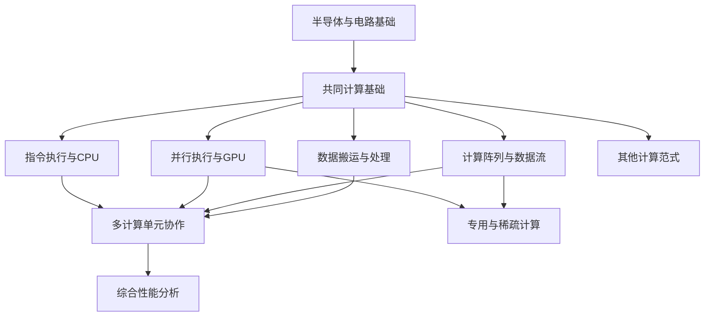

# 计算微架构系列重构计划书

版本：v1.1 · 2026-11-26

仓库：[microarch-flow/wiki](https://github.com/microarch-flow/wiki)  
网站：[从硅到系统](https://microarch-flow.github.io/wiki/)  
状态：知识体系与 37 篇初版文章规划已确认，已搭建新版系列与九个专题导读，正文已开始逐篇重构。

本计划用于跨会话协作；以仓库 docs/microarchitecture-v2-plan.md 的现行版本为准。

## 1. 目标与已确认的决定

- 重新构建计算微架构系列，而非在旧文章目录上逐篇修补。
- 以「半导体与电路基础」为写作范例：知识层层递进，从具体现象出发，解释原因、结构和行为，用可追踪的算例展示推导，不堆砌术语。
- 十二个知识域保证覆盖完整性；知识依赖图决定阅读顺序。共同基础之后可以分出多条路线，既不强行将所有知识串成一条线，也不要求每个读者阅读所有分支。
- 覆盖通用计算微架构及现代 CPU 的核心机制，同时深入 GPU、NPU、DMA、多引擎与计算单元协作。DMA、存内计算的基本机制进入阅读路线，深入资料作为进阶或参考。
- 严格聚焦硬件机制。编译器、系统软件和推理运行时的合并与详细组织在另一会话讨论；不在本项目中擅自改动其他系列。
- 初始规划 37 篇（常规 32 篇、拓展 5 篇），这是基线，不是固定篇数。实际写作时依据知识密度和读者反馈讨论拆分或合并。

## 2. 新旧版本与发布

- 旧版源码：series/microarchitecture/。重构期间保持正文可访问，不再基于旧目录实施本轮重构。
- 新版源码：series/microarchitecture-v2/，九个专题目录已建立。实际创建时连同已有实质内容接入网站，逐篇或逐批发布，用户可以直接检查网页效果。无需等全部 37 篇结束才公开。
- 新版入口应能从现有计算微架构系列进入，有清楚的新版重构状态及旧版入口；不创建虚假正文或把未撰写的计划条目显示成已完成文章。导航、阅读顺序与版本切换的具体实现应结合现行网站构建机制核查。
- 新版稳定后，由用户确认旧版归档或删除；检查原有公开 URL、锚点、跨系列链接和站内搜索，避免新旧重复收录或无效链接。保留重要的 DMA/CIM 深入资料，迁移或索引有价值的旧内容。
- 计划书本身维护在 docs/，不是博客正文。导读具有独立阅读价值，可以先发布；不生成尚未编写的空白正文。

新版目录与路线：

| 路线 | 源码目录 | 规划篇数 |
|---|---|---:|
| A | 01-foundations/ | 8 |
| B | 02-cpu/ | 8 |
| C | 03-parallel-execution/ | 3 |
| D | 04-compute-arrays/ | 3 |
| E | 05-data-movement/ | 3 |
| F | 06-resource-cooperation/ | 3 |
| G | 07-specialized-compute/ | 2 |
| H | 08-performance/ | 2 |
| I | 09-compute-paradigms/ | 5 |

各目录的 README.md 是面向读者的专题导读，包含宏观定位、知识关系图、计划阅读顺序和跨专题衔接。正文发布前，计划条目保留为纯文本并标注“未发布”；写作时以稳定编号作为文件名前缀（如 a01-state-and-control.md），发布后为导读中的对应条目加链接、更新状态，并维护知识关系图。SVG 图在各目录 assets/ 中，同时保留 Graphviz .dot 源文件便于修改。

## 3. 十二个知识域及知识边界

核心：本系列详细解释的硬件结构、行为与取舍；关联：为理解硬件而简要引入的接口、必要语义或前置；外部：由其他系列或软件专题深入解释。核心不等于每位读者都必须学习，进阶计算范式也可属于核心知识。

| 知识域 | 核心知识 | 关联知识 | 外部知识 |
|---|---|---|---|
| 1. 数字逻辑与计算基础 | 数字状态、数据与控制通路，MUX/译码/编码、比较、计数、移位寄存器、FSM、复位与使能；整数/补码、定点、浮点、溢出/舍入/饱和、INT4/INT8、FP16/BF16/FP8/MX | 组合/时序电路行为，触发器；ISA/微架构/RTL 的概念区别 | 晶体管、门电路的物理原理；HDL/综合流程；模型量化策略 |
| 2. 运算单元与数据通路 | 加减、进位、移位、比较、位运算、除法；乘法部分积、Booth、Wallace/Dadda、MAC/FMA、累加位宽；浮点算术、查表/迭代/近似；ALU/FPU/SFU、操作数选择、RF端口、写回、旁路、功能单元共享 | 寄存器文件本体组织 | 存储单元物理实现、数学算法完整推导、综合/布局布线 |
| 3. 流水线与执行时序 | 关键路径约束、流水级、latency/II/吞吐、填充排空、停顿气泡、反馈依赖、资源冲突、valid/ready、FIFO、反压、弹性流水、跨域交接 | setup/hold、时钟偏差、亚稳态 | RC、PLL、时序物理及 STA/CDC 签核 |
| 4. 指令执行与通用处理器 | 取指译码发射执行访存写回提交、RAW/WAR/WAW、冒险、多发射、超标量、VLIW、scoreboard/RS、OoO、ROB、重命名、分支预测/推测恢复、AGU/LSU/LSQ、store buffer、存储转发/消歧、精确异常/中断、SMT | ISA、PC、指令编码、架构状态、寻址、内存次序和屏障/原子语义、Cache/TLB 接口 | 完整 ISA、编译器指令选择/调度、OS 进程管理、地址翻译和一致性协议内部 |
| 5. 并行执行机制 | 标量/SIMD/向量/SIMT、物理 lane、分批运行/掩码/尾部、分支发散、warp调度、延迟隐藏、驻留、资源分配/occupancy、访存合并、线程交换和同步 | 线程、warp/wavefront、线程块等语义；共享存储与 bank conflict 的影响 | 并行编程 API、自动向量化、软件内核优化与线程划分 |
| 6. 计算阵列与张量计算 | 点积、PE、并行 MAC、广播/邻居传递/归约、脉动阵列、数据驻留、stationary 数据流的硬件支持、计算粒度、权重/激活供数、部分和、填排、形状/规模/带宽/利用率 | 矩阵乘/张量语义、分块与时空映射的基本概念 | 软件分块、循环变换、数据流选择、映射搜索 |
| 7. 数据搬运与处理引擎 | Load/Store 与 DMA、地址生成、连续/多维 stride、gather/scatter、请求拆分/对齐/burst、在途请求/响应匹配、描述符/队列硬件、完成状态、转置/重排/打包、类型转换、压缩/解压 | doorbell/completion 等软硬件契约、访问权限和可见性 | 具体 AXI/PCIe 协议、IOMMU 机制、驱动、软件搬运编排 |
| 8. 任务控制与资源协作 | 接纳/就绪/执行/完成/可见性，异步/非阻塞、依赖、同步事件、semaphore/barrier/scoreboard、资源占用/所有权、双缓冲和重叠条件、仲裁/公平、硬件动态调度、集中/层级/分布式控制、死锁/活锁/饥饿/取消 | 软件任务图、静态执行契约 | 软件依赖分析、编译调度、缓冲分配及优化 |
| 9. 多计算单元与芯片组织 | PE/Core/Tile/Cluster、私有/共享资源、硬件任务分发、广播/归约、执行上下文/隔离、负载分发、异构引擎、指令/任务/数据流驱动、CPU/GPU/NPU/DSP 组织对比 | 数据切分与复制的基本语义、局部存储和互连服务能力 | 软件任务划分/放置、NoC 拓扑路由、TP/PP/DP/EP 软件策略、具体芯片产品架构 |
| 10. 专用计算与稀疏计算 | 逐元素、归约树/scan、特殊函数、复杂算子硬件分解、转发与连续执行、稀疏索引/元数据/解码、跳零、操作数匹配、不规则工作量、固定与可编程功能 | Softmax/RMSNorm 等算子数学表达与稀疏模式定义 | 模型训练/剪枝、编译器融合、内核生成和优化 |
| 11. 其他计算范式 | CGRA/空间计算/可重构数据通路、近存、数字和模拟存内、外围计算/结果归约、精度能耗权衡、光子/神经形态计算组织 | FPGA 基础资源、介质特性、ADC/DAC、相关光学和神经计算基础 | 介质物理和制造、光学器件原理、编译映射、产品产业研究及工具链教程 |
| 12. 性能分析与设计权衡 | 延迟/吞吐/II/IPC/利用率、峰值与有效吞吐、资源及数据供给约束、在途/排队、瓶颈与等待、门控/DVFS、任务能量、面积/性能/功耗/精度、性能计数器 | Roofline、Little 定律、解析/周期/事件模型和校准条件 | 模拟器软件实现、自动搜索、EDA PPA 流程、推理服务 SLO 指标 |

边界以责任主体划分，而非术语划分：硬件支持的数据驻留属于微架构，软件选择怎样复用属于编译器；硬件动态发射属于微架构，软件任务图安排属于系统软件。存储系统讲存储本体和访问机制，微架构讲其端口、容量和带宽如何约束执行；互连系列讲通信实现，微架构讲计算端点的请求、可用性和协作。

## 4. 知识依赖与阅读组织

不能直接将十二个知识域排成前后顺序。同一知识域的不同机制可能位于不同知识层次。

箭头表示知识来源或阅读导向，并非汇合节点必须等所有上游路线读完。具体强前置如下：

- 半导体的逻辑门、寄存器、时钟与采样 → 状态和基本算术 → 可控数据通路 → 流水线、停顿和握手 → 依赖、接纳、就绪、仲裁等共同语义。
- 乘加、浮点和数值格式是按用途深化的算术分支，并非理解最基本的 CPU 控制或 DMA 的全部必修前置。
- CPU：架构状态、指令生命周期 → 顺序流水线 → 冒险、动态发射 → 提交、重命名、推测与访存；控制流和访存可以相对独立地深入。
- GPU：数据并行和物理通道 + 基本指令执行及发射 → SIMT/多执行上下文 → 延迟隐藏、驻留与资源约束。不要求先学习完整 CPU 乱序机制。
- 阵列：乘加/累加状态 + 并行资源 → PE 及数据传递/归约 → 数据驻留、复用、数据流 → 供数与规模权衡。脉动阵列与 stationary dataflow 不等价。
- DMA：基本控制 + 存储地址和访问粒度 + 互连请求/响应接口 → 地址生成、事务拆分 → 并发与完成 → 数据处理引擎。不依赖完整 CPU/GPU 或阵列路线。
- 局部控制和依赖是共同前置；多引擎协作在独立实体及其资源生命周期基础上展开。多核不要求先理解 DMA。
- 专用计算、稀疏计算与其他计算范式只依赖各自必要知识；存内计算还需要存储介质、阵列与数值精度的关联知识。
- 性能分析贯穿各路线：每种机制建立时就计算或比较延迟、吞吐、利用率和成本；最后汇总，而非等到末尾才介绍指标。

## 5. 文章基线与进度（37 篇）

所有条目初始为 **待写**；编号是跨会话稳定标识。标题为暂定题目，编写时可调整；拆分、合并时在本计划中记录新旧编号和理由，并更新数量、依赖及进度。共 A 8 + B 8 + C 3 + D 3 + E 3 + F 3 + G 2 + H 2 = 常规 32 篇；I 5 篇拓展。

### A. 共同计算基础（8 篇）

承接半导体与电路基础，从逻辑器件和寄存器出发，建立通用硬件执行语言。可以先理解基本算术和控制通路，再按需要深入复杂算术。

2026-11-27 协作决定：半导体与电路基础中的组合逻辑正文已发布，寄存器与时序逻辑、状态反馈与数字控制仍在完善。当前保留 A01 中维持阅读自洽所需的内容，继续编写 A02–A08；待前置系列稳定后统一复核 A01 及共同基础的知识边界。不在此阶段改变八篇基线。

| ID | 暂定标题 | 内容范围与写作重点 | 状态 |
|---|---|---|---|
| A01 | 怎样让电路按照要求保存、选择和更新数据？ | 寄存器、MUX、译码器、计数器、使能、复位、FSM；沿状态和信号推导控制 | 已发布（[正文](https://microarch-flow.github.io/wiki/microarchitecture-v2/01-foundations/a01-state-and-control/)，初次发布 `3a0a2c5`；2026-11-27 按新版写作原则打磨） |
| A02 | 有限个比特，怎样表示一个数并完成加减运算？ | 二进制、补码、定点、半加/全加、进位、减法、比较、移位、溢出；从小位宽 ALU 推导快进位 | 已发布（[正文](https://microarch-flow.github.io/wiki/microarchitecture-v2/01-foundations/a02-number-representation-and-arithmetic/)，提交 `b86d5ac`，已核验） |
| A03 | 从部分积到 MAC：芯片怎样完成一次乘加？ | 乘法部分积与符号、Booth、压缩树、MAC、累加位宽、反馈、点积与归约 | 已发布（[正文](https://microarch-flow.github.io/wiki/microarchitecture-v2/01-foundations/a03-multiplication-and-accumulation/)，提交 `30dee23`，已核验） |
| A04 | 浮点与低精度运算：芯片怎样计算不同格式的数？ | 指数、有效数字、对齐、规格化、舍入、特殊值、FMA、BF16/FP8/MX、混合精度；不讲模型量化选择 | 已发布（[正文](https://microarch-flow.github.io/wiki/microarchitecture-v2/01-foundations/a04-floating-point-and-low-precision/)，提交 `51ff618`，已核验） |
| A05 | 一组运算单元怎样连续完成不同的计算？ | ALU/FPU/MAC、寄存器文件、操作数选择、读写端口、数据通路、控制通路、写回与多周期执行 | 已发布（[正文](https://microarch-flow.github.io/wiki/microarchitecture-v2/01-foundations/a05-datapath-and-control/)，提交 `25f9a6b`，已核验） |
| A06 | 第一份结果还没出来，为什么下一份运算可以开始？ | 关键路径、流水级、延迟、II、吞吐、填排和反馈依赖；独立输入与相关输入对照 | 已发布（[正文](https://microarch-flow.github.io/wiki/microarchitecture-v2/01-foundations/a06-pipeline-and-throughput/)，提交 `a20f155`，已核验） |
| A07 | 下游来不及接收数据，上游怎样知道何时停止？ | 停顿、气泡、valid/ready、FIFO、反压、弹性流水、跨时钟域交接；不重复物理时序 | 已发布（[正文](https://microarch-flow.github.io/wiki/microarchitecture-v2/01-foundations/a07-handshake-and-backpressure/)，提交 `fad0023`，已核验） |
| A08 | 多项工作同时就绪，谁先使用计算资源？ | 数据依赖、资源占用、在途任务、就绪、仲裁、发射、完成、结果可用，通用执行语义 | 已发布（[正文](https://microarch-flow.github.io/wiki/microarchitecture-v2/01-foundations/a08-dependencies-and-scheduling/)，提交 `ec2151a`，已核验） |

2026-11-27：A01–A08 八篇首轮正文均已发布并核验，保持原定八篇基线，阅读顺序和链接已贯通。待半导体与电路基础系列稳定后，按此前协作决定统一复核共同基础的前置知识、边界与表述；当前阶段不改旧版正文。

### B. 指令执行与 CPU（8 篇）

使用同一个简化的 RISC 式教学指令和短程序贯穿；不把某一产品实现当作全部 CPU 的事实，不深入完整 ISA 和 OS。

B01 采用真实 RV32I 的 ADD、LW、SW、BEQ 语义和精简的五阶段单条在途教学模型，延续 A05 的控制字段、RF 和 A01 的边沿记法；其 I0–I8 程序作为后续文章的共同基线，按需扩展以解释额外机制。维持 B01–B08 现有划分。

| ID | 暂定标题 | 内容范围与写作重点 | 状态 |
|---|---|---|---|
| B01 | 一条指令怎样让数据通路执行指定的运算？ | ISA、PC、编码、取指译码、执行、访存、写回、架构状态 | 已发布（[正文](https://microarch-flow.github.io/wiki/microarchitecture-v2/02-cpu/b01-instructions-and-architectural-state/)，初次发布 `30ee7e8`，已核验；2026-11-27 按写作原则复核知识引入顺序） |
| B02 | 第一条指令尚未完成，第二条怎样安全地开始？ | 顺序指令流水线、各种冒险、旁路、互锁、停顿和 flush | 已发布（[正文](https://microarch-flow.github.io/wiki/microarchitecture-v2/02-cpu/b02-in-order-pipeline-and-hazards/)，提交 `4baead4`，已核验） |
| B03 | 前面的指令还在等待，后面的指令能否先执行？ | 多发射、超标量、指令窗口、发射队列、scoreboard、保留站、乱序动态发射、VLIW 对照 | 已发布（[正文](https://microarch-flow.github.io/wiki/microarchitecture-v2/02-cpu/b03-dynamic-issue-and-out-of-order-execution/)，初次发布 `e35a627`，已核验） |
| B04 | 后发指令先算完，为什么不能直接提交结果？ | 完成与提交、ROB 一种实现、顺序退休、精确异常、中断与恢复 | 已发布（[正文](https://microarch-flow.github.io/wiki/microarchitecture-v2/02-cpu/b04-in-order-commit-and-precise-exceptions/)，提交 `a31b0d7`，已核验） |
| B05 | 两条指令写入同一个寄存器，为什么不一定存在真正的依赖？ | RAW/WAR/WAW、物理寄存器、重命名、映射、资源回收与提交 | 已发布（[正文](https://microarch-flow.github.io/wiki/microarchitecture-v2/02-cpu/b05-register-renaming/)，提交 `7ed1ff4`，已核验） |
| B06 | 分支结果还没有算出来，处理器下一拍该执行什么？ | 分支方向和目标预测、BTB/RAS、推测执行、错误路径恢复 | 已发布（[正文](https://microarch-flow.github.io/wiki/microarchitecture-v2/02-cpu/b06-branch-prediction-and-speculation/)，提交 `ad69b05`，已核验） |
| B07 | 前面的 Store 地址还没有确定，后面的 Load 能否提前执行？ | AGU、LSU、LSQ、store buffer、地址消歧、存储转发、内存次序/屏障/提交与可见性的区别 | 已发布（[正文](https://microarch-flow.github.io/wiki/microarchitecture-v2/02-cpu/b07-memory-execution-and-ordering/)，提交 `76f49b2`，已核验） |
| B08 | 一个线程正在等待，另一个线程怎样利用空闲的计算资源？ | 多硬件上下文、交错多线程、SMT、资源共享、公平与吞吐权衡 | 已发布（[正文](https://microarch-flow.github.io/wiki/microarchitecture-v2/02-cpu/b08-hardware-multithreading-and-resource-sharing/)，提交 `a72d567`，已核验） |

### C. 并行执行与 GPU（3 篇）

2026-11-28：审查 A、B 的前置认知、域 5 的核心知识及相邻系列边界后，保留三篇基线。以十对彼此独立的 32 位整数加法为共同算例：C01 比较单通道、四通道独立标量、定长 SIMD 及内部分批的向量执行；C02 将数据元素对应到线程，观察线程状态、分支、调度与等待；C03 比较驻留容量、有效执行宽度和访存服务能力。线程间交换与同步的必要语义在 C02 引入，不深入编程接口或 F 的多引擎协作协议。存储与互连机制、具体 GPU 产品参数及阵列数据流分别由其所属系列或专题展开。

| ID | 暂定标题 | 内容范围与写作重点 | 状态 |
|---|---|---|---|
| C01 | 十个独立的加法，怎样交给四条执行通道？ | 标量、SIMD、向量、物理 lane、分批、掩码与尾部 | 已发布（[正文](https://microarch-flow.github.io/wiki/microarchitecture-v2/03-parallel-execution/c01-scalar-simd-and-vector-execution/)，提交 `3065248`，已核验） |
| C02 | 一组线程还在等待数据，另一组线程能否先执行？ | SIMT、warp/wavefront、线程上下文、分支发散、谓词执行、硬件发射、延迟隐藏、组内交换与同步基本语义 | 已发布（[正文](https://microarch-flow.github.io/wiki/microarchitecture-v2/03-parallel-execution/c02-simt-and-warp-scheduling/)，提交 `5a7c4df`，已核验） |
| C03 | 为什么 GPU 中的线程越多，计算不一定越快？ | 线程块驻留、寄存器和共享存储容量、Occupancy、执行端口与供数、访存合并、bank conflict | 已发布（[正文](https://microarch-flow.github.io/wiki/microarchitecture-v2/03-parallel-execution/c03-gpu-resources-and-execution-efficiency/)，提交 `178123b`，已核验） |

2026-11-28：C01–C03 三篇首轮正文均已发布并核验，保留原定三篇基线。由标量与物理通道、SIMT 线程与调度逐步衔接到驻留容量、执行端口与访存服务；专题导读和逐篇链接已贯通。

### D. 计算阵列与数据流（3 篇）

使用同一个小型矩阵乘法，逐次改变连接方式、数据驻留位置、阵列规模与供数条件。分块与映射只解释硬件契约，不深入软件选优。

2026-11-28：审查 A、B、C 的实际前置认知与相邻系列边界，保留三篇基线。D01 采用 2×4 的 X 与 4×2 的 W 相乘，Y[0,0] 沿用 A03 的点积 6+5+6+4=21，四位无符号输入、十位累加。依次比较单 MAC、沿输出或归约维度分工、行列广播、逐拍邻接传递，区分不同观察边界的输入流量与有效 MAC 槽位比例。D02 保持 2×2 物理阵列及同一矩阵，以行列广播的 OS 为对照，分别按两个 k 分组演示 WS、IS 与部分和的逐拍归约；区分缓冲与 PE 投递流量、跨分组部分和读写和跨块驻留窗口，RS 结合其卷积语境解释，不强行套作通用 GEMM 分类；D03 从相同矩阵在 2×2、2×4、4×4 阵列的 OS 映射出发，区分形状限制、填排与连续块重叠、源端供数和入口容量、结果交付等约束，并使用明确的逐拍模型区分峰值、有效 MAC 槽位比例与完整任务时间。阵列外搬运及引擎协作留给 E、F。

| ID | 暂定标题 | 内容范围与写作重点 | 状态 |
|---|---|---|---|
| D01 | 多个 MAC 怎样协作完成一次矩阵乘法？ | PE、并行 MAC、广播、邻居传递、部分和归约、脉动阵列与执行时序 | 已发布（[正文](https://microarch-flow.github.io/wiki/microarchitecture-v2/04-compute-arrays/d01-macs-and-array-data-paths/)，提交 `ac50696`，已核验） |
| D02 | 同一块矩阵，哪些数据应该留在计算单元里？ | 数据驻留/复用，weight/input/output/row-stationary 的数据路径及代价 | 已发布（[正文](https://microarch-flow.github.io/wiki/microarchitecture-v2/04-compute-arrays/d02-stationary-dataflows-and-reuse/)，提交 `0da1519`，已核验） |
| D03 | 为什么扩大计算阵列，不一定能同比例提高吞吐？ | 填排、局部缓冲、供数/输出带宽、矩阵形状、阵列尺寸与利用率 | 已发布（[正文](https://microarch-flow.github.io/wiki/microarchitecture-v2/04-compute-arrays/d03-array-size-bandwidth-and-utilization/)，提交 `81d6154`，已核验） |

2026-11-28：D01–D03 三篇首轮正文全部发布并核验，保留原定三篇基线。以同一矩阵语义贯通 MAC 分工和数据传递、数据驻留与复用、形状及容量/带宽/利用率的逐拍推导；专题导读、前后文章链接和图解均已贯通。

### E. 数据搬运与处理引擎（3 篇）

2026-11-28：核查共同基础、CPU/GPU 的访存知识、D 专题规划和存储/互连相关正文后，保留三篇基线。以 3×4 个 1 B 元素的矩阵贯穿：E01 先建立单任务、单段在途的简单复制模型，再用独立的源/目标行步长和接口约束展开读写事务；E02 沿用源行距 8 B、目标行距 4 B 的矩阵，解除单段在途限制，讨论响应匹配、容量、反压及命令/完成队列；E03 改变地址对应关系或数值表示，解释重排、转换及处理路径。E01 不依赖尚在完善的 D 正文。 E02 保持每行4 B、每拍2 B，以两个4 B内部槽追踪独立请求状态；人为延长首行的首拍延迟以演示乱序返回，并用相同服务时间对照27/17拍。区分读在途事务、缓冲预留、写成功确认和命令/完成队列，不重复F的跨引擎缓冲所有权。

| ID | 暂定标题 | 内容范围与写作重点 | 状态 |
|---|---|---|---|
| E01 | 一块数据从内存搬到计算单元，DMA 要做哪些工作？ | 独立引擎、描述符、地址生成、多维 stride、burst、对齐与边界切分 | 已发布（[正文](https://microarch-flow.github.io/wiki/microarchitecture-v2/05-data-movement/e01-dma-task-and-address-generation/)，提交 `41eb230`，已核验） |
| E02 | 第一笔请求还没有返回，为什么 DMA 能发出第二笔请求？ | outstanding、ID、内部缓冲、响应匹配/乱序、反压、命令队列、完成通知与可读条件 | 已发布（[正文](https://microarch-flow.github.io/wiki/microarchitecture-v2/05-data-movement/e02-outstanding-requests-and-completion/)，提交 `9c6492e`，已核验） |
| E03 | 搬运数据时，能否顺便改变数据的布局和格式？ | gather/scatter、转置、重排、类型转换、打包、压缩/解压、粒度及吞吐 | 待写 |

旧版 [DMA 专题](../series/microarchitecture/05-dma/README.md)的进阶资料保留原地址并按以下归属继续查阅；本轮不修改旧目录：

- [多通道、虚拟化](../series/microarchitecture/05-dma/03-dma-microarchitecture/channels-virtualization.md)及复杂队列：E02 建立基本控制机制后作为进阶资料，不强行引入所有产品实现。
- [系统集成](../series/microarchitecture/05-dma/05-system-integration/README.md)及一致性/地址翻译：接口约束在 E 简述，协议和存储本体由互连与存储系列解释。
- 双缓冲、资源所有权、计算搬运重叠：F 专题；驱动开发和软件任务编排：软件系列。
- [性能建模与校准](../series/microarchitecture/05-dma/06-performance-modeling/README.md)：E02 建立基本吞吐约束，综合性能权衡归 H，详细建模、诊断资料保留供进阶查阅。
- [工作负载案例](../series/microarchitecture/05-dma/07-workloads-case-studies/README.md)、[商业 IP](../series/microarchitecture/05-dma/08-industry-ip/README.md)和[研究参考](../series/microarchitecture/05-dma/09-reference-research/README.md)：继续作为独立实现与研究资料，待新版稳定后评估归档、迁移或索引。

### F. 多执行实体与资源协作（3 篇）

| ID | 暂定标题 | 内容范围与写作重点 | 状态 |
|---|---|---|---|
| F01 | 第一块数据还在计算，第二块数据能开始搬运吗？ | 逐拍对比串行与重叠、双缓冲、多缓冲、资源占用、端口竞争、缓冲复用 | 已发布（[正文](https://microarch-flow.github.io/wiki/microarchitecture-v2/06-resource-cooperation/f01-overlap-and-buffer-reuse/)，提交 `3ae28e2`，已核验） |
| F02 | 多个引擎各自执行，怎样知道下一项工作可以开始？ | 事件、barrier、semaphore、完成与可用、局部消费/全体同步、硬件调度、集中/层级/分布式控制、进展条件 | 已发布（[正文](https://microarch-flow.github.io/wiki/microarchitecture-v2/06-resource-cooperation/f02-task-control-and-synchronization/)，提交 `150c35b`，已核验） |
| F03 | 把同一块矩阵交给两个计算单元，需要交换哪些数据？ | Core/Tile/Cluster、硬件分发、共享资源、输入复制/部分和归约、负载分发、异构引擎与 CPU/GPU/NPU/DSP 概念对照 | 正文完成（[正文](https://microarch-flow.github.io/wiki/microarchitecture-v2/06-resource-cooperation/f03-multiple-compute-units/)，待发布核验） |

2026-11-28：核查共同基础、CPU/GPU、D/E 当前内容、旧版控制和片上组织，以及存储、互连与架构实例后，保留三篇基线。F01 以 A 的三个独立行块与预驻留的 B 相乘为共同算例，沿用旧版 2 拍搬入、3 拍计算、2 拍写回的教学服务时间，从单输入槽推导双槽复用，区分槽空间与物理端口的约束。F02 在这个日程上推导数据就绪、局部交付、缓冲释放、任务接纳、资源仲裁和进展条件，不预设集中式调度。F03 将视角扩展到多个完整计算单元，关注跨单元操作数、部分和及共享资源，不重复 D 的阵列内部数据流；可从多单元共享存储示例独立进入，不必先学习 DMA。

### G. 专用计算与稀疏计算（2 篇）

| ID | 暂定标题 | 内容范围与写作重点 | 状态 |
|---|---|---|---|
| G01 | 矩阵乘法算完了，其他运算由谁完成？ | 逐元素、归约树/scan、特殊函数、查表/近似、复杂算子的硬件协作，以 Softmax 或 RMSNorm 举例 | 待写 |
| G02 | 一半的数据都是零，为什么计算未必能快一倍？ | 稀疏表示与元数据、索引解析、跳零、操作数匹配、不规则计算、负载失衡与开销 | 待写 |

### H. 性能分析与设计权衡（2 篇）

| ID | 暂定标题 | 内容范围与写作重点 | 状态 |
|---|---|---|---|
| H01 | 执行单元增加一倍，为什么任务不一定提前一半结束？ | 峰值/有效吞吐、利用率、资源服务约束、计算强度/Roofline、排队、关键路径和运行时间下界、解析/周期/事件模型、性能计数与校准 | 待写 |
| H02 | 增加并行单元、扩大缓冲区，还是提高时钟频率？ | 以同一任务比较面积、性能、功耗、任务能量、资源复用、门控、电源状态、DVFS、设计权衡 | 待写 |

### I. 其他计算范式（5 篇，拓展）

| ID | 暂定标题 | 内容范围与写作重点 | 状态 |
|---|---|---|---|
| I01 | 计算任务改变后，硬件的数据通路也能改变吗？ | 固定与可重构数据通路、空间计算、数据流驱动、FPGA 与 CGRA | 待写 |
| I02 | 如果把计算单元放到存储器旁边或内部，会发生什么？ | 传统/近存/数字存内计算对照、搬运成本、存储阵列求值 | 待写 |
| I03 | 怎样利用模拟电路完成矩阵乘加？ | 模拟存内计算、外围电路、ADC/DAC、精度与误差、能耗取舍 | 待写 |
| I04 | 如果不用电子传输数值，怎样利用光完成计算？ | 光子计算的信息承载、基本机制及计算组织 | 待写 |
| I05 | 如果计算不再按照统一时钟推进，而是由事件触发，会怎样？ | 神经形态计算、神经元状态、脉冲与事件驱动；不暗示所有神经形态芯片都是无时钟实现 | 待写 |

## 6. 写作与评审要求

遵循仓库现行 AGENTS.md 和 docs/wiki-blog-design-rules.md。以下为本轮特定的写作约定：

1. 先用少量文字从宏观上帮助读者认清主题和用途，再提出具体、可观察的问题或实验，尽量承接已完成前文。以 What（是什么）、Why（为什么需要、解决什么问题）、How（怎样工作、背后的原理）、Implications（理解后能解释哪些工程现象与设计取舍）作为组织内容的思考方式，不强制使用四个固定小节。深入解释因果和机制仍是重点。先确定本篇独有的读者认知目标和前置知识，再设计内容。
2. 围绕问题逐步改变一项条件，追踪数据、状态、信号、资源与时间；让每个新增机制成为解决前一个问题的理由，而不是百科式定义。
3. 优先使用贯穿路线的小规模示例、可手算的数字、清晰结构图或逐拍时序图；明确示例假设和适用边界，区分教学模型、推导与实测。
4. 关键技术事实核查原始论文、规范或官方资料；保持前后术语一致。不要把术语表、结构清单或抽象结论当作机制解释。
5. 核心知识详讲；关联知识只提供理解接口所需的上下文；外部知识链接相邻系列。注意硬件具备某项能力与软件选择执行方案的区别。
6. 不以固定篇数、固定字数或统一文章模板牺牲叙事完整性。实际编写发现拆合必要时先说明理由，更新计划和依赖后再继续。
7. 逐篇检查正文逻辑、技术准确性、重复与边界、图解可读性、前后链接；按网站维护文档进行构建和必要测试，发布后检查实际网页（导航、面包屑、搜索、图文排版及移动端表现按改动范围检查）。

## 7. 多会话协作与执行顺序

- 建议先完善 A01–A08，建立共同术语和例子；随后 B、C、D、E 可按前置知识的稳定程度并行推进。F、G、H、I 按各自依赖进入，不等待无关分支。
- 新会话开始时读取仓库中的当前计划、仓库协作规则、相关已发布正文与其他会话已经完成的修改；明确本次负责的文章编号和范围。不得误将旧目录当作新版本的写作目标。
- 每个会话尽量负责独立文章或路线；涉及共享系列首页、导航、网站配置、计划表等文件时，与其他提交及时同步，保留他人的变更。并行任务完成时更新本计划对应条目，不覆盖其他会话的进度。
- 状态建议：待写 → 编写中 → 已评审 → 已发布（记录源码路径、提交或公开页面地址）；有用户反馈未修复可标为待调整。仅当对应正文实际发布并核验后标为已发布。
- 开始新目录时即接入网站并发布已有正文，不等待全系列完成。旧版仍可供读者和作者对比；新版稳定后再办理旧版退役。
- 每轮工作结束时简述完成的文章、实际公开地址、核验结果、未完成问题及与初始计划的偏差。用户可在多个会话中继续精修或调整。

## 8. 完成标准

- 十二知识域的核心知识均有明确且无明显重复的正文归属；与外部系列衔接合理。
- 共同基础和各条分支具有清晰的前置依赖与递进关系。
- 37 篇初版基线已完成或有明确合并、拆分、取代记录；进阶 DMA/CIM 资料处置有据可查。
- 技术说明、示例、数字、图解、引用和站内链接经过相应核查，实际站点正常展示。
- 用户确认新版稳定后，完成旧系列归档或退役、兼容原有公开链接及搜索导航的处理。

## 9. 变更记录

| 日期 | 版本 | 说明 |
|---|---|---|
| 2026-11-26 | v1.0 | 已确认十二知识域、核心/关联/外部知识边界、知识依赖关系、37 篇基线、新目录逐步公开发布、旧版保留至新版稳定。 |
| 2026-11-26 | v1.1 | 建立新版入口及九个专题导读；记录 What / Why / How / Implications 写作思路；37 篇正文仍全部待写。 |
