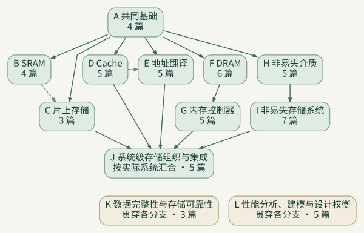

# 存储系统系列重构计划书

版本：v1.0 · 2026-11-29

仓库：[microarch-flow/wiki](https://github.com/microarch-flow/wiki)

网站：[从硅到系统](https://microarch-flow.github.io/wiki/)

状态：十四个知识域、十二个专题与 57 篇初版文章基线已确认；新版目录及专题导读独立建立，正文尚未发布。

本文件是跨会话协作的维护入口，记录知识范围、认知依赖、文章基线、旧内容迁移及完成状态；以仓库现行版本为准，不作为博客正文。

## 一、目标与已确认的决定

- 围绕一个问题重建知识体系：计算所需的数据怎样保存，又怎样在需要时被正确、高效地提供给计算单元？
- 延续 [Wiki 与博客设计规则](wiki-blog-design-rules.md)以及[计算微架构](microarchitecture-v2-plan.md)、[编译器与运行时系统](compiler-runtime-plan.md)的重构方法。先用知识域检验覆盖与主讲职责，区分知识层次，再以认知依赖和具体问题组织正文，不照搬旧目录。
- 从数据状态及一次访问请求出发，解释逻辑地址、资源定位、请求接纳、服务过程、状态改变、响应和可见性。由存储单元扩展到阵列、宏、控制器及系统，不把同名概念在不同抽象层次的行为混为一谈。
- 共十四个知识域，组织成 A–L 十二个阅读专题。初版 57 篇（54 篇常规、3 篇深化）；这是覆盖基线而不是固定篇数。正文写作发现相邻问题需要合并或拆分时，先检验认知密度与实际依赖，再同步维护计划、状态和导航。
- 同时覆盖 SRAM、DRAM、NAND 等真实介质，片上显式存储、Cache、地址翻译、DRAM 控制器、SSD/HBF、异构系统组织、数据完整性及存储性能建模。针对 CPU、MCU、GPU 和确定性 NPU 保留独立学习路线；文件系统、数据库和分布式对象存储不是本系列主线。
- 详细解释存储自身的组织与访问服务。计算微架构负责指令执行、DMA 内部结构与任务协作；互连负责传输协议及详细一致性协议；编译器与运行时负责数据布局选择、Buffer 分配复用、任务调度与模型状态管理。不因本轮重构改写其他系列。
- 继承旧文有效推导、算例、资料版本、参考清单和历史公开链接，核查前提及技术事实；不将已有有效内容误判为缺失，也不为压缩文章数删除必要知识。

## 二、新旧目录、发布和阅读入口

- 新版源码：[series/storage-v2/](../series/storage-v2/README.md)，独立编号目录和 SVG 知识关系图；旧版源码 [series/storage/](../series/storage/README.md) 暂时保留，不删除、不移动、不重写旧正文。
- 原有存储系统主入口与八个主系列保持不变。新版在原存储系列下提供独立入口，公开地址为 `storage-v2/`；旧站点的路径、锚点、索引与阅读资料继续可用。通过导读与关联链接逐步开放新正文，不必等整个系列完成。
- 各目录的 README.md 为读者建立宏观定位、核心问题、贯穿算例、知识关系、边界及计划阅读顺序；计划条目尚未发布时不添加正文链接、不创建空文件。正文实际发布并验证后再添加链接与更新该行状态。
- 图解使用静态 SVG，Graphviz 源文件与 SVG 同置于目录的 assets/；实线表示主要前置，虚线表示按问题参考。图解与导航按实际文章同步更新。源码文件名前缀使用下表稳定编号。
- 新版稳定后，由用户确认旧版资料的归档、退出或兼容方案。届时核查公开 URL、锚点、站内链接、搜索、评论路径与历史深入资料；不得提前废弃原资料。
- 本计划随内容进展调整。在新会话开展某专题时，先阅读本计划、专题导读、已发表的必要前置正文及对应旧资料。遵循仓库 AGENTS.md 和共同设计规则。

| 专题 | 源码目录 | 常规 | 深化 | 合计 |
| --- | --- | ---: | ---: | ---: |
| A · 存储系统共同基础 | [01-foundations/](../series/storage-v2/01-foundations/README.md) | 4 | 0 | 4 |
| B · SRAM 单元与存储宏 | [02-sram/](../series/storage-v2/02-sram/README.md) | 4 | 0 | 4 |
| C · 片上存储组织与显式管理 | [03-on-chip-storage/](../series/storage-v2/03-on-chip-storage/README.md) | 3 | 0 | 3 |
| D · Cache 与多级缓存 | [04-cache/](../series/storage-v2/04-cache/README.md) | 5 | 0 | 5 |
| E · 地址空间、翻译与保护 | [05-address-translation/](../series/storage-v2/05-address-translation/README.md) | 4 | 1 | 5 |
| F · DRAM 单元、阵列与接口 | [06-dram/](../series/storage-v2/06-dram/README.md) | 6 | 0 | 6 |
| G · 内存控制器与请求调度 | [07-memory-controller/](../series/storage-v2/07-memory-controller/README.md) | 5 | 0 | 5 |
| H · 非易失性存储介质 | [08-nonvolatile-media/](../series/storage-v2/08-nonvolatile-media/README.md) | 4 | 1 | 5 |
| I · 非易失性存储系统 | [09-nonvolatile-storage/](../series/storage-v2/09-nonvolatile-storage/README.md) | 6 | 1 | 7 |
| J · 系统级存储组织与集成 | [10-system-integration/](../series/storage-v2/10-system-integration/README.md) | 5 | 0 | 5 |
| K · 数据完整性与存储可靠性 | [11-reliability/](../series/storage-v2/11-reliability/README.md) | 3 | 0 | 3 |
| L · 性能分析、建模与设计权衡 | [12-performance/](../series/storage-v2/12-performance/README.md) | 5 | 0 | 5 |
| 合计 | | 54 | 3 | 57 |

## 三、十四个知识域、知识层次与主讲边界

知识域决定覆盖范围，不等于读者的章节顺序。本节的基础（支撑）、核心与深化是本系列的阅读层次；同一知识点在不同文章中可处于不同层次。

| 层次 | 判断依据 | 写作方式 |
| --- | --- | --- |
| 基础／支撑 | 知道定义、关系、必要的前置认知及适用条件，即可继续推导当前机制 | 简明交代，必要时用小算例回顾 |
| 核心 | 不理解其机制，就无法理解本域或相关后续核心机制 | 正文展开必要的因果、结构、状态与过程 |
| 深化 | 不影响基本主线，但可以用于更细定量分析、实际实现、研究或特定应用 | 在主线之后深化、选读或独立案例 |

属于某一知识域的核心，不意味着所有读者都必须掌握该知识，例如 NAND 擦除是 SSD 路线的核心，却不是 Cache 路线的先修。下表既是知识覆盖清单，也是未来评审是否遗漏重要知识的检查基线。

| 知识域 | 基础／支撑知识 | 核心知识 | 深化知识 | 主要承载 |
| --- | --- | --- | --- | --- |
| 01. 存储系统共同基础 | Bit、Byte、Word、地址范围、容量、位宽、访问粒度与对齐；易失、非易失；延迟、带宽、吞吐、并发；片上/片外、本地/远端 | 数据状态与位置的区分；读写请求（地址、大小、掩码、数据、身份及状态）；接纳、响应及数据可用边界；请求/操作/传输粒度；时间与空间局部性、工作集、数据复用和跨层搬运；存储技术、组织、角色、协议与集成的区别；层次的容量、时延、功耗和成本动机 | 存储与计算速度演变、工作集/访问模式统计 | A01、A04；L01 |
| 02. 存储阵列与访问组织 | 抽象存储单元、逻辑深度与位宽、行列、地址译码、端口、Bank | 地址到逻辑条目与行列的映射；选择、读写与掩码；逻辑组织与物理实现的区分；共享资源、Bank 划分、独立接纳与共享返回通路；多端口、复制、Banking、时分复用；交错映射、固定步长访问与冲突、仲裁、同址访问语义；用具体器件解释布线、外围负载和容量的取舍 | 复杂映射与哈希、CAM/TCAM、阵列物理优化 | A02、A03；B02–B04、F02 |
| 03. SRAM 单元与存储宏 | CMOS 反相器、反馈、双稳态、供电保持、预充和感测概念 | 6T 单元保持、读扰动、写翻转与未选中状态；位线差分、感测及写驱动；字线、列 MUX 和局部阵列；Macro 地址、控制、数据、时钟、写掩码；接纳间隔、访问延迟、同步采样、同址碰撞、部分写；1RW/1R1W/2RW 等端口契约及物理实现成本；多 Bank 结构与共享路径 | 7T/8T 等变体、SNM、Vmin、读写辅助；漏电、低功耗保持/唤醒、宏拼接、先进工艺缩放；BIST/ECC 主讲见 K | B01–B04 |
| 04. DRAM 单元与阵列 | 电荷、电容、泄漏、电荷共享、感测、参考电位与预充 | 1T1C 存储、感测恢复及写入；ACT 开行如何感测整行；Row Buffer、列选择、写入其他位保持、预充与开关行；行命中/空闲/冲突；Bank 与 Subarray 独立及共享资源；读取恢复不同于周期刷新；保持时间和刷新资源占用 | eDRAM/pSRAM、立体电容、内部细粒度并行、工艺与变异；错误保护见 K | F01、F02；F05 |
| 05. 非易失性存储介质 | 易失与非易失、ROM/OTP/EEPROM/Flash 分类，读/编程/擦除粒度、保持和耐久性 | 浮栅/电荷俘获、阈值状态和读参考；NOR 选址、随机读取及 XIP 所需条件；NAND String、选择管、感测和页缓冲、Page/Block/Plane/Die；编程验证与抑制、整块擦除、原位更新限制；SLC/MLC/TLC/QLC、阈值分布和密度/速度/寿命代价；P/E、保持及扰动 | 3D NAND、pSLC、其他 NVM（MRAM、ReRAM、PCM、铁电等）、介质实现与工艺 | H01–H05 |
| 06. 片上存储组织与显式管理 | RF、SPM、TCM、Local/Shared Memory、地址和数据放置；私有/共享；驻留和消费 | Register File 逻辑编号与存储条目、标量/向量组织、供数端口；显式地址和本地资源可达性；TCM 紧耦合路径、访问时间可预测的条件；逻辑缓冲与宏/Bank/分区、并发访问仲裁、同址读取合并与广播条件；权重/激活/部分和缓冲、数据到达与可用、覆盖条件；多缓冲的共享物理路径约束 | Cache/SPM 共享阵列、可配置分区、分层 RF、分布式 Tile Local Memory、最坏服务时间 | C01–C03；J03、L02 |
| 07. Cache 与多级缓存 | 局部性、工作集、Line、Tag、Set、Way、Offset、Valid/Dirty、数据副本 | 地址分解与查找、Tag/Data 阵列；直接/组相联/全相联；缺失、填充、候选及替换，首次/容量/冲突缺失；直写/写回与写分配/不写分配独立维度、部分写与写回；MSHR、兼容请求合并、非阻塞 Cache、Fill/Writeback Buffer、在途限制；多级与私有/共享缓存、Inclusive/Exclusive/Non-inclusive、层间流量；预取收益与污染；最新数据、权限及 Clean/Invalidate 等必要语义 | 高级替换、预取、Cache 分区/锁定、压缩、Sector/Victim Cache、GPU 专用缓存；VIPT 等与 08 汇合 | D01–D05；E03 |
| 08. 地址空间、翻译与保护 | 虚拟、物理、设备、本地地址空间；页与页内偏移、虚拟与物理连续性；访问者和权限 | 地址空间隔离/共享、页表和多级遍历、PTE、权限与属性、Page Fault；TLB 的命中、缺失、填充、上下文及失效；区分 TLB Miss/Data Cache Miss/Page Fault；页表变更、ASID、TLB Shootdown；地址别名及 PIPT/VIPT/VIVT 的查找/翻译并行；设备 MMU/IOMMU、IOTLB、地址隔离及共享地址语义；直接物理寻址/MPU 保护 | 大页、TLB Reach、Page Walk Cache、两阶段翻译；设备 ATS/PASID/PRI 等接口按需引用互连 | E01–E05；J04 |
| 09. DRAM 接口与器件组织 | CA、CK、DQ、DQS、SDR/DDR、MT/s、Burst；Channel/Rank/Chip/Die/器件位宽 | 颗粒组织、容量与 Rank 拼位宽，多个 Channel 和共享 Channel 的 Rank；Prefetch 与 Burst；ACT/RD/WR/PRE/REF；tRCD/tRAS/tRP/tRC/CL 等单 Bank 约束、Bank Group/跨资源时序、数据总线未来占用、读写切换与刷新命令约束；DDR/LPDDR/GDDR/HBM 的接口、通道及伪通道组织和设计目标；初始化后可访问的模式和条件 | 标准代际参数、RDIMM 等模块、PHY 校准/Training/ODT、低功耗状态、具体标准与器件资料 | F03–F06 |
| 10. 内存控制器与请求调度 | 读写事务、请求/响应队列、在途请求、背压、MC/PHY 职责；物理地址和器件粒度 | 地址拆分、交错/哈希与资源定位、前端拆分/合并、掩码与子请求跟踪、数据响应；请求队列、Bank 行状态、命令合法性及 CA/DQ 预约；FCFS/FR-FCFS、行策略；读写队列、写排空、同址及部分重叠顺序/转发；刷新作用域、时限及提前/推迟；多请求者公平、老化、QoS、隔离、进展与背压 | 高级应用感知/有界时延调度，多通道协同、功耗及错误约束、具体控制器实现、命令级模型见 L | G01–G05 |
| 11. 非易失性存储系统 | 裸 NAND 与受管理设备，SSD/eMMC/UFS、块地址 LBA、主机与介质粒度、可见与持久 | SSD 控制器/缓冲/通道、FTL 查找、读路径、异地写入、旧版本失效、部分写与元数据；有效/无效/空闲页、坏块、预留空间、GC、TRIM/Deallocate、磨损均衡及放大；接纳/完成/可见/持久不同，易失写缓存及 FLUSH/FUA、掉电保护、元数据版本更新和恢复；HBF 的 base die、core die、地址定位、读取粒度和并发、主机与设备的写擦及维护分工 | 复杂 FTL、ZNS、Open-Channel、设备产品、Load/Store 持久内存、特定 HBF 规范/产业参数与权重案例 | I01–I07；K、L |
| 12. 系统级存储组织与集成 | 片上/外、私有/共享、本地/远端、UMA/NUMA、Host/Device Memory、Die/Stack/Module/Package | MCU/CPU/GPU/NPU 典型层次及需求；多 Channel/Controller、NUMA 页归属与远近路径；私有/共享片上资源、多级数据位置和供数；独立内存、共享物理内存、统一虚拟地址的区别；异构层次、数据放置与迁移代价、CXL 扩展/池化/共享；DDR/LPDDR/GDDR/HBM/HBF/SSD 配置及封装对容量、位宽、带宽、功耗、散热、良率和成本的影响 | 内存分解、压缩、跨设备内存池、近存集成、3D 缓存；厂商产品及混合存储场景 | J01–J05；L02、L05 |
| 13. 数据完整性与存储可靠性 | bit error、软/硬错误、保持/扰动/磨损/传输错误，保护粒度与故障域，检测/纠正/恢复不同 | Parity、CRC、ECC/SECDED 和码字覆盖/保证；校验生成检查、部分写读改写、初始化、纠正不等于回写、Scrubbing；MBIST 与冗余行列修复；SRAM/DRAM/NAND 不同错误及覆盖；on-die、系统和传输保护边界；CE/UE、错误地址、Poison、隔离、页退休、重映射、恢复及冗余，维护流量与容量代价 | Chipkill、BCH/LDPC、交错、故障率模型、故障注入、设备生命周期及高级容错 | K01–K03；介质及设备域 |
| 14. 性能分析、建模与设计权衡 | 观察边界与窗口、容量、延迟、吞吐、位宽/速率、并发、平均/分位、能耗/功率、逻辑/物理字节 | 峰值/实际/有效带宽、粒度与流量、局部性和工作集、访问冲突、在途数/排队/等待及饱和；多级容量/带宽预算、有效数据与实际搬运、计算供数上界与瓶颈；分析/固定服务时间/队列/事务/命令/周期/事件模型和选择精度；资源状态、合法动作、事件、守恒；Microbenchmark/Trace/计数器、校准/独立验证/误差敏感性；容量/性能/面积/能耗/成本/可预测性/Pareto | gem5、Ramulator、DRAMsim3、CACTI 等固定版本模型案例；联合维护/故障/尾延迟、热/能耗、参数扫描和多目标搜索 | L01–L05；各专题随机制引入 |

### 3.1 容易重叠的知识点及唯一主讲职责

| 主题 | 归属与边界 |
| --- | --- |
| 通用阵列与实际电路 | A02/A03 建立抽象接口、地址映射、并发资源；B02–B04、F02、H02 分别推导实际阵列、外围和物理行为。不把逻辑 Bank 数直接当作实际并行能力。 |
| SRAM 与 RF/Cache/SPM/TCM | B 解释介质和宏能提供什么行为；C、D 解释用这些资源做什么、怎样管理。寄存器重命名、指令选择与发射由微架构主讲。 |
| 同名的映射 | E 讲 VA/PA 或 IOVA 的翻译与保护；D 讲 Tag/Set/Offset 和副本查找；A/B/C 讲 SRAM Bank；G 讲 PA 到 DRAM 资源；I 讲 LBA 到 Flash 物理位置。不是相互替代的机制。 |
| Cache 一致性、访问顺序与可见性 | D02/D04 建立副本、写权限、Dirty、最新值、维护和可见性的必要语义；详细 MSI/MESI、目录、探查和 CHI/CXL 协议由[互连一致性专题](../series/interconnect/COHERENCE/README.md)负责。CPU 的 LSQ、Store Buffer、内存顺序由微架构 B07 主讲，软件同步与资源交接归编译运行时。 |
| MMU、IOMMU 与设备映射 | E 讲硬件地址翻译、属性和权限；互连讲地址路由、设备标识与事务；编译运行时 E02 讲软件如何 Pin、Map、配权及维护资源寿命。逻辑 KV 分页不等于硬件页。 |
| DRAM 单元、接口与控制器 | F01/F02 解释物理结构产生的行为，F03–F06 解释接口契约及组织，G 解释如何从真实请求生成并选择合法命令。G 不重新推导单元物理，F 不提前引入控制器调度算法。 |
| NAND、SSD 与 HBF | H 主讲介质读编程擦除和磨损，I 主讲设备的地址映射、请求服务、元数据及数据维护。HBF 是近计算 NAND 的系统实现，不与 NAND 介质等价；SSD 和 HBF 是并列阅读分支。 |
| 存储与数据搬运 | C/J 讲存储位置、容量、端口以及交接时的可用/可见等约束；微架构 E/F 讲 DMA 地址生成、描述符和依赖、搬运与计算重叠；编译运行时 C/F 讲布局、Buffer 与静态/动态任务规划。 |
| 芯片系统、封装与新型存储 | J 讲存储拓扑、层次、放置与系统取舍；互连讲 CXL/D2D/PCIe 的传输契约；芯片开发讲制造、封装、测试实现；微架构 I 讲近存/存内计算的计算机制；具体产品归芯片架构实例。 |
| 数据完整性与可靠性 | 器件域解释介质为什么产生错误、需要哪些维护；K 解释通用保护、错误域、隔离与恢复；I04/I06 深入持久性及非易失数据维护。传输 CRC 等协议细节由互连深入。 |
| 存储性能、建模与验证 | 各机制篇随需要计算延迟、占用与流量；L 统一存储特有指标、跨层流量、状态模型、校准及设计权衡。计算微架构 H 和编译运行时 K 的一般方法复用，不重复为通用性能教程。 |

## 四、认知依赖与阅读路线

依赖以知识点组而非整域为单位。强依赖表示解释目标机制需要的前置，关联表示按场景查阅，汇合表示已独立建立的多个机制在实际系统中共同使用。运行时请求经过 MMU、Cache、控制器的顺序不直接等于读者学习顺序。

### 4.1 知识点组的主要依赖

- **共同基础 A**：数据状态、地址、粒度及请求契约 A01 → 逻辑阵列 A02 → 端口/Bank 及资源竞争 A03；局部性和层次 A04 由 A01 独立展开。A02 的抽象单元先不解释晶体管；实际行列、感测及外围代价由具体介质实例补齐。
- **B SRAM**：半导体的 MOS、反相器、反馈 → B01 保持、读取与写入；B01 与 A02 → B02 物理阵列 → B03 宏接口与时序 → B04 多端口和多 Bank 组织。B 与 F/H 均可独立展开单元机制；掌握宏接口的抽象条件即可进入 C/D 的基础机制，不要求完整 SRAM 电路。
- **C 片上存储**：A02/A03 → C01 RF 访问组织；A01/A04 → C02 SPM/TCM 和显式地址；C02、A03 → C03 资源可达性、共享与并发争用。B04 是实际物理端口成本的按需前置。C02 不要求先读 C01 或 D。
- **D Cache**：A01/A04 → D01 副本、地址查找与读缺失 → D02 写策略、Dirty 状态和维护；D01/D02 和 A03 → D03 在途缺失、合并及资源约束；D04 多级副本组织可直接衔接 D01/D02，非阻塞层级按需参考 D03；D05 预取的收益和资源竞争衔接 D01–D03。使用已给定物理地址及抽象下层内存，避免把 MMU 或完整 DRAM 作为 Cache 基础的强前置。
- **E 地址翻译**：A01 → E01 地址空间、页表及保护 → E02 TLB 与失效；TLB 只需要缓存近期翻译结果的抽象概念，不要求完整 D 专题。E01/E02 与 D01 汇合于 E03，解释虚实地址缓存组织、别名与查找并行。E04 设备翻译、E05 嵌套翻译可分别从 E01/E02 进入；详细设备协议和软件映射不在此重复。
- **F DRAM**：电容存储、泄漏及感测 F01 → 开行、列选择与行状态 F02 → 器件和接口组织 F03；F02/F03 → F04 基本命令与单 Bank 时序；F03/F04 汇合 F05 共享资源、跨 Bank 约束与刷新；F06 比较不同接口家族。不要求先掌握完整 SRAM 或所有 DRAM 产品才能理解命令契约。
- **G 控制器**：共同请求契约和接口粒度 → G01 拆分、映射和返回；G01 及 F04/F05 → G02 合法命令判断与选择策略；G03、G04 分别展开写排空与刷新；G05 结合实际混合流量分析公平和进展。合法性判断是先决条件，调度算法是在合法集合上选择。
- **H 非易失介质**：MOS 阈值和非易失状态 H01 → H02 NOR 或 NAND 阵列；NAND 基本读取、编程擦除限制 H02/H03 → H04 多状态、耐久与保持。H05 为其他非易失介质深化。理解 NAND 不需要先完成 SRAM、DRAM 或 NOR 分支；完整多状态读取不是理解基本 FTL 的必需前置。
- **I 非易失系统**：H02 → I01 SSD 读取；I01/H03 → I02 异地写入及元数据 → I03 回收、磨损和写放大；I04 将接纳、完成、可见及持久语义与 I01/I02 的实际写入机制汇合。I05 HBF 读取从 H02/A03 独立进入，I06 结合 H03/H04 讨论写擦与维护；与 SSD 的职责比较按需回顾 I02/I03，不强制先学完整 SSD。I07 在 HBF 读取及 L01 基础上分析业务性能。HBM/HBF 比较才要求补充 F。
- **J 系统集成**：J01 按目标系统汇合所需机制，不要求全部域；J02 结合物理页放置与多控制器拓扑，J03 组合片上显式存储和外存访问，J04 结合地址空间及互连 CXL 访问语义讨论异构容量，J05 从实际接口与器件形态分析封装后果。系统组织先建立拓扑，再组合 L 的性能分析和选型。
- **K 可靠性**：A01 → K01 错误与保护范围/原理；K02 将编码与具体阵列访问汇合解释初始化、读改写、Scrubbing、测试及修复；K03 随具体拓扑、设备与错误情形解释跨层报告、隔离与恢复。一般 ECC 不要求先了解全部介质，介质特定保护依赖对应机制。
- **L 性能**：A01/A03 → L01 观测边界、资源服务和带宽；L02 结合 J03 等场景分析跨层流量；L03 将已知的具体资源机制变成可执行与验证的模型；L04 校准与独立验证；L05 根据目标、系统拓扑、模型和约束比较候选。L01、L03 可在相关机制后提前进入；不要求模型总是精确到命令级。K、L 均横切各阅读路线。

### 4.2 按阅读目标选择

| 学习目标 | 建议阅读路径 |
| --- | --- |
| 理解存储电路与 SRAM | 半导体相关基础 → A → B；需要可靠性时 K |
| 理解 DRAM/HBM | A → F → G；封装与选型按需 J05、L |
| MCU 存储与实时性 | A → B、C02/C03、H01/H02 → J01；MMU/Cache 按实际设备选读 |
| CPU 存储 | A → D、E → F、G → J01/J02；共享一致性参考互连 |
| GPU/NPU 存储 | A → B/C → F/G → J03、L；Cache、MMU 是否必需由目标架构决定 |
| NAND/SSD/HBF | A → H → I 的 SSD 或 HBF 分支，按需 J、K、L |
| 系统级容量扩展 | A、E 及相关介质服务 → J04；补互连 CXL、所需一致性与可靠性 |
| 存储架构探索 | 相关机制 → L01/L03/L04 → J03/J05、L02/L05；K 按目标约束选择 |

### 4.3 共用观察模型与最小算例

- A、B：从一笔按字节寻址的 4 B 读取，转为一块逻辑阵列、多 Bank 请求；B 再回到 6T 单元的电气状态及宏接口。不假定所有存储器共享固定延迟、位宽或寻址粒度。
- D/E/F/G：继承旧首页的数组相邻整数（4 B、教学 64 B Cache Line、4 KiB 页），D 先以已给定物理地址 0x1000/0x1004 说明命中和填充，E 再建立 0x00403000 到 0x1000 的教学翻译；F/G 用具体构造的 64 B 传输、Rank/Bank/Row 与三笔请求，分别解释介质时序及队列选择。只有在系统篇需要时才把全链路汇合，不能将假设组织当作所有器件规格。
- C/J/L：参考计算微架构 D 专题及编译器 C 专题的小矩阵、权重/激活/部分和例子，分别追踪存储位置、资源可用、真实边界字节和供数时间。软件分块、异步依赖与调度归对应系列；L03 可从双 Bank 存储资源及未来事件建立最小模型。
- H/I：从 NAND 阈值状态与 Page/Block 的约束出发，沿旧文 A/B 页更新的例子解释 FTL、垃圾回收和持久性；HBF 沿 4 KiB 教学请求（例如地址 0x5000）跟踪 host、base die 与 NAND，明确主机访问粒度和介质粒度，采用写作时核验的规范版本；不拼凑产业参数或将理想带宽当实测。
- K：先给单码字错误的教学案例，再在相应阵列、接口或设备路径说明保护边界和故障恢复；无需先完成所有介质。
- 每篇选择能够推进核心问题的最小算例，不强行用一个复杂模型贯穿所有路线。跨层切换时说明对象、地址、状态、资源与接口之间的对应关系。

## 五、文章基线与进度（57 篇）

下表记录已确认的稳定编号、暂定标题、核心范围、主要前置知识、计划文件名和状态。计划文件名只是未来正文路径；本轮不创建文章占位。标记“深化”的三篇仍属于初版覆盖，但不是其他主线的必修前置。

### A. 存储系统共同基础（4 篇）

同一笔读写逐渐引入逻辑阵列、独立端口与 Bank，再从访问序列解释层次与局部性。A04 可在 A01 后独立进入。不提前推导真实存储器电路或特定接口。

[专题导读](../series/storage-v2/01-foundations/README.md)

| ID | 暂定标题 | 核心范围 | 主要前置 | 计划文件名 | 状态 |
| --- | --- | --- | --- | --- | --- |
| A01 | 一次访存请求，究竟要求存储器做什么？ | 数据、地址、读写请求、访问粒度、接纳与完成 | 无 | `a01-storage-request.md` | 未发布 |
| A02 | 大量存储单元怎样组成一块可寻址的存储器？ | 逻辑阵列、深度、位宽、译码、行列选择 | A01 | `a02-addressable-array.md` | 未发布 |
| A03 | 四笔存储请求，为什么有时可以同时处理，有时只能排队？ | 端口、Bank、地址映射、资源竞争、访问并发 | A01、A02 | `a03-ports-and-banks.md` | 未发布 |
| A04 | 为什么计算机不使用一块又大又快的存储器？ | 局部性、工作集、存储层次、数据放置、复用 | A01 | `a04-memory-hierarchy-and-locality.md` | 未发布 |

### B. SRAM 单元与存储宏（4 篇）

从 6T 单元的状态出发，随请求扩展到阵列、宏和物理并发。复用旧版的读写过程、地址例与时序；稳定性、工艺和低功耗等深入资料保留在相应正文或选读。

[专题导读](../series/storage-v2/02-sram/README.md)

| ID | 暂定标题 | 核心范围 | 主要前置 | 计划文件名 | 状态 |
| --- | --- | --- | --- | --- | --- |
| B01 | 六个 MOS 管怎样保存、读取和修改一个 bit？ | 6T SRAM、双稳态、读扰动、写入及保持 | 半导体与电路基础；A01 的 bit 概念 | `b01-6t-sram-cell.md` | 未发布 |
| B02 | SRAM 打开一整行单元，为什么只返回一个 Word？ | 字线、位线、预充、感测、行列译码、局部阵列 | B01、A02 | `b02-sram-array.md` | 未发布 |
| B03 | SRAM 在哪一拍接纳请求，数据又在哪一拍可用？ | Macro 接口、时序、读写掩码、同址读写 | B02 | `b03-sram-macro-interface.md` | 未发布 |
| B04 | 怎样让一块 SRAM 同时支持更多读写请求？ | 多端口、Banking、复制、时分复用及物理代价 | B03、A03 | `b04-sram-ports-and-banks.md` | 未发布 |

### C. 片上存储组织与显式管理（3 篇）

分别解释 Register File 和显式存储，再从多请求者、缓冲区及共享资源追踪供数。不要把 TCM、SPM、Cache 都等价为 SRAM 技术；软件布局与执行计划另由相邻系列负责。

[专题导读](../series/storage-v2/03-on-chip-storage/README.md)

| ID | 暂定标题 | 核心范围 | 主要前置 | 计划文件名 | 状态 |
| --- | --- | --- | --- | --- | --- |
| C01 | 一条指令需要多个操作数，Register File 怎样同时提供它们？ | 寄存器文件、读写端口、标量与向量组织 | A02、A03；按需 B04 | `c01-register-file.md` | 未发布 |
| C02 | 计算单元怎样找到并使用显式放在片上存储中的数据？ | Scratchpad、TCM、Local Memory、显式数据放置 | A01、A04 | `c02-scratchpad-and-tcm.md` | 未发布 |
| C03 | 两块缓冲区的地址互不重叠，为什么搬运和计算仍可能争用？ | Shared Memory、Bank Conflict、权重与激活缓冲、多缓冲的资源约束 | C02、A03 | `c03-shared-on-chip-storage.md` | 未发布 |

### D. Cache 与多级缓存（5 篇）

沿两个相邻整数观察命中、写入、在途缺失、多级副本和预取。先使用物理地址与抽象下层；D02/D04 建立共享权限与可见性所需语义，协议内部不重复。

[专题导读](../series/storage-v2/04-cache/README.md)

| ID | 暂定标题 | 核心范围 | 主要前置 | 计划文件名 | 状态 |
| --- | --- | --- | --- | --- | --- |
| D01 | 读取两个相邻整数，Cache 怎样知道第二个数据已经在这里？ | Cache Line、Tag、Set、Way、命中、填充、相联度、替换 | A01、A04 | `d01-cache-lookup.md` | 未发布 |
| D02 | 只修改 4 个字节，为什么 Cache 有时还需要取回整条缓存行？ | 写分配、写回、直写、脏数据、写权限与缓存维护 | D01 | `d02-cache-write-policies.md` | 未发布 |
| D03 | 一次 Cache Miss 还没有完成，为什么后续读取可以继续执行？ | MSHR、请求合并、非阻塞 Cache、填充与写回缓冲 | D01、D02 | `d03-nonblocking-cache.md` | 未发布 |
| D04 | L1 Cache 没有找到数据，为什么不一定需要访问 DRAM？ | 多级缓存、副本关系、私有与共享缓存、跨层流量 | D01、D02 | `d04-multilevel-cache.md` | 未发布 |
| D05 | 提前读取下一条缓存行，为什么有时反而让程序变慢？ | 预取、覆盖率、提前量、缓存污染与带宽竞争 | D01–D03 | `d05-cache-prefetch.md` | 未发布 |

### E. 地址空间、翻译与保护（5 篇）

从进程地址空间到页表和 TLB，再与 D 的缓存查找汇合。设备地址和两级翻译为各自分支，不依赖完整 DRAM 或 CPU 微架构。

[专题导读](../series/storage-v2/05-address-translation/README.md)

| ID | 暂定标题 | 核心范围 | 主要前置 | 计划文件名 | 状态 |
| --- | --- | --- | --- | --- | --- |
| E01 | 两个程序访问相同的地址，为什么可以得到不同的数据？ | 地址空间、页、页表、多级翻译、权限、Page Fault | A01 | `e01-address-spaces-and-page-tables.md` | 未发布 |
| E02 | 每次读取之前，都需要重新遍历页表吗？ | TLB、Page Walker、ASID、翻译失效、大页 | E01 | `e02-tlb-and-invalidation.md` | 未发布 |
| E03 | 地址翻译还没有结束，为什么 L1 Cache 已经可以开始查找？ | PIPT、VIPT、VIVT、地址别名、翻译与查找并行 | E01、E02、D01 | `e03-cache-and-translation.md` | 未发布 |
| E04 | 为什么不能总是将 CPU 使用的地址直接交给计算设备？ | 设备地址空间、IOMMU、设备 MMU、地址保护 | E01、E02 | `e04-device-address-translation.md` | 未发布 |
| E05 | 虚拟机中的一次访存，为什么有时需要两级地址翻译？ | 嵌套页表、Guest PA、Host PA、VMID | E01、E02 | `e05-nested-address-translation.md` | 未发布（深化） |

### F. DRAM 单元、阵列与接口（6 篇）

保留电荷共享、整行感测、开关行、资源组织、接口粒度与时序的完整因果关系。实际访问条件及初始化/训练保留在深化内容；F06 对照具体接口，参数必须注明标准、版本与适用对象。

[专题导读](../series/storage-v2/06-dram/README.md)

| ID | 暂定标题 | 核心范围 | 主要前置 | 计划文件名 | 状态 |
| --- | --- | --- | --- | --- | --- |
| F01 | 一颗电容怎样保存一个 bit，为什么读取后还需要恢复数据？ | 1T1C、电荷共享、感测恢复、泄漏与刷新 | 半导体与电路基础；A01 的 bit 概念 | `f01-1t1c-dram-cell.md` | 未发布 |
| F02 | 只读取几个字节，DRAM 为什么要先打开一整行？ | 行缓冲、列选择、开关行、Bank、内部并行资源 | F01、A02 | `f02-dram-row-and-bank.md` | 未发布 |
| F03 | 一次 64 B 读取，为什么可能由八颗 DRAM 一起送出？ | Channel、Rank、Chip、位宽、DDR、Prefetch、Burst | F02 | `f03-dram-interface-organization.md` | 未发布 |
| F04 | 同一个 Bank 连续读取三次，为什么等待时间可能不同？ | ACT、RD、WR、PRE、行状态、基本命令时序 | F02、F03 | `f04-dram-commands-and-timing.md` | 未发布 |
| F05 | 两笔请求位于不同的 Bank，为什么仍可能互相等待？ | Bank Group、共享资源、跨 Bank 时序、读写切换、刷新约束 | F03、F04 | `f05-dram-shared-resource-timing.md` | 未发布 |
| F06 | 同样是 DRAM，为什么 DDR、LPDDR、GDDR 和 HBM 的组织不同？ | 各类接口的设计动机、位宽、速率、功耗及通道组织 | F03–F05 | `f06-dram-interface-families.md` | 未发布 |

### G. 内存控制器与请求调度（5 篇）

以请求和目标资源为对象，先判断合法动作再选择策略，从普通读到混合读写、刷新和多请求者。接口已在 F 建立，不重复器件物理；完整性能模型归 L。

[专题导读](../series/storage-v2/07-memory-controller/README.md)

| ID | 暂定标题 | 核心范围 | 主要前置 | 计划文件名 | 状态 |
| --- | --- | --- | --- | --- | --- |
| G01 | 控制器收到一笔读写请求，怎样找到目标 Bank 并形成内部事务？ | 地址映射、请求拆分、队列、在途状态、响应跟踪 | A01、F03 | `g01-memory-controller-request-path.md` | 未发布 |
| G02 | 为什么 DRAM 控制器有时优先服务较晚到达的读取请求？ | 命令合法性、资源预约、FCFS、FR-FCFS、行策略 | G01、F04、F05 | `g02-command-legality-and-scheduling.md` | 未发布 |
| G03 | 写请求不断积压时，控制器应该什么时候暂停读取？ | Write Buffer、Write Drain、读写切换、顺序与转发 | G01、G02 | `g03-write-buffer-and-drain.md` | 未发布 |
| G04 | 控制器怎样在满足刷新期限的同时，尽量减少对普通访问的影响？ | 刷新调度、提前与推迟、资源竞争 | F01、F05、G02 | `g04-refresh-scheduling.md` | 未发布 |
| G05 | 多个请求者共享内存，怎样避免其中一个长期得不到服务？ | 多主设备仲裁、公平性、优先级、QoS、可预测性 | G02–G04 | `g05-fairness-and-qos.md` | 未发布 |

### H. 非易失性存储介质（5 篇）

以掉电保持和擦写限制为核心问题。NOR 与 NAND 从 Flash 单元分别展开；NAND 多状态及其他非易失介质按场景深化，FTL 属 I。

[专题导读](../series/storage-v2/08-nonvolatile-media/README.md)

| ID | 暂定标题 | 核心范围 | 主要前置 | 计划文件名 | 状态 |
| --- | --- | --- | --- | --- | --- |
| H01 | 断开电源以后，芯片怎样仍然记住一份启动程序？ | ROM、OTP、Flash 单元、浮栅、电荷俘获 | 半导体与电路基础；A01 | `h01-nonvolatile-cell.md` | 未发布 |
| H02 | 为什么 NOR 通常适合直接取指，而 NAND 要先感测一个 Page？ | NOR、NAND 阵列、XIP、Page、Block、Plane | H01、A02 | `h02-nor-and-nand-arrays.md` | 未发布 |
| H03 | 为什么 NAND 无法像 SRAM 一样随意覆盖已有的数据？ | NAND 编程、验证、擦除、物理操作约束 | H02 | `h03-nand-program-and-erase.md` | 未发布 |
| H04 | 一个存储单元保存更多 bit，为什么会更难正确读取数据？ | SLC、MLC、TLC、QLC、保持与磨损 | H01–H03 | `h04-nand-multilevel-and-endurance.md` | 未发布 |
| H05 | 除了电荷，还能利用哪些物理状态保存数据？ | MRAM、ReRAM、PCM、铁电存储等 | A01、H01 | `h05-emerging-nonvolatile-media.md` | 未发布（深化） |

### I. 非易失性存储系统（7 篇）

由 NAND 介质机制分出 SSD 与 HBF。SSD 从读取到异地更新、GC 和持久化；HBF 从读取到写入维护和业务分析，不能将介质非易失等价为完成后必然持久。

[专题导读](../series/storage-v2/09-nonvolatile-storage/README.md)

| ID | 暂定标题 | 核心范围 | 主要前置 | 计划文件名 | 状态 |
| --- | --- | --- | --- | --- | --- |
| I01 | 向 SSD 请求一段数据，设备怎样找到并返回它？ | SSD 结构、LBA、FTL 查找、内部并行、读取路径 | H02 | `i01-ssd-read-path.md` | 未发布 |
| I02 | SSD 更新 A 页，为什么同一个 Block 中的 B 页不会丢失？ | 异地写入、有效页、无效页、FTL 映射更新 | I01、H03 | `i02-ftl-and-out-of-place-write.md` | 未发布 |
| I03 | 主机只写入了 4 KiB，为什么 SSD 实际写入的数据可能更多？ | GC、Wear Leveling、预留空间、TRIM、写放大 | I02；按需 H04 | `i03-garbage-collection-and-write-amplification.md` | 未发布 |
| I04 | SSD 已经报告写入完成，突然断电后一定能读到新数据吗？ | 持久化语义、写缓存、元数据、掉电恢复 | I01、I02 | `i04-persistence-and-recovery.md` | 未发布 |
| I05 | NAND 的单次读取较慢，HBF 怎样向计算芯片提供高带宽？ | HBF 结构、地址映射、读取路径与并行资源 | H02、A03 | `i05-hbf-architecture-and-read.md` | 未发布 |
| I06 | HBF 更新一个 NAND Block 时，谁负责保护仍然有效的数据？ | HBF 写入、擦除、管理责任、维护及可靠性 | I05、H03、H04 | `i06-hbf-write-and-maintenance.md` | 未发布 |
| I07 | 将大模型权重放在 HBF 中，什么时候才能真正用上它的聚合带宽？ | HBF 工作负载、地址分布、读取放大、并发和预测 | I05、L01；按需 I06 | `i07-hbf-workload-and-bandwidth.md` | 未发布（深化） |

### J. 系统级存储组织与集成（5 篇）

按 MCU、CPU、GPU、NPU 等实际场景组合相关资源，逐渐加入多通道/NUMA、异构扩展和封装影响。J03 关注系统数据位置，L02 负责定量流量预算。

[专题导读](../series/storage-v2/10-system-integration/README.md)

| ID | 暂定标题 | 核心范围 | 主要前置 | 计划文件名 | 状态 |
| --- | --- | --- | --- | --- | --- |
| J01 | 为什么 MCU、CPU、GPU 和 NPU 需要不同的存储层次？ | 四类系统的典型组织及不同需求 | A04；按系统选择相关机制 | `j01-system-memory-hierarchies.md` | 未发布 |
| J02 | 增加内存通道或者处理器后，为什么一个地址不能使用全部带宽？ | 多控制器、多通道、NUMA、本地与远端访问 | F03、G01、E01 | `j02-multichannel-and-numa.md` | 未发布 |
| J03 | 一份权重在计算芯片的多层存储中，应该放在哪里？ | 私有与共享存储、权重、激活、部分和驻留 | C02、C03、F03、G01 | `j03-accelerator-memory-organization.md` | 未发布 |
| J04 | 内存容量不足时，为什么不能直接把新增容量当成同一种内存？ | 异构内存、统一地址、分层存储、CXL 扩展与池化 | J01、E01；按场景补充 | `j04-heterogeneous-memory-and-expansion.md` | 未发布 |
| J05 | 为什么采用 HBM、DIMM 或 PoP，会改变整颗芯片的设计约束？ | 封装与集成、互连密度、容量、带宽、散热及成本 | F06、J01 | `j05-memory-packaging-and-integration.md` | 未发布 |

### K. 数据完整性与存储可靠性（3 篇）

错误来源随机制解释，K 统一保护、修复和系统级恢复。K01 从共同基础即可进入，后两篇按实际介质和拓扑补充，不要求先学完整存储体系。

[专题导读](../series/storage-v2/11-reliability/README.md)

| ID | 暂定标题 | 核心范围 | 主要前置 | 计划文件名 | 状态 |
| --- | --- | --- | --- | --- | --- |
| K01 | 一个 bit 发生了变化，硬件怎样发现并恢复原来的数据？ | 错误类型、Parity、ECC、SECDED | A01 | `k01-error-detection-and-correction.md` | 未发布 |
| K02 | ECC 已经纠正了读出的数据，为什么还需要检查和修复存储器？ | ECC 读改写、Scrubbing、初始化、MBIST、冗余修复 | K01、相关阵列机制 | `k02-scrubbing-testing-and-repair.md` | 未发布 |
| K03 | 存储系统报告了错误，怎样确定哪些数据仍然可以使用？ | 多层保护、故障域、错误上报、隔离与恢复 | K01、K02、相关系统组织 | `k03-end-to-end-memory-reliability.md` | 未发布 |

### L. 性能分析、建模与设计权衡（5 篇）

在一致观察边界下定义指标，逐步建立资源服务预测、跨层流量、事件模型、校准和架构选型。同时记录适用条件、假设、验证数据和误差；不要重复通用硬件或软件性能方法。

[专题导读](../series/storage-v2/12-performance/README.md)

| ID | 暂定标题 | 核心范围 | 主要前置 | 计划文件名 | 状态 |
| --- | --- | --- | --- | --- | --- |
| L01 | 两块存储器的峰值带宽相同，为什么处理同一批请求的时间不同？ | 延迟、带宽、并发、排队、有效带宽、尾延迟 | A01、A03 | `l01-memory-service-and-bandwidth.md` | 未发布 |
| L02 | 计算单元使用了多少字节，各层存储就需要搬运多少字节吗？ | 数据复用、传输粒度、多层实际流量、供数预算 | L01、J03 | `l02-hierarchy-traffic-and-bandwidth-budget.md` | 未发布 |
| L03 | 怎样把一笔存储访问变成可预测其完成时间的模型？ | 资源状态、事件、队列、时序约束、建模精度 | L01、对应存储机制 | `l03-memory-event-modeling.md` | 未发布 |
| L04 | 模型预测与真实硬件存在差距，应该怎样定位和校准？ | Microbenchmark、Trace、性能计数器、模型验证 | L01、L03 | `l04-measurement-and-calibration.md` | 未发布 |
| L05 | 扩大 SRAM、增加内存通道，还是换用 HBM，怎样选择更好的方案？ | 容量与带宽预算、能耗、成本、架构探索、Pareto | J03、J05、L01–L04 必要知识 | `l05-memory-design-exploration.md` | 未发布 |

## 六、旧版内容迁移清单

旧版共有 102 个 Markdown 文件，其中 15 个系列/专题/章节导读，87 个非 README 正文、兼容入口与参考资料。下面为 87 个非 README 文件逐项记录知识归属，旧版导读及所有配图仍原样保留。

“拟承载”表示写作时吸收、整合或按需保留为深化及参考的目标，不表示旧文章已迁移、已删除或新文章已完成。对原入口或重定向页，不另造重复正文；新版稳定后再讨论原公开地址与锚点的兼容。参考清单、术语、资料链接和自测题按覆盖范围保留，不要求机械改写为独立正文。

### 存储层级与数据路径

| 旧版文件 | 拟承载 | 迁移要求 |
| --- | --- | --- |
| [locality-working-set-data-movement.md](../series/storage/01-memory-hierarchy/01-system-basics/locality-working-set-data-movement.md) | A04、L02 | 保留顺序访问、工作集冲突和显式权重复用算例；统一跨层流量边界 |
| [memory-hierarchy-as-system.md](../series/storage/01-memory-hierarchy/01-system-basics/memory-hierarchy-as-system.md) | A04、C、D、J01 | 分类与角色归 A04，具体组织归 C/D/J |
| [memory-hierarchy-tension.md](../series/storage/01-memory-hierarchy/01-system-basics/memory-hierarchy-tension.md) | A04、L05 | 继承容量/速度/功耗/成本取舍及适用条件 |
| [problem-statement.md](../series/storage/01-memory-hierarchy/01-system-basics/problem-statement.md) | A01、A04、J01 | 将完整请求路径拆为抽象请求和系统汇合 |
| [sram-dram-divergence.md](../series/storage/01-memory-hierarchy/01-system-basics/sram-dram-divergence.md) | A04、B01、F01 | 以两种真实介质说明保持和访问差异 |
| [taxonomy.md](../series/storage/01-memory-hierarchy/01-system-basics/taxonomy.md) | A01、A04、J05 | 保留五维分类，不混淆介质、角色、协议与封装 |
| [cache-dram-coordination.md](../series/storage/01-memory-hierarchy/02-access-paths/cache-dram-coordination.md) | D03、D04、G01 | 保留缺失合并、写回、返回及计数算例 |
| [cache-hit-lookup.md](../series/storage/01-memory-hierarchy/02-access-paths/cache-hit-lookup.md) | D01 | 继承相邻整数、组相联和 tag/offset 例 |
| [cache-vs-scratchpad.md](../series/storage/01-memory-hierarchy/02-access-paths/cache-vs-scratchpad.md) | A04、C02、D02 | 将显式放置与缓存管理、写策略各自归位 |
| [numa-multi-channel-multi-socket.md](../series/storage/01-memory-hierarchy/02-access-paths/numa-multi-channel-multi-socket.md) | J02、G01 | 保留交错、first-touch 与本地远端流量 |
| [sram-vs-dram-access-pattern.md](../series/storage/01-memory-hierarchy/02-access-paths/sram-vs-dram-access-pattern.md) | A03、B04、F05、L01 | 保留不同服务状态、步长与并发对照 |
| [bandwidth-vs-latency-fundamental.md](../series/storage/01-memory-hierarchy/03-performance/bandwidth-vs-latency-fundamental.md) | L01 | 延迟、并发、吞吐及观察边界 |
| [effective-bandwidth-vs-peak.md](../series/storage/01-memory-hierarchy/03-performance/effective-bandwidth-vs-peak.md) | L01、L02 | 区分峰值、实际流量及有效字节 |
| [memory-bound-vs-compute-bound.md](../series/storage/01-memory-hierarchy/03-performance/memory-bound-vs-compute-bound.md) | L02、L05 | 对照微架构性能方法，保留存储瓶颈归因 |
| [activation-buffer-and-double-buffering.md](../series/storage/01-memory-hierarchy/04-npu-case/activation-buffer-and-double-buffering.md) | C03、J03、L02 | 保留活跃数据与共享资源约束；重叠日程链接微架构 F01 |
| [data-movement-first-principle.md](../series/storage/01-memory-hierarchy/04-npu-case/data-movement-first-principle.md) | J03、L02 | 原入口保留，复用实际数据搬运与驻留推导 |
| [npu-memory-hierarchy.md](../series/storage/01-memory-hierarchy/04-npu-case/npu-memory-hierarchy.md) | J03、L02 | 保留三个块、外存和片上流量差异 |
| [on-chip-bandwidth-budget.md](../series/storage/01-memory-hierarchy/04-npu-case/on-chip-bandwidth-budget.md) | C03、L02 | 保留端口供数与各边界带宽预算 |
| [weight-buffer-design.md](../series/storage/01-memory-hierarchy/04-npu-case/weight-buffer-design.md) | C03、J03、L02 | 原入口保留，按关联正文吸收容量和供数 |

### SRAM

| 旧版文件 | 拟承载 | 迁移要求 |
| --- | --- | --- |
| [cache-sram-tag-data-arrays.md](../series/storage/02-sram/applications/cache-sram-tag-data-arrays.md) | D01、B04 | Cache 查询组织与宏物理接口分工 |
| [npu-weight-buffer-activation-buffer.md](../series/storage/02-sram/applications/npu-weight-buffer-activation-buffer.md) | C03、J03 | 保留权重/激活/部分和角色及资源组织 |
| [register-file-as-sram.md](../series/storage/02-sram/applications/register-file-as-sram.md) | C01、B04 | 寄存器功能与实际多端口存储技术区分 |
| [scratchpad-vs-cache.md](../series/storage/02-sram/applications/scratchpad-vs-cache.md) | C02、D02、A04 | 保留原入口与管理责任的对照 |
| [tcm-itcm-dtcm-in-mcu.md](../series/storage/02-sram/applications/tcm-itcm-dtcm-in-mcu.md) | C02、C03、J01 | 保留 TCM 接口、紧耦合路径和实时约束 |
| [6t-cell-bistable-storage.md](../series/storage/02-sram/foundations/6t-cell-bistable-storage.md) | B01 | 保留双稳态、读扰动与写入推导 |
| [read-write-cycle-timing.md](../series/storage/02-sram/foundations/read-write-cycle-timing.md) | B03 | 保留宏接口、边沿与碰撞语义 |
| [single-port-dual-port-multi-port.md](../series/storage/02-sram/foundations/single-port-dual-port-multi-port.md) | B04、C01 | 保留端口组合约束、实现成本及适用条件 |
| [sram-array-organization.md](../series/storage/02-sram/foundations/sram-array-organization.md) | B02、B04 | 保留局部阵列、外围共享及物理负载 |
| [sram-bank-address-mapping-conflicts.md](../series/storage/02-sram/foundations/sram-bank-address-mapping-conflicts.md) | A03、B04、C03 | 保留可计算的步长、Bank 冲突和输出通路 |
| [sram-macro-interface-and-semantics.md](../series/storage/02-sram/foundations/sram-macro-interface-and-semantics.md) | B03 | 原入口保留，正文按已合并的时序篇吸收 |
| [sram-power-leakage-retention.md](../series/storage/02-sram/foundations/sram-power-leakage-retention.md) | B01、B03、L05 | 保存低功耗、保持及唤醒深化资料 |
| [sram-process-scaling-challenge.md](../series/storage/02-sram/foundations/sram-process-scaling-challenge.md) | B02、B04、L05 | 保留工艺缩放、Vmin、稳定性及成本深化 |
| [sram-reliability-ecc-mbist-repair.md](../series/storage/02-sram/foundations/sram-reliability-ecc-mbist-repair.md) | K01、K02 | 保留 ECC、测试、初始化和冗余修复 |
| [wordline-bitline-sense-amp.md](../series/storage/02-sram/foundations/wordline-bitline-sense-amp.md) | B02 | 保留行列选择和位线/感测实例 |

### DRAM

| 旧版文件 | 拟承载 | 迁移要求 |
| --- | --- | --- |
| [1t1c-cell-destructive-read.md](../series/storage/03-dram/foundations/1t1c-cell-destructive-read.md) | F01、F02 | 将电荷共享与开行列读分层解释 |
| [bank-group-prefetch-burst.md](../series/storage/03-dram/foundations/bank-group-prefetch-burst.md) | F03、F05 | Prefetch/Burst 归 F03，跨组资源约束归 F05 |
| [bank-organization-parallelism.md](../series/storage/03-dram/foundations/bank-organization-parallelism.md) | F02、F05 | 保留独立行状态及共享路径 |
| [channel-rank-chip-hierarchy.md](../series/storage/03-dram/foundations/channel-rank-chip-hierarchy.md) | F03 | 保留颗粒 x 位宽、容量、Rank/Channel 组织算例 |
| [dram-process-stacking-trends.md](../series/storage/03-dram/foundations/dram-process-stacking-trends.md) | F01、F06、J05 | 保留电容密度及堆叠/工艺深化 |
| [dram-reliability-retention-rowhammer-ecc.md](../series/storage/03-dram/foundations/dram-reliability-retention-rowhammer-ecc.md) | F01、K02、K03 | 保留保持与扰动成因、错误保护目标及范围 |
| [refresh-the-fundamental-cost.md](../series/storage/03-dram/foundations/refresh-the-fundamental-cost.md) | F01、F05、G04 | 保持机制、接口约束与控制器调度分别归属 |
| [row-buffer-as-cache.md](../series/storage/03-dram/foundations/row-buffer-as-cache.md) | F02 | 保留原入口与行缓冲的准确边界 |
| [row-column-decode-sense-amplify.md](../series/storage/03-dram/foundations/row-column-decode-sense-amplify.md) | F01、F02 | 保留原入口和感测/恢复逻辑 |
| [commands-act-rd-wr-pre.md](../series/storage/03-dram/protocols/commands-act-rd-wr-pre.md) | F04、F05 | 继承同 Bank 三笔读及跨资源约束 |
| [ddr-generation-evolution.md](../series/storage/03-dram/protocols/ddr-generation-evolution.md) | F06 | 保留代际差异的选读与资料 |
| [ddr-lpddr-gddr-hbm-tradeoff-map.md](../series/storage/03-dram/protocols/ddr-lpddr-gddr-hbm-tradeoff-map.md) | F06、J05、L05 | 接口机制归 F06，系统定量比较归 J/L |
| [dram-interface-init-training.md](../series/storage/03-dram/protocols/dram-interface-init-training.md) | F03、F04、F06 | 保留初始化后正常请求的前提，训练和 PHY 深化 |
| [gddr-graphics-bandwidth.md](../series/storage/03-dram/protocols/gddr-graphics-bandwidth.md) | F06、J05 | 保留高速数据接口与系统代价 |
| [hbm-stacked-wide-io.md](../series/storage/03-dram/protocols/hbm-stacked-wide-io.md) | F06、J05 | 保留伪通道/宽接口及集成的不同视角 |
| [lpddr-low-power-mobile.md](../series/storage/03-dram/protocols/lpddr-low-power-mobile.md) | F06、J05 | 保留移动低功耗接口条件和系统组织 |
| [timing-parameters-trcd-trp-tras.md](../series/storage/03-dram/protocols/timing-parameters-trcd-trp-tras.md) | F04、F05 | 原入口保留，参数随机制解释 |
| [why-double-data-rate.md](../series/storage/03-dram/protocols/why-double-data-rate.md) | F03 | 保留 DDR、MT/s 与传输粒度关系 |

### DRAM 控制器

| 旧版文件 | 拟承载 | 迁移要求 |
| --- | --- | --- |
| [address-mapping-channel-rank-bank-row-col.md](../series/storage/04-dram-controller/address-mapping-channel-rank-bank-row-col.md) | G01 | 保留同一地址流的两种资源映射 |
| [command-scheduling-fr-fcfs.md](../series/storage/04-dram-controller/command-scheduling-fr-fcfs.md) | G02、G05 | 保留合法性、访问选择和公平性的算例 |
| [mc-modeling-for-simulation.md](../series/storage/04-dram-controller/mc-modeling-for-simulation.md) | G02、L03、L04 | 保留控制器状态、预约、事件及验证方法 |
| [page-policy-open-close-adaptive.md](../series/storage/04-dram-controller/page-policy-open-close-adaptive.md) | G02 | 原入口保留，页策略与调度共同解释 |
| [qos-multi-master-arbitration.md](../series/storage/04-dram-controller/qos-multi-master-arbitration.md) | G05 | 保留带宽隔离、多请求者与公平算例 |
| [refresh-management-distributed-postponed.md](../series/storage/04-dram-controller/refresh-management-distributed-postponed.md) | G04 | 保留刷新作用域、时限与请求竞争 |
| [why-mc-is-the-real-bottleneck.md](../series/storage/04-dram-controller/why-mc-is-the-real-bottleneck.md) | G01、G02、L01 | 保留事务拆分/响应跟踪及实际性能条件 |
| [write-buffer-write-drain.md](../series/storage/04-dram-controller/write-buffer-write-drain.md) | G03 | 保留读写切换、写排空与同址重叠字节例 |

### HBF

| 旧版文件 | 拟承载 | 迁移要求 |
| --- | --- | --- |
| [01-position.md](../series/storage/05-hbf/01-position.md) | I05、I07、J04 | 将 HBF 定位与机制、性能、系统层次衔接 |
| [02-nand-foundations.md](../series/storage/05-hbf/02-nand-foundations.md) | H01–H04、I01–I03 | 保留 NAND 单元组织及 A/B 更新、异地写入和回收推导 |
| [03-architecture.md](../series/storage/05-hbf/03-architecture.md) | I05、I06 | 保留 host/base die/core die 组织、接口与职责 |
| [04-read-walkthrough.md](../series/storage/05-hbf/04-read-walkthrough.md) | I05 | 保留 4 KiB 教学读取的路径及实际粒度 |
| [05-mapping-and-performance.md](../series/storage/05-hbf/05-mapping-and-performance.md) | I05、I07、L01 | 保留映射、并发度、读取放大及带宽分析 |
| [06-write-and-reliability.md](../series/storage/05-hbf/06-write-and-reliability.md) | I06、I04、K03 | 保留写擦维护职责、持久边界及错误处理 |
| [07-workload-and-modeling.md](../series/storage/05-hbf/07-workload-and-modeling.md) | I07、J04、L03 | 保留 AI 推理约束、数据位置、预取及模型 |
| [08-spec-and-industry.md](../series/storage/05-hbf/08-spec-and-industry.md) | I05、I06、I07（深化资料） | 保留版本与来源；重新核验行业目标，不当通用机制 |
| [09-reference.md](../series/storage/05-hbf/09-reference.md) | I，相关参考资料 | 保留术语、来源及题目，随正文按需引用 |

### 系统集成

| 旧版文件 | 拟承载 | 迁移要求 |
| --- | --- | --- |
| [future-packaging-cxl-near-memory.md](../series/storage/06-system-integration/future-packaging-cxl-near-memory.md) | J04、J05 | CXL 容量扩展/集成；近存计算机制引用微架构 I |
| [hbm-vs-lpddr-for-npu.md](../series/storage/06-system-integration/hbm-vs-lpddr-for-npu.md) | J03、J05、L05 | 保留权重访问路径和选型假设 |
| [dimm-sodimm-traditional-forms.md](../series/storage/06-system-integration/packaging/dimm-sodimm-traditional-forms.md) | J05 | 比较模块化内存的容量、布局及接口代价 |
| [hbm-2.5d-3d-tsv.md](../series/storage/06-system-integration/packaging/hbm-2.5d-3d-tsv.md) | J05、F06 | 原入口保留，封装系统影响与接口机制归位 |
| [pop-mcp-mobile-integration.md](../series/storage/06-system-integration/packaging/pop-mcp-mobile-integration.md) | J05 | 保留移动系统封装组织与约束 |
| [why-hbm-is-expensive.md](../series/storage/06-system-integration/packaging/why-hbm-is-expensive.md) | J05、L05 | 原入口保留，成本与设计权衡按条件比较 |
| [why-systems-choose-different-memory.md](../series/storage/06-system-integration/why-systems-choose-different-memory.md) | J01 | 保留各类处理器的存储需求和组织对照 |

### 查阅与练习

| 旧版文件 | 拟承载 | 迁移要求 |
| --- | --- | --- |
| [cache-scratchpad-introduction.md](../series/storage/reading-and-reference/01-reading/cache-scratchpad-introduction.md) | A04、C02、D | 原入口保留，不重复正文 |
| [first-read-practice.md](../series/storage/reading-and-reference/01-reading/first-read-practice.md) | D01、E01、F03、G01、J03、L02 | 保留 CPU 读整数与 NPU 搬权重练习，按机制拆分与汇合 |
| [learning-roadmap.md](../series/storage/reading-and-reference/01-reading/learning-roadmap.md) | 新版系列与专题导读 | 保留原路线，重建新版阅读关系 |
| [self-test-questions.md](../series/storage/reading-and-reference/01-reading/self-test-questions.md) | A–L 对应知识点，练习索引 | 核对 82 道题的有效知识与适用前提，不因目录改造删除 |
| [dram-debug-checklist.md](../series/storage/reading-and-reference/02-reference/dram-debug-checklist.md) | G、L04，参考资料 | 保留 DRAM 性能排查清单与条件 |
| [first-principles.md](../series/storage/reading-and-reference/02-reference/first-principles.md) | A、J、L，参考资料 | 保留跨层分析要点 |
| [glossary.md](../series/storage/reading-and-reference/02-reference/glossary.md) | A–L 对应知识点，术语索引 | 维护统一术语，不重复立正文 |
| [high-frequency-questions.md](../series/storage/reading-and-reference/02-reference/high-frequency-questions.md) | A–L 对应知识点，参考资料 | 逐项检查有效问答的知识归属，保留原索引 |
| [memory-modeling-template.md](../series/storage/reading-and-reference/02-reference/memory-modeling-template.md) | L03、L04，参考资料 | 保留面向架构探索的模型模板和可验证状态 |
| [sram-design-checklist.md](../series/storage/reading-and-reference/02-reference/sram-design-checklist.md) | B、C、L05，参考资料 | 保留 SRAM 设计与选型清单 |
| [timing-parameter-cheatsheet.md](../series/storage/reading-and-reference/02-reference/timing-parameter-cheatsheet.md) | F04、F05、G，参考资料 | 保留时序速查及其标准适用条件 |

## 七、后续正文工作方式与验收

1. 每次先确认本文唯一核心问题；阅读计划、导读、相关已发布前置正文、旧资料和相邻系列实际内容，不把未发表文章当作已有认知。
2. 对照第三节知识分层、第四节依赖和第六节迁移清单，审查知识必要性及术语；若文章目标改变，更新计划及导读，不无故删除对应知识。技术事实、器件参数、规范版本和模型假设依据共同设计规则核查。
3. 正文遵循 What/Why/How 的认知主线，优先短句、必要因果推导和可追踪静态图示。主体不依赖深化阅读；若同一篇承担两个不同的核心问题，审查是否应分篇。
4. 文章写完后，更新专题导读的链接与完成状态、此计划的状态及知识图；新增正文使用真实来源目录及稳定文件名。不修改旧版正文或跨系列未授权范围。
5. 按 [网站构建与维护](../website/README.md) 执行暂存、构建与相关测试，核对文件/标题/正文链接、面包屑、搜索、图解和历史访问路径。同一正文仅在一个主要导航位置出现。
6. 旧版迁移清单需随着写作更新吸收情况和待补内容。新版全部完成初稿后，再按认知路线逐篇审阅；不把完成初稿等同于知识正确性和网站公开结果均已验证。
