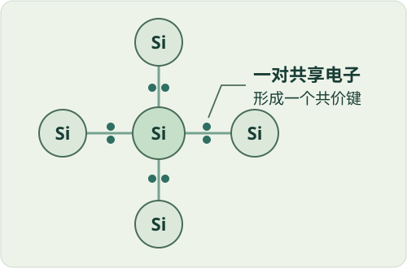
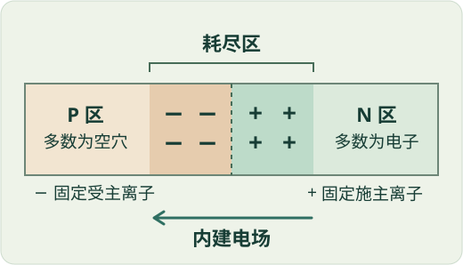
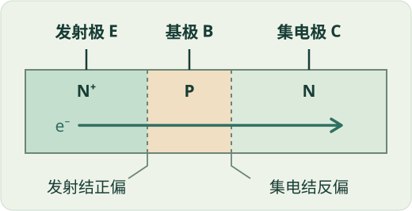
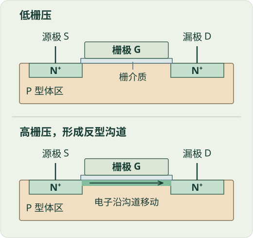
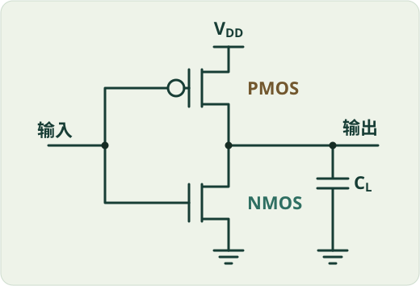

# 从硅到门电路

当一个 CMOS 反相器的输入由高变低，输出就从低电平升到高电平。**谁给输出节点送入电荷，电压又需要多久才能升高？** 要回答这两个问题，可以从电路中的电荷和电流出发，先看硅如何导电，再看晶体管如何控制电流，最后回到反相器的输出节点。

## 阅读顺序

1. [电压、电流、电阻与电容](#用电压电流电阻和电容描述一个节点)
2. [硅晶格、载流子与 P/N 型掺杂](#从硅的四个价电子理解-p-型和-n-型掺杂)
3. [PN 结与二极管](#pn-结如何形成势垒二极管如何整流)
4. [双极型晶体管（BJT）](#三极管怎样放大电流并作为开关)
5. [MOSFET 与沟道电流](#mosfet-如何用栅极电压控制沟道电流)
6. [CMOS 反相器与逻辑门](#cmos-门怎样用充放电实现逻辑运算)

## 电压、电流、电阻与电容 {#用电压电流电阻和电容描述一个节点}

要判断输出电压怎样变化，先约定参考点和电流方向。用电阻描述压差怎样产生支路电流，再用电容描述电流怎样改变节点电压。

### 先选参考点和方向

电压总是两个位置之间的电势差。把节点 B 作为参考，VAB = VA − VB。1 V 等于每库仑 1 焦耳。标成 GND 的节点是电路选定的 0 V 参考。

电流 I = dQ/dt 表示单位时间通过截面的净电荷。1 A 等于每秒 1 C。约定电流正向与正电荷运动方向一致。电子带负电，其净移动方向与它贡献的电流方向相反。先为支路选一个参考方向，算出负值就表示实际电流流向相反。

在集中参数电路中，按选定方向写电路方程。对于理想连接节点，流入的支路电流之和等于流出的支路电流之和，这是基尔霍夫电流定律（KCL）。绕一条闭合回路，各支路电压的代数和为零，这是基尔霍夫电压定律（KVL）。节点若通过一个电容积累电荷，电容的支路电流也属于 KCL 的一项。集中参数模型适合用节点和支路表示互连的情况。传播时间与信号边沿时间可比时，应采用相应的分布参数模型。见 [MIT 6.002 的集中参数电路](https://ocw.mit.edu/courses/6-002-circuits-and-electronics-spring-2007/resources/6002_l1/)。

### 电阻把压差换算成支路电流

对理想线性电阻，若电流 I 从电压正端流入，V = IR。电阻 R 的单位是欧姆（Ω）。例如，理想 1 V 电源接到 1 kΩ 电阻两端，稳态电流为 1 mA，电阻消耗的功率 P = VI = 1 mW。

实际器件的 I–V 曲线可能随偏置或温度变化。对二极管、晶体管等非线性器件，需要标明工作点。V/I 给出该点的电压与电流比，dV/dI 给出该点附近电压对电流的微小变化率。对理想线性电阻，两者都等于 R。

### 电容把电流换算成电压变化

对理想线性电容，Q = CV。Q 是所选正端极板上的电荷，V 是两极板的电压差，C 的单位是法拉（F）。若 I 流入电压正端，则 **I = C · dV/dt**。

给电容充电时，外电路在两个极板上建立等量异号的电荷。理想介质隔开极板，端口仍有充电电流。电压保持恒定后，理想电容的电流为零。此时极板可继续带电。见 [MIT 6.002 的电容与一阶电路](https://ocw.mit.edu/courses/6-002-circuits-and-electronics-spring-2007/resources/6002_l12/)。

设芯片输出节点的等效负载为 50 fF，另一端接 0 V。把它从 0 V 拉到 0.8 V，要送入 ΔQ = 50 fF × 0.8 V = **40 fC**。如果驱动电流恒为 0.2 mA，所需时间是 ΔQ/I = **200 ps**。这是恒流假设下的估算。若用电压源和串联电阻驱动，电流随节点电压升高而减小，节点电压遵循一阶 RC 阶跃响应。完整算例见[电路与时序基础](../../series/microarchitecture/02-pipeline/electrical-timing-foundations.md)。

## 硅晶格、载流子与 P/N 型掺杂 {#从硅的四个价电子理解-p-型和-n-型掺杂}

前面用电流描述电荷的移动。硅中的导电载流子是电子和空穴。掺杂会改变两者的浓度，从而改变材料的电导率。

### 硅原子如何成键

硅原子有四个价电子。在单晶硅中，每个硅原子与四个近邻构成四面体配位。用局部成键模型看，每个共价键由两个原子各贡献一个价电子，构成一对共享电子。晶体中的电子态跨越多个原子，下面的图用局部电子对表示键合关系。见 [MIT 6.012 的硅晶格与成键模型](https://ocw.mit.edu/courses/6-012-microelectronic-devices-and-circuits-spring-2009/resources/mit6_012s09_lec02/)。

*图中将四面体配位压到平面上。每个近邻还有其他键，图中省略。*

晶体的允许电子能量可组成能带。价带顶和导带底之间的能量差叫禁带宽度。电子获得足够的热能或吸收光能后，可以从价带跃迁到导带，留下一个空的价带状态。导带电子能参与导电。价带中相邻电子可以填补空位，让空位在晶格中移动。电路模型将这个空位视为带正电的**空穴**。

从价带激发一个电子时，会同时产生一个电子和一个空穴。电子与空穴复合时，这一对载流子消失并释放能量。纯硅在热平衡下的电子浓度 n 与空穴浓度 p 相等，均为本征载流子浓度 ni。ni 受温度影响。

### 磷提供电子，硼提供空穴

| 掺杂 | 杂质取代硅原子后 | 多数载流子 |
| --- | --- | --- |
| N 型，例如磷（P） | 磷有五个价电子。成键后，有一个电子容易进入导带，并留下固定的正离子。磷是**施主**。 | 电子 |
| P 型，例如硼（B） | 硼有三个价电子。硼可接受一个价带电子，成为固定的负离子，并在价带留下空穴。硼是**受主**。 | 空穴 |

P 型和 N 型的名称表示多数载流子的类型。掺杂后的均匀硅体内远离界面处，载流子电荷和电离杂质的电荷近似平衡。例如，N 型硅的多数电子带负电，电离施主带正电。两类材料也都有少数载流子。

以热平衡、非简并且杂质近似完全电离的 N 型硅为例。若有效施主浓度远大于 ni，则 n 近似等于有效施主浓度。此时 n·p = ni2。若 n 是 ni 的 106 倍，p 就是 ni 的 10−6 倍。这是相同温度下的浓度比例。若施主和受主并存，要考虑补偿。若器件正在注入载流子，则要按偏置条件求 n 和 p。见 [MIT 6.012 的本征、掺杂与补偿模型](https://ocw.mit.edu/courses/6-012-microelectronic-devices-and-circuits-spring-2009/resources/mit6_012s09_lec02/)。

### 载流子怎样形成电流

**漂移**由电场驱动。空穴沿电场方向漂移，电子反向漂移，两者贡献的常规漂移电流都沿电场方向。低电场下，均匀材料的电导率 σ = q(nμn + pμp)。其中 q 是元电荷的大小，μn 和 μp 是两类载流子的迁移率。一段长度为 L、截面积为 A 的均匀硅条，在上述条件下有 R = L/(σA)。计算时，掺杂水平也会影响迁移率。

**扩散**由浓度梯度产生。同类载流子从高浓度区向低浓度区发生净移动。将 P 型和 N 型区域做在同一块晶体中，结附近的漂移和扩散会共同决定电流。见 [MIT 6.012 的载流子输运](https://ocw.mit.edu/courses/6-012-microelectronic-devices-and-circuits-spring-2009/resources/mit6_012s09_lec03/)。

## PN 结与二极管 {#pn-结如何形成势垒二极管如何整流}

将 P 型和 N 型区域做在同一块硅晶体中，交界处会形成 PN 结。结内电场影响载流子跨结的速率。改变外加电压，就能得到正、反方向不同的电流。

### 平衡时，扩散和漂移怎样抵消

设同一硅晶体中，P 区在左，N 区在右。电子从 N 区向 P 区扩散，空穴从 P 区向 N 区扩散。一部分载流子在界面附近复合。由于多数载流子减少，P 侧留下固定的负受主离子，N 侧留下固定的正施主离子。这个区域称为**耗尽区**。

固定电荷建立从 N 侧指向 P 侧的内建电场。它使电子向 N 侧漂移，使空穴向 P 侧漂移。热平衡时，每类载流子的漂移电流与扩散电流相互抵消，净电流为零。内建电势差在结内部。平衡时，外部欧姆接触间测得的端口电压为零。见 [MIT 6.012 的 PN 结静电学](https://ocw.mit.edu/courses/6-012-microelectronic-devices-and-circuits-fall-2009/resources/mit6_012f09_lec04/)。

*图按对称掺杂画出耗尽区。对突变结，掺杂较轻的一侧通常分到更宽的耗尽区。*

### 外加电压怎样改变结电流

定义二极管端电压 VD = VP − VN。常规正向电流从阳极（P 侧）流向阴极（N 侧）。

| 偏置 | 势垒和耗尽区 | 稳态电流机制 |
| --- | --- | --- |
| 正向，VD > 0 | 势垒降低，耗尽区变窄 | 电子和空穴更容易跨结。到达另一侧后，成为该侧的过剩少数载流子，并扩散和复合。 |
| 反向，VD < 0 | 势垒升高，耗尽区变宽 | 多数载流子注入受抑制。击穿前，少数载流子被电场扫过结等机制产生小的反向电流。 |

理想扩散模型在固定温度、低注入、忽略串联电阻和结区产生复合电流、且避开击穿时，给出 **ID = IS[exp(VD/UT) − 1]**。IS 是反向饱和电流的大小，UT = kBT/q 是热电压，300 K 时约为 25.9 mV。

当正向电流远大于 IS 时，电压每升高 UT·ln(10)，理想电流约增大十倍。300 K 时，这个电压增量约为 **60 mV**。常说的「硅二极管压降约 0.7 V」是选定工作电流下的粗略估计。实际 I–V 曲线还受温度、复合、串联电阻和高注入影响。较强反偏可能引发击穿，电流会快速增大。具体范围取决于器件和限流条件。见 [MIT 6.012 的 PN 结 I–V 模型及其适用条件](https://ocw.mit.edu/courses/6-012-microelectronic-devices-and-circuits-fall-2009/resources/mit6_012f09_lec06/)。

### PN 结也会储存电荷

改变反偏会改变耗尽区边界和端口电荷，表现为随偏置变化的**耗尽电容**。正向偏置时，注入到两侧的过剩少数载流子还会形成储存电荷，对应**扩散电容**。从正偏切换到反偏时，需要先清除一部分储存电荷，二极管电流才会恢复到反偏稳态值。这个过程与开关速度有关。见 [MIT 6.012 的二极管等效电路与储存电荷](https://ocw.mit.edu/courses/6-012-microelectronic-devices-and-circuits-fall-2005/pages/lecture-notes/)。

## 双极型晶体管（BJT） {#三极管怎样放大电流并作为开关}

电路中常说的「三极管」在这里指双极型晶体管（BJT）。它用发射结注入载流子，再用集电结收集穿过基区的载流子。在正向放大区，如果基区厚度远小于注入载流子的扩散长度，**大部分注入基区的载流子能到达集电极**。这是 BJT 能提供电流增益的原因之一。

### 三个端子决定两个结的偏置

以 NPN 管为例。发射极 E 接在重掺杂 N 型发射区，基极 B 接在薄的 P 型基区，集电极 C 接在 N 型集电区。定义 VBE = VB − VE，VBC = VB − VC。PNP 管交换 P 型和 N 型区域，偏置和常规电流方向也相应反转。

*图中箭头表示电子运动方向。区域宽度仅作示意。*

在正向放大区，发射结正偏，集电结反偏。发射区把电子注入基区。大部分电子扩散到集电结，再被该处的电场扫入集电区。部分电子在基区与空穴复合，基极电流负责补充空穴。空穴从基区注入发射区的过程也贡献基极电流。两个结共享同一个薄基区，因此载流子可以由一个结注入，经另一个结收集。见 [MIT 6.012 的 BJT 注入与收集模型](https://ocw.mit.edu/courses/6-012-microelectronic-devices-and-circuits-fall-2009/resources/mit6_012f09_lec07/)。

### 从端口看工作区

下表假设器件避开击穿。电流取 NPN 正向使用时的大小。

| 工作区 | 发射结和集电结的偏置 | 可用的近似 |
| --- | --- | --- |
| 截止 | 发射结反偏或正偏很弱，集电结反偏或零偏。 | 集电极电流接近漏电量级。 |
| 正向放大 | 发射结正偏，集电结反偏。 | 固定温度、低注入时，IC 对 VBE 近似呈指数关系。给定工作点附近，也可用 IC ≈ βIB。 |
| 饱和 | 两个结均正偏。 | VCE 通常较小，集电极电流需与外部负载一起求解。 |
| 反向放大 | 发射结反偏，集电结正偏。 | 集电区承担注入。常规器件的发射区和集电区结构不同，反向增益通常较低。 |

β 随器件、温度和偏置而变。工程上可以用基极电流估算集电极电流，内部注入同时取决于 VBE。硅 BJT 的 VBE 应随电流和温度一起给出。用作饱和开关时，关断还要移除基区的储存电荷。

### 用负载检查一次开关状态

设发射极接地，集电极经 1 kΩ 电阻接 3.3 V 电源。基极驱动由外部电路提供。对这个电路，VCE = 3.3 V − IC × 1 kΩ。

1. 若假设 β = 100、IB = 10 µA，正向放大模型给出 IC ≈ 1 mA，VCE ≈ 2.3 V。取教学工作点 VBE ≈ 0.7 V，集电极高于基极，满足集电结反偏的条件。
2. 若 IB 增至 0.4 mA，沿用 β = 100 会得到 40 mA。即使 VCE 降为零，电阻也只能提供 3.3 mA。应检查饱和工作点。若本例取 VCE(sat) ≈ 0.2 V，则 IC ≈ **3.1 mA**。

这里的参数是供手算使用的假设。实际开关要根据负载电流与基极驱动查规格。例如 onsemi 的 2N3904 在 IC = 10 mA、IB = 1 mA、环境温度 25 °C 的脉冲测试中，给出 VCE(sat) 最大值 0.2 V。另一个电流测试点有不同上限。见 [onsemi 2N3904/D，Rev. 3，第 2 页](https://www.onsemi.com/pdf/datasheet/2n3904-d.pdf#page=2)。

## MOSFET 与沟道电流 {#mosfet-如何用栅极电压控制沟道电流}

金属–氧化物–半导体场效应晶体管（MOSFET）也叫 MOS 管。它的栅极隔着介质建立电场，改变硅表面的载流子浓度。形成导电沟道后，漏极与源极的压差驱动电流。

### 用平面 NMOS 观察沟道怎样形成

以增强型平面 NMOS 为例。器件有栅极 G、源极 S、漏极 D 和体端 B。两个重掺杂 N 型区形成源区和漏区，位于 P 型体区中。栅极和硅之间由薄的介质隔开。对本例，令体端与源极同电位，漏极电位略高于源极。

逐步提高栅极电压时，栅极电场先从硅表面排开部分空穴，形成耗尽区。电场进一步增强时，电子在表面聚集。表面从以空穴为主变为以电子为主，称为**反型**。在强反型且漏源电压较小时，电子沟道将源区和漏区连起来。

*截面为教学示意。两幅图均以源极为参考，省略体端接触和边缘电场。下图假设漏源电压较小，强反型沟道延伸至漏区。*

定义 VGS = VG − VS，VDS = VD − VS。在上述 NMOS 方向下，电子从源极移向漏极，常规漏极电流 ID 从漏极流向源极。PMOS 使用空穴沟道，常用正值 VSG = VS − VG 表示栅驱动。提高 VSG 会增强 PMOS 的沟道导电能力。见 [MIT 6.004 的 MOSFET 结构与端口特性](https://ocw.mit.edu/courses/6-004-computation-structures-spring-2017/pages/c3/c3s1/)。

### 漏极电流随端电压怎样变化

用一个长沟道 NMOS 的一阶模型。设体端与源极相连，VDS ≥ 0，温度固定。模型沿沟道采用恒定的迁移率和阈值，忽略亚阈值电流、沟道长度调制和串联电阻。以 VTN 表示 NMOS 阈值，Vov = VGS − VTN 表示过驱动电压。系数 k = μnCoxW/L，Cox 是单位面积栅介质电容，W 和 L 是沟道宽度和长度。

| 模型工作区 | 条件 | 漏极电流 ID |
| --- | --- | --- |
| 截止 | Vov ≤ 0 | 近似为零。 |
| 线性区 | Vov > 0 且 0 ≤ VDS < Vov | k(VovVDS − VDS2/2)。 |
| 饱和区 | Vov > 0 且 VDS ≥ Vov | kVov2/2。 |

在线性区靠近 VDS = 0 的范围，沟道近似一个电阻，约为 1/(kVov)。这个区间适合用来分析低压降开关的稳态导通。

当 VDS 增至 Vov，漏端的强反型沟道开始**夹断**。源端仍向沟道供应电子，电子穿过漏端的高电场区被收集。理想模型中的 ID 由栅源电压决定。实际饱和区的 ID 也可随 VDS 增加。见 [MIT 6.012 的长沟道 MOSFET 大信号模型](https://ocw.mit.edu/courses/6-012-microelectronic-devices-and-circuits-fall-2009/resources/mit6_012f09_lec11/)。

例如，取 VTN = 0.3 V、VGS = 0.8 V、k = 200 µA/V²，得到 Vov = 0.5 V。在 VDS = 0.1 V 时，模型得到 ID = **9 µA**。在 VDS = 0.5 V 或 0.8 V 时，理想饱和电流均为 **25 µA**。这些数值来自指定模型和假设。

### 看规格时，先看测量条件

- **转移特性**固定 VDS 等条件，扫描 VGS，观察 ID。某个工作点的跨导 gm 是固定其他端电压时 ID 对 VGS 的局部斜率，单位为西门子（S）。
- **输出特性**对多个固定的 VGS，分别扫描 VDS，得到一组 ID 曲线。用作低损耗开关时，关注规定栅驱动和温度下的导通电阻 RDS(on)。
- **输入电容与栅电荷**描述驱动电路在切换时需要转移的电荷。绝缘栅极的稳态漏电通常很小。每次改变栅极电压，驱动电路仍需提供瞬态电流。

例如，Nexperia 2N7002 在结温 25 °C、VDS = VGS、ID = 0.25 mA 时，测得的栅源阈值规格范围为 1.0–2.5 V。同为 25 °C，导通电阻最大值 5.3 Ω 对应 VGS = 4.5 V 和 ID = 75 mA。前一个测试定义小电流门限，后一个测试才给出指定负载和栅驱动下的导通电阻。见 [Nexperia 2N7002，Rev. 7，表 7 与图 5–7](https://assets.nexperia.com/documents/data-sheet/2N7002.pdf#page=5)。

实际器件还要考虑亚阈值电流、体偏置改变阈值、源漏与体区之间的 PN 结、寄生电容及短沟道效应。上面的一阶式适合解释趋势。预测特定工艺中的电流和延迟，要使用对应的器件模型与工作条件。器件结构演化见 [FAB 的 Planar、FinFET 与 GAAFET](../../series/chip-development/FAB/wiki/02-front-end-fabrication/transistor-evolution-planar-finfet-gaa.md)。

## CMOS 反相器与逻辑门 {#cmos-门怎样用充放电实现逻辑运算}

把 PMOS 和 NMOS 接到同一个输出节点，可以控制这个节点的充放电。静态 CMOS 门用 PMOS 建成**上拉网络**，用 NMOS 建成**下拉网络**。分析门的输出时，先判断哪条路径会接通，再判断节点电压会怎样变化。

### 用两只管构成反相器

反相器的 PMOS 源极接 VDD，NMOS 源极接 GND。两个栅极接输入，两个漏极接输出。在常见体硅 CMOS 中，这两个器件的体端分别接 VDD 和 GND。以下过程假设供电和输入满足器件的正常工作条件，输出接等效电容负载 CL。

*黑点表示电气连接。图中的 CL 代表下一级输入和连线等效到输出节点的电容，体端连接见正文。*

| 输入 | 管子状态 | 稳态输出 |
| --- | --- | --- |
| 0 | PMOS 导通，NMOS 截止。 | 1 |
| 1 | PMOS 截止，NMOS 导通。 | 0 |

稳定后，逻辑 1 的电压接近 VDD，逻辑 0 的电压接近 GND。

输入设置两只管子的栅极电压。输入从高变低时，电荷从 VDD 经 PMOS 流入输出节点。输入从低变高时，输出节点通过 NMOS 向 GND 放电。把负载近似为接地的线性电容，并忽略其他电流路径，则节点方程是 **CL·dVout/dt = IP − IN**。这里 IP 是由上拉流入节点的电流，IN 是由下拉流出节点的电流。实际两个电流都随输入和输出电压变化。近似成等效电阻后，可用一阶 RC 估计过门限时间。见 [MIT 6.004 的 CMOS 反相器与门延迟](https://ocw.mit.edu/courses/6-004-computation-structures-spring-2017/pages/c3/c3s1/)和[电路与时序基础](../../series/microarchitecture/02-pipeline/electrical-timing-foundations.md)。

### 用串联和并联推导 NAND 与 NOR

对于两输入静态 CMOS 门，A 和 B 各控制一只 PMOS 和一只 NMOS。串联支路要求每个开关都导通，并联支路只需有一个支路导通。

| 门 | 上拉和下拉的接法 | 输出何时为 0 |
| --- | --- | --- |
| NAND（与非） | PMOS 并联，NMOS 串联。 | A 和 B 都为 1。 |
| NOR（或非） | PMOS 串联，NMOS 并联。 | A 和 B 至少有一个为 1。 |

以 A = 1、B = 0 为例。NAND 的 B 控制管关断了串联下拉，B 同时使一个并联上拉支路导通，输出为 1。对同样输入，NOR 的 A 控制管打开一个并联下拉支路，同时断开串联上拉，输出为 0。

| 输入 (A, B) | NAND | NOR |
| --- | --- | --- |
| (0, 0) | 1 | 1 |
| (0, 1) | 1 | 0 |
| (1, 0) | 1 | 0 |
| (1, 1) | 0 | 0 |

在 NAND 或 NOR 后再接一级反相器，就分别得到 AND 或 OR。分析这条路径时，要计入两级的负载与传播延迟。见 [MIT 6.004 的互补网络和组合门](https://ocw.mit.edu/courses/6-004-computation-structures-spring-2017/pages/c3/c3s1/)。

### 电压落在哪个范围，逻辑值才有效

缓慢扫描输入电压并等待输出稳定，可以得到反相器的电压传输曲线。输入接近两个电源轨时，输出分别接近相反的电源轨。中间过渡区可能出现两只管同时导通，输出由两边的电流平衡决定。

| 电平参数 | 在规定的供电、温度和负载条件下 |
| --- | --- |
| VIL、VIH | 接收端保证识别为低电平的最高输入电压，以及保证识别为高电平的最低输入电压。两者之间的逻辑结果无保证。 |
| VOL、VOH | 驱动端输出低电平时的最高保证电压，以及输出高电平时的最低保证电压。 |

一对兼容的驱动端和接收端应有正的直流噪声容限。低电平容限为 VIL − VOL，高电平容限为 VOH − VIH。例如，若本例的低电平输出上限为 0.10 V，接收低电平上限为 0.25 V，低电平容限为 **0.15 V**。该值只描述所选端口条件下的静态余量。

器件的 VTN 用于描述单个 NMOS 的导电。门电路的直流翻转点可用传输曲线上 Vin = Vout 的点定义。传播延迟则按约定的输入和输出参考门限计量。分析时应分别取相应的器件参数、接口电平和时序库门限。见 [MIT 6.004 的数字抽象与电平规范](https://ocw.mit.edu/courses/6-004-computation-structures-spring-2017/pages/c2/c2s1/)。

### 翻转消耗的能量来自哪里

在理想全摆幅的充放电模型中，输出每次从 0 V 升至 VDD，电源向 CL 送入 CLVDD 的电荷，提供能量 CLVDD2。其中一半暂存在电容里，一半在上拉路径耗散。随后放电时，存下的能量在下拉路径耗散。

设 f 是每秒的周期数，α 是每周期平均发生的 **0 → 1** 次数，则该节点平均负载切换功率为 Psw = αfCLVDD2。把第一节的 50 fF 节点作为反相器负载。若供电为 0.8 V，电源每次全摆幅充电提供 **32 fJ**。若 f = 1 GHz，平均每四周期发生一次上升，则 Psw = **8 µW**。实际门还会消耗两管同时导通时的短路能量、内部节点翻转能量和漏电功率。见 [MIT 6.012 的 CMOS 延迟与功耗](https://ocw.mit.edu/courses/6-012-microelectronic-devices-and-circuits-fall-2009/resources/mit6_012f09_lec16_scaling/)。

## 用到哪里

- **时序。** 从输出节点充放电继续算到寄存器的采样边沿。见[电路与时序基础](../../series/microarchitecture/02-pipeline/electrical-timing-foundations.md)。
- **运算。** 从基本逻辑门进入部分积和累加电路。见[从部分积到 MAC](../../series/microarchitecture/01-datapath/multiply-accumulate-from-gates.md)。
- **存储。** 从两个反相器维持状态，读到访问管怎样连接存储节点与位线。见 [6T SRAM cell](../../series/storage/02-sram/foundations/6t-cell-bistable-storage.md)和 [1T1C DRAM](../../series/storage/03-dram/foundations/1t1c-cell-destructive-read.md)。
- **前道工艺。** 从材料特性进入掺杂、注入和栅极结构。见[掺杂与离子注入](../../series/chip-development/FAB/wiki/02-front-end-fabrication/doping-and-ion-implantation.md)和[器件演化](../../series/chip-development/FAB/wiki/02-front-end-fabrication/transistor-evolution-planar-finfet-gaa.md)。
