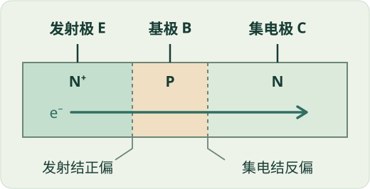

# 三极管怎样放大电流并作为开关

双极型晶体管（BJT）用发射结注入载流子，再用集电结收集穿过基区的载流子。在正向放大区，如果基区厚度远小于注入载流子的扩散长度，**大部分注入基区的载流子能到达集电极**。这是 BJT 能提供电流增益的原因之一。

## 三个端子决定两个结的偏置

以 NPN 管为例。发射极 E 接在重掺杂 N 型发射区，基极 B 接在薄的 P 型基区，集电极 C 接在 N 型集电区。定义 VBE = VB − VE，VBC = VB − VC。PNP 管交换 P 型和 N 型区域，偏置和常规电流方向也相应反转。

*图中箭头表示电子运动方向。区域宽度仅作示意。*

在正向放大区，发射结正偏，集电结反偏。发射区把电子注入基区。大部分电子扩散到集电结，再被该处的电场扫入集电区。部分电子在基区与空穴复合，基极电流负责补充空穴。空穴从基区注入发射区的过程也贡献基极电流。两个结共享同一个薄基区，因此载流子可以由一个结注入，经另一个结收集。见 [MIT 6.012 的 BJT 注入与收集模型](https://ocw.mit.edu/courses/6-012-microelectronic-devices-and-circuits-fall-2009/resources/mit6_012f09_lec07/)。

## 从端口看工作区

下表假设器件避开击穿。电流取 NPN 正向使用时的大小。

| 工作区 | 发射结和集电结的偏置 | 可用的近似 |
| --- | --- | --- |
| 截止 | 发射结反偏或正偏很弱，集电结反偏或零偏。 | 集电极电流接近漏电量级。 |
| 正向放大 | 发射结正偏，集电结反偏。 | 固定温度、低注入时，IC 对 VBE 近似呈指数关系。给定工作点附近，也可用 IC ≈ βIB。 |
| 饱和 | 两个结均正偏。 | VCE 通常较小，集电极电流需与外部负载一起求解。 |
| 反向放大 | 发射结反偏，集电结正偏。 | 集电区承担注入。常规器件的发射区和集电区结构不同，反向增益通常较低。 |

β 随器件、温度和偏置而变。工程上可以用基极电流估算集电极电流，内部注入同时取决于 VBE。硅 BJT 的 VBE 应随电流和温度一起给出。用作饱和开关时，关断还要移除基区的储存电荷。

## 用负载检查一次开关状态

设发射极接地，集电极经 1 kΩ 电阻接 3.3 V 电源。基极驱动由外部电路提供。对这个电路，VCE = 3.3 V − IC × 1 kΩ。

1. 若假设 β = 100、IB = 10 µA，正向放大模型给出 IC ≈ 1 mA，VCE ≈ 2.3 V。取教学工作点 VBE ≈ 0.7 V，集电极高于基极，满足集电结反偏的条件。
2. 若 IB 增至 0.4 mA，沿用 β = 100 会得到 40 mA。即使 VCE 降为零，电阻也只能提供 3.3 mA。应检查饱和工作点。若本例取 VCE(sat) ≈ 0.2 V，则 IC ≈ **3.1 mA**。

这里的参数是供手算使用的假设。实际开关要根据负载电流与基极驱动查规格。例如 onsemi 的 2N3904 在 IC = 10 mA、IB = 1 mA、环境温度 25 °C 的脉冲测试中，给出 VCE(sat) 最大值 0.2 V。另一个电流测试点有不同上限。见 [onsemi 2N3904/D，Rev. 3，第 2 页](https://www.onsemi.com/pdf/datasheet/2n3904-d.pdf#page=2)。

下一篇转到场效应器件，观察绝缘栅极如何改变硅表面的电荷与导电路径。[MOSFET 与沟道电流](./mosfet.md)
