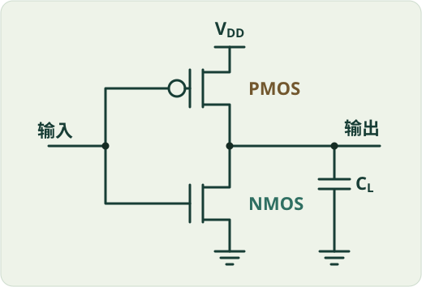

# CMOS 门怎样用充放电实现逻辑运算

静态 CMOS 门用 PMOS 建成**上拉网络**，用 NMOS 建成**下拉网络**。对有效且稳定的输入，上拉将输出驱到高电平，或下拉将输出驱到低电平。分析一个门时，先找输出到两个电源轨的路径，再判断路径是否导通。

## 用两只管构成反相器

反相器的 PMOS 源极接 VDD，NMOS 源极接 GND。两个栅极接输入，两个漏极接输出。在常见体硅 CMOS 中，这两个器件的体端分别接 VDD 和 GND。以下过程假设供电和输入满足器件的正常工作条件，输出接等效电容负载 CL。

*黑点表示电气连接。图中的 CL 代表下一级输入和连线等效到输出节点的电容，体端连接见正文。*

| 输入 | 管子状态 | 稳态输出 |
| --- | --- | --- |
| 0 | PMOS 导通，NMOS 截止。 | 1 |
| 1 | PMOS 截止，NMOS 导通。 | 0 |

稳定后，逻辑 1 的电压接近 VDD，逻辑 0 的电压接近 GND。

输入从高变低时，PMOS 给输出节点充电。输入从低变高时，NMOS 把电荷从输出节点移走。把负载近似为接地的线性电容，并忽略其他电流路径，则节点方程是 **CL·dVout/dt = IP − IN**。这里 IP 是由上拉流入节点的电流，IN 是由下拉流出节点的电流。实际两个电流都随输入和输出电压变化。近似成等效电阻后，可用一阶 RC 估计过门限时间。见 [MIT 6.004 的 CMOS 反相器与门延迟](https://ocw.mit.edu/courses/6-004-computation-structures-spring-2017/pages/c3/c3s1/)和[电路与时序基础](../../series/microarchitecture/02-pipeline/electrical-timing-foundations.md)。

## 用串联和并联推导 NAND 与 NOR

对于两输入静态 CMOS 门，A 和 B 各控制一只 PMOS 和一只 NMOS。串联支路要求每个开关都导通，并联支路只需有一个支路导通。

| 门 | 上拉和下拉的接法 | 输出何时为 0 |
| --- | --- | --- |
| NAND（与非） | PMOS 并联，NMOS 串联。 | A 和 B 都为 1。 |
| NOR（或非） | PMOS 串联，NMOS 并联。 | A 和 B 至少有一个为 1。 |

以 A = 1、B = 0 为例。NAND 的 B 控制管关断了串联下拉，B 同时使一个并联上拉支路导通，输出为 1。对同样输入，NOR 的 A 控制管打开一个并联下拉支路，同时断开串联上拉，输出为 0。

| 输入 (A, B) | NAND | NOR |
| --- | --- | --- |
| (0, 0) | 1 | 1 |
| (0, 1) | 1 | 0 |
| (1, 0) | 1 | 0 |
| (1, 1) | 0 | 0 |

在 NAND 或 NOR 后再接一级反相器，就分别得到 AND 或 OR。分析这条路径时，要计入两级的负载与传播延迟。见 [MIT 6.004 的互补网络和组合门](https://ocw.mit.edu/courses/6-004-computation-structures-spring-2017/pages/c3/c3s1/)。

## 电压落在哪个范围，逻辑值才有效

缓慢扫描输入电压并等待输出稳定，可以得到反相器的电压传输曲线。输入接近两个电源轨时，输出分别接近相反的电源轨。中间过渡区可能出现两只管同时导通，输出由两边的电流平衡决定。

| 电平参数 | 在规定的供电、温度和负载条件下 |
| --- | --- |
| VIL、VIH | 接收端保证识别为低电平的最高输入电压，以及保证识别为高电平的最低输入电压。两者之间的逻辑结果无保证。 |
| VOL、VOH | 驱动端输出低电平时的最高保证电压，以及输出高电平时的最低保证电压。 |

一对兼容的驱动端和接收端应有正的直流噪声容限。低电平容限为 VIL − VOL，高电平容限为 VOH − VIH。例如，若本例的低电平输出上限为 0.10 V，接收低电平上限为 0.25 V，低电平容限为 **0.15 V**。该值只描述所选端口条件下的静态余量。

器件的 VTN 用于描述单个 NMOS 的导电。门电路的直流翻转点可用传输曲线上 Vin = Vout 的点定义。传播延迟则按约定的输入和输出参考门限计量。分析时应分别取相应的器件参数、接口电平和时序库门限。见 [MIT 6.004 的数字抽象与电平规范](https://ocw.mit.edu/courses/6-004-computation-structures-spring-2017/pages/c2/c2s1/)。

## 翻转消耗的能量来自哪里

在理想全摆幅的充放电模型中，输出每次从 0 V 升至 VDD，电源向 CL 送入 CLVDD 的电荷，提供能量 CLVDD2。其中一半暂存在电容里，一半在上拉路径耗散。随后放电时，存下的能量在下拉路径耗散。

设 f 是每秒的周期数，α 是每周期平均发生的 **0 → 1** 次数，则该节点平均负载切换功率为 Psw = αfCLVDD2。例如，50 fF 的节点以 0.8 V 全摆幅充电，电源每次提供 **32 fJ**。若 f = 1 GHz，平均每四周期发生一次上升，则 Psw = **8 µW**。实际门还会消耗两管同时导通时的短路能量、内部节点翻转能量和漏电功率。见 [MIT 6.012 的 CMOS 延迟与功耗](https://ocw.mit.edu/courses/6-012-microelectronic-devices-and-circuits-fall-2009/resources/mit6_012f09_lec16_scaling/)。

## 接下来怎么读

- 想从充放电继续算到时钟采样，读[电路与时序基础](../../series/microarchitecture/02-pipeline/electrical-timing-foundations.md)。
- 想看反相器怎样维持一个 bit，读 [6T SRAM cell](../../series/storage/02-sram/foundations/6t-cell-bistable-storage.md)。
- 想看基本逻辑怎样组合成运算，读[从部分积到 MAC](../../series/microarchitecture/01-datapath/multiply-accumulate-from-gates.md)。
