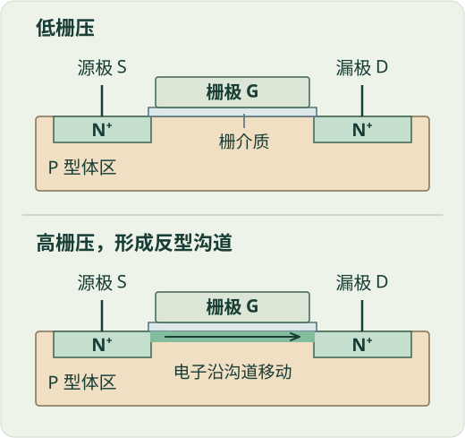

# MOSFET 如何用栅极电压控制沟道电流

**栅极建立电场，电场改变硅表面的载流子浓度。** 当栅极形成一个导电沟道后，漏极与源极的压差驱动电流。漏极电流因此同时取决于栅源电压和漏源电压。

## 用平面 NMOS 观察沟道怎样形成

以增强型平面 NMOS 为例。器件有栅极 G、源极 S、漏极 D 和体端 B。两个重掺杂 N 型区形成源区和漏区，位于 P 型体区中。栅极和硅之间由薄的介质隔开。对本例，令体端与源极同电位，漏极电位略高于源极。

逐步提高栅极电压时，栅极电场先从硅表面排开部分空穴，形成耗尽区。电场进一步增强时，电子在表面聚集。表面从以空穴为主变为以电子为主，称为**反型**。在强反型且漏源电压较小时，电子沟道将源区和漏区连起来。

*截面为教学示意。两幅图均以源极为参考，省略体端接触和边缘电场。下图假设漏源电压较小，强反型沟道延伸至漏区。*

定义 VGS = VG − VS，VDS = VD − VS。在上述 NMOS 方向下，电子从源极移向漏极，常规漏极电流 ID 从漏极流向源极。PMOS 使用空穴沟道，常用正值 VSG = VS − VG 表示栅驱动。提高 VSG 会增强 PMOS 的沟道导电能力。见 [MIT 6.004 的 MOSFET 结构与端口特性](https://ocw.mit.edu/courses/6-004-computation-structures-spring-2017/pages/c3/c3s1/)。

## 漏极电流随端电压怎样变化

用一个长沟道 NMOS 的一阶模型。设体端与源极相连，VDS ≥ 0，温度固定。模型沿沟道采用恒定的迁移率和阈值，忽略亚阈值电流、沟道长度调制和串联电阻。以 VTN 表示 NMOS 阈值，Vov = VGS − VTN 表示过驱动电压。系数 k = μnCoxW/L，Cox 是单位面积栅介质电容，W 和 L 是沟道宽度和长度。

| 模型工作区 | 条件 | 漏极电流 ID |
| --- | --- | --- |
| 截止 | Vov ≤ 0 | 近似为零。 |
| 线性区 | Vov > 0 且 0 ≤ VDS < Vov | k(VovVDS − VDS2/2)。 |
| 饱和区 | Vov > 0 且 VDS ≥ Vov | kVov2/2。 |

在线性区靠近 VDS = 0 的范围，沟道近似一个电阻，约为 1/(kVov)。这个区间适合用来分析低压降开关的稳态导通。

当 VDS 增至 Vov，漏端的强反型沟道开始**夹断**。源端仍向沟道供应电子，电子穿过漏端的高电场区被收集。理想模型中的 ID 由栅源电压决定。实际饱和区的 ID 也可随 VDS 增加。见 [MIT 6.012 的长沟道 MOSFET 大信号模型](https://ocw.mit.edu/courses/6-012-microelectronic-devices-and-circuits-fall-2009/resources/mit6_012f09_lec11/)。

例如，取 VTN = 0.3 V、VGS = 0.8 V、k = 200 µA/V²，得到 Vov = 0.5 V。在 VDS = 0.1 V 时，模型得到 ID = **9 µA**。在 VDS = 0.5 V 或 0.8 V 时，理想饱和电流均为 **25 µA**。这些数值来自指定模型和假设。

## 看规格时，先看测量条件

- **转移特性**固定 VDS 等条件，扫描 VGS，观察 ID。某个工作点的跨导 gm 是固定其他端电压时 ID 对 VGS 的局部斜率，单位为西门子（S）。
- **输出特性**对多个固定的 VGS，分别扫描 VDS，得到一组 ID 曲线。用作低损耗开关时，关注规定栅驱动和温度下的导通电阻 RDS(on)。
- **输入电容与栅电荷**描述驱动电路在切换时需要转移的电荷。绝缘栅极的稳态漏电通常很小。每次改变栅极电压，驱动电路仍需提供瞬态电流。

例如，Nexperia 2N7002 在结温 25 °C、VDS = VGS、ID = 0.25 mA 时，测得的栅源阈值规格范围为 1.0–2.5 V。同为 25 °C，导通电阻最大值 5.3 Ω 对应 VGS = 4.5 V 和 ID = 75 mA。前一个测试定义小电流门限，后一个测试才给出指定负载和栅驱动下的导通电阻。见 [Nexperia 2N7002，Rev. 7，表 7 与图 5–7](https://assets.nexperia.com/documents/data-sheet/2N7002.pdf#page=5)。

实际器件还要考虑亚阈值电流、体偏置改变阈值、源漏与体区之间的 PN 结、寄生电容及短沟道效应。上面的一阶式适合解释趋势。预测特定工艺中的电流和延迟，要使用对应的器件模型与工作条件。器件结构演化见 [FAB 的 Planar、FinFET 与 GAAFET](../../series/chip-development/FAB/wiki/02-front-end-fabrication/transistor-evolution-planar-finfet-gaa.md)。

下一篇把 PMOS 和 NMOS 接到同一个输出节点，用两个方向的电流建立逻辑电平。[CMOS 反相器与逻辑门](./cmos-logic.md)
