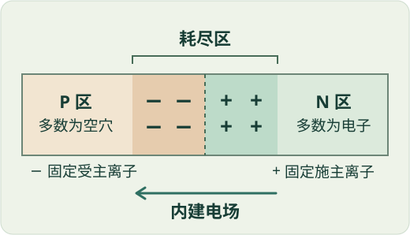

# PN 结如何形成势垒，二极管如何整流

**PN 结通过耗尽区建立内建电场。** 外部电压改变势垒，进而改变载流子跨结的速率。普通 PN 结二极管用这一机制获得方向不对称的电流。

## 平衡时，扩散和漂移怎样抵消

设同一硅晶体中，P 区在左，N 区在右。电子从 N 区向 P 区扩散，空穴从 P 区向 N 区扩散。一部分载流子在界面附近复合。由于多数载流子减少，P 侧留下固定的负受主离子，N 侧留下固定的正施主离子。这个区域称为**耗尽区**。

固定电荷建立从 N 侧指向 P 侧的内建电场。它使电子向 N 侧漂移，使空穴向 P 侧漂移。热平衡时，每类载流子的漂移电流与扩散电流相互抵消，净电流为零。内建电势差在结内部。平衡时，外部欧姆接触间测得的端口电压为零。见 [MIT 6.012 的 PN 结静电学](https://ocw.mit.edu/courses/6-012-microelectronic-devices-and-circuits-fall-2009/resources/mit6_012f09_lec04/)。

*图按对称掺杂画出耗尽区。对突变结，掺杂较轻的一侧通常分到更宽的耗尽区。*

## 外加电压怎样改变结电流

定义二极管端电压 VD = VP − VN。常规正向电流从阳极（P 侧）流向阴极（N 侧）。

| 偏置 | 势垒和耗尽区 | 稳态电流机制 |
| --- | --- | --- |
| 正向，VD > 0 | 势垒降低，耗尽区变窄 | 电子和空穴更容易跨结。到达另一侧后，成为该侧的过剩少数载流子，并扩散和复合。 |
| 反向，VD < 0 | 势垒升高，耗尽区变宽 | 多数载流子注入受抑制。击穿前，少数载流子被电场扫过结等机制产生小的反向电流。 |

理想扩散模型在固定温度、低注入、忽略串联电阻和结区产生复合电流、且避开击穿时，给出 **ID = IS[exp(VD/UT) − 1]**。IS 是反向饱和电流的大小，UT = kBT/q 是热电压，300 K 时约为 25.9 mV。

当正向电流远大于 IS 时，电压每升高 UT·ln(10)，理想电流约增大十倍。300 K 时，这个电压增量约为 **60 mV**。常说的「硅二极管压降约 0.7 V」是选定工作电流下的粗略估计。实际 I–V 曲线还受温度、复合、串联电阻和高注入影响。较强反偏可能引发击穿，电流会快速增大。具体范围取决于器件和限流条件。见 [MIT 6.012 的 PN 结 I–V 模型及其适用条件](https://ocw.mit.edu/courses/6-012-microelectronic-devices-and-circuits-fall-2009/resources/mit6_012f09_lec06/)。

## PN 结也会储存电荷

改变反偏会改变耗尽区边界和端口电荷，表现为随偏置变化的**耗尽电容**。正向偏置时，注入到两侧的过剩少数载流子还会形成储存电荷，对应**扩散电容**。从正偏切换到反偏时，需要先清除一部分储存电荷，二极管电流才会恢复到反偏稳态值。这个过程与开关速度有关。见 [MIT 6.012 的二极管等效电路与储存电荷](https://ocw.mit.edu/courses/6-012-microelectronic-devices-and-circuits-fall-2005/pages/lecture-notes/)。

下一篇用同一个薄基区把两个 PN 结耦合起来，观察注入的电子能否穿过基区。[双极型晶体管（BJT）](./bipolar-transistor.md)
