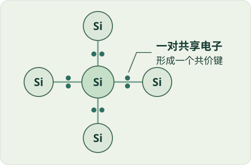

# 从硅的四个价电子理解 P 型和 N 型掺杂

**掺杂改变能参与导电的电子和空穴的浓度。** 先看纯硅怎样形成晶格，再看少量杂质怎样改变导电能力。

## 硅原子如何成键

硅原子有四个价电子。在单晶硅中，每个硅原子与四个近邻构成四面体配位。用局部成键模型看，每个共价键由两个原子各贡献一个价电子，构成一对共享电子。晶体中的电子态跨越多个原子，下面的图用局部电子对表示键合关系。见 [MIT 6.012 的硅晶格与成键模型](https://ocw.mit.edu/courses/6-012-microelectronic-devices-and-circuits-spring-2009/resources/mit6_012s09_lec02/)。

*图中将四面体配位压到平面上。每个近邻还有其他键，图中省略。*

晶体的允许电子能量可组成能带。价带顶和导带底之间的能量差叫禁带宽度。电子获得足够的热能或吸收光能后，可以从价带跃迁到导带，留下一个空的价带状态。导带电子能参与导电。价带中相邻电子可以填补空位，让空位在晶格中移动。电路模型将这个空位视为带正电的**空穴**。

从价带激发一个电子时，会同时产生一个电子和一个空穴。电子与空穴复合时，这一对载流子消失并释放能量。纯硅在热平衡下的电子浓度 n 与空穴浓度 p 相等，均为本征载流子浓度 ni。ni 受温度影响。

## 磷提供电子，硼提供空穴

| 掺杂 | 杂质取代硅原子后 | 多数载流子 |
| --- | --- | --- |
| N 型，例如磷（P） | 磷有五个价电子。成键后，有一个电子容易进入导带，并留下固定的正离子。磷是**施主**。 | 电子 |
| P 型，例如硼（B） | 硼有三个价电子。硼可接受一个价带电子，成为固定的负离子，并在价带留下空穴。硼是**受主**。 | 空穴 |

P 型和 N 型的名称表示多数载流子的类型。掺杂后的均匀硅体内远离界面处，载流子电荷和电离杂质的电荷近似平衡。例如，N 型硅的多数电子带负电，电离施主带正电。两类材料也都有少数载流子。

以热平衡、非简并且杂质近似完全电离的 N 型硅为例。若有效施主浓度远大于 ni，则 n 近似等于有效施主浓度。此时 n·p = ni2。若 n 是 ni 的 106 倍，p 就是 ni 的 10−6 倍。这是相同温度下的浓度比例。若施主和受主并存，要考虑补偿。若器件正在注入载流子，则要按偏置条件求 n 和 p。见 [MIT 6.012 的本征、掺杂与补偿模型](https://ocw.mit.edu/courses/6-012-microelectronic-devices-and-circuits-spring-2009/resources/mit6_012s09_lec02/)。

## 载流子怎样形成电流

**漂移**由电场驱动。空穴沿电场方向漂移，电子反向漂移，两者贡献的常规漂移电流都沿电场方向。低电场下，均匀材料的电导率 σ = q(nμn + pμp)。其中 q 是元电荷的大小，μn 和 μp 是两类载流子的迁移率。一段长度为 L、截面积为 A 的均匀硅条，在上述条件下有 R = L/(σA)。计算时，掺杂水平也会影响迁移率。

**扩散**由浓度梯度产生。同类载流子从高浓度区向低浓度区发生净移动。将 P 型和 N 型区域做在同一块晶体中，结附近的漂移和扩散会共同决定电流。见 [MIT 6.012 的载流子输运](https://ocw.mit.edu/courses/6-012-microelectronic-devices-and-circuits-spring-2009/resources/mit6_012s09_lec03/)。

下一篇追踪两种载流子在交界处怎样建立电场。[PN 结与二极管](./pn-junction.md)
