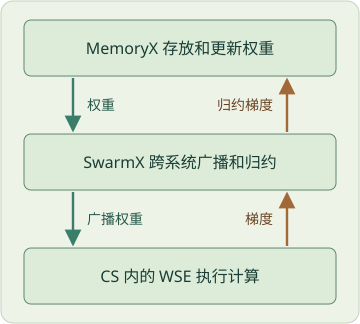

# Cerebras WSE 与 CS 怎样组织晶圆级计算和权重流

WSE 把计算单元、局部 SRAM 和二维路由网络铺在一片晶圆上。CS 是装有 WSE 的系统，提供供电、散热和 I/O。理解这套架构可以跟踪两条路径。一条在晶圆内部传数和计算。另一条在特定训练配置中把权重从外部送入 CS。

## 先固定 WSE 与 CS 的代际

| 对象 | 本文采用的公开资料 |
| --- | --- |
| WSE-2 和 CS-2 | Hot Chips 2021／2022 的权重流与晶圆内计算结构。 |
| WSE-3 和 CS-3 | Hot Chips 2024 公布的晶圆芯片为 90 万个计算核、44 GB 片上 SRAM，厂商列出 21 PB/s 片上存储聚合带宽与 214 Pb/s 片上互连聚合带宽。 |
| WSE-2 和 WSE-3 的编程接口 | Cerebras SDK 1.4 分别描述数据任务与输入队列。 |

上表的 PB/s 和 Pb/s 分别以字节和比特计，且表示两个不同层级的聚合能力。单个 PE 或单条链路的带宽要用对应资料。厂商将 125 PFLOPS 列为 WSE-3 的峰值 AI 算力。本文使用的规格资料未明确给出完整的精度与运算计数条件，横向性能比较应补齐该口径。 [WSE-2 Hot Chips 2022](https://www.hc34.hotchips.org/assets/program/conference/day2/Machine%20Learning/HC2022_Cerebras_Final_v02.pdf) · [WSE-3 Hot Chips 2024](https://hc2024.hotchips.org/assets/program/conference/day2/72_HC2024.Cerebras.Sean.v03.final.pdf)

## 晶圆内的消息怎样启动计算

每个处理单元（PE）包含计算引擎、局部存储和路由器。其他 PE 通过晶圆内互连交换消息。程序可以用数据结构描述符（DSD）描述局部张量或来自互连的数据流，并用指令处理它。

假定 PE A 已通过指定路由向 PE B 发送一个消息（wavelet）。PE B 预先为该通道配置了数据任务。接收过程如下。

1. 路由器根据 wavelet 的颜色（color）及配置转发数据。该颜色表示一条逻辑通信通道。
2. 数据到达接收端，已绑定的任务进入可调度状态。在 WSE-2 上，数据任务 ID 从颜色取得。在 WSE-3 上，数据任务 ID 从与颜色关联的输入队列取得。
3. PE 选择就绪任务，读取消息负载并更新局部结果。若下游需要它，可再发一个 wavelet。

收到消息也可以由程序配置为向 fabric DSD 提供数据。芯片支持由程序显式激活的本地任务。是否运行特定任务取决于绑定、阻塞状态和接收路径。 [Cerebras SDK 1.4 的 PE、任务和互连说明](https://cerebras-sdk-docs-140.netlify.app/computing-with-cerebras)

## 为什么稀疏权重可以少发消息

以有限数矩阵乘 Y = XW 的一列为例。假定仅 W 的第 0、3 行在这一列非零。结果等于 X 的第 0 列乘第一个权重，加上 X 的第 3 列乘第二个权重。若程序已将 X 分布到各 PE，权重可以流到拥有相应数据的 PE，各自形成部分和，再通过晶圆内路径归约。

在厂商的稀疏映射示例里，发送端可跳过为零的权重，省去对应的 wavelet 和乘加。收益取决于模型保留的稀疏度、索引与元数据开销、非零项分布以及归约负载。这个机制也依赖映射和输入数据的表达。 [CS-2 Hot Chips 2021 的稀疏矩阵算例](https://hc33.hotchips.org/assets/program/conference/day2/HC2021.Cerebras.SeanLie.v1.pdf) · [Cerebras 稀疏张量示例](https://cerebras-sdk-docs-140.netlify.app/csl/code-examples/tutorial-topic-04-sparse-tensors)

## 外部系统怎样供给训练权重

在厂商展示的权重流式训练配置中，MemoryX 存放权重、优化器状态并处理权重更新。SwarmX 把所需权重广播给各 CS，并归约返回的梯度。WSE 处理分到本系统的数据，局部 SRAM 保存计算所需的工作数据。

这是系统级功能示意，一台 CS 的晶圆内部仍使用自己的互连。能否把权重传输和计算重叠，取决于层间工作量、分配的批大小和可用带宽。外部权重与优化器状态容量应按所选训练配置核对。 [CS-2 Hot Chips 2021](https://hc33.hotchips.org/assets/program/conference/day2/HC2021.Cerebras.SeanLie.v1.pdf) · [CS-3 Hot Chips 2024](https://hc2024.hotchips.org/assets/program/conference/day2/72_HC2024.Cerebras.Sean.v03.final.pdf)

## 推理常驻容量的下界

若目标是把 700 亿个 FP16 权重常驻于晶圆 SRAM，每个权重占 2 B，权重共占 140 GB。按每片公称 44 GB 计算，理想均匀分片至少需要四片。该估算只计权重。实际部署还需预算 KV cache、激活、代码、工作区和分片布局。跨片连接也进入每个 token 的时延预算。

## 接下来怎么读

- 对照众核架构如何通过显式屏障协调本地计算和数据交换。 [Graphcore GC200](../Graphcore_IPU/README.md)
- 对照另一种片上 SRAM 容量约束和编译期调度。 [Groq 第一代 TSP](../groq-tsp/README.md)
- 查阅原文使用的历史资料和经营背景。 [原稿存档](https://github.com/microarch-flow/chip-architecture-wiki/blob/3086204c049a762eb59033f8141fba9e91f4c669/Cerebras/README.md)
