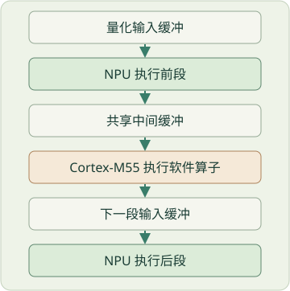

# STM32N657 的 Neural-ART 怎样映射一个端侧模型

端侧模型能否加速，先取决于哪些算子可以放到 NPU，以及权重、激活和工作区能否放入可用存储。本文采用 STM32N657，跟踪一个量化视觉子图经过编译、缓冲分配和执行的过程。

## 芯片、NPU 和编译器的职责

STM32N657 内含 Arm Cortex-M55 和 ST Neural-ART NPU。NPU 由流处理单元、专用运算单元和可配置的数据流互连组成。设备规格列出 4.2 MB 连续片上 SRAM，由不同存储区组成。NPU 与主机可访问共享系统存储。应用、编译配置和板载外存共同决定模型可用的内存池。 [STM32N657 数据表，第 3.3 和 3.5 节](https://www.st.com/resource/en/datasheet/stm32n657x0.pdf)

编译器输入包括模型、量化信息和目标内存池。它为支持的算子安排 NPU 硬件路径，分配输入、权重和中间缓冲，并生成运行时所用的配置与代码。ST 把一次硬件配置及其执行称为 **epoch**。若网络的一段需要 CPU 软件实现，运行时在该段执行前后处理依赖，并按需要维护缓存。 [Neural-ART 编程模型，ST Edge AI Core 4.1.0](https://stedgeai-dc.st.com/assets/embedded-docs/stneuralart_programming_model.html)

## 先看算子放置，再跟踪张量

假定输入已经预处理为 INT8。模型包含两个受当前配置支持的卷积，还包含一个需要 CPU 实现的操作。下面是示意路径，实际边界由编译结果决定。

CPU 消费中间张量前要确认数据可见，NPU 继续读取前也要等待 CPU 完成。在支持的条件下，ST 工具链可以选择混合硬件与软件实现，也可使用整数或浮点软件实现。若软件路径需要浮点，工具链会按规则插入反量化和再量化。缺少可用实现时，编译会报错。应结合算子配置和编译报告判断映射结果。 [Neural-ART 回退与委派规则](https://stedgeai-dc.st.com/assets/embedded-docs/stneuralart_programming_model.html#fall-back-and-delegate-mechanism)

## 一个中间张量占多少内存

假定 CPU 算子的输入和输出各为 32 × 32 × 16 个 INT8 元素。每个张量为 16 KiB。若输入和输出同时存活、各有独立缓冲，仅这两块就占 32 KiB。若软件还要将一份同形状输入展开成 FP32，且另外分配完整缓冲，则再需要 64 KiB。

这项估算需要与权重、NPU 工作区、应用缓冲以及各内存池的实际容量一起检查。缓冲跨段存活会影响峰值内存。放到板载外部 Flash 或 RAM 后，访问速度取决于对应接口及缓存配置。编译报告可以检查算子分配和各内存池用量，端到端时延需要在指定板卡与模型上测量。 [STM32N6 模型评估指南](https://stedgeai-dc.st.com/assets/embedded-docs/stneuralart_getting_started.html)

## 接下来怎么读

- 从一个完整的相机或控制周期分解推理截止时间。 [端侧推理约束](../../workload/06-chip-workload-analysis/edge-inference-chip-requirements.md)
- 进一步理解共享缓冲的可见性与数据搬运同步。 [DMA 同步与一致性](../../microarchitecture/05-dma/04-programming-model/synchronization-errors.md)
