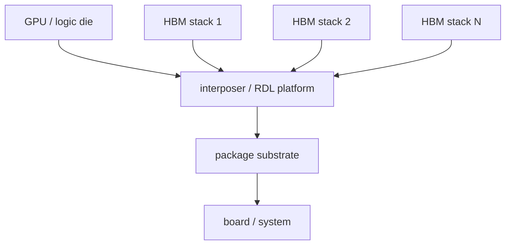
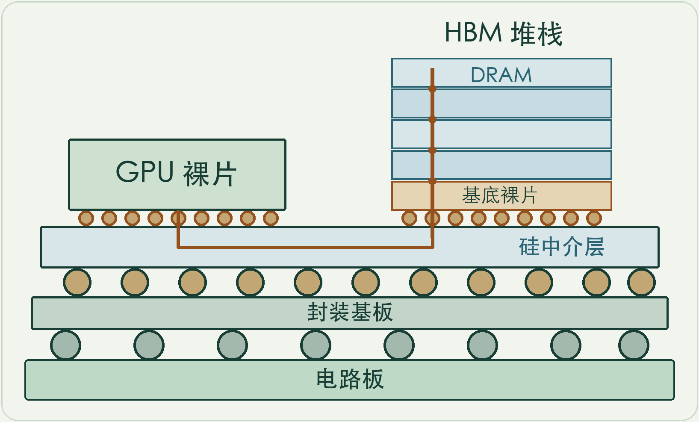
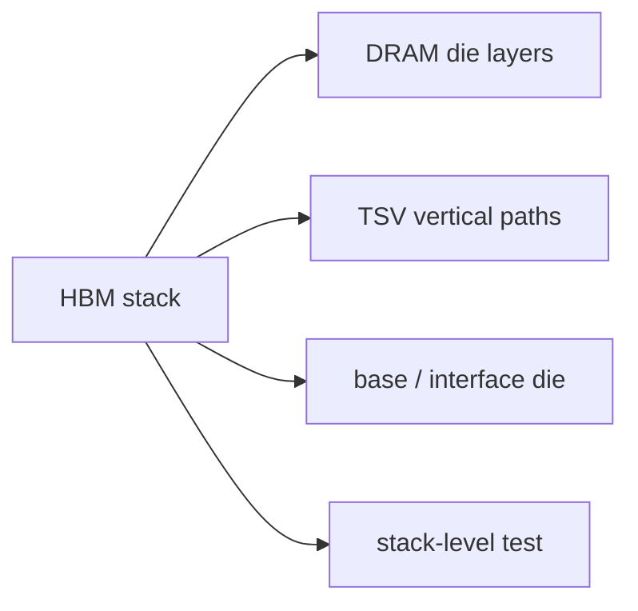
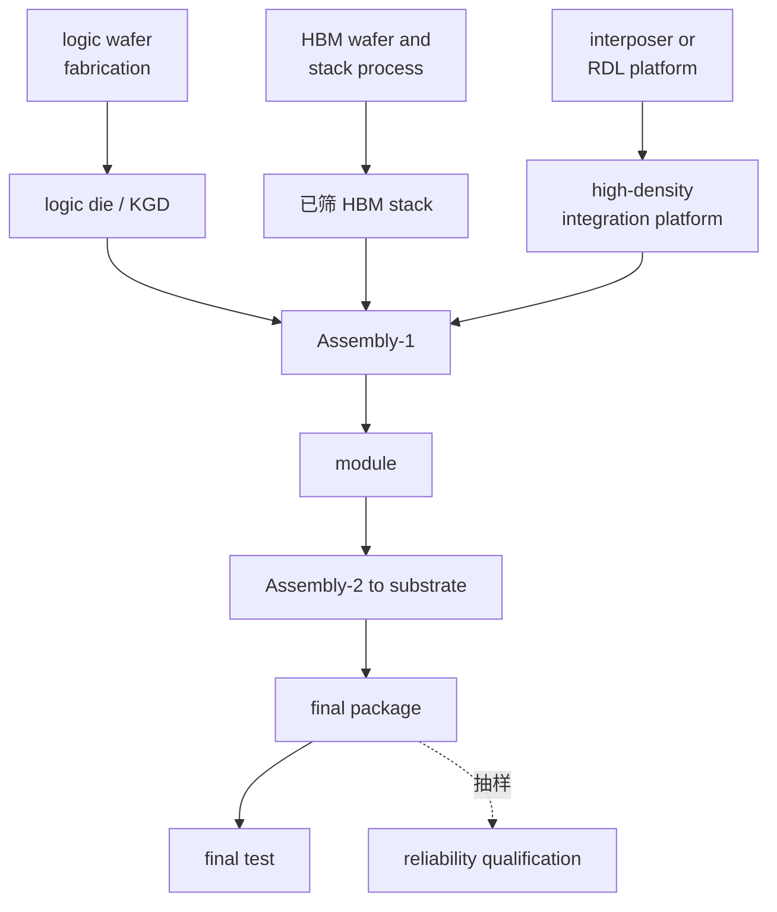

# AI GPU + HBM 封装的完整对象关系

上级:[HBM 制造与集成](README.md)
相关:[CoWoS-S 简化制造对象流](../2.5d-routes/cowos-s-complete-process.md), [HBM stack 是怎么制造出来的](hbm-stack-manufacturing.md), [热路径管理](../../06-cross-cutting-engineering/thermal-path-and-management.md)

## 这页在回答什么问题

AI GPU + HBM package 中到底有哪些对象，它们如何从 wafer、die、stack、interposer、substrate 逐步组成最终产品。

## 对象关系总图



这张图的关键是不要把 GPU die、HBM die、HBM stack、interposer、substrate 混成一个层级。AI GPU package 是多个高价值对象的系统集成。

## 同一个封装里，信号在哪一层横着走，又在哪里竖着走？ {#hbm-section}

[](../../../../../semiconductor-foundations/inverter-to-package/img/gpu-hbm-section.png)

从 GPU 裸片底部的一个信号凸点出发，沿棕线向下进入**硅中介层**，再向右走到 HBM 底部。GPU 和 HBM 并排安装，交换信号的密集走线由中介层提供。图中这种把并排裸片连起来的方式称为 **2.5D 集成**，可以在台积电的 CoWoS-S 剖面里找到相同的层次。[台积电的 CoWoS-S 硅中介层](https://3dfabric.tsmc.com/english/dedicatedFoundry/technology/cowos.htm)

再沿棕线往上，从 HBM 的基底裸片走向目标 DRAM 层。层间连接跨过两片裸片之间的界面，**硅通孔（TSV）**穿过硅，把垂直方向上的这段路径接通。这一段属于 **3D 堆叠**。棕线只标识走线所在的层次，实际信号还要经过接口电路；层数和厚度也都按示意绘制。继续向下看，中介层下方才是把电源和外部信号引向电路板的封装基板。[HBM 堆栈的制造与互连](hbm-stack-manufacturing.md) · [比较硅中介层、局部硅桥与 3D 键合](../README.md)

## HBM stack 内部层级



因此封装厂面对的不是“多颗 DRAM die 直接放在 GPU 旁边”，而是已经形成的 HBM stack。

## 完整制造对象流



Assembly-1 形成 logic + HBM 的高密度模块，Assembly-2 把该模块接入 substrate 和系统级封装。测试节点穿插在对象准备、模块形成和最终封装之后。

## PI 与热为什么必须在图里

AI GPU + HBM 的带宽不是只由 interface 宽度决定。高功耗 logic die 需要稳定 PDN，多个 HBM stack 需要低噪声接口，interposer/RDL 和 substrate 需要承担供电、decap 和回流路径。与此同时，logic 主热源与 HBM 邻近，热耦合会影响 HBM 温度；是否改变系统频率取决于明确的传感器和控制策略。

```text
bandwidth target
  -> interface width
  -> package routing / PDN
  -> thermal stability
  -> usable sustained performance
```

例如，多个 stack 虽然提高聚合峰值上限，若请求只访问一个 stack，持续带宽仍受该 stack 和控制器约束。邻近 logic 热点可能升高此 stack 温度；没有温度阈值、滞回和控制动作时，模型只报告温度或超规格，不生成调频。已筛 stack 的投入概率也不能重复乘内部裸片筛选率。

## 一句话理解

AI GPU + HBM package 是 logic KGD、已筛 HBM stack、高密度 interposer/RDL、substrate、热结构和测试节点共同组成的系统对象。

## 架构师启示

架构师画 GPU + HBM block diagram 时，必须把 package 也画进来。HBM stack 位置、NoC 到 memory controller 的流量、interposer routing、PDN、decap 和热路径共同决定最终可持续带宽，而不是逻辑接口宽度单独决定。
