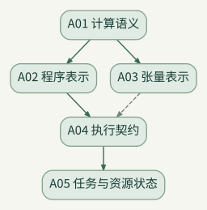

# 软件执行共同基础

程序写的是需要完成的计算，芯片接受的却是指令或任务。要理解两者怎样连接，需要先区分计算语义、表示形式、执行契约和任务状态。

## 贯穿算例与阅读边界

从 y = (a + b) * c 开始，记录值怎样产生与被使用；再比较同一张量的不同布局。把一次向量加法交给设备，观察搬入、计算、写回之后，哪个时刻结果可用。

本路线只建立软件可观察的语义，不提前深入 SSA 分析、静态分配、驱动或真实队列机制。A03 是张量路线的重要基础，普通标量程序可按需读。

## 知识关系

<figure class="micro-v2-map" markdown="1">

<figcaption>图中实线表示本专题内的主要前置关系，虚线表示按场景参考；跨专题先修知识见下表。 点击可查看大图。</figcaption>
</figure>

## 阅读顺序 {#计划阅读顺序}

本专题规划 5 篇正文。 A01、A02 已发布并核验；其余为未发布的阅读计划。标题与范围可在编写时根据认知目标调整。

| 编号 | 文章（暂定标题） | 读完应理解什么 | 主要前置知识 | 状态 |
| --- | --- | --- | --- | --- |
| A01 | [同一段计算，软件究竟要求计算机做什么？](a01-program-semantics.md) | 程序语义、值与变量、函数、状态、副作用；区分计算结果和可观察行为。 | 基本编程 | 已发布 |
| A02 | [程序中的计算、分支和先后关系怎样被明确表达？](a02-program-representation.md) | 数据流、控制流、计算图、IR、依赖关系的表达；认识不同抽象层次。 | A01 | 已发布 |
| A03 | 同一个张量，为什么可以在内存中有不同的排列？ | Shape、Dtype、Stride、Layout、索引到地址、转置视图、动态维度。 | A01 | 未发布 |
| A04 | 软件怎样把一项计算交给硬件？ | ISA、ABI、编程模型、指令、Kernel、任务、资源抽象与可执行产物的接口。 | A01、A02；张量场景参考 A03 | 未发布 |
| A05 | 一项任务被提交之后，什么时候结果才可以使用？ | 接纳、就绪、执行、完成、可见性、同步、资源所有权与生命周期。 | A04 | 未发布 |

## 从哪里来，接下来往哪读

可直接进入：已有基本编程即可开始，不要求先深入计算微架构。

后续方向：[编译前端与程序优化](../02-frontend-and-optimization/README.md)、[资源映射与执行规划](../03-mapping-and-planning/README.md)、[设备驱动与底层资源管理](../05-device-driver/README.md)、[通用执行运行时](../06-execution-runtime/README.md)。

更多阅读路线见[编译器与运行时系统系列首页](../README.md)。
