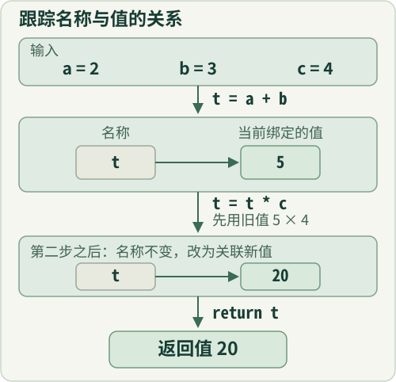

# 同一段计算，软件究竟要求计算机做什么？

假设我们要计算三个数：先将 2 与 3 相加，再将结果乘以 4。无论使用 CPU，还是将这项计算交给某种专用计算设备，我们都希望得到 20。

但软件的要求可能不只有这个数。如果程序还要求把 20 写入历史记录，后来读取这份记录时，就应当能看到新加入的 20。只计算出正确的数，却没有更新记录，程序仍然没有完成要求的工作。

**程序语义（Program Semantics）**描述程序在给定输入和执行条件下应当具有怎样的行为。编译器需要理解这些要求，才能改变程序的实现方式；运行时需要遵守相应的执行约定，才能正确交付结果。

本篇先不关心代码怎样变成指令，只跟踪值如何产生、程序状态如何变化，以及这些变化中哪些能够被程序的使用者观察到。

## 一句表达式要求完成什么计算？ {#values-and-expressions}

我们用 Python 写出这项计算：

```python
a = 2
b = 3
c = 4
y = (a + b) * c
```

这里的 2、3、4 都是值（Value）。`a`、`b`、`c` 是变量名，用来在后续计算中引用对应的值。`a + b` 是一个表达式：根据加法的规则读取当前的两个值，产生结果 5。

整个表达式 `(a + b) * c` 还需要使用刚得到的 5 和 `c` 当前的值 4，才能算出 20。最后，赋值语句 `y = ...` 让名称 `y` 引用计算结果。

值还具有类型（Type）。在这个例子中，我们使用 Python 内置整数，所有计算都是精确的整数运算。若把 `a` 和 `b` 改为字符串 `"2"` 和 `"3"`，同样写 `a + b`，结果会是字符串 `"23"`。类型也是理解运算含义所必需的信息。

因此，仅知道程序中出现了 `+` 和 `*` 两个符号还不够。我们至少还要知道每项操作取得什么值、这些值是什么类型、操作应当产生什么结果。

[Python 3.13 语言参考：对象、值与类型](https://docs.python.org/3.13/reference/datamodel.html#objects-values-and-types)

## 为什么同一个变量可以先表示 5，再表示 20？ {#state}

把这项计算拆开写，使用一个变量 `t`：

```python
t = a + b
t = t * c
```

第一句让 `t` 引用 5。执行第二句时，右边的 `t * c` 先取得 `t` 当前的值 5，再与 4 相乘。产生新值 20 后，左边的 `t` 才改为引用 20。

如果把 `t` 看作数学中的一个未知数，`t = t * 4` 就很奇怪。但程序中的赋值描述的是一次状态更新：先使用更新前的值进行计算，再更新名称的绑定。

| 执行到哪里 | `a` | `b` | `c` | `t` |
| --- | ---: | ---: | ---: | --- |
| 两句之前 | 2 | 3 | 4 | 尚未绑定 |
| `t = a + b` 之后 | 2 | 3 | 4 | 5 |
| `t = t * c` 之后 | 2 | 3 | 4 | 20 |

在当前观察模型中，记录各名称现在引用的值，就能解释这些语句怎样改变**程序状态（Program State）**。状态还可能包含可变对象中的数据、执行到的位置等信息。我们只记录解释当前问题所需的部分。

Python 的整数对象本身不可变。这里改变的是 `t` 引用哪个值，而不是把原来的整数 5 修改成 20。其他语言可能将变量定义为可读写的存储位置，但源程序中的变量名通常不足以确定它会使用哪个物理寄存器或地址。

[Python 3.13 语言参考：赋值语句](https://docs.python.org/3.13/reference/simple_stmts.html#assignment-statements)

## 函数返回了一个数，还留下了什么？ {#functions}

如果很多地方都需要这项计算，可以将刚才的两条语句写成一个函数（Function）：

```python
def evaluate(a, b, c):
    t = a + b
    t = t * c
    return t

y = evaluate(2, 3, 4)
```

调用时，传入的三个值分别作为本次计算的参数。函数体产生中间值 5 和结果 20，`return t` 将结果交还给调用者，随后调用者将返回值绑定给 `y`。

<figure markdown="1">

[](assets/a01-values-and-state.svg)

<figcaption>图中每个阶段表示程序语义上的状态变化，不表示真实的时钟边沿、寄存器或内存位置。</figcaption>
</figure>

`t` 是函数中的局部变量。调用结束后，调用者可以使用返回的 20，却不需要知道这次计算是否使用过一个叫 `t` 的局部名称。

如果只关心这个接口规定的输入和返回值，也可以写成下面这样：

```python
def evaluate_direct(a, b, c):
    return (a + b) * c
```

在本文的整数输入条件下，这两种写法要求相同的算术结果。对于不观察函数内部临时名称的调用者，是否存在一个名为 `t` 的变量不是接口要求。

但如果一个函数还会修改其他地方的数据，那么只记录返回值，就不足以描述一次完整调用。

[Python 3.13 语言参考：return 语句](https://docs.python.org/3.13/reference/simple_stmts.html#the-return-statement)

## 两个函数都返回 20，为什么仍可能有不同的行为？ {#side-effects}

假设调用者还持有一份历史记录 `history = [7]`。我们比较两个函数，给它们相同的初始数据和参数。第一个函数不修改历史记录，第二个函数把本次结果追加到记录中：

```python
def evaluate_plain(a, b, c, history):
    return evaluate(a, b, c)

def evaluate_and_record(a, b, c, history):
    result = evaluate(a, b, c)
    history.append(result)
    return result
```

Python 的列表是一种可变对象。调用者将列表传给函数时，函数中的 `history` 引用同一个列表对象。`append` 改变的是列表的内容，而不只是某个局部名称的绑定。

分别执行下面两次调用。每次调用都从独立的 `[7]` 开始，避免把上一次调用留下的状态当成本次的初始状态。

| 调用 | 返回值 | 调用前的 `history` | 调用后的 `history` |
| --- | ---: | --- | --- |
| `evaluate_plain(2, 3, 4, history)` | 20 | `[7]` | `[7]` |
| `evaluate_and_record(2, 3, 4, history)` | 20 | `[7]` | `[7, 20]` |

<figure markdown="1">

[![两个调用的初始参数和历史记录内容相同，均返回 20；不修改记录的调用保留 [7]，写入记录的调用则让调用者之后读到 [7, 20]。](assets/a01-observable-behavior.svg)](assets/a01-observable-behavior.svg)

<figcaption>返回值相同，调用者能够读取的外部状态却不同。</figcaption>
</figure>

第二个函数除了计算和返回一个值，还改变了调用者能够访问的数据。这是一次**副作用（Side Effect）**。向文件写入内容、打印信息等操作，也可能产生返回值之外必须保留的效果。

这里要区分函数内部的状态变化与外部可观察的状态变化。前面的 `evaluate` 同样更新了局部变量 `t`，但普通调用者无法在函数返回后读取这次局部绑定，因此它不是上述接口所关心的外部副作用。

### 如果函数只读取外部状态呢？ {#hidden-inputs}

假设函数在返回前还读取了历史记录的最后一个数，返回 `evaluate(a, b, c) + history[-1]`，却没有修改历史记录。

当 `history` 最后一个数是 7 时，返回 27；当它是 10 时，返回 30。函数没有写入列表，但结果取决于列表当时的内容，而不只取决于三个整数。

因而，理解函数时要分别问两个问题：它需要读取哪些输入或状态？它返回什么、又可能改变哪些状态？在本文的观察范围内，只由输入决定结果并且没有外部副作用的 `evaluate`，可以看作一个纯函数（Pure Function）。

[Python 3.13 函数式编程指南：函数、状态与副作用](https://docs.python.org/3.13/howto/functional.html#introduction)

## 最终的数和状态都一样，行为就一定一样吗？ {#observable-behavior}

假设在计算中我们还要把中间结果 5 和最终结果 20 打印出来。下面两种写法都返回 20，不改变历史记录，却给出了不同的输出顺序：

```python
def report_first(a, b, c):
    t = a + b
    y = t * c
    print(t)
    print(y)
    return y

def report_reverse(a, b, c):
    t = a + b
    y = t * c
    print(y)
    print(t)
    return y
```

第一种先输出 5，再输出 20；第二种先输出 20，再输出 5。如果这些输出是程序需要提供的结果之一，即使两次调用的返回值与最终列表内容相同，也不能交换这两个输出操作。

在这里，我们把调用者或其他相关观察者按约定可以取得的结果、状态变化和输出等行为称为可观察行为（Observable Behavior）。对于不同语言和接口，规定观察什么、怎样观察，可能有不同的规则。

于是，可以用下面的问题描述本文中的一次函数调用：

| 观察对象 | 要问的问题 |
| --- | --- |
| 输入与起始状态 | 本次使用的值、类型和已有数据是什么？ |
| 计算结果 | 正常返回时，结果应当是什么？ |
| 状态变化 | 哪些数据要保持不变，哪些要更新？ |
| 可观察的动作 | 是否需要输出、写入或按照规定的顺序产生某些效果？ |

这还不是所有程序语义的完整清单。例如，程序还可能要求在某种输入下报告错误，或者规定多个并发操作之间允许观察到哪些结果。本文以正常结束的单次调用建立共同认识，其他情况将在需要时补充。

## 既然程序已经写出了每一步，计算机为什么还能选择其他实现？ {#semantics-and-implementation}

回到 `evaluate`。源程序先给 `t` 绑定 5，再给它绑定 20。实际执行时，机器未必需要为 `t` 专门分配一个带有这个名称的存储位置。

在允许这样实现的语言及观察条件下，5 可以暂时保存在某个寄存器里，也可以由后续运算直接使用。若三个参数在执行前就已确定为 2、3、4，某些编译器还可以提前计算出 20，避免真正执行这两项算术运算。

但假如接口要求更新历史记录，提前算出 20 并不足以完成任务。无论采取哪种计算方案，都仍要保证随后读取记录的调用者能够得到约定的内容。

这就是为什么要区分软件要求的行为与实现这些行为的具体手段。C11 公开委员会草案 N1570 的 5.1.2.3 节就是一个具体例子：语言描述抽象执行语义，而实现可以省略不需要的求值，前提是保留规范要求的可观察行为。

这条 C 语言规则不能直接代替其他语言的规范。改变程序实现时，还要考虑具体的数值类型、允许的精度、异常和观察条件。例如数学上相等的两个式子，采用有限精度浮点数执行时，可能因舍入顺序不同而得到不同结果。

[ISO C11 公开委员会草案 N1570，§5.1.2.3 Program execution](https://www.open-std.org/jtc1/sc22/wg14/www/docs/n1570.pdf) · [计算微架构：浮点数与低精度](../../microarchitecture-v2/01-foundations/a04-floating-point-and-low-precision.md)

## 从程序语义到执行 {#summary}

在本文中，我们一直跟踪同一项计算 `(a + b) * c`，但观察范围逐渐扩大：先看表达式产生的值，再看变量和对象的状态，最后看调用者能够观察到的返回结果、状态变化和动作顺序。

从编译器的角度，需要明确程序的这些要求，才能判断改变表示或实现后是否仍然正确。从运行时的角度，则需要确保计算被实际执行，并在约定的观察边界交付结果及相关效果。

[计算微架构 B01：指令与架构状态](../../microarchitecture-v2/02-cpu/b01-instructions-and-architectural-state.md#architectural-state)曾从硬件侧区分软件可见状态和内部实现状态。两者处于不同层次：源程序规定计算行为，机器指令进一步规定目标处理器应实现的行为。

下一篇 [A02：程序中的计算、分支和先后关系怎样被明确表达？](a02-program-representation.md) 将继续使用这组计算。如果程序中出现多项计算、分支或外部状态的读写，软件怎样明确表示每一项操作需要什么数据，以及哪些步骤必须保持先后关系？

返回[软件执行共同基础导读](README.md)。
