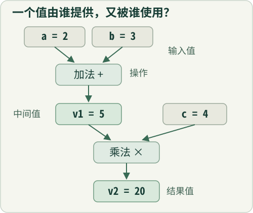
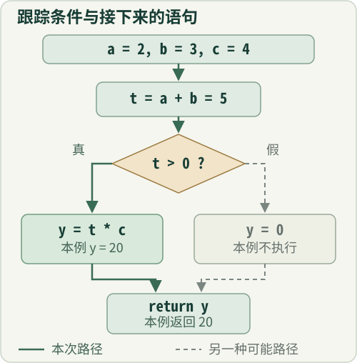

# 程序中的计算、分支和先后关系怎样被明确表达？

[A01](a01-program-semantics.md) 中，我们用三个整数计算 `(a + b) * c`，并观察了程序如何产生值、改变状态，以及哪些行为需要保留。

如果要把这段程序交给编译器，或者将其中一部分计算交给其他执行设备，软件就需要明确知道：每项操作使用哪个值？在什么条件下才需要执行？哪些操作必须保持先后关系？

本文将沿用 a = 2、b = 3、c = 4 的算例，逐步把这些关系表达出来。**数据流**描述值从哪里产生、被哪里使用；**控制流**描述程序允许沿哪些路径执行。程序还可能读写外部状态，需要表达相应的顺序约束。

将这些信息组织成具有明确语义、便于软件处理的表示，是中间表示（IR）的重要用途。

## 为什么需要区分同一个变量在不同时刻的值？ {#value-dependencies}

先回到 A01 的函数：

```python
def evaluate(a, b, c):
    t = a + b
    t = t * c
    return t
```

第一句执行后，`t` 引用整数 5；第二句读取这个 5，与 4 相乘后，再让 `t` 引用整数 20。如果只记录两条语句都使用了 `t`，就难以区分乘法和 `return` 分别使用的是哪一个值。

给这两次运算产生的值分别取一个名称：v1 和 v2。于是可以准确描述：加法产生 v1，乘法使用 v1 和 c 产生 v2，函数返回 v2。

| 操作 | 需要的值 | 产生的值 |
| --- | --- | --- |
| 加法 | a = 2，b = 3 | v1 = 5 |
| 乘法 | v1 = 5，c = 4 | v2 = 20 |
| 返回 | v2 = 20 | 将 20 交还给调用者 |

现在我们不再只关注源代码中变量的名字，而是追踪每个值是由谁产生、又会被谁使用。这里给值编号是为了建立认知，不要求所有程序表示都采用这种命名方式。

## 怎样把值的生产和使用关系画成一张图？ {#dataflow}

既然我们已经知道每项运算需要哪些值，就可以把运算画成节点，用箭头标记这些值从哪里来、被送给哪个运算使用。

<figure markdown="1">

[](assets/a02-value-flow.svg)

<figcaption>这是程序的计算关系图。箭头不表示数据必须经过哪段物理连线，也不表示一个时钟周期。</figcaption>
</figure>

乘法需要加法的结果，所以它们之间存在一条**数据依赖（Data Dependency）**。只看这条关系，就能知道在按图直接计算时，必须先取得 v1 才能求出 v2。

这类由值的生产与使用形成的关系称为数据流（Data Flow）。用节点和边来表达计算及其数据关系，就构成了一种计算图（Computation Graph）。

关系图不需要为所有操作安排一个确定的先后顺序。比如除了求 `a + b`，我们还要独立求 `c + c`。两个加法只依赖各自的输入，彼此不需要对方的结果。

在本文小整数、正常执行且没有其他副作用的条件下，可以先算出 5，也可以先算出 8，或者同时进行两个加法。这张图说明需要满足哪些关系，但还没有确定实际的执行时间或资源分配。

实际芯片能否并行执行，要看运算资源和数据是否已经就绪。本篇只讨论软件表达的计算关系，不决定硬件怎样调度。

[计算微架构 A08：依赖与调度](../../microarchitecture-v2/01-foundations/a08-dependencies-and-scheduling.md#dependency)从硬件侧解释这些问题。

## 为什么有些运算只在特定条件下才需要执行？ {#control-flow}

前面的图有一个简单的前提：函数每次正常执行时都要完成加法和乘法。现在增加一个条件，只有 a + b 大于 0 时才需要乘以 c，否则直接返回 0。

```python
def evaluate_if_positive(a, b, c):
    t = a + b
    if t > 0:
        y = t * c
    else:
        y = 0
    return y
```

在 a = 2、b = 3、c = 4 时，t = 5，条件成立，执行乘法，最后返回 20。若改用 a = −5、b = 3、c = 4，t = −2，条件不成立，按源程序语义不执行该分支中的乘法，返回 0。

如果只把比较、乘法和返回画成由值连接的节点，就缺少一项重要信息：比较的结果决定哪些操作会被执行，以及返回时使用哪条路径产生的 y。

为此，可以把程序可能经过的路径单独画出来：

<figure markdown="1">

[](assets/a02-branch-flow.svg)

<figcaption>箭头表示可能的控制转移，而不是值沿着线传递。图包含两条可能路径；本次调用只经过真分支。</figcaption>
</figure>

**控制流（Control Flow）**描述程序可能按怎样的路径继续执行。在图中的条件节点，比较结果决定下一条路径。两条路径随后汇合，返回的 y 来自本次真正经过的分支。

数据流和控制流因此可以互相影响。比较 `t > 0` 需要加法产生的 t，这是数据关系；比较的真假决定执行哪一段代码，这是控制关系。

循环同样需要控制流来表达。例如从 t = 5 开始，反复执行 `t = t + c`，直到指定次数。程序在一次迭代结束后可能返回前面的判断位置；下一次迭代又需要上一次得到的 t。

因此，一次实际执行经过的路径与用于描述程序所有可能路径的图是两个不同的对象。程序表示还可以包含回到先前节点的边，不能将所有程序都直接表示为前面那种无环的算术图。

[Python 3.13 语言参考：if 语句](https://docs.python.org/3.13/reference/compound_stmts.html#the-if-statement) · [while 语句](https://docs.python.org/3.13/reference/compound_stmts.html#the-while-statement)

## 没有值从一项操作传给另一项，为什么仍可能需要保持顺序？ {#effect-dependencies}

回忆 [A01 的输出顺序算例](a01-program-semantics.md#observable-behavior)。算出两个值之后，我们希望先打印 t，再打印 y：

```python
def report(a, b, c):
    t = a + b
    y = t * c
    print(t)
    print(y)
    return y
```

当 t = 5、y = 20 都已产生时，两个 `print` 获得了各自需要的值。第二个 `print` 没有使用第一个 `print` 的返回值。因此，只看普通的算术值依赖，不足以保证两次输出是按 5、20 的顺序发生。

这两项操作都影响调用者能观察到的输出。若交换它们，输出就变成 20、5。要保留程序规定的行为，还需要表达这两次操作之间的必要顺序。

再看 A01 的历史记录，将结果追加，然后读取最新的一项：

```python
def record_and_read(a, b, c, history):
    y = evaluate(a, b, c)
    history.append(y)
    latest = history[-1]
    return latest
```

假设调用前 `history = [7]`，且在本次调用期间没有其他操作修改它。两种执行顺序分别会发生什么？

| 操作顺序 | 返回的 latest | 最终 history |
| --- | ---: | --- |
| 先追加 20，再读最后一项 | 20 | `[7, 20]` |
| 先读最后一项，再追加 20 | 7 | `[7, 20]` |

即使两个顺序最终留下相同的列表，它们读取到的值也不同。原因是读操作使用的数据取决于先前的写操作是否已经改变了列表。

这并不要求所有读写都互相等待。如果访问的是互不影响的对象，约束可能不同。但要判断哪些操作可以改变顺序，必须先知道它们访问了哪些状态，以及语言和接口要求保留哪些效果。

这类顺序要求可以通过读写状态的描述、规定的操作序列或显式的依赖关系来表达；不同表示不必都额外绘制一种箭头。具体怎样分析依赖与副作用，以及判断变换是否合法，留给后续编译专题。

[MLIR：Side Effects & Speculation](https://mlir.llvm.org/docs/Rationale/SideEffectsAndSpeculation/) 以其控制流区域为例说明了为何除了值依赖，还需要建模操作对可变资源的访问及其他行为。

## 怎样让软件能够直接处理这些关系？ {#intermediate-representation}

至此，我们已经能在纸上画出数据关系、控制路径，并指出状态访问产生的顺序要求。但编译器还需要在程序内部保存和处理这些信息，例如查询某个值从哪里来，检查它被哪些操作使用。

假设把 A01 的算术函数改写为下面的形式。每个操作都具有明确的名字、输入值和结果值：

```text
v1 = add(a, b)
v2 = mul(v1, c)
return v2
```

这段教学记法没有指定任何芯片的指令编码。读到 `mul` 时，软件可以明确查找它需要的 v1，再找到产生这个值的 `add`。

进一步给操作和值补充类型等语义信息，就可以建立**中间表示（Intermediate Representation，IR）**。它是软件用来保存、分析或转换程序信息的一种表示形式。

例如，以下是使用 MLIR 的 `func` 和 `arith` 操作表示同一组算术关系的一个实际写法：

```mlir
func.func @evaluate(%a: i32, %b: i32, %c: i32) -> i32 {
  %v1 = arith.addi %a, %b : i32
  %v2 = arith.muli %v1, %c : i32
  func.return %v2 : i32
}
```

其中 `i32` 表示 32 位整数类型，`%v1` 和 `%v2` 标识不同的结果值。输入 2、3、4，结果仍是 20。此处只比较能在该位宽下正确表示的小整数算例，不将固定宽度运算等同于 Python 的任意精度整数语义。

IR 也能够表达分支、循环、调用和状态访问，但不同 IR 对这些行为采用的表示方式可能不同。例如 MLIR 既有表示结构化 `if` 的 `scf.if`，也支持用条件跳转描述控制路径。

[MLIR Language Reference](https://mlir.llvm.org/docs/LangRef/) · [整数算术操作](https://mlir.llvm.org/docs/Dialects/ArithOps/) · [结构化控制流](https://mlir.llvm.org/docs/Dialects/SCFDialect/)

### 计算图和 IR 是同一个东西吗？

计算图可以成为 IR 的一种形式。它也可以只是从程序中提取的某些关系的示意图，并不包含完整的程序语义。

IR 并不要求在屏幕上显示为图。例如刚才的 MLIR 可以打印成文本，也可以由编译器保存为内存中的操作和值对象。关键是表示本身有明确的语义与结构，软件知道该怎样解释和操作它，而不是采用哪一种显示形式。

实际算子图也有各自的约束。例如 [ONNX IR 规范](https://onnx.ai/onnx/repo-docs/IR.html#graphs)规定计算图包含无环、按拓扑顺序列出的节点。

单张图无环也不等于模型不能表达循环：ONNX 可以用 [Loop 算子](https://onnx.ai/onnx/operators/onnx__Loop.html)及其子图表示循环。不能把单张图的约束推广到所有 IR 或所有程序。

## 为什么同一项计算还需要不同层次的表示？ {#levels-of-representation}

把 a、b 从两个数推广成两组数 A、B，每个位置上的对应元素相加。我们既可以把整组加法视为一个操作，也可以将其描述为许多次小整数加法。

假设两组数分别为 [2, 1] 和 [3, 4]，则结果是 [5, 5]。这是后续张量加法的最小算例之一。两种描述都可以表达这项计算，但它们强调的信息不同。

| 表示层次 | 可以明确表达什么 |
| --- | --- |
| 算子级表示 | 对整组数进行逐元素加法，以及输入、输出之间的关系 |
| 循环级表示 | 遍历哪些位置，怎样取得对应元素并写入结果 |
| 指令级或任务级表示 | 目标设备可以理解的具体操作及其参数和所需资源接口 |

较高层的表示便于整体理解和组织计算。较低层的表示则能表达更多与具体实现有关的决定。例如某个循环如何读取元素、或者哪类目标指令负责完成加法。

从较高层的表示转到更接近实现的表示，通常称为降低（Lowering）。过程中可以拆分或组合操作，但仍要保持原程序和接口约定的语义。具体怎样选择实现、怎样验证变换，后续专题会深入解释。

这几个层次只是本文用于建立认知的例子。不是每套编译器都必须具备完全相同的三层 IR，也不是只有编译器才能利用这些表示来组织工作。

## 从表示到下一步问题 {#summary}

我们从 A01 的值与状态出发，建立了三种需要明确的关系：值如何产生和使用、程序可能经过哪些路径、读写与副作用需要保留哪些顺序。

IR 可以组织这些信息，供软件查询和处理。但计算图中的输入和值，仍然没有确定实际存储在什么位置；操作节点也不一定能直接交给硬件执行。

接下来，[A03：同一个张量，为什么可以在内存中有不同的排列？](a03-tensor-representation.md) 将把前面的数扩展为张量，区分逻辑上的元素与实际存储排列。A04 将进一步解释软件怎样把计算关系转换为硬件能够接受的工作，以及软件与设备之间需要哪些共同约定。

返回[软件执行共同基础导读](README.md)。
