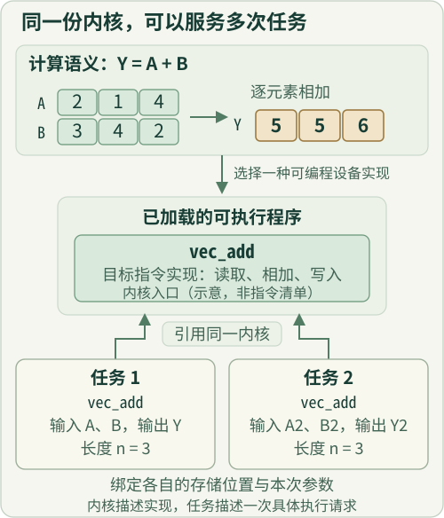

# 软件怎样把一项计算交给硬件？

[A01](a01-program-semantics.md) 明确了程序要求完成什么，[A02](a02-program-representation.md) 解释了怎样表示计算和依赖关系，[A03](a03-tensor-representation.md) 则建立了张量元素与存储地址的关系。

现在取 A03 中两个矩阵的第一行，进行一次向量加法。输入 A = [2, 1, 4]、B = [3, 4, 2]，希望得到 Y = [5, 5, 6]。我们知道结果应该是什么，但芯片并不能只凭 `Y = A + B` 就确定要做哪些工作。

软件和硬件之间需要一套共同的约定：哪些操作可以执行，数据从哪里取，参数怎样传递，以及怎样启动一次工作。本文将这些约定统称为**执行契约（Execution Contract）**。

下面从一条 CPU 指令出发，逐步理解设备端的计算内核、任务及执行入口。不讨论这些工作怎样在硬件内部调度，也不提前研究驱动队列和任务完成机制。

## CPU 怎样知道要执行一次加法？ {#isa}

先只计算 A[0] + B[0]，即 2 + 3。假设一个 RISC-V RV32I 处理器的整数寄存器 x12 已经保存 2，x13 保存 3，希望将加法的结果写入 x14。

```asm
add x14, x12, x13
```

这是一条 RISC-V 整数加法指令的汇编表示。它规定读取哪个寄存器、进行什么运算、将结果写入哪个寄存器。在本例中，执行后 x14 的值为 5。其他输入的结果则遵循相应位宽的整数运算规则。

指令的二进制编码、软件可见的寄存器以及每条指令的行为等，由**指令集架构（Instruction Set Architecture，ISA）**规定。

这样，软件不需要知道处理器用了什么结构的加法器、经历几个流水级，仍然可以给出硬件能够解释的指令。不同的处理器实现可以遵守相同的 ISA。

但 ISA 中的这条加法指令没有告诉我们：如果另一段程序调用这个加法函数，应该把两个操作数放在哪两个寄存器中？计算完成后，调用者又到哪里取结果？

[RISC-V RV32I 指令集规范](https://docs.riscv.org/reference/isa/v20260120/unpriv/rv32.html) · [计算微架构 B01：指令与架构状态](../../microarchitecture-v2/02-cpu/b01-instructions-and-architectural-state.md#instruction)

## 为什么有了 ISA，还需要 ABI？ {#abi}

假设我们将这项加法写成一个函数 `add_two(a, b)`，由另一段程序调用。函数和调用方可能分别编译。如果没有共同约定，调用方把 2 放在 x12 中，而函数却从 x10 中读取，就无法完成正确的计算。

需要规定的不只是源程序形参的名称，而是已经编译后的软件怎样传递参数、返回值和保存状态。这类二进制接口约定称为 ABI（Application Binary Interface）。

以 RISC-V 的基本整数调用约定为例，a0、a1 是前两个整数参数寄存器，分别对应 x10、x11。返回一个这样的整数时，结果也放在 a0。

```asm
add_two:
    add a0, a0, a1
    ret
```

这是针对该调用约定的小整数加法函数示例，`ret` 是汇编伪指令。调用方按约定准备 a0 = 2、a1 = 3 及正确的返回地址；函数执行后将 5 留在 a0，再返回调用方。

| 共同约定 | 本例中规定的内容 |
| --- | --- |
| ISA | `add` 读取哪些寄存器、写入什么结果；跳转指令如何改变执行位置 |
| ABI | 参数从哪个寄存器传入、返回值从哪个寄存器取得 |

ABI 还可以规定栈、数据类型的二进制表示及目标文件等接口。本文只用参数传递说明它的作用。CPU 仍按 ISA 执行指令，并不会替调用方检查两段软件是否遵守同一套函数调用约定。

[RISC-V psABI：整数调用约定](https://riscv-non-isa.github.io/riscv-elf-psabi-doc/#_integer_calling_convention)

## 如果需要计算三个元素，硬件接收的还只是一条指令吗？ {#programming-model}

回到向量加法。Y 的每个元素都需要读取 A、B 的对应值，再相加并写出结果。软件可以用循环表示这个计算：

```c
for (int i = 0; i < 3; ++i) {
    Y[i] = A[i] + B[i];
}
```

对于只提供标量运算指令的目标，软件需要组织多次取数、加法和写入。对于其他目标，软件可以使用硬件所支持的、更高层次或更并行的操作。

不同目标允许软件怎样组织工作、引用数据、描述并行执行实体和可用资源，这些约定构成了**编程模型（Programming Model）**的重要部分。

| 编程模型中的一种计算表达 | 软件可以怎样描述工作 |
| --- | --- |
| 标量指令 | 每次指定一组标量操作数 |
| 向量指令 | 指定一组元素上的运算及相应参数 |
| SIMT（单指令、多线程） | 编写线程程序，让线程根据各自标识处理不同元素 |
| 张量或 Tile（数据块）操作 | 利用接口提供的矩阵、数据块等操作原语 |
| 任务或命令式接口 | 指定引擎可执行的工作类型、数据位置和任务参数 |

这些是从不同目标的接口中提取的观察方式，不是互斥的芯片分类。例如一个 GPU 可以同时提供线程编程模型和矩阵运算指令；某个加速器也可以同时提供计算程序与数据搬运命令。

[计算微架构 C01：标量、SIMD 与向量执行](../../microarchitecture-v2/03-parallel-execution/c01-scalar-simd-and-vector-execution.md) · [C02：SIMT 与 Warp](../../microarchitecture-v2/03-parallel-execution/c02-simt-and-warp-scheduling.md)

## 一组计算关系怎样成为可被调用的计算内核？ {#kernel}

以 CUDA 的线程编程模型为例。我们希望每个软件线程处理一个元素。它需要能够访问三组数据 A、B、Y，还需要知道这一次计算共有多少个元素。

下面是一个使用 CUDA C++ 的简单计算内核（Kernel）。假设每个元素为 32 位有符号整数，输入数据和中间结果都符合该类型的表示范围，且三组数据连续存放、彼此不重叠。

```cpp
#include <stdint.h>

__global__ void vec_add(const int32_t* A,
                        const int32_t* B,
                        int32_t* Y, int n) {
    int i = blockIdx.x * blockDim.x + threadIdx.x;
    if (i < n) {
        Y[i] = A[i] + B[i];
    }
}
```

`vec_add` 定义了在设备端执行的计算过程。每个线程根据自己的索引 i 取得对应元素，然后将结果写入 Y。这里的 Kernel 指设备侧可调用的计算实现，不是操作系统的内核。

与 A02 中的加法算子相比，Kernel 更进一步明确了实现方式：如何将计算分给线程、怎样访问元素、怎样处理超出元素范围的线程。但 CUDA C++ 源代码还不是目标 GPU 可以直接执行的机器指令。

假设设备端已经准备好了三组数据对应的存储区，主机侧可以发起这样一次 Kernel 调用（Launch）：

```cpp
vec_add<<<1, 4>>>(d_A, d_B, d_Y, 3);
```

这里的 `<<<1, 4>>>` 表示启动一个线程块（Block），每块包含 4 个线程。`d_A`、`d_B`、`d_Y` 是目标设备可访问的对应数据地址，3 是这次需要处理的元素数。

| 线程索引 i | 工作 | 结果 |
| ---: | --- | --- |
| 0 | A[0] + B[0] | Y[0] = 5 |
| 1 | A[1] + B[1] | Y[1] = 5 |
| 2 | A[2] + B[2] | Y[2] = 6 |
| 3 | i 不小于 n，跳过读写和加法 | 不写入 Y |

这里选择 4 个逻辑线程，是为了演示不属于有效元素的线程怎样避免访问越界。本例不代表推荐的 GPU 线程块大小，也不表示硬件必须有 4 个独立的加法单元或让所有线程同时执行。

线程、线程块和网格（Grid）是 CUDA 提供给软件的执行资源组织方式。设备有自己的资源容量和调度机制，软件给出的并行规模以及共享存储等资源需求还要满足目标设备的限制。

[CUDA Programming Model](https://docs.nvidia.com/cuda/cuda-programming-guide/01-introduction/programming-model.html) · [计算微架构 C03：GPU 资源与执行效率](../../microarchitecture-v2/03-parallel-execution/c03-gpu-resources-and-execution-efficiency.md)

## 为什么只知道 Kernel 的名字，还不足以启动一次计算？ {#task-parameters}

`vec_add` 可以反复使用。每次调用可能处理不同的输入，并将结果写到不同的位置。因此必须区分计算过程的定义与某一次具体的工作。

<figure markdown="1">

[](assets/a04-execution-layers.svg)

<figcaption>在图中的可编程设备例子里，Kernel 是可以复用的计算实现；具体调用绑定本次参数形成工作实例。两次调用不要求实际并行执行。</figcaption>
</figure>

为了执行本次加法，调用者至少需要按相应的接口约定准备这些信息：

| 本次工作所需的约定 | 在本例中的含义 |
| --- | --- |
| 执行入口 | 选择 `vec_add` 的实现 |
| 输入与输出位置 | 给出 A、B、Y 的设备可访问地址 |
| 参数及其传递方式 | 提供三个地址与元素数 n = 3，符合对应参数类型和二进制布局 |
| 数据表示与访问约束 | int32、连续排列，每组有效数据 12 B，满足相应的地址对齐与读写权限 |
| 执行规模及资源 | 一个线程块、每块四个逻辑线程，满足设备限制 |

为什么要规定数据布局？`vec_add` 使用 `A[i]` 读取数据，假定相邻元素的地址相差 4 字节。如果实际输入是 A03 中需要跨步长取数的视图，单独传一个起始地址和 n，就不足以让这个 Kernel 获得正确的输入。

可以先将输入转换为约定的布局，也可以选择另一种接受步长参数的实现。同一个算子可以由不同的 Kernel 实现，多个算子也可以由同一个 Kernel 完成。本篇不决定哪种实现更好。

我们将这里的一次具体执行工作称为任务（Task）。Kernel 是计算过程的定义，而任务是某次使用这一实现的工作。任务还可以是一次数据搬运或其他设备操作，不一定需要调用计算 Kernel。

实际接口中的名字可能不同，例如 Launch、Dispatch 或 Command，不必要求所有设备都将其称为 Task。重要的是分清它描述的是可复用的实现，还是一项具有具体参数的工作。

[CUDA Driver API：Execution Control](https://docs.nvidia.com/cuda/cuda-driver-api/cuda_driver_api/group__CUDA__EXEC.html) 中的 `cuLaunchKernel` 就需要函数入口、Grid/Block 规模及参数等信息。

## 源代码怎样成为设备能够执行的产物？ {#executable-artifacts}

刚才定义的 `vec_add` 仍是源程序。如果希望可编程设备执行它，就必须通过相应的编译机制生成目标能够接受的代码，并让运行环境取得该实现的入口。

可执行产物可以包含目标机器代码、供加载或进一步编译的中间代码，以及支持加载和调用的必要信息。一个产物可以包含多个 Kernel，不要求每个 Kernel 对应一个独立的可执行文件。

例如在 CUDA 平台，编译过程可以生成 PTX（供目标编译的虚拟指令集表示），或者生成包含针对特定 GPU 架构的机器代码的 cubin。fatbin 可以封装面向多个目标的 cubin 和 PTX。

运行环境可以加载适合当前设备的产物；若加载的是需要进一步编译的 PTX，则还可能在运行时生成对应的目标机器代码。对于需要目标机器指令的设备，兼容的指令集和代码格式都是执行的前提。

除此之外，调用方还需要取得入口，并按照该实现所需的参数类型、位置、资源要求等信息准备调用。具体信息可能保存在产物及其元数据中，也可能由运行时或调用接口约定。

[CUDA Driver API 的模块管理](https://docs.nvidia.com/cuda/cuda-driver-api/cuda_driver_api/group__CUDA__MODULE.html) 提供加载模块与查找其函数入口的操作；[CUDA 平台](https://docs.nvidia.com/cuda/cuda-programming-guide/01-introduction/cuda-platform.html) 解释 PTX 和目标二进制的兼容条件。

这里暂不展开机器代码生成、链接、加载和 JIT 的内部过程。我们只需要知道：程序语义、目标代码、调用入口和本次调用参数是不同的信息，运行环境需要把它们正确连接起来。

## 数据已经保存在主机内存，还能直接交给设备计算吗？ {#device-address-space}

前面假设 `d_A`、`d_B`、`d_Y` 已经准备好。现在考虑一个主机与设备各有独立存储区的教学系统。最初 A、B 留在主机内存中，Y 最终也需要由主机读取。

A03 的索引计算只能告诉我们某个元素位于给定基址后的多少字节。主机能访问的地址，不一定就是设备能访问的地址。软件要根据设备的地址空间、内存映射和访问权限，准备本次任务所需的存储位置。

假设这个教学系统需要先显式搬运数据。A、B 各有三个 int32 元素，各占 12 B。为设备准备输入区与输出区，然后让设备完成加法，再将 12 B 的结果送回主机。

<figure markdown="1">

[![教学系统中 A 和 B 从主机内存搬入独立的设备存储区，设备调用 vec_add 产生 Y=[5,5,6]，再将结果写回主机。](assets/a04-device-task.svg)](assets/a04-device-task.svg)

<figcaption>图中的搬入与写回针对本例描述的独立存储系统，箭头表示需要完成的数据交接与先后关系；图中的函数形式仅表示入口和参数，不代表完整 CUDA 启动语法。</figcaption>
</figure>

某些系统允许主机和设备直接访问同一块已经满足映射与权限要求的存储区，或者由运行环境维护数据迁移。这时软件不一定需要显式提交两次复制。即使使用统一地址空间，也仍要满足相应的设备访问条件。

[CUDA Unified Addressing](https://docs.nvidia.com/cuda/cuda-driver-api/cuda_driver_api/group__CUDA__UNIFIED.html) · [计算微架构 B01：从内存取数](../../microarchitecture-v2/02-cpu/b01-instructions-and-architectural-state.md#load-store)

## 如果设备没有可供软件编程的计算指令呢？ {#command-interface}

假设设备中的搬运引擎已经具备复制连续数据的功能。软件不一定要为这次复制编写一段设备端指令，只需告诉引擎源地址、目标地址和长度等参数。

在上面的教学系统中，可以有一项工作描述为：将主机侧 A 的 12 B 数据搬到设备可访问的 A 存储区。引擎按照已有功能执行这项工作。

此时软件使用的执行接口可以是命令（Command）。一份记录任务参数的数据结构常称为描述符（Descriptor）。有的设备通过控制寄存器接收参数，有的通过内存中的描述符接收任务，具体形式取决于设计。

[计算微架构 E01：DMA 任务与地址生成](../../microarchitecture-v2/05-data-movement/e01-dma-task-and-address-generation.md#task-state) 已解释过这类命令怎样在硬件中展开成实际搬运。本篇只关注软件需要给出什么才能描述一项搬运任务。

同样，有些专用计算引擎直接支持某种计算命令。软件可以指定运算类型、输入与输出地址、尺寸等参数，由硬件或固件提供实现，不必为每次计算生成机器指令。

因此，设备提交的工作可以是一次计算程序调用，也可以是一条固定功能命令。使用哪种形式，由目标的编程模型和接口契约决定。

在异构系统中，应用通常通过运行时或驱动提供的接口组织这样的工作，而不是自行控制每条总线事务。运行时怎样加载和绑定具体产物，驱动怎样取得设备并提交命令，后续专题将分别解释。

## 从交付一项工作到取得结果 {#summary}

A04 将观察对象从计算语义转向软件与硬件共同理解的执行接口。可以用三个问题区别本文中的对象：

- 算子要表达哪项计算？
- Kernel、指令或固定功能操作能提供怎样的实现？
- 本次任务调用哪种实现，需要哪些数据、参数与资源？

软件必须按约定准备执行所需的信息。可是参数已准备好，甚至提交操作已经返回，仍然不能直接推导出结果已经写好、对主机可读或存储区可以复用。

下一篇 [A05：一项任务被提交之后，什么时候结果才可以使用？](a05-task-and-resource-lifecycle.md) 将继续沿用搬入、计算、写回的向量加法，理解一项工作从交付到完成的状态变化，以及结果何时能够使用。

返回[软件执行共同基础导读](README.md)。
