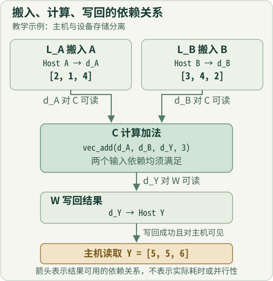
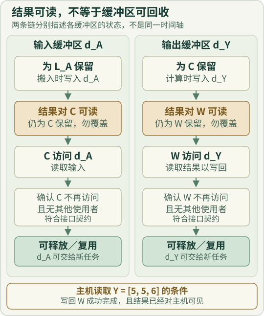

# 一项任务被提交之后，什么时候结果才可以使用？

[A04](a04-execution-contract.md) 已经说明：软件可以准备计算内核、参数和存储位置，再将一项工作交给设备。

假设提交向量加法的函数已经返回，主机能否马上读取计算结果？如果设备还在等待输入，或者结果正在从设备写回主机，提前读取就可能得到错误的数据。

**任务完成语义**描述软件可以怎样判断工作已经推进到某个阶段，以及这个状态能够保证什么。我们不仅要知道计算是否结束，还要知道哪些消费者现在可以读取结果、哪些存储空间不再被使用。

本篇继续跟踪 A04 的向量加法，从提交、数据交接到缓冲区复用，建立软件可观察的执行状态。不研究真实驱动队列、硬件事件电路或选择最快执行日程的算法。

## 提交了四项工作，它们就能立即执行吗？ {#task-dependencies}

沿用 A04 的教学系统：主机存有 A = [2, 1, 4]、B = [3, 4, 2]，希望得到 Y = [5, 5, 6]。主机与设备存储分离，各组数据都是 3 个 int32 元素，占 12 B。

假设已准备好设备存储区 d_A、d_B、d_Y 和主机结果区 Y，主机和设备的各个存储区互不重叠。需要的地址、访问权限和计算入口均已准备好。主机在对应搬入任务读完之前不修改输入。将整个过程拆分成四项任务：

| 任务 | 工作 | 读写的存储区 |
| --- | --- | --- |
| L_A | 搬入 A | 读主机 A，写 d_A |
| L_B | 搬入 B | 读主机 B，写 d_B |
| C | 执行 vec_add | 读 d_A、d_B，写 d_Y |
| W | 写回结果 | 读 d_Y，写主机 Y |

分别提交这些任务，并不意味着每一项任务都已经取得所需输入。假设 L_A 已经写好 d_A，但 L_B 尚未开始写 d_B。d_B 此时可能仍保存上次工作留下的值，例如 [0, 0, 0]。

如果 C 此时就读到 d_A = [2, 1, 4] 和旧 d_B = [0, 0, 0]，便会得到 [2, 1, 4]，而不是正确的 [5, 5, 6]。

为了使 C 正确工作，d_A 和 d_B 都必须保存这一次计算所需的数据，并且这些数据已对 C 可读。W 同样需要等待 C 产生的正确结果。

<figure markdown="1">

<figcaption>箭头表示本例中的任务依赖和数据交接，不表示真实耗时。两项搬入任务没有彼此的数据依赖，但这不保证它们会在硬件中同时运行。</figcaption>
</figure>

在 [A02](a02-program-representation.md#dataflow) 中，我们使用计算图描述值的生产和使用。这里的关系扩展到了具体任务：不仅要知道谁产生数据，还要保证接下来使用的是本次工作已经可以读取的那份数据。

为什么不能只按提交顺序理解这些关系？某些执行接口会保证指定序列中的先后顺序，另一些需要显式描述依赖。软件必须遵守具体接口的约定，而不是默认提交顺序等于实际执行顺序。

## 一项工作从接纳到完成，需要经过哪些状态？ {#task-states}

为了让主机不必等每项工作结束后才提交下一项，可以使用支持异步执行的接口，并事先描述 C、W 需要等待哪些工作。

假设本例中的提交接口支持提前成功返回，并承担保存和处理这项工作的责任。即使任务还未送到实际执行引擎，也可以在软件层记录它已被接纳。

此时主机可以继续准备其他输入；设备侧则按接口保证的依赖和资源条件推进工作。这种将提交与工作结束分开的方式称为**异步执行（Asynchronous Execution）**。

下面只观察计算任务 C，区分几个有意义的阶段或条件：

| 状态或事件 | 在本例中意味着什么 |
| --- | --- |
| 已接纳 | 所选提交接口接受了 C 的工作请求 |
| 等待输入 | d_A、d_B 尚未都对 C 可读 |
| 数据就绪 | 所需的输入已经对 C 可读 |
| 可执行 | 数据、输出空间、执行资源等条件均满足，可以参与选择与执行 |
| 执行中 | 执行实体已经开始为 C 服务 |
| 执行结束 | 本次执行到达接口所定义的结束状态，需要区分成功与失败 |

数据已就绪时，执行引擎可能仍在为其他任务服务，因此数据就绪不一定意味着马上开始计算。可执行也不一定意味着已经取得执行许可。我们暂不讨论任务的选择和调度方法。

这些是本文使用的观察边界，不是要求所有接口提供相同的状态枚举。例如 OpenCL 的事件状态包含已入队、已提交至设备、执行中、成功完成等状态，还允许用错误状态报告异常终止。

异步接口也可能因资源不足或实现约束暂时阻塞调用方。是否允许提前返回、返回后保证了什么，要以接口约定为准。异步执行并不自动带来实际并行。

[OpenCL：Event Objects](https://registry.khronos.org/OpenCL/specs/unified/html/OpenCL_API.html#event-objects) · [CUDA：API Synchronization behavior](https://docs.nvidia.com/cuda/cuda-runtime-api/api-sync-behavior.html)

[计算微架构 F02：依赖与资源](../../microarchitecture-v2/06-resource-cooperation/f02-task-control-and-synchronization.md#dependencies-and-resources)解释相关硬件机制。A05 只观察软件通过契约能够得知的状态。

## 计算结束了，为什么主机仍然不能读取结果？ {#completion-and-visibility}

假设 C 中的三个加法已经算出 5、5、6，但最后一个数还在等待写入 d_Y。此时如果 W 就开始读取最后一个元素，它可能取得的是旧值。

即使所有写请求都已发出，也需要按照系统的执行及内存语义，判断这些写入何时能够被 W 读取。发出请求、写入完成和结果对后续消费者可见，可能处于不同的观察边界。

这里说的**可见性（Visibility）**，是指在规定的访问条件与顺序下，指定的消费者能够观察到生产者写入的新数据。它不是说数据必须已经存入片外 DRAM，也不要求整个系统的所有访问者都能同时观察到这些值。

我们需要明确：一个完成状态到底提供了什么保证？某些接口的成功完成已经保证相应消费者可读取结果；有的状态只表示某一部分执行已经结束，还需要其他内存同步或数据交接条件。

在本例中，我们假设生产者成功交接时，其输出已经对指定消费者可读。于是可以记录下面的事实：

| 观察到的交接条件 | 哪些数据可以使用？ |
| --- | --- |
| L_A 成功交接给 C | C 可以读取本次 d_A；d_B 还需单独判断 |
| L_A、L_B 均成功交接给 C | C 的输入可读；仍需满足其他执行条件 |
| C 成功交接给 W | W 可以读取 d_Y = [5, 5, 6] |
| W 成功交接给主机 | 主机可以读取 Y = [5, 5, 6] |

注意，C 的结果对 W 可读，并不意味着主机的 Y 已经更新。主机与设备存储分离，只有 W 完成相应的搬运且新数据对主机可见，主机才可以读取本次结果。

如果系统提供共享内存，可能不需要额外的 W 搬运任务。但消费者仍需满足该系统规定的地址访问、顺序和可见性条件，不能只凭某个任务的提交成功就读取。

[Vulkan：Synchronization Dependencies](https://docs.vulkan.org/spec/latest/chapters/synchronization.html#synchronization-dependencies) 是明确区分执行依赖与内存依赖的一个实际规范例子。它说明仅约束操作先后，并不足以自动保证写入值对另一组操作可读。

[计算微架构 F02：事件与可见性](../../microarchitecture-v2/06-resource-cooperation/f02-task-control-and-synchronization.md#event-and-visibility)及[互连中的事务次序与完成](../../interconnect/NOC/05-system-integration/transaction-ordering-and-completion.md)解释硬件中的写请求与通知。

## 怎样让下一项工作知道它所需要的条件已经满足？ {#synchronization}

假设主机不知道 L_A、L_B 需要多久，也不知道 C 会在什么时候取得计算资源。它不能仅依据预计耗时来决定下一项工作能否安全开始。

我们可以为本例中的四项交接分别建立一个可等待的标记：e_A、e_B、e_C、e_Y。每个标记都关联本次工作和一个明确的条件。

| 标记 | 本例约定的含义 | 谁需要确认它？ |
| --- | --- | --- |
| e_A | L_A 成功交接，d_A 可供 C 读取 | C 的执行方 |
| e_B | L_B 成功交接，d_B 可供 C 读取 | C 的执行方 |
| e_C | C 成功交接，d_Y 可供 W 读取 | W 的执行方 |
| e_Y | W 成功交接，Y 可供主机读取 | 主机 |

这样，只要 C 的执行方能够在开始使用输入之前确认 e_A、e_B 均满足，W 的执行方在读 d_Y 前确认 e_C，主机在访问 Y 前确认 e_Y，就能维持所需的依赖关系。

**同步（Synchronization）**的用途就是在不同执行活动之间建立这样的约束，让相关工作按照约定的顺序推进，并满足必要的内存可见性条件。

同步不一定要求主机在每个阶段都停下来。例如，主机可以先安排 C 等待搬入任务、W 等待 C，再去做其他事情。等真的需要 Y 时，主机才确认 e_Y。

不同执行接口中的 Event、Fence 或其他同步对象会提供不同的状态和保证。这里的标记只用于说明语义，不能把所有名为 Event 的对象都理解为具有相同的内存同步作用。

真实例子见 CUDA：可以用 `cudaEventRecord` 记录某个流中此前提交的工作，用 `cudaStreamWaitEvent` 约束另一流后续提交的工作，也可以由主机调用 `cudaEventSynchronize` 等待事件所记录的工作完成。

具体流、事件、内存同步和任务提交路径的实现与使用规则，留给后续通用运行时专题。本篇只要求理解需要检查哪个工作及其契约提供的条件。

[CUDA Event Management](https://docs.nvidia.com/cuda/cuda-runtime-api/group__CUDART__EVENT.html) · [CUDA Stream Management](https://docs.nvidia.com/cuda/cuda-runtime-api/group__CUDART__STREAM.html)

## 数据已经可以读取，为什么存储空间还不能复用？ {#ownership-and-lifecycle}

回到 C 已成功交接给 W 的阶段。这时 d_Y 保存 [5, 5, 6]，W 可以读取它。但如果下一次加法任务 C2 想使用同一个 d_Y 存储区，能否马上开始写入？

假设下一次任务的结果为 [3, 10, 4]。若 C2 在 W 读取旧结果前覆盖了 d_Y，W 就可能将新的 [3, 10, 4] 错当成本次结果送回主机。若两者访问重叠，还可能出现其他错误或不符合接口要求的行为。

问题不在于 d_Y 是否已有有效数据，而是还有没有工作需要读取这次产生的数据。C 结束只表示它完成了生产工作，不能替 W 确认消费结束。

**资源所有权（Ownership）**在这里指按接口约定，某段存储空间当前由哪些工作持有使用权、哪些工作可以修改或读取它。多个消费者可以同时拥有读权限，但上层不能在仍需要这代数据时，无约束地将它覆盖。

<figure markdown="1">

<figcaption>存储区经历分配、生产、消费和归还等阶段。数据可读与存储可复用是不同的交接条件；图中只追踪本例的主要消费者，不表示真实时间轴。</figcaption>
</figure>

沿用本文的四项任务，假设没有其他持有引用或使用这些数据的工作。可以逐个检查各段存储的使用期限：

| 存储区 | 什么时候可以覆盖或回收？ |
| --- | --- |
| 主机 A、B | 相应搬入任务已不再读取原数据，且接口允许归还其使用权 |
| 设备 d_A、d_B | C 已不再访问相应输入，且接口允许归还使用权 |
| 设备 d_Y | W 已不再读取旧结果，且不存在其他未完成访问或保留的使用权 |
| 主机 Y | W 已完成对它的访问，主机及其他消费者也已结束使用，且允许归还 |

例如，主机 A 的数据如果已经被搬入且不会再被读取，就不必一直等整个向量加法结束才归还其使用权。另一方面，主机取得 Y 后也可能继续使用它，在此之前不能让下一次写回覆盖它。

如果还有其他消费者需要 d_Y，必须把这些访问也算进去。A03 介绍的共享视图同样如此：两个逻辑对象可能访问同一段存储，因此只看一个变量名或一个任务的结束状态，可能不足以判断存储可以复用。

从分配空间、产生数据、保留数据，直到最后一次需要的访问结束并允许回收，这段期间就是我们观察的**资源生命周期（Resource Lifetime）**。这里跟踪的是某次使用所需的资源期限；存储区被归还后，底层内存可以保留并用于另一项工作，不一定实际释放。

实际软件可能没有暴露最后一次读写的精确时刻。这时应使用能够保证不再访问的完成或释放接口作为判断依据，而不是猜测某个任务已经读完数据。

例如在 OpenCL 的非阻塞写入接口中，源主机缓冲区在调用返回后仍不能复用，必须等相应写入命令结束。对非阻塞读出接口，主机目标缓冲区在命令成功完成之前也不能当作结果使用。

[OpenCL：clEnqueueReadBuffer / clEnqueueWriteBuffer](https://registry.khronos.org/OpenCL/specs/unified/refpages/man/html/clEnqueueReadBuffer.html) · [CUDA：Stream-Ordered Memory Allocator](https://docs.nvidia.com/cuda/cuda-programming-guide/04-special-topics/stream-ordered-memory-allocation.html)

[计算微架构 F02：所有权与生命周期](../../microarchitecture-v2/06-resource-cooperation/f02-task-control-and-synchronization.md#ownership-and-lifecycle)从硬件侧解释了怎样管理这一类交接。本文只建立软件判断资源可回收的基本条件。

## 如果任务失败或被取消，还能直接使用结果或释放资源吗？ {#failure-and-cancellation}

前面假设所有任务都能成功完成。但如果 L_B 发生错误，C 可能无法取得正确的 B。即使有一项工作已经不再推进，也不能认为它成功产生了约定的输出。

因此软件在判断依赖满足时，还要检查状态是否表明成功，而不是仅检查任务是否结束。若前置工作失败，后续工作需要按照接口规定进行错误处理，而不是继续消费未确认有效的数据。

同样，主动取消一项任务或向调用者报告失败，并不一定意味着设备上的读写已经停止。除非接口已经保证相关在途访问结束且允许回收，否则软件仍不能释放或覆盖这些存储区。

错误传播、设备复位、取消及资源清理的具体机制，由后续设备驱动和运行时专题深入描述。

## 从任务状态回到程序语义 {#summary}

A01 说明程序要求哪些结果与状态变化，A02 说明怎样表达计算及其依赖，A03 解释元素对应的存储位置，A04 建立了软件将工作交给硬件的执行契约。

现在我们继续追踪这项工作，从提交、等待依赖、执行，到结果可以使用及资源可以复用。判断一项任务是否足以推进下一步时，需要分别确认三类事实：

| 要判断的事情 | 需要知道什么 |
| --- | --- |
| 任务能否开始 | 所需输入和执行资源是否满足条件 |
| 结果能否使用 | 生产是否成功，正确的数据是否已对指定消费者可读 |
| 资源能否回收 | 是否还有在途访问或其他持有者，接口是否允许归还 |

这三类条件可以在某些接口中同时得到满足，也可以发生在不同的阶段。理解这些关系，是后续编译规划、设备驱动和运行时正确组织计算与数据搬运的共同基础。

至此，[软件执行共同基础](README.md) 的五篇文章建立了从程序语义到软件执行的共同认知。接下来可以根据学习目标选择：

- [编译前端与程序优化](../02-frontend-and-optimization/README.md)：进一步理解程序表示怎样生成、怎样在保持语义的前提下变换计算。
- [设备驱动与底层资源管理](../05-device-driver/README.md)：沿执行契约进入设备上下文、地址管理、命令提交与完成处理。
- [通用执行运行时](../06-execution-runtime/README.md)：结合必要的驱动接口，理解可执行物加载、异步执行和资源管理。
