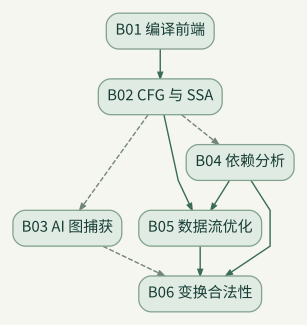

# 编译前端与程序优化

编译器先要理解程序的结构和含义，才能判断哪些计算可以改写。前端负责将源描述转成 IR，分析与优化负责在保持规定语义的条件下改变它。

## 贯穿算例与阅读边界

从 A01 的 `(a + b) * c` 开始，看编译器怎样认出乘法的输入。加入分支和循环后，同一个名字可能对应不同路径产生的值。再沿用 A02 的历史记录读写，判断哪些操作必须保持顺序，哪些计算可以复用或删除。

张量算例从小矩阵乘法、加偏置和 ReLU 开始。B03 追踪模型中的哪些计算能被捕获，B06 检查形状、数值和读写条件是否允许改写这张图。

B03 可以在 A02/A03 后独立阅读。这里主讲变换的语义和合法性，不在此选择硬件分块或实现融合内核。

## 知识关系

<figure class="micro-v2-map" markdown="1">

<figcaption>图中实线表示本专题内的主要前置关系，虚线表示按场景参考；跨专题先修知识见下表。 点击可查看大图。</figcaption>
</figure>

## 阅读顺序 {#计划阅读顺序}

本专题规划 6 篇正文。可依次阅读 B01–B03，其余三篇为后续计划。

| 编号 | 文章（暂定标题） | 读完应理解什么 | 主要前置知识 | 状态 |
| --- | --- | --- | --- | --- |
| B01 | [一段源代码怎样变成编译器能够处理的表示？](b01-compiler-frontend.md) | Token、词法与语法分析、AST、符号表、作用域、类型检查、初始 IR。 | A01、A02 | 已发布 |
| B02 | [遇到分支和循环，编译器怎样表示不同执行路径上的值？](b02-control-flow-and-ssa.md) | CFG、基本块、SSA、Phi、Block Argument、支配关系、Use-Def。 | B01；已有 IR 认知可直接进入 | 已发布 |
| B03 | [AI 框架运行过一次模型，为什么编译器仍可能不知道完整的计算过程？](b03-graph-capture.md) | Tracing、Export、模型导入、动态形状、控制流捕获、Guard、Graph Break。 | A02、A03；按需 B02 | 已发布 |
| B04 | 两项运算究竟能不能交换执行顺序？ | 数据依赖、内存读写、Alias、副作用、循环依赖与顺序合法性。 | A02；按需 B02 | 未发布 |
| B05 | 程序中哪些计算可以提前完成、复用或直接删除？ | 数据流分析、活跃性分析、常量传播与折叠、CSE、DCE、控制流化简。 | B02、B04 | 未发布 |
| B06 | 看起来等价的两种计算，编译器为什么不能任意替换？ | Shape 推导、符号约束、图重写、融合与分解合法性、循环变换、数值语义、Pass Pipeline。 | B04、B05；按需 B03 | 未发布 |

## 从哪里来，接下来往哪读

主要衔接：[软件执行共同基础](../01-foundations/README.md)。

后续方向：[资源映射与执行规划](../03-mapping-and-planning/README.md)、[算子实现与代码生成](../04-code-generation/README.md)。

更多阅读路线见[编译器与运行时系统系列首页](../README.md)。
