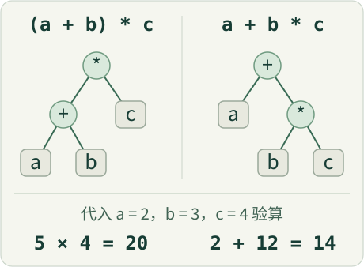

# 一段源代码怎样变成编译器能够处理的表示？

输入同样的三个整数 2、3、4，`(a + b) * c` 得到 20，去掉括号写成 `a + b * c` 就得到 14。两行里都有一次加法、一次乘法。编译器读到这些字符时，怎样认出乘法到底要用哪两个值？

**编译前端（Compiler Frontend）**按源语言的规则读入程序，把程序的结构和含义记录下来。后续分析就能直接问“乘法的左输入由谁提供”，不用每次重新读一遍源码、数一次括号。

[A01 用 Python 写过这项计算](../01-foundations/a01-program-semantics.md#functions)。这里保留同一条表达式，换用 Go 写函数，让参数类型直接出现在源码里。

```go
func evaluate(a, b, c int32) int32 {
    return (a + b) * c
}
```

括号内的 `int32` 同时声明三个参数的类型，括号外的 `int32` 声明返回值类型。参数和返回值都是 32 位有符号整数。我们可以用 2、3、4 验算。编译器读这段函数定义时，还不知道调用者会传哪三个数。

## 字符连在一起，怎样认出名字和符号？ {#tokens}

把中间的空格去掉，写成 `return (a+b)*c`，结果仍是 20。前端怎样知道 `a+b` 是三项，而函数名 `evaluate` 的八个字母应当合在一起？

读取字符时，前端按词法规则识别能组成一个单元的连续字符。在 Go 中，`evaluate` 整体符合标识符的规则。读 `a+b` 时，`+` 不能接在标识符里，于是 `a` 到这里结束，`+` 自己构成一个运算符，接下来是标识符 `b`。

这个过程称为**词法分析（Lexing）**。识别出的每个单元叫作词法单元（Token）。下面只列返回语句从 `return` 到 `c` 的部分，分隔线表示两个 Token 的边界。

```text
return | ( | a | + | b | ) | * | c
```

`return` 是关键字，`a`、`b`、`c` 是标识符。词法分析可以同时记下它们在源文件中的位置，供后续报告错误。到这里，前端已经识别出乘号，却还要确定乘号左边的整个操作数。

[Go 语言规范 · Token 与标识符](https://go.dev/ref/spec#Tokens)

## 括号怎样改变一棵树？ {#expression-tree}

读到 `return` 后，前端要找出将要返回的表达式。在 `(a + b) * c` 中，左括号开启一个子表达式。读到与它配对的右括号时，里面的 `a + b` 已经组成整体。遇到外面的 `*`，这个整体就成为乘法的左操作数，`c` 是右操作数。

去掉括号后，两个运算符的优先级决定怎样分组。Go 的乘法比加法优先级高，所以 `a + b * c` 中的 `b * c` 组成整体。最外层成了加法，右操作数是整个乘积。

按语法规则把 Token 组成表达式、语句和函数，称为**语法分析（Parsing）**。把这种嵌套关系存成树，就得到一种**抽象语法树（Abstract Syntax Tree，AST）**。整棵树里有函数和返回语句，下面只画返回表达式。

<figure markdown="1">

[](assets/b01-expression-trees.svg)

<figcaption>从根往下读，每条线把一项运算连到它的一个操作数。图中用树形表达括号的分组效果。输入值和验算结果另列，替换这三个输入仍可使用同一棵树。</figcaption>
</figure>

沿第一棵树看，乘法左边的子树覆盖 `a + b`。沿第二棵树看，乘法左边只有 `b`。这正是两行代码在结构上的差别。若写成 `(a + ) * c`，加号后直接遇到右括号，缺少右操作数，即使每个 Token 都能识别，也无法组成合法的加法表达式。

实际的树可以保留更多源代码细节。例如 Go 标准库的 `go/ast` 还用一个括号表达式节点包住 `a + b`，便于工具找回这对括号的位置。

[Go 语言规范 · 运算符优先级](https://go.dev/ref/spec#Operator_precedence) · [Go 标准库 · 括号表达式节点](https://pkg.go.dev/go/ast#ParenExpr)

## 树上的 c 指哪个 c？ {#name-resolution}

假设在同一个包里，函数外还有一句 `var c int32 = 100`。调用 `evaluate(2, 3, 4)` 时，如果乘法用了外面的 `c`，结果会是 500。为什么实际返回的是 20？

`c` 这个拼写在两处声明过。每个声明都有一定的**作用域（Scope）**，即程序中这个声明起作用的范围。Go 的函数参数在函数体内有效。在返回表达式的位置，内层的参数 `c` 遮住了包里同名的变量。

前端可以在**符号表（Symbol Table）**中按作用域记录声明。例如，包这一层记录变量 `c`，函数这一层记录参数 `a`、`b` 和 `c`。处理树上的名字时，从使用位置所属的作用域向外查找，找到适用的声明，就把这次使用与它关联起来。

| 源码中的位置 | 前端记录的含义 |
| --- | --- |
| 函数外的 `var c int32 = 100` | 声明包变量 `c`，初值为 100 |
| 函数参数中的 `c` | 声明本函数的第三个参数，类型为 `int32` |
| `return (a + b) * c` 中的 `c` | 引用函数的第三个参数，类型为 `int32` |

这一步叫作**名称解析（Name Resolution）**。编译时可以确定乘法用第三个参数，调用时传入的 4 才给出它的值，所以结果是 20。

若把表达式末尾改成 `d`，乘法仍有两个操作数，树也能建出来。但假设可见范围内没有声明过 `d`，前端就能指出这个名字没有定义。

[Go 语言规范 · 声明与作用域](https://go.dev/ref/spec#Declarations_and_scope) · [Go 标准库 · 名称的声明与使用](https://pkg.go.dev/go/types#Info)

## 名字都找到了，加号就一定能用吗？ {#type-checking}

回到原来的 `a + b`。查到参数声明后，前端知道两边都是 `int32`。Go 允许两个这种类型的值相加，结果仍是 `int32`。沿树向上，乘法接收到这个结果和参数 `c`，两边类型也匹配。最后得到的类型正好符合函数声明的返回类型。

其中有两个动作。根据操作数和运算规则得出 `a + b` 的结果类型，是在**推断表达式的类型**。核对这个加号能否用于这两个输入、最终的值能否返回，是在做**类型检查（Type Checking）**。

现在只把参数列表改成 `a int32, b string, c int32`。原来的树仍能建好，三个名字都能找到声明。可是 `a + b` 一边是整数、一边是字符串。Go 的 `+` 支持数值相加，也支持字符串拼接，这里两套规则都不适用，因此这个表达式会在编译时得到类型错误。

名称解析和类型检查都属于**语义分析（Semantic Analysis）**。这个例子可以在编译时确定加法的含义，因为 Go 的参数声明给出了类型。A01 的 Python 函数还可以接收其他类型的对象，单凭一次整数调用，推不出所有调用都做整数加法。

[Go 语言规范 · 算术运算符](https://go.dev/ref/spec#Arithmetic_operators) · [A01 · 值、类型与表达式](../01-foundations/a01-program-semantics.md#values-and-expressions)

## 怎样从树上得到 A02 的两条运算？ {#initial-ir}

现在看带括号的原式。树的叶子已经对应到具体参数，运算节点也有了确定的类型。要让后续分析能直接找到乘法的输入，可以给每项运算的结果取一个名字，并让使用它的操作引用这个名字。

具体做法是从 `return` 所需的乘法结果往下找。处理左边的加法子树时，两个叶子直接提供参数 `a`、`b`。记下一项加法，把它的结果命名为 `v1`。回到乘法，左输入已经是 `v1`，右输入就是参数 `c`。再记录乘法的结果 `v2`，让返回操作使用它。

```text
evaluate(a: i32, b: i32, c: i32) -> i32
    v1 = add.i32(a, b)
    v2 = mul.i32(v1, c)
    return v2
```

这是沿用 A02 写法的**教学 IR**。这里约定 `i32` 对应 Go 的 `int32`，加法、乘法遵守该类型的运算规则。看乘法这一行，顺着第一个输入 `v1` 找到它的定义，就知道这个值来自哪项加法。

这个过程只构造表示。只有代入某次调用的参数，才能给 `v1` 和 `v2` 填上那次的数值。对于输入 2、3、4，分别是 5 和 20。如果源码去掉了括号，第一项运算就要改成 `mul.i32(b, c)`，再把它的结果与 `a` 相加，得到 14。

AST 本身也是一种中间表示。这里把它展开成一列操作，是为了让每个结果与使用它的位置都清楚可查。真实前端可以保留带类型的树，也可以生成另一种 IR。LLVM 的前端教程就演示了怎样递归处理子表达式，并把生成的结果传给外层运算。

[LLVM 前端教程 · 从表达式树生成 IR](https://llvm.org/docs/tutorial/MyFirstLanguageFrontend/LangImpl03.html#expression-code-generation) · [Go 语言规范 · 整数溢出](https://go.dev/ref/spec#Integer_overflow)

## 如果返回值来自两条不同的路径呢？ {#next}

回到开头的两行代码。语法分析确定乘法的两个操作数，名称解析找到参数声明，类型检查确认它们可以做整数运算。生成 IR 时，每棵子树提供的值都成了外层操作可以引用的输入。即使不保留源代码的空格和括号，也能从 `mul.i32(v1, c)` 找回原式要求的计算。

[A02 的分支算例](../01-foundations/a02-program-representation.md#control-flow)又多了一步。条件成立时令 `y = t * c`，否则令 `y = 0`，两条路最后都到达 `return y`。刚才可以沿 `v2` 一步找到乘法，现在要怎样记录返回值来自本次实际经过的那条路？这是下一篇 B02 要解决的问题。

返回[编译前端与程序优化导读](README.md)。
