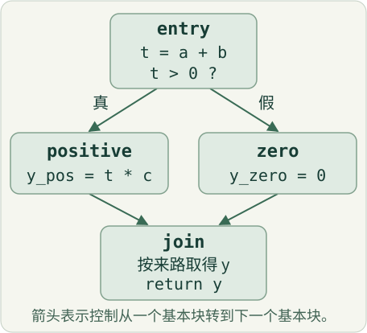
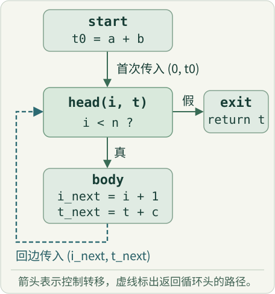

# 遇到分支和循环，编译器怎样表示不同执行路径上的值？

[B01](b01-compiler-frontend.md#initial-ir) 里，顺着 `return v2` 往回找，可以直接找到产生 `v2` 的乘法。现在给这个函数加一个条件。输入 2、3、4 时，它返回乘积 20。把第一个数改成 −5，它就返回 0。源代码里却只有一句 `return y`。

如果要在运行前分析这个函数，编译器该把 `return` 的输入连到哪里？要回答这个问题，既要记录程序可能从哪里走到这里，也要记录沿每条路能取得哪个值。控制流图记录前一件事，静态单赋值形式让后一件事也能顺着名字查到。

## 同一句 return，为什么有两条来路？ {#two-paths}

沿用 [A02 的条件分支](../01-foundations/a02-program-representation.md#control-flow)，用 B01 的 Go 整数类型写出函数。这里的 `:=` 声明局部变量并给它初值。

```go
func evaluateIfPositive(a, b, c int32) int32 {
    t := a + b
    var y int32
    if t > 0 {
        y = t * c
    } else {
        y = 0
    }
    return y
}
```

| 输入 (a, b, c) | 进入分支前 | 这次执行的赋值 | 返回值 |
| --- | --- | --- | ---: |
| (2, 3, 4) | t = 5，条件为真 | y = 5 × 4 | 20 |
| (−5, 3, 4) | t = −2，条件为假 | y = 0 | 0 |

Go 会把刚声明的 `y` 初始化为 0。两个分支都会给它重新赋值，所以到达返回处的值只可能来自这两处分支赋值。

每次调用都只经过一条分支，执行到 `return` 时，`y` 的值很明确。但分析函数定义时，两条路都要保留。如果只按源码从上往下找离 `return` 最近的赋值，就会总是找到 `y = 0`，无法解释第一行的 20。

## 怎样把可能的路径画出来？ {#basic-blocks-and-cfg}

先把连续执行的操作放在一起。入口处的加法、比较和按条件跳转可以放在同一组。乘法只在真分支执行，把 0 赋给 `y` 只在假分支执行，所以各占一组。最后，两条路都能进入包含 `return` 的一组。

这样的直线片段叫作**基本块（Basic Block）**。在本例中，控制从块的开头进入，按顺序走到块末尾，再由最后的操作确定后继块，或者返回调用者。条件跳转属于入口块的末尾，并不需要单为比较再画一个块。

<figure markdown="1">

[](assets/b02-branch-cfg.svg)

<figcaption>每个框是一个基本块，箭头表示控制可以从哪个块转到哪个块。positive 和 zero 中给值取的两个名字，标记了源程序里对 y 的两处赋值。</figcaption>
</figure>

基本块是节点，可能的控制转移是有向边，这就构成了**控制流图（Control Flow Graph，CFG）**。从 `positive` 可以直接走到 `join`，就称 `positive` 是 `join` 的前驱，`join` 是它的后继。

从 `entry` 沿箭头走一次，可以重现表中的任一条路径。现在已经知道两条路在哪里汇合。接下来要让软件能从汇合处的 `return` 反查它使用的值。

## 给每次赋值单独命名，还缺哪一步？ {#ssa-and-phi}

沿用 B01 给运算结果取名的方法，把真分支产生的乘积叫作 `y_pos`，把假分支给出的 0 叫作 `y_zero`。这两个名字各有一个来源。可是把末尾直接写成 `return y_pos` 仍然有问题：从 `zero` 进来时，产生 `y_pos` 的乘法根本没有执行。

可以在 `join` 的入口定义一个新值 `y`，并把取值规则写下来。从 `positive` 来，就取 `y_pos`。从 `zero` 来，就取 0。此后的 `return` 只需引用这一个新定义。**φ（读作 phi）**就是按进入当前块的那条边取得相应值的合并操作。

下面是这个 Go 函数的一种 LLVM IR 写法。`%` 开头的名字标识局部的值或块。`icmp sgt` 按有符号整数比较 `%t` 是否大于 0，得到一位真假值。`br` 跳往指定块。假分支可以直接把常量 0 列作 φ 输入，所以 `zero` 块里只剩一条跳转。

```llvm
define i32 @evaluate_if_positive(i32 %a, i32 %b, i32 %c) {
entry:
  %t = add i32 %a, %b
  %ok = icmp sgt i32 %t, 0
  br i1 %ok, label %positive, label %zero

positive:
  %y_pos = mul i32 %t, %c
  br label %join

zero:
  br label %join

join:
  %y = phi i32 [ %y_pos, %positive ], [ 0, %zero ]
  ret i32 %y
}
```

读 `phi` 这一行时，把每对方括号看成“值、前驱块”。输入 2、3、4 时，刚执行过的前驱是 `positive`，于是 `%y` 取得 20。换成 −5、3、4，前驱是 `zero`，于是取得 0。控制流已经选定来路，φ 沿这条来路取值，无需再次判断 `%ok`。

这种给值命名的方式称为**静态单赋值形式（Static Single Assignment，SSA）**。在这个函数里，每个 SSA 值都能找到唯一的静态定义。源程序可以给同一变量多次赋值，转成 SSA 后，各处产生的值有各自的名字，路径交会处也可以定义自己的合并结果。

[LLVM 语言参考 · φ 指令](https://llvm.org/docs/LangRef.html#phi-instruction) · [Cytron 等 · SSA 形式的经典论文](https://research.ibm.com/publications/efficiently-computing-static-single-assignment-form-and-the-control-dependence-graph)

## 为什么 %t 可以直接用，%y_pos 却要看路径？ {#dominance-and-use-def}

用手遮住 CFG 图里的 `entry`，从函数入口就走不到 `positive` 或 `join`。再遮住 `positive`，仍然可以沿 `entry → zero → join` 走到返回处。两个定义对返回处的可用性就差在这里。

对于从入口可达的块，如果从函数入口到块 B 的每条路径都会经过块 A，就说 **A 支配 B（Dominance）**。`entry` 支配 `join`，而 `positive` 不支配 `join`。这个判断检查所有可能路径，只走一次真分支无法得出它。

普通 SSA 操作使用一个值时，定义必须支配这次使用。在同一块里，定义要在普通使用之前。上例中 `%t` 在入口已定义，所以真分支可以直接拿它做乘法，汇合块如果需要也可以直接用它。

那为什么 φ 可以写 `%y_pos`？LLVM 将这项输入的使用位置放在 `positive → join` 这条**入边**上。走到这条边时乘积一定已经产生。沿另一条边到达时，对应的输入是 0。进入 `join` 后，`ret` 使用的是块头已经定义的 `%y`。

可以实际检验这一点。保留其他代码，把最后一行改成 `ret i32 %y_pos`，LLVM 的 IR 验证器会报告定义没有支配所有使用。沿图中的假分支走一遍，就能找到它拒绝这段 IR 的原因。

| 从哪一次使用往回查 | 查到的定义或直接给出的值 |
| --- | --- |
| `ret i32 %y` 使用的 `%y` | `join` 块头的 φ |
| φ 在 `positive → join` 上使用的 `%y_pos` | `positive` 中的乘法 |
| φ 在 `zero → join` 上取得的输入 | 常量 0 |
| 乘法使用的 `%t` | `entry` 中的加法 |

从一次使用找到它对应的定义，叫作**使用到定义（Use-Def）关系**。反过来，从 `%t` 的定义能找到它在比较和乘法中的两处使用，这是定义到使用（Def-Use）。后续分析可以沿这些关系查询哪些操作依赖某个结果。

这些名字标在编译器的 IR 中。芯片执行指令时怎样给结果分配物理寄存器，是[计算微架构中的寄存器重命名](../../microarchitecture-v2/02-cpu/b05-register-renaming.md#rename-map)讨论的另一层问题。

[LLVM 语言参考 · 合法 IR 与支配](https://llvm.org/docs/LangRef.html#well-formedness)

## 能不能在跳往 join 时就把值交给它？ {#block-arguments}

再看同一个汇合过程。可以让 `join` 声明“每次进入我时，请带一个整数”，再让两个前驱各自在跳转时交出自己的值。这个接收输入的名字就叫作**块参数（Block Argument）**。

下面摘出 MLIR 中对应的三个块。入口已经得到 `%t` 并完成分支判断，`%c` 仍是函数参数。`cf.br` 跳到目标块，括号里写这条边带过去的值。

```mlir
^positive:
  %y_pos = arith.muli %t, %c : i32
  cf.br ^join(%y_pos : i32)
^zero:
  %y_zero = arith.constant 0 : i32
  cf.br ^join(%y_zero : i32)
^join(%y: i32):
  func.return %y : i32
```

对照 LLVM 的 `[ %y_pos, %positive ]` 看，MLIR 在 `positive` 末尾把 `%y_pos` 传给 `^join`。走另一条边就传 0。两种写法保留了同一份“来路与值”的对应关系。块参数写起来像函数参数，这里发生的控制转移仍是函数内的跳转。

[MLIR 语言参考 · 基本块与块参数](https://mlir.llvm.org/docs/LangRef/#blocks) · [MLIR 控制流方言 · 分支操作](https://mlir.llvm.org/docs/Dialects/ControlFlowDialect/#cfbr-cfbranchop)

## 循环回到同一处，带回来的是哪一轮的值？ {#loop-carried-values}

[A02](../01-foundations/a02-program-representation.md#control-flow) 还提到过从 `t = a + b` 开始反复加 `c`。现在用 `n` 指定次数。取 `a = 2`、`b = 3`、`c = 4`，做两轮应当返回 13，做零轮应当直接返回初值 5。

```go
func accumulate(a, b, c, n int32) int32 {
    t := a + b
    for i := int32(0); i < n; i++ {
        t = t + c
    }
    return t
}
```

先看判断 `i < n` 的位置。第一次到这里，`i` 是 0，`t` 是入口算出的 5。做完一轮再到同一处，`i` 是 1，`t` 是刚算出的 9。循环头也有两种来路，可以用刚才的块参数同时接收本次的 `(i, t)`。

<figure markdown="1">

[](assets/b02-loop-values.svg)

<figcaption>每次进入 head，只接收刚走过的那条边送来的一对值。body 回到 head 的箭头叫回边，它让同一组静态基本块可以描述任意多次迭代。</figcaption>
</figure>

| n = 2 时怎样到达 head | 本次收到 (i, t) | 检查 i < 2 | 下一步 |
| --- | --- | --- | --- |
| 从 start 首次进入 | (0, 5) | 真 | body 算出 (1, 9) |
| 从 body 第一次返回 | (1, 9) | 真 | body 算出 (2, 13) |
| 从 body 第二次返回 | (2, 13) | 假 | exit 返回 13 |

如果 `n = 0`，第一次检查就是 `0 < 0`，结果为假。程序从 `head` 直接进入 `exit`，返回 5。这条路径从未产生过 `t_next`，所以退出时应使用循环头收到的 `t`。同理，最后一轮结束后，循环头收到 13，退出时拿到的就是 13。

若把图中的循环头改写为 LLVM 的 φ，块头有下面两行。这里 `%t0` 在 `start` 算出，`%i_next` 和 `%t_next` 都在 `body` 算出。

```llvm
%i = phi i32 [ 0, %start ], [ %i_next, %body ]
%t = phi i32 [ %t0, %start ], [ %t_next, %body ]
```

两行 φ 按同一条入边取值。走回边时，取的是刚完成的那轮已经算好的两个结果。静态 IR 里 `%t` 仍只有循环头这一处定义。执行这处定义三次，可以依次得到 5、9、13。这就是“静态单赋值”与“循环中数值不断变化”能够同时成立的原因。

[Go 语言规范 · for 循环](https://go.dev/ref/spec#For_statements) · [LLVM · 循环头与回边](https://llvm.org/docs/LoopTerminology.html#terminology)

## 从一次执行能看见多少程序？ {#next}

回看开头的 `return y`。在 SSA 中追到 φ 或块参数，就能找到各条入边对应的值。对某一次调用，只要知道它从哪条边到达，就能继续追到这一次真正使用的输入。循环只是让程序有机会沿回边再次到达同一处。

这也留下了 B03 的问题。如果 AI 框架只用 2、3、4 运行一次，并记录实际执行的算术操作，它会看到加法和乘法。换一组输入，乘法就会被跳过。编译器凭什么知道哪些条件、路径和输入形状也要记录下来？

返回[编译前端与程序优化导读](README.md)。
