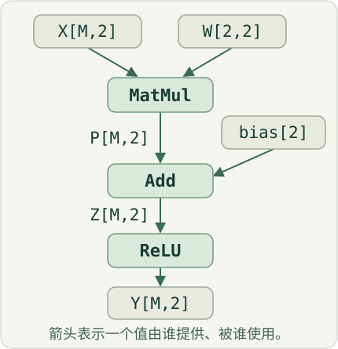
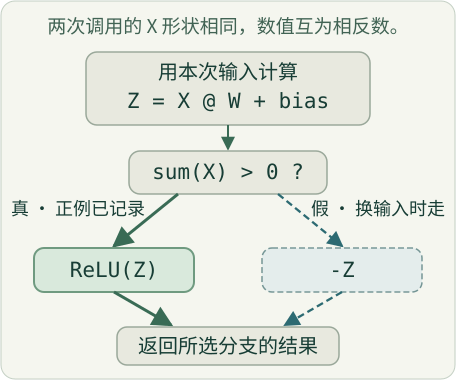

# AI 框架运行过一次模型，为什么编译器仍可能不知道完整的计算过程？

[B02](b02-control-flow-and-ssa.md#two-paths) 中，两次函数调用都走到同一句 `return`，一次返回乘积，另一次返回 0。如果只能看到第一次调用，能从那次乘法推回另一条分支吗？在 AI 框架里，即使两次输入的形状完全相同，也会遇到这个问题。

**模型捕获（Graph Capture）**要把框架程序中的计算整理成编译器可以处理的图。图要写清每个操作用哪个值，还要交代哪些条件下它能代表原程序。我们先用一个三步模型捕获一张图，再分别改变输入的数值和行数，看看它还能不能用。

## 算出一个矩阵，怎样留下它的计算过程？ {#operator-graph}

下面的模型先做矩阵乘法，给结果的每一行加同一个偏置，再把负数变为 0。最后这项逐元素操作叫作 ReLU。为了看清每个输入从哪里来，先把权重 `w` 和偏置 `bias` 都写成函数参数。以下 PyTorch 算例使用 2.8.0 CPU 版和 `float32`。

```python
import torch
from torch import nn

class Layer(nn.Module):
    def forward(self, x, w, bias):
        p = x @ w
        z = p + bias
        return torch.relu(z)

x = torch.tensor([[1., 2.], [-1., 0.]])
w = torch.tensor([[1., 2.], [3., -1.]])
bias = torch.tensor([1., -2.])
args = (x, w, bias)
```

只跟踪第一行就能手算：矩阵乘法的第一项是 1 × 1 + 2 × 3 = 7，第二项是 1 × 2 + 2 × (−1) = 0。加偏置后变成 [8, −2]，经过 ReLU 得到 [8, 0]。第二行经过相同三步得到 [0, 0]。

一次调用返回的四个数只给出了这次的答案。要留下计算过程，可以在遇到张量运算时记下一项操作。遇到 `p + bias`，就记录加法的一个输入来自刚才的乘法，另一个来自函数参数。这样，换一组输入值后仍有一份可以重新求值的表示。

<figure markdown="1">

[](assets/b03-operator-graph.svg)

<figcaption>箭头和 A02 的数据流图一样，连接值的生产者与使用者。M 表示输入行数，本次等于 2。偏置的两个元素按列加到每一行。</figcaption>
</figure>

像这样沿着程序收集操作，把产生的值接到后续操作的输入上，称为**追踪（Tracing）**。值从产生处流向使用处的关系，见 [A02 的数据流图](../01-foundations/a02-program-representation.md#dataflow)。

[B01](b01-compiler-frontend.md#expression-tree) 从源码的语法结构生成表示。这里的前端多了一条线索：框架已经知道 `@` 在这两个张量上表示矩阵乘法，也知道它接下来把哪个结果交给加法。

追踪有多种实现。直接执行时可以记录实际调用的算子，前端也可以用带有类型和形状信息的替身张量来推导算子输出。比如推导乘积有几行几列，就用不到那四个实际数值。

[算法与模型 · 矩阵乘法的形状与偏置广播](../../workload/00-overview/tensor-shapes-and-cost.md) · [PyTorch 2.8 · FakeTensor](https://docs.pytorch.org/docs/2.8/torch.compiler_fake_tensor.html)

## 只改变数值，第一次记录的路径还能用吗？ {#single-path-trace}

现在保留前两项运算，只改变最后一步。若输入元素之和大于 0，仍然返回 ReLU 的结果。否则把 `z` 的每个元素取相反数。

```python
class ByValue(nn.Module):
    def forward(self, x, w, bias):
        z = x @ w + bias
        if x.sum() > 0:
            return torch.relu(z)
        return -z
```

先用上面的 `x` 运行一次，元素和为 2，原程序走到 `relu(z)`。再传入 `-x`，它仍是 2×2，元素和却是 −2。这次 `z` 的第一行变成 [−6, −2]，正确的返回行是 [6, 2]。如果继续套用 ReLU，就会得到 [0, 0]。

<figure markdown="1">

[](assets/b03-branch-capture.svg)

<figcaption>图上画的是原程序允许的两条路径。实线标出第一次调用走过的部分。只记录这次算术操作的追踪器看不到虚线上的取负操作。</figcaption>
</figure>

用旧式接口 `torch.jit.trace(ByValue(), args)` 可以复现这次丢失。Python 的 `if` 需要一个真假值，这次把比较结果读成了真。追踪器对此发出警告，产物中留下了矩阵乘法、加法和 ReLU，缺少能在下次重新选择分支的条件操作。

| 再调用时传入 | 元素和 | 原程序返回的第一行 | 在 x 上追踪所得图返回的第一行 |
| --- | ---: | --- | --- |
| x | 2 | [8, 0] | [8, 0] |
| −x | −2 | [6, 2] | [0, 0] |

这是这类单路径追踪的具体行为。两个输入连类型、形状都相同，仅靠检查形状无法修复这张图。要涵盖这两个输入，表示里还需要保留根据张量内容选择路径的能力。

[PyTorch 2.8 · torch.jit.trace 对控制流的限制](https://docs.pytorch.org/docs/2.8/generated/torch.jit.trace.html) · [PyTorch 2.9 · TorchScript 弃用说明](https://docs.pytorch.org/docs/2.9/jit.html)

## 要导出整个函数，怎样把另一条路也交出去？ {#export-and-control-flow}

**导出（Export）**要交付一份可供后续工具使用的程序表示。在 PyTorch 中，`torch.export.export` 产生的 `ExportedProgram` 包含计算图、输入输出签名以及推导出的形状约束。读者可以据此区分调用者提供的值、模型自带的参数和返回值。

对上面的 `ByValue` 调用 `torch.export.export(ByValue(), args, strict=True)`，实测在普通 Python `if` 处导出失败。捕获时知道比较会产生一个布尔张量，却无法由形状推出它必为真或必为假。静默选一边会重现刚才的错误。

要交付能处理两种输入的图，可以把条件判断也写成图里的操作。把 `ByValue.forward` 中的 `if` 和两个返回语句换成下面这一句，保留原来的 `z`。

```python
return torch.cond(x.sum() > 0, lambda v: torch.relu(v), lambda v: -v, (z,))
```

两个小函数都接收 `z`，各自返回同形状、同类型的张量。再次严格导出，图中保留了条件、真分支子图和假分支子图。执行这份产物时才根据当次输入选择一路。同一份产物接收 `x` 返回首行 [8, 0]，接收 `-x` 返回 [6, 2]。

这和 [B02 的分支汇合](b02-control-flow-and-ssa.md#ssa-and-phi)解决的是同一个取值问题。这里两段计算被放在一个条件算子的两个子图中，结果来自被选中的子图。模型前端可以保留这种结构化表示，后续工具仍能看见控制流。

[PyTorch 2.8 · Export 编程模型](https://docs.pytorch.org/docs/2.8/export.programming_model.html) · [torch.cond 的操作数与分支约束](https://docs.pytorch.org/docs/2.8/generated/torch.cond.html)

## 输入多一行，图里的哪个量需要可变？ {#dynamic-shapes}

回到没有分支的 `Layer`。如果给 `x` 追加一行 [0, 0]，矩阵乘法会多产生一行 [0, 0]，加偏置得到 [1, −2]，ReLU 输出 [1, 0]。三个操作以及它们的连接方式都可以沿用。

按 [A03 的动态维度](../01-foundations/a03-tensor-representation.md#dynamic-shape)来描述，令输入形状为 [M, 2]，把 M 留到调用时确定。权重仍是 [2, 2]。乘法要求输入列数等于权重行数，两者在本例中都固定为 2。输出的行数则跟着 M 变化。

```python
from torch.export import Dim, export

fixed = export(Layer(), args, strict=True)
rows = Dim("rows", min=2, max=4)
varying = export(
    Layer(), args, strict=True,
    dynamic_shapes={"x": {0: rows}, "w": {}, "bias": {}},
)
```

两次导出都以同一组两行数据为例。第一份采用默认静态形状。第二份把 `x` 的第 0 维命名为 `rows`，声明区间 [2, 4]，其余维度保持固定。用各自的 `.module()` 调用导出产物，结果如下。

| 传入的 x 形状 | 默认静态形状 | 声明动态行数 |
| --- | --- | --- |
| [2, 2] | 得到 [2, 2] 输出 | 得到 [2, 2] 输出 |
| [3, 2] 或 [4, 2] | 入口要求恰好两行 | 输出分别有三行或四行 |
| [5, 2] | 入口要求恰好两行 | 超过行数上界 4，报错 |
| [3, 3] | 与静态输入形状不符 | 列数要求为 2，报错 |

可以直接查看两份产物留下了什么。在下列代码中，`call_function` 筛出调用算子的节点，`node.target` 标明调用了哪个算子。

```python
for program in (fixed, varying):
    print([str(node.target) for node in program.graph.nodes
           if node.op == "call_function"])
    print(program.range_constraints)
```

两份图都列出 `aten.matmul.default`、`aten.add.Tensor`、`aten.relu.default`。区别出现在输入的形状约定上。动态产物还记录了符号行数的范围 [2, 4]。

记录的范围和入口实际检查的范围可以分别核对。例如本次 2.8.0 的动态产物也放行了一行输入。这次调用成功只描述这个入口的行为，使用导出图时仍应依据经过验证的形状约定。

[PyTorch 2.8 · torch.export 与动态维度 Dim](https://docs.pytorch.org/docs/2.8/export.html#torch.export.dynamic_shapes.Dim)

## 编译器为什么会生成 M ≤ 4 这个条件？ {#shape-guards}

现在把选择 ReLU 或取负的条件，从 `x.sum() > 0` 换成 `x.shape[0] <= 4`。这次只需知道行数，就能决定走哪条路。编译器用两行样例走到 ReLU 时，可以把这条路径专门化为一张只含乘法、加法和 ReLU 的图。

这张图能代表原程序有一个前提：输入必须使这次选中的分支仍然成立。由此得到 `M <= 4`。这样的有效性条件称为 **Guard（守卫条件）**。导出时可以用声明的形状范围证明这个条件成立。按输入复用编译结果时，也可以先检查条件再使用对应的图。

| 同样以 M = 2 严格导出 | ReLU 这条路径能否覆盖整个范围？ |
| --- | --- |
| 声明 2 ≤ M ≤ 4 | 能。声明范围内每个行数都走这一支 |
| 声明 2 ≤ M ≤ 6 | 本例导出时报约束冲突。M = 5、6 应当取负 |

这个例子区分了两个问题。对于行数条件，给定范围后可以证明某一条路径覆盖所有约定输入。对于按数据判断的 `x.sum() > 0`，即使固定为两行，元素和仍能取两种符号，所以仍需表达数据分支或保留外部程序来选择。

[PyTorch 2.8 · 导出时的形状假设与有效性条件](https://docs.pytorch.org/docs/2.8/export.html#torch.export.export)

## 图在中途断开，原程序怎样继续？ {#graph-breaks}

严格导出要求所选函数可以整段交付。如果原来的 Python 环境仍在运行，还有另一种选择。回到数据依赖的 `ByValue`，用 `torch.compile` 编译它，并允许框架捕获多个片段。

在本例的 `fullgraph=False` 实验中，前端先捕获计算 `z` 和比较条件的片段。在 Python 需要决定下一步走哪条路时，当前图结束。外围代码根据实际条件选路，后面的 ReLU 或取负又可以形成图。这样一次捕获在边界处分段，就叫作**图断点（Graph Break）**。

在 CPU 上用只记录并执行图的后端检查，两组输入仍得到正确结果。改为 `fullgraph=True`，同一个 Python 分支就导致编译报错。分段运行依靠外围程序接续执行，因此不能把其中一个片段单独交给另一个系统，就期望它覆盖整个函数。

图断点发生在**捕获程序**时。Guard 不满足发生在**检查现有编译结果是否适用**时。两者可以用一次没有分支的实验区别开来。

编译直线模型 `Layer`，指定 `dynamic=False` 和 `fullgraph=True`。依次传入两行、三行、再两行。后端收到的完整图累计为 1、2、2 张。三行输入未通过第一份图的行数检查，触发第二次编译。回到两行时，第一份图又能复用，全程没有图断点。

这里的图描述模型操作和条件。旧版运行时讲的 CUDA Graph 则记录可提交给设备的工作，重放还涉及地址等执行条件。两种捕获的对象可以分别对照阅读。[旧版推理运行时 · 动态形状与执行计划](../../inference-runtime/02-model-execution/dynamic-shapes.md)

[PyTorch 2.8 · Dynamo 的追踪与 Guard](https://docs.pytorch.org/docs/2.8/torch.compiler_dynamo_deepdive.html) · [torch.compile 的 fullgraph 约定](https://docs.pytorch.org/docs/2.8/generated/torch.compile.html)

## 如果拿到的已经是一张图，还需要追踪 Python 吗？ {#model-import}

假设另一个团队已经把无分支的模型保存为 ONNX。文件中有三个算子节点，节点按名字引用值。这时可以做**模型导入（Import）**：读取已有表示，按照模型声明的算子版本解释每个节点，再把输入、输出和依赖接到编译器自己的 IR 中。

例如下面这份 ONNX 模型选用标准算子集版本 18，把 `W` 和 `bias` 的数值保存在文件的初始化张量（initializer）中。这样导入以后，调用者只需提供 `X`。下面列的是文件里的值关系。

| 文件中的节点 | 导入时怎样接线 |
| --- | --- |
| MatMul(X, W) → P | 取图输入 X 和文件中的 W，登记乘积 P |
| Add(P, bias) → Z | 按名字找到上一步的 P，再取 bias，按广播规则相加 |
| Relu(Z) → Y | 取加法产生的 Z，把结果 Y 接到模型输出 |

在 ONNX 1.20.1 中，这份三节点模型通过检查。权重和偏置随模型提供，参考执行器的调用者只需传入 `X`。给它开头的两行数据，得到 [[8, 0], [0, 0]]。追加 [0, 0] 后，输出也多出 [1, 0]，与前面的推导一致。

如果交来的文件只保存了 ReLU 路径，导入器能还原的也只有文件描述的计算。原 Python 中是否还写过另一支，得回到模型的捕获和导出过程核实。

[ONNX IR 规范 · 图、值名与初始化张量](https://onnx.ai/onnx/repo-docs/IR.html#graphs) · [ONNX 参考执行器](https://onnx.ai/onnx/api/reference.html)

## 怎样判断手中的图覆盖了什么？ {#next}

看一份捕获结果，可以沿一个返回值问三件事：它由哪些操作产生？如果原程序还可能走另一条路，谁负责选路？换形状之后，哪些条件仍要成立？这样才能分清手中拿到的是单路径记录、由 Python 接续的片段，还是覆盖约定输入的完整导出程序。

知道图覆盖哪些输入后，还可以继续追问哪些操作能换序。在三节点图中，加法必须取得乘积 P。若两个操作之间没有这样的值连线，却可能读写同一片内存，还能交换吗？[B04 从两次访问的内存范围入手，判断它们能否换序。](b04-dependency-and-alias-analysis.md)

返回[编译前端与程序优化导读](README.md)。
