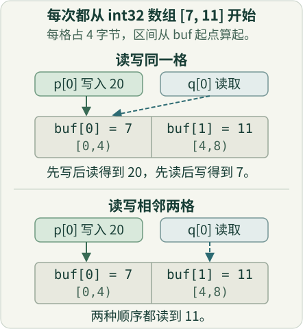

# 两项运算究竟能不能交换执行顺序？

历史记录里原本只有 7。先把本次算出的 20 追加进去，再读最后一项，读到 20。把这两步换个顺序，读到 7。两次运行结束时，打开列表看到的却都是 `[7, 20]`。[A02 的历史记录算例](../01-foundations/a02-program-representation.md#effect-dependencies)

编译器改排两项操作之前，要找出程序要求保留的先后关系，这叫**依赖分析**。要判断一次读取能否提前，可以从它所需的值问起。它要用谁算出的值？它要看到哪一次写入？换序后，调用者还能看到原来的返回值、状态和输出吗？

## 哪些先后关系能直接从值连线上读出来？ {#value-dependence}

[B01 的整数算例](b01-compiler-frontend.md#initial-ir)先求 `t = a + b`，再求 `y = t * c`。输入 2、3、4，乘法需要加法交出的 5，才能算出 20。在 [B03 的张量图](b03-graph-capture.md#operator-graph)里，加偏置也要先取得矩阵乘法产生的 P。两处都有一条从生产者指向使用者的**值依赖**。

让函数再返回一个结果 `u = c + c`。下面用教学 IR 给每个中间值起一个名字，操作数仍是 B01 的 Go `int32` 整数。

```text
%t = add(a, b)
%u = add(c, c)
%y = mul(%t, c)
return (%y, %u)
```

先求 %t 再求 %u，得到 5 和 8。对调前两行，%u 先得到 8，%t 随后得到 5。到乘法处，%t 仍然是 5，两次返回的都是 (20, 8)。

这次换序对其他输入也成立。两次整数加法都只取函数入口已有的值，各自产生一个新值，也没有其他可观察效果。换成乘法和产生 %t 的加法，情况就不同了。把乘法挪到最前，它使用的 %t 还没有定义。[B02 怎样从使用处找到定义](b02-control-flow-and-ssa.md#dominance-and-use-def)

## 两个参数都写着下标 0，读到的是哪一格？ {#alias-and-access-ranges}

历史记录里的读和写都提到了同一个列表，联系容易看见。现在把“写入 20”和“读出一个整数”分给两个参数。Go 的切片可以看作底层数组的一段窗口。函数拿到两扇窗口 `p` 和 `q`，各自的下标 0 都表示从自己的起点数第一格。[Go 规范 · 切片与底层数组](https://go.dev/ref/spec#Slice_types)

```go
func observe(p, q []int32) int32 {
    p[0] = 20
    return q[0]
}
```

如果想提前读，可以先执行 `v := q[0]`，再执行 `p[0] = 20`，最后返回 `v`。回看原函数的教学 IR，store 把 20 写入内存，load 从内存取值。store 没有把一个结果值交给 load，只顺着普通的值连线找，看不出提前读取会有什么影响。

```text
store(address(p[0]), 20)
%v = load(address(q[0]))
return %v
```

让每次试验都从 `buf := []int32{7, 11}` 开始。用 `p = buf[:1]` 让写操作固定写第一格，只改变传给 `q` 的切片。两次访问都在界内，运行期间也没有其他执行者访问这块内存。

| 传给 q 的切片 | q[0] 实际读取 | 先写后读的返回值 | 先读后写的返回值 | 两种顺序最终的 buf |
| --- | --- | ---: | ---: | --- |
| `buf[:1]` | buf[0] | 20 | 7 | `[20, 11]` |
| `buf[1:]` | buf[1] | 11 | 11 | `[20, 11]` |

第一行里，`p[0]` 和 `q[0]` 是访问同一格的两个名字，称为**别名（Alias）**。第二行仍共用同一个底层数组，写入的四个字节却碰不到读出的四个字节。判断这次读写能否交换，要比较这两次访问实际覆盖的范围。

<figure markdown="1">

[](assets/b04-alias-ranges.svg)

<figcaption>箭头分别标出 p[0] 写哪里、q[0] 读哪里。字节区间从底层数组起点数，[0,4) 包含字节 0 到 3。</figcaption>
</figure>

访问的宽度也有用。假设改为在一个字节数组上操作，一次写前 8 个字节，另一次从偏移 4 读 4 个字节。起点分别是 0 和 4，读出的四个字节却全部落在写入范围内。只比较两个起点就会漏掉这段重叠。

张量视图也能把这个关系藏起来。[A03 的转置视图](../01-foundations/a03-tensor-representation.md#transpose-view)里，`A[1,0]` 和 `T[0,1]` 的地址都是 1012。若通过 A 把这一格从 3 改成 20，通过 T 提前读就会读到 3，写后再读则得到 20。把 T 换成事先做好的独立副本，写 A 就影响不到副本里的 3。

## 编译器能证明这两次访问分开吗？ {#alias-analysis}

只看 `observe` 的函数体，参数类型能告诉编译器每次读写 4 字节，却没有告诉它两扇窗口从哪里开始。刚才的两种调用都符合函数签名。若为所有非空输入生成同一份函数，就必须照顾返回 20 的那种调用。把读无条件提前，会在这组输入上出错。

**别名分析（Alias Analysis）**利用编译时掌握的事实收窄答案。在第二种调用处，若编译器能同时看见两个切片的来源和偏移，就可以从共同的基址算出 [0,4) 和 [4,8)，证明它们分开。在第一种调用处，同样的推导会发现两次访问完全重合。

如果编译时掌握的事实还不足以排除重叠，就要按“可能重叠”处理。此时可以保留原顺序。有些编译器也会生成一次范围检查，只在检查确认两段分开时选用换序版本。LLVM 的循环向量化器就会在合适的循环上用这种办法。[LLVM · 别名查询](https://llvm.org/docs/AliasAnalysis.html#the-alias-method) · [LLVM · 运行时指针检查](https://llvm.org/docs/Vectorizers.html#runtime-checks-of-pointers)

## 知道范围重叠，哪些顺序还要保留？ {#memory-dependences}

现在固定访问同一格 x，起初存着 7。下面每行单独运行，读取得到的值会返回给调用者，最后写入的值也可观察。只看普通内存，访问都有效，没有并发读写。按原顺序给操作配对，就能从换序后的差别读出三类内存依赖。

| 原顺序 | 交换后有什么变化 | 对应的关系 |
| --- | --- | --- |
| 写 20，再读 x | 原来读到 20，现在读到 7 | 写后读（RAW），读需要前一次写出的值 |
| 读 x，再写 20 | 原来读到 7，现在读到 20 | 读后写（WAR），写要等旧值被读出 |
| 写 20，再写 30 | x 的最终值由 30 变为 20 | 写后写（WAW），最后生效的写入变了 |
| 读 x 给 u，再读 x 给 v | u、v 都仍是 7 | 两次读彼此独立，谁都没有改变 x |

表里真正起作用的是**哪次读需要看见哪次写，以及哪次写的结果会留下来**。因此，别名分析只回答了一个问题。还要知道每项操作对这段内存做什么，以及这些效果能否被观察到。

## 遇到函数调用，怎样知道它会碰什么？ {#effects-and-control}

把 `p[0] = 20` 换成 `update(p)`，后面仍然返回 `q[0]`。如果能检查函数体，发现它只从普通内存读取 `p[0]`，随后正常返回，也没有其他可观察效果，两次读取就可以在上述条件下换序。若它会写 `p[0]`，则又要追问它和 `q[0]` 是否重叠。

这就是**效果分析**要提供的信息。实现可以检查被调用函数，也可以利用可信的接口约定。例如 LLVM 能针对一段指定内存查询某次调用是否可能读取它（Ref）、修改它（Mod），或两者都有。缺少足够信息时，必须把尚不能排除的读写算进去。[LLVM · 调用的 Mod/Ref 查询](https://llvm.org/docs/AliasAnalysis.html#the-getmodrefinfo-methods)

程序还可能产生内存表里看不见的**副作用**。回到 A01，先执行 `print(t)` 再执行 `print(y)`，读者看见 5、20。交换后看见 20、5。即使两个参数值早已算好，两次操作仍作用在同一个输出序列上。[A01 的可观察行为](../01-foundations/a01-program-semantics.md#observable-behavior)

移动操作还要留心它原来在哪条路径上执行。假设 Go 函数用下面的条件决定要不要取第一格。

```go
if len(q) == 0 {
    return 0
}
return q[0]
```

空切片原本直接返回 0。如果把 `q[0]` 提到条件之前，空切片也会尝试读取，越界触发 panic。即使这次读取只读内存，编译器也需要证明它在新位置执行是安全的。[Go 规范 · 下标与越界](https://go.dev/ref/spec#Index_expressions) · [MLIR 对控制流区域中效果与推测执行的区分](https://mlir.llvm.org/docs/Rationale/SideEffectsAndSpeculation/)

## 同一行循环体，为什么不能从末尾开始做？ {#loop-carried-dependence}

[B02 的循环](b02-control-flow-and-ssa.md#loop-carried-values)把上轮的标量值带回循环入口。值也可以经由数组交给下一轮。让 `a` 从 `[5, 0, 0, 0]` 开始，每轮读左边一格，加一，写入当前格。

```go
for i := 1; i < len(a); i++ {
    a[i] = a[i-1] + 1
}
```

乍看每轮都写不同的位置。把第 i 轮和第 i+1 轮的下标展开，联系就出来了。前者写 `a[i]`，后者读 `a[(i+1)-1]`，正好也是 `a[i]`。跨越不同迭代的依赖叫**循环携带依赖（loop-carried dependence）**。本例是上一轮写，下一轮读。

<figure markdown="1">

[![从 [5,0,0,0] 出发，第 1 轮用 5 写出 6，第 2 轮读回 6 写出 7，第 3 轮读回 7 写出 8。](assets/b04-loop-dependence.svg)](assets/b04-loop-dependence.svg)

<figcaption>横向看一轮怎样读、加、写。沿斜箭头看，上一轮写入的那一格，正是下一轮的输入。</figcaption>
</figure>

正序得到 `[5, 6, 7, 8]`。若先做 i=3，它读到的 a[2] 还是 0，只能给 a[3] 写 1。接着 i=2 也读到旧的 0。最后才轮到 i=1 把 6 写进去。逆序留下 `[5, 6, 1, 1]`。

若把循环体改为 `a[i] = a[i] + 1`，每轮只读写自己的格子。仍遍历 i=1、2、3，各格的读都要先于本轮的写，却没有哪一轮需要另一轮写出的值。正做、倒做都会留下 `[5, 1, 1, 1]`。同样是原地修改数组，下标关系足以让结论改变。[得州大学奥斯汀分校编译课程 · 循环携带依赖](https://www.cs.utexas.edu/~lin/cs380c/handout27.pdf)

## 拿到一对操作，怎样决定能不能换序？ {#next}

回到 `observe(p, q)`。先沿值连线找各自的输入，再追到两次访问的字节范围。写和读可能落在同一格时，还要保住读应当取得的那次写入。遇到调用或分支，再核对外部效果以及操作在哪些输入上会执行。这些条件合起来，才说明某个新顺序能覆盖哪些调用。

放回矩阵乘法也可以这样读。C01 的 X、W 只读，Y 单独存放，每个输出元素占用不同的存储位置。两项工作分别写 Y 的两格，即使共读 X 中的同一个数，也不会改掉对方要读或写的值。满足这些条件后，才轮到选择把工作分给哪个计算单元。[C01 的两个单元怎样分担四个输出](../03-mapping-and-planning/c01-tensor-mapping.md#space-and-time)

还有一种情况：对同一格读了两遍，编译器能否直接沿用第一次读出的值？除了确认中间有没有可能改写它，还要知道第一次的结果能否沿当前路径传到这里。下一篇 B05 将沿这个问题讨论计算的提前、复用和删除。

返回[编译前端与程序优化导读](README.md)。
