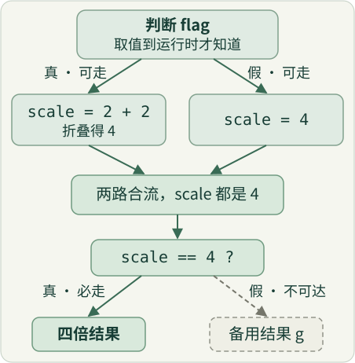
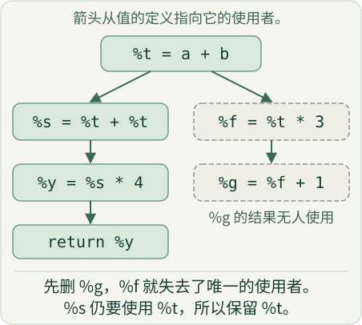

# 程序中哪些计算可以提前完成、复用或直接删除？

读出一个数，过几行又读一次。编译器要是能让后面的加法直接用第一次读出的数，就省去了一次读取。但如果这几行里有人把 7 改成了 20，加法原本要算的是 7 + 20，改写后却成了 7 + 7。

编译器需要知道，在程序的某个位置，哪些值已经确定，哪些旧结果还能用，哪些结果往后还会有人读。**数据流分析**沿程序可能经过的路径推导这些事实。优化再据此改写程序。下面看看同一个整数函数能一步步简化成什么样。

## 两次读取长得一样，能合成一次吗？ {#reuse-a-read}

接着 [B04 的读写算例](b04-dependency-and-alias-analysis.md#alias-and-access-ranges)，现在把写入前后的两次读数都加进返回值。每次调用都从数组 `[7, 11]` 开始，切片非空，运行期间也没有其他执行者改动数组。

```go
func readTwice(p, q []int32) int32 {
    first := q[0]
    p[0] = 20
    second := q[0]
    return first + second
}
```

| p[0] 写第一格时，q[0] 读哪里？ | 原程序 | 如果用 first 代替 second |
| --- | --- | --- |
| 也是第一格 | 7 + 20 = 27 | 7 + 7 = 14 |
| 相邻的第二格 | 11 + 11 = 22 | 11 + 11 = 22 |

第一条读取在每条到达第二条读取的路径上都已执行，所以后面拿得到 first。但这只解决了“手上有没有旧值”。还要证明第二次读到的仍是这个值。若两个访问范围分开，中间那次写入碰不到 q[0]，这份证据就齐了。对任意 p、q 都适用的版本则必须考虑第一行。

## 在拿到输入之前，函数里哪些数已经知道？ {#fold-and-propagate}

回到 B01 的 `a + b`。给这个和选一个倍率，再计算返回值。下面把两条配置路径都写出来。一条用两个半份算倍率，另一条直接填入 4。为观察哪些工作最后会消失，函数还先准备了备用结果 g。

```go
func score(a, b int32, flag bool) int32 {
    t := a + b
    f := t * 3
    g := f + 1

    var scale int32
    if flag {
        half := int32(2)
        scale = half + half
    } else {
        scale = 4
    }

    if scale == 4 {
        again := a + b
        return (t + again) * scale
    }
    return g
}
```

先手算一次。令 a=2、b=3，入口得到 t=5，备用的 g=16。flag 为真时，两份 2 合成 4。flag 为假时，也得到 4。两次都走到含 again 的返回语句，算出 (5 + 5) × 4 = 40。

编译时还没有 a、b 和 flag。这时仍可以做两步。先沿真分支，把 half 定义处的 2 带到使用处，将 `half + half` 写成 `2 + 2`，这叫**常量传播**。再按该加法的整数语义算出 4，用 4 替换整项运算，这叫**常量折叠**。

同样的方法用在入口，能把 `t * 3` 整项折叠吗？3 已知，t 却要由本次调用的 a、b 决定。刚才手算得到的 5 只属于那组输入。下面的教学 IR 将这些步骤展开，真实前端可以更早完成其中一些计算。[B01 的类型与初始 IR](b01-compiler-frontend.md#initial-ir) · [Go 规范中的整数运算](https://go.dev/ref/spec#Integer_overflow)

## flag 仍然未知，为什么后一个分支已经可以选定？ {#constants-at-join}

按 [B02 的 φ 写法](b02-control-flow-and-ssa.md#ssa-and-phi)，汇合处的 scale 从刚刚经过的那条边取值。Go 声明 scale 时给它零值，但两条路都会在汇合前覆盖它。图里只需画出这两条来路实际送来的数。

<figure markdown="1">

[](assets/b05-constants-at-join.svg)

<figcaption>第一处分叉的两条边都可能经过。两边送到汇合处的数相同，才使第二处分叉的假边不可达。</figcaption>
</figure>

用教学 IR 记作 `%scale = φ([4, 真路], [4, 假路])`。顺着任一来路，到这里都能用常量 4 替换 %scale。于是 `%scale == 4` 化成真，条件跳转可以改成直接跳往第一条返回语句，另一条通往 `return g` 的边可以删除。这是一次**控制流化简**。

改动一处试试。让 flag 的假路提供 5，汇合处就可能收到 4 或 5。给它相同的 a=2、b=3，flag 为真仍返回 40，为假却返回备用的 16。若把条件跳转一律删成“走真路”，第二次调用就会出错。

要在汇合处用一个常量替换这个值，每条可能到达的来路都必须支持同一个数。已经证明不可达的边可以略过。若某条边只是还没分析到，就得给它留下更新结论的机会。

从入口把已知事实向后传，每遇一条指令就更新，每遇汇合就比较来路，这叫**正向数据流分析**。遇到循环，后来发现的回边也会改变结论。例如 B02 的循环头首次收到 i=0，执行一轮后还可能收到 1。分析要重新处理受影响的位置，直到记录的事实不再变化。[Clang 的数据流分析导论](https://clang.llvm.org/docs/DataFlowAnalysisIntro.html)

同时追踪 SSA 值和可能执行的控制流边，就能让两种信息互相帮助。在这里，常量 4 使备用分支不可达。反过来，若某个 φ 的一条入边已被排除，那条边携带的值也就不会影响 φ 的结果。**稀疏条件常量传播（SCCP）**是采用这种思路的一种算法。[Wegman 与 Zadeck 的原论文](https://cs.brown.edu/research/pubs/techreports/reports/CS-91-22.html)

## 谁能证明第二个 a + b 已经算过？ {#common-subexpressions}

回到倍率总为 4 的版本。虽然 t 在编译时仍没有确定的数值，编译器却能知道运行时的 again 等于 t。把使用 again 的地方换成使用 t，就能省掉一次加法。这个变换叫**公共子表达式消除（CSE）**。

| 比较哪件事 | 在 score 中如何证明 |
| --- | --- |
| 两次算的是同一项吗？ | 都按 int32 做加法，取同一对参数 a、b，中间没有重新赋值 |
| 后面一定拿得到前一个结果吗？ | t 定义在入口，通往 again 的每条路径都已算出 t |
| 省掉后一次执行会漏掉别的行为吗？ | 这次整数加法只产生结果，没有输出、内存写入或异常 |

第二行用到了 B02 的**支配**。设想只在 flag 的真路额外记录一个值 u = a + b。到了汇合处，能用这个 u 替换 again 吗？从假路进来时，产生 u 的那次加法根本没有执行。[B02 的定义与使用](b02-control-flow-and-ssa.md#dominance-and-use-def) · [康奈尔大学编译课程的公共子表达式消除](https://www.cs.cornell.edu/courses/cs4120/2023sp/notes/redund_elim/)

这也解释了开头的两次读取。加法的输入都写在操作数里，而一次读取还依赖那个地址当时存着什么。入口已经算过、指令文本相同，都不足以单独证明两次读取等价。

## 从 return 往回找，哪些中间值还会用到？ {#live-values}

原程序中，若还认为 `return g` 可能发生，就要为这条路径留下 g。现在这条边已经证明不可达。两条配置路径剩下的都是常量赋值，汇合处也不再需要分辨来路，可以把它们一并收起。此时先保留入口原有的 f、g，得到下面这段教学 IR。

```text
%t = add(a, b)
%f = mul(%t, 3)
%g = add(%f, 1)
%s = add(%t, %t)
%y = mul(%s, 4)
return %y
```

一个值在某个程序点是**活跃的**，指从这个位置出发，至少有一条可能的后续路径会使用它当前的值。对于能反复赋值的变量，要在下次覆盖它之前使用才算。要回答这个问题，可以从使用处向前倒推。

| 原样保留以上指令，从后往前读 | 通过这一行向前推，哪些值需要带到行前？ |
| --- | --- |
| `return %y` | 需要 %y |
| `%y = mul(%s, 4)` | %y 在本行产生，行前只需 %s |
| `%s = add(%t, %t)` | 两个输入都是 %t，行前只需 %t |
| `%g = add(%f, 1)` | 后面仍要 %t，本行还读 %f，所以行前要 %t 和 %f |

刚好在 %g 这行之后，活跃集合只有 {%t}。倒推到 %g 这行之前，%f 也在集合里，因为本行还要读它。若控制流分叉，只要任一后继需要某值，这个值就在分叉的出口活跃。这与常量传播在汇合处要求各路一致，问的是两件不同的事。[康奈尔大学编译课程的活跃性分析](https://www.cs.cornell.edu/courses/cs4120/2023sp/notes/livevar/)

<figure markdown="1">

[](assets/b05-live-values.svg)

<figcaption>箭头从定义指向使用处。左边的值通向返回语句。右边走到 %g 就没有箭头接出，沿这条链往回看，能找出下一项可以删除的计算。</figcaption>
</figure>

先删谁？%g 没有使用者，生成它的加法也没有其他效果，可以删。删完以后重新检查，%f 失去了唯一的使用者，产生它的乘法也可以删。这叫**死代码消除（DCE）**。%t 还要交给 %s，所以这条删除链到此为止。[LLVM 的 DCE 对已删除指令的输入如何复查](https://llvm.org/docs/Passes.html#dce-dead-code-elimination)

## 无人读取返回值，能把操作本身也删掉吗？ {#observable-effects}

把 `print(g)` 加在原函数算出 g 之后。给它 2 和 3，程序会先输出 16，再返回 40。打印本身没有可供后面使用的结果，却是程序要求发生的事。打印仍然需要 g，而算出 g 需要 f。

若把打印写进已经证明不可达的备用分支，原程序就没有任何调用会产生这次输出，整段分支可以随不可达的边一起删掉。[A01 的可观察行为](../01-foundations/a01-program-semantics.md#observable-behavior)

再看 Go 的 `_ = q[0]`。即使读出的整数被丢弃，给它一个空切片仍会触发 panic。删除这行就可能把出错的调用改成正常返回。“结果无人需要”说明可以放弃这个值。要删除产生它的操作，还得确认连同它消失的行为都可以省略。[B04 的越界反例](b04-dependency-and-alias-analysis.md#effects-and-control)

## 化简前后，调用者还能观察到什么？ {#next}

原版 score 剩下三项算术。先算出 t，再取 t + t，最后乘 4。保留原函数签名，函数体可以写成下面这样。

```go
t := a + b
return (t + t) * 4
```

用 Go 1.19.8 运行两版函数，输入 (2, 3) 都返回 40，输入 (−5, 3) 都返回 −16。另把原函数写成等价的 LLVM IR，交给 LLVM 19.1.7 优化，得到两条加法、一条乘法和返回指令。

七组整数输入分别取两种 flag，覆盖了正数、负数和 int32 溢出边界，Go 与 LLVM 的原版、化简版在这 14 次调用中结果相同。样例能帮我们发现写错的变换。让结论覆盖其他 int32 输入的依据，则是每次替换都能从原有定义、可达路径和效果推导出来。

把这个判断带回 [B03 的 MatMul → Add → ReLU](b03-graph-capture.md#operator-graph)。若两个下游各写了一次 Add(P, bias)，两次都按同一算子规则读取同一对张量值，又没有额外效果，就能让两个下游共用一个加法结果。

若还想把几个算子合成一个，或者改写浮点运算的分组，就要再检查形状、读写及数值约定。下一篇 B06 接着讨论这些条件。

返回[编译前端与程序优化导读](README.md)。
