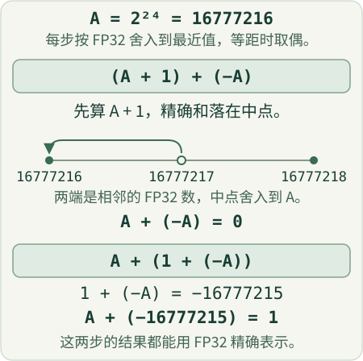

# 看起来等价的两种计算，编译器为什么不能任意替换？

[B03](b03-graph-capture.md#operator-graph) 的小模型有三项操作。先做矩阵乘法，再加偏置，最后做 ReLU。如果把后两项合成一项，模型仍然可以逐元素求出相同的结果。如果把三项操作的先后关系也改一改，结果还会一样吗？

编译器可以用不同的表示来描述同一项计算。**程序变换的合法性**要解决的问题是，改写后的程序能否在约定的输入范围内，保持原程序要求的返回值、状态变化和其他可观察行为。这里沿用前面的矩阵，看看一次改写需要哪些证据。

## 还未拿到张量，怎样知道输出有几行几列？ {#shape-inference}

B03 用两个小矩阵做乘法。现在用三个符号 M、K、N 记录行数和列数，并约定它们是正整数。输入和权重保持为同一种 float32 元素类型。先只考虑与 B03 一样的二维矩阵乘法。

| 已知输入 | 运算 | 推导出的结果 |
| --- | --- | --- |
| X 为 [M, K]，W 为 [K, N] | MatMul | P 为 [M, N] |
| P 为 [M, N]，bias 为 [N] | Add | Z 为 [M, N] |
| Z 为 [M, N] | ReLU | Y 为 [M, N] |

为什么可以这样推？要得到 P[i,j]，就从 X 的第 i 行和 W 的第 j 列，按同一 k 配对相乘后求和。因此输出行数取自 X，列数取自 W，两项计算的 k 范围必须一样。接下来的偏置按 j 取值，ReLU 仍逐格产生结果。

这就是**形状推导（Shape Inference）**。编译器按照每个算子的规则，用输入的维度和类型推导输出的维度和类型。就算 M 仍是一个运行时才有数值的符号，也能得到 Y 的形状为 [M,N]。[算法与模型 · 张量形状与计算](../../workload/00-overview/tensor-shapes-and-cost.md) · [MLIR 的形状与类型推导](https://mlir.llvm.org/docs/ShapeInference/)

这里还有条件。若 X 为 [M,K₁]，W 为 [K₂,N]，必须知道 K₁ = K₂ 才能按上述规则解释矩阵乘法。把这些维度之间的等式、不等式和取值范围记录下来，就是**形状约束**的一种表示方式。

## 输出形状一样，偏置为什么还会加错？ {#symbolic-constraints}

沿用 B03 的具体输入，第一行 X 是 [1,2]，W 的两列是 [1,3] 和 [2,−1]。乘法得 P 的第一行 [7,0]。偏置为 [1,−2]，所以 Z 的第一行是 [8,−2]，Y 的第一行是 [8,0]。

如果把 Add 和 ReLU 改写为逐元素计算，偏置的下标该取 i 还是 j？M=N=2 时，两种写法都能查到偏置，输出形状也都是 [2,2]。但按行取 i 时，P 第一行会加上两个 1，得到 [8,1]，ReLU 的第二项也变为 1。

B03 还把 X 扩展到三行，新增一行 [0,0]。正确的改写仍按 j 取偏置，输出多出 [1,0]。错误的改写用 i=2 去找偏置的第三项，此时连下标也越界。形状相同的两份 IR 仍需要核对索引对应关系。

再把接口推广一步，允许偏置的长度 L 可变。这是一个新的输入约定，仍要求输出为 [M,N]。按照 NumPy 风格的广播规则，L 可以等于 N，也可以等于 1。长度为 1 时，每一列都使用 bias[0]。

| N=2 时的 bias | 原始广播加法对 [7,0] 的结果 |
| --- | --- |
| [1,−2] | [8,−2] |
| [−2] | [5,−2] |
| [1,−2,3] | 形状不相容 |

若仍有 N>1，改写后直接取 bias[j]，长度为 1 的合法调用就会越界。编译器若想使用这条简化规则，需要先从已有形状信息证明 L=N。只知道 L=1 或 L=N 时，可以保留广播，或像 B03 的 Guard 一样，生成有条件使用的版本。

一般广播也允许将 N=1 的输入沿列扩展，和长度 L>1 的偏置相加，输出变成 [M,L]。本例要求保留矩阵乘法的输出形状。

[ONNX 的广播规则](https://onnx.ai/onnx/repo-docs/Broadcasting.html)适用于采用该规则的算子，例如 ONNX Add。StableHLO 的 Add 要求按同形张量逐元素相加。需要列偏置时，可先用 broadcast_in_dim 表达广播，再做 Add。[StableHLO · Add](https://openxla.org/stablehlo/spec#add) · [broadcast_in_dim](https://openxla.org/stablehlo/spec#broadcast_in_dim)

## 两个算子放进一项计算，哪个值还要交出去？ {#fusion-and-decomposition}

现在设定 L=N。在原图中，Add 交出 Z，ReLU 接收 Z 并产生 Y。观察其中一格，只要先按原来的加法规则求 Z[i,j]，再按原来的 ReLU 规则求 Y[i,j]，就能对每个位置依次完成这两项操作。

把两项操作组织成一项复合操作，明确记录组合的输入、输出和内部运算关系，这称为**算子融合（Fusion）**。例如可以用下面的教学 IR 表达一种融合形式。

```text
Before:
  %z = Add(%p, %bias)
  %y = Relu(%z)
  return %y

After:
  %y = BiasRelu(%p, %bias)
  return %y
```

这里自行定义 BiasRelu 的语义为原来的广播、Add 和 ReLU，包含原有类型、舍入及特殊值等约定。对每一格都做相同的两步，再按相同形状交出 Y，就得到原函数要求的结果。组合内部还需要那个 Z 的值，只是不再需要把它列作独立的外部结果。

反过来也成立。如果 IR 中已经有这样的复合算子，可以把它的定义展开为 Add、ReLU 及其连接关系。这称为**算子分解（Decomposition）**。例如 StableHLO 的 composite 操作带有用来描述其语义的分解函数。[StableHLO · composite](https://openxla.org/stablehlo/spec#composite)

现在让调用者还需要 Z，例如为了观察 ReLU 前的值，函数改为 `return Y, Z`。原图的 Z 就多了一条使用关系。能不能只输出 Y，再让调用者用 Y 当作 Z？

<figure markdown="1">

[![原本 Add 产生 Z=[8,−2]，ReLU 产生 Y=[8,0]，两者都交给调用者。可把两项运算放在同一个组合内，但 Z 和 Y 的输出仍各自保留。](assets/b06-fusion-uses.svg)](assets/b06-fusion-uses.svg)

<figcaption>跟踪第一行的两个值。第二个元素经过 ReLU 后从 −2 变为 0，所以调用者仍需要独立的 Z。</figcaption>
</figure>

这次融合仍可以成立，只需保证外部的两项使用得到原本的值，例如让组合同时产生 Y、Z。若直接删掉 Z 的所有外部使用，第二列的 −2 就会消失。这里用到了 B02、B05 的定义与使用关系。

这些操作的输入在本例中只读，结果也具有独立的值语义。如果改为原地写入，或者跨过一项能改变 P 或 bias 的操作，还要重新核查 [B04 的内存依赖与副作用](b04-dependency-and-alias-analysis.md#effects-and-control)。

将这样的匹配与条件写成可执行的规则，匹配原图，再按规则建立新节点并重接使用关系，就是**图重写（Graph Rewriting）**的一种做法。可以组合多个节点，也可以展开节点。一个规则的正确性取决于其匹配条件和替换定义。[MLIR 的 Pattern Rewriting](https://mlir.llvm.org/docs/PatternRewriter/)

## 把 ReLU 移到乘法内部，为什么可能得到别的数？ {#operator-order}

上面两项逐元素操作的组内先后关系没有变化。再试另一种改写。只观察 B03 中乘积 P 的第二列、第一行。它由两个乘积 2 和 −2 相加得到 0。

如果希望在矩阵乘法过程中就完成 ReLU，能不能在两个乘积上先做 ReLU，再把它们相加？

| 处理顺序 | 结果 |
| --- | --- |
| 两项先求和，再做 ReLU | ReLU(2 + (−2)) = 0 |
| 每项先做 ReLU，再求和 | ReLU(2) + ReLU(−2) = 2 |

此处先忽略偏置，只比较一处 ReLU 怎样跨过求和。原求和需要正数和负数共同贡献，提前截掉负数就改变了贡献。即使所有计算都能精确进行，二者也不同。

相邻算子可以组合执行，但把运算移到归约的每一项上需要额外的数学条件。编译器不能仅凭两个节点相邻，就把整个归约后的操作提前。[C01 中沿 k 求和的含义](../03-mapping-and-planning/c01-tensor-mapping.md#split-reduction)

## 加法的括号，为什么在浮点数里也有意义？ {#numeric-semantics}

整数小算例很容易手算出正确结果。C01 把多项乘积先分组再求和，只要整数结果没有超出所用格式，前后的数值就一致。现在比较三个浮点数相加，约定每次加法都把结果舍入为 FP32，采用舍入到最近值、平分取偶的方式。

令 A=16777216，比较 A、1、−A 三个数。A 恰好是 2 的 24 次方。在 FP32 中，从这里往上一个可表示的数是 16777218。精确的和 16777217 刚好夹在两者之间，按约定被舍入成 16777216。

换一种分组会怎样？先算 1 + (−16777216)，得到 −16777215，这个数可以精确表示。再加上 16777216，得到 1。

<figure markdown="1">

[](assets/b06-float-rounding.svg)

<figcaption>三个输入都保持相同，只改变加法的分组。先相加的两个数不同，舍入后最终结果差了 1。</figcaption>
</figure>

这些差别来自有限的有效数字位数，详见[计算微架构的浮点运算与低精度](../../microarchitecture-v2/01-foundations/a04-floating-point-and-low-precision.md)。同样的道理，若原来要求先乘法舍入，再加法舍入，改成只在最后舍入一次的融合乘加，也可能改变结果。

能否改分组，要看具体程序和 IR 的数值语义。有的要求逐次舍入，有的给归约实现留出不同的累加方式。LLVM 的 fast-math 标志中，reassoc 就明确允许浮点重结合。它表达的是变换许可，所以要在编译器获得这种许可时使用。

即使把两个算子合在一起，也要遵守原语义要求的舍入点、数据类型及特殊值规则。NaN、有符号零等还可能使只在普通有限数上成立的改写失效。[LLVM · Fast-Math Flags](https://llvm.org/docs/LangRef.html#fast-math-flags) · [Goldberg · 浮点算术](https://docs.oracle.com/cd/E19957-01/806-3568/ncg_goldberg.html)

## 循环的先后顺序，能不能跟着一起换？ {#loop-transformations}

图中两项操作可以组合成一项，循环里也有改变工作顺序的机会。仍以 B03 的 Add、ReLU 为例，假设 P、bias 都只读，输出 Y 独立存放，每格占用互不重叠的位置。

循环范围 i=0..M−1、j=0..N−1。假设这些操作会正常完成，且没有额外可观察效果。对于其中一格，计算始终是先加再做 ReLU。

当 M=N=2，原来以 i 为外层循环，输出顺序是 (0,0)、(0,1)、(1,0)、(1,1)。如果将 j 作为外层循环，输出顺序就变成 (0,0)、(1,0)、(0,1)、(1,1)。四格各算一次，每格输入在两种执行顺序中都相同。于是最终的四个值不受影响。

这种变换称为**循环交换（Loop Interchange）**。如果原程序用两个循环分别算完整的 Z 和 Y，在上述条件下，也可以把计算同一格的 Add 和 ReLU 放进同一个循环体。这是一种循环融合，保留了每格的写后读关系。

再看一段原地更新循环，两个下标的取值范围也很简单，却有一条来自上一行的依赖。以下使用普通整数数组，初值和循环范围固定。

```python
a = [[5, 7, 9], [0, 0, 0], [0, 0, 0]]
for i in range(1, 3):
    for j in range(2):
        a[i][j] = a[i-1][j+1] + 1
```

| 先后执行的两项工作 | 原顺序 i 外、j 内 | 改为 j 外、i 内 |
| --- | --- | --- |
| (1,1) 写 a[1][1] | 写入 10 | 较晚才写入 10 |
| (2,0) 读 a[1][1] | 读到 10，写入 11 | 提前读到 0，写入 1 |

跟踪这两个坐标，原顺序中它们之间有一条 B04 的写后读依赖。交换内外循环后，读跑到了写之前。两种顺序最后都会把 a[1][1] 写成 10，但 a[2][0] 已经不同。

这就是 [B04 的循环携带依赖](b04-dependency-and-alias-analysis.md#loop-carried-dependence)在两层循环里的应用。循环交换、分块或合并等变换，都需要核查原来哪些迭代必须先于其他迭代，以及新边界会不会遗漏或重复工作，才能进一步比较方案。[得州大学奥斯汀分校编译课程 · 循环携带依赖](https://www.cs.utexas.edu/~lin/cs380c/handout27.pdf)

## 编译器怎样把多次分析和变换接起来？ {#pass-pipeline}

回看 B05 的程序，只有在传播常量、判定分支不可达后，才能认出备用结果 g 已经无人使用。删掉 g 的加法，又会让另一项乘法失去用途。每次变换产生的新 IR，都可能提供下一次变换所需的信息。

编译器通常把一项分析或变换组织为一个 **Pass**，把先后执行的多个 Pass 组织成 **Pass Pipeline**。以 B03 的普通三节点图（只返回 Y）为例，可以安排以下处理过程。

| 步骤 | 使用的事实 | 处理后的表示或新事实 |
| --- | --- | --- |
| 形状与类型推导 | B03 原输入约定及算子规则 | P、Z、Y 同为 [M,N]，bias 的长度等于 N |
| 图重写 | Add 的唯一使用者是 ReLU，且满足组合算子条件 | 将 ReLU 的结果使用改接到 BiasRelu |
| 删除无用操作 | 重新检查 Add、ReLU 的使用关系及效果 | 先删旧 ReLU，再删旧 Add，仍需 P 和 bias |
| 核对变换结果 | 新 IR 的类型、形状和使用关系 | 新图满足表示的结构及类型规则 |

在图重写前统计出的使用次数，不能一直拿到后面用。重写后，旧 Y 失去使用者。删除产生旧 Y 的 ReLU 后，旧 Z 才失去最后一个使用者。后续 Pass 要重新计算受影响的分析结果，或由变换证明某些分析仍有效。

有些变换合在一个 Pass 内完成，有些分析按需执行，也可反复应用规则。上表只是为了说明信息怎样在步骤之间传递。MLIR 采用 Pass Manager 来组织这些步骤，并提供分析缓存和失效机制。[MLIR · Pass Infrastructure](https://mlir.llvm.org/docs/PassManagement/)

结构检查也有边界。把 bias[j] 错写为 bias[i] 的 2×2 例子，仍然可能通过类型和形状检查。每条变换规则还必须有自己的语义依据，并在适用条件成立时才应用。

## 从能否变换，到怎样选择执行方案 {#next}

我们从源代码和框架程序中得到可分析的 IR，再追踪值、控制路径、内存读写和形状约束。到这里，编译器就能据此解释哪些计算可替换、何时必须保留原有关系。

算例用 NumPy 2.3.5 的 float32 和 PyTorch 2.8.0 CPU 核对了形状与偏置索引，用 NumPy 验证了两种求和分组，并用整数数组复算了循环交换。样例能暴露一条规则的错误，规则在其他输入上成立还需要前面逐步建立的条件。

同一个合法的计算关系，可能有多种执行方式。例如独立的几个输出既能按行依次计算，也能分别交给不同计算单元。接下来要知道硬件有什么资源、怎样分工以及如何安排数据，这就是[资源映射与执行规划](../03-mapping-and-planning/README.md)要解决的问题。可以从 [C01：一块矩阵怎样分给有限数量的计算单元？](../03-mapping-and-planning/c01-tensor-mapping.md) 开始。

返回[编译前端与程序优化导读](README.md)。
