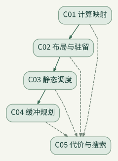

# 资源映射与执行规划

一个矩阵乘法可以有许多合法执行方案。芯片的计算资源、缓冲容量和数据供给能力不同，软件需要选择分块、放置、搬运和执行顺序。

## 贯穿算例与阅读边界

复用计算微架构 D 专题的 2×4 与 4×2 小矩阵；逐步改变分块、驻留、搬运日程和 Buffer 复用约束，最后比较多个合法候选。

硬件如何支持数据流与 DMA 由相邻系列讲解；这里讲方案选择和静态规划。具体生成代码归 D，运行时动态分配归 F，实测归 K。

## 知识关系

<figure class="micro-v2-map" markdown="1">

<figcaption>图中实线表示本专题内的主要前置关系，虚线表示按场景参考；跨专题先修知识见下表。 点击可查看大图。</figcaption>
</figure>

## 阅读顺序 {#计划阅读顺序}

本专题规划 5 篇正文。 当前均为未发布的阅读计划，标题与范围可在编写时根据认知目标调整。

| 编号 | 文章（暂定标题） | 读完应理解什么 | 主要前置知识 | 状态 |
| --- | --- | --- | --- | --- |
| C01 | 一块矩阵怎样分给有限数量的计算单元？ | 计算分解、张量分块、时空映射、任务分配、Placement、尾块与资源约束。 | A03、A04、B04 的必要知识 | 未发布 |
| C02 | 同一组数据怎样安排布局和驻留，才能减少搬运？ | Layout 选择、数据复用、Dataflow 选择、存储层次、布局转换代价。 | C01 | 未发布 |
| C03 | 计算与数据搬运怎样安排在同一张时间表上？ | Task DAG、静态调度、资源占用、DMA 编排、通信规划、计算搬运重叠。 | A05、C02 | 未发布 |
| C04 | 已经使用过的缓冲空间，什么时候可以交给下一项任务？ | 静态 Buffer 生命周期、分配、复用、干涉关系、容量及别名约束。 | C03、B04；按需 B05 | 未发布 |
| C05 | 许多方案都能正确执行，怎样找到更好的一个？ | 合法性与优化目标、代价模型、设计空间、搜索、Auto-tuning、Pareto、Shape 专门化。 | C01–C04 的相关知识；按需 K03 | 未发布 |

## 从哪里来，接下来往哪读

主要衔接：[软件执行共同基础](../01-foundations/README.md)、[编译前端与程序优化](../02-frontend-and-optimization/README.md)。

硬件机制参考[计算微架构](../../microarchitecture-v2/README.md)、[存储系统](../../storage/README.md)和[芯片与系统互连](../../interconnect/README.md)。

后续方向：[算子实现与代码生成](../04-code-generation/README.md)、[通用执行运行时](../06-execution-runtime/README.md)、[分布式执行与通信编排](../09-distributed-execution/README.md)、[性能分析、建模与验证](../11-performance/README.md)。

更多阅读路线见[编译器与运行时系统系列首页](../README.md)。
