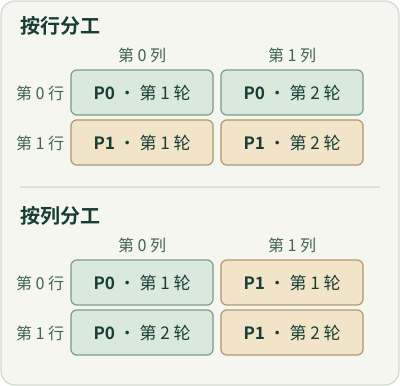

# 一块矩阵怎样分给有限数量的计算单元？

矩阵乘法要交出四个数，设备却只有两个计算单元。可以让每个单元负责一行，也可以让两个单元合力算出一个数。这两种分工给设备留下的任务有什么不同？

**计算映射（Mapping）**要把原计算拆成若干份，选定每份工作由哪个资源承担，以及同一资源按什么顺序做这些工作。下面沿用计算微架构 D01 的矩阵。我们站在编译器一侧，试着为只有两个单元的目标写一份分工表。

## 划一块工作，最少要说清哪几个索引？ {#iteration-space}

输入 X 有两行、四列。权重 W 有四行、两列。为了看清每个乘积从哪里来，表中把 X 的两行和 W 的两列都按相同的 k 展开。

| 取哪些元素 | k = 0 | k = 1 | k = 2 | k = 3 |
| --- | ---: | ---: | ---: | ---: |
| X 第 0 行 | 2 | 1 | 3 | 4 |
| X 第 1 行 | 1 | 2 | 1 | 2 |
| W 第 0 列 | 3 | 5 | 2 | 1 |
| W 第 1 列 | 1 | 2 | 3 | 4 |

要算输出 Y[0,0]，取 X 第 0 行和 W 第 0 列，在同一个 k 处配对相乘。从零累加，得到 2×3 + 1×5 + 3×2 + 4×1 = 21。换成 W 第 1 列就得到 Y[0,1] = 29。两行最后得到的结果分别是 (21, 29) 和 (17, 16)。

三个索引各有用处。i 选 X 的行，j 选 W 的列，二者一起选中输出 Y[i,j]。k 选中要加进这个输出的一项 X[i,k] × W[k,j]。一共两种 i、两种 j、四种 k，合计 2 × 2 × 4 = 16 次乘加（MAC）。

给同一个任务一段 i、一段 j 和一段 k，就能推回它要读的 X、W 以及要更新的输出。把整个索引范围切成这样的小块，称为**分块（Tiling）**。例如固定 i=0、j=1，取全部四个 k，这一块工作恰好算出一个完整的 29。

块的边界也可以只画在纸上。上面的 W 按列列出，是为了看清点积。实际取数仍遵循张量自身的布局，选中一列并不要求先把它复制到一块新内存里。[A03：张量切片怎样定位元素](../01-foundations/a03-tensor-representation.md#storage-offset)

## 四个输出怎样排进两个单元？ {#space-and-time}

假设目标向软件开放两个可分别指定的单元 P0、P1。每个单元有一个累加器，每拍能把一个乘积加进去，下一拍可接着累加。输入是四位无符号整数，乘积保留八位，十位累加器能容纳四个最大乘积之和 4 × 225 = 900。

先假设两单元都能及时取得所需输入，开始新点积时清零，交出结果和清零都不额外占拍。我们只从第一项乘加数到最后一项乘加。原始矩阵、精度及单元内部的逐拍变化见[计算微架构 D01](../../microarchitecture-v2/04-compute-arrays/d01-macs-and-array-data-paths.md#single-mac)。

先把输出沿行切成两个 1×2 的块。P0 负责第 0 行，P1 负责第 1 行。每个单元只有一个累加器，便先用它算本行第 0 列，交出结果后，再从零开始算第 1 列。

本例中 X 和 W 只读，Y 单独存放，四个输出各有自己的写入位置。P0 与 P1 同时读 W 第 0 列，谁也不会改掉对方要读的数。它们写回 Y 的位置也不同，因此两行可以同时算。[A02：读写怎样约束顺序](../01-foundations/a02-program-representation.md#effect-dependencies)

| 计算轮次 | P0 负责的点积 | P1 负责的点积 |
| --- | --- | --- |
| 第一轮，4 拍 | X 第 0 行 × W 第 0 列 → Y[0,0] = 21 | X 第 1 行 × W 第 0 列 → Y[1,0] = 17 |
| 第二轮，4 拍 | X 第 0 行 × W 第 1 列 → Y[0,1] = 29 | X 第 1 行 × W 第 1 列 → Y[1,1] = 16 |

把可同时做的工作放在不同单元，叫作**空间映射**。让一个单元在不同轮次承担多份工作，叫作**时间映射**。这里 i 决定单元，j 决定轮次，k 在每一轮中从 0 走到 3。这样，任意一个 (i,j,k) 都能在分工表中找到自己的位置。

两单元每拍共做两次 MAC，16 次至少需要 8 拍。表里的两轮恰好达到这个计算下界。输入搬入、单元等待和结果写回要另行计时。

如果沿列切成两个 2×1 的块，让 P0 负责第 0 列、P1 负责第 1 列，结果会怎样？这次由 j 决定单元，i 决定轮次。第一轮两单元同时取 X 第 0 行，各自配上不同的 W 列，同样可以在两轮内完成。

<figure markdown="1">

<figcaption>任选一个格子追踪。例如 Y[1,0] 总是用 X 第 1 行和 W 第 0 列。按行分时由 P1 在第一轮算，按列分时由 P0 在第二轮算。</figcaption>
</figure>

## 任意交换 P0 和 P1 都能工作吗？ {#placement}

刚才把第 0 行交给 P0，是在给逻辑工作选择执行位置，称为**放置（Placement）**。写下 P0 之前，先查目标接口允许指定什么。有的接口只允许指定逻辑线程或工作组，具体落到哪个物理单元由设备决定。[A04：软件可见的编程模型](../01-foundations/a04-execution-contract.md#programming-model)

单独改一个条件。设 X 第 0 行只在 P0 的本地存储，第 1 行只在 P1 的本地存储。两单元均可读取完整的 W、写入各自的输出，不能直接读取对方的本地存储。

按行分时，两个单元都能直接读齐所需输入。按列分时，P0 要算 Y[1,0]，却读不到 X 第 1 行。即使它的累加器正空着，这个放置也缺了一项前提。目标若支持复制输入，可以先把缺的行送到对应单元，为副本留出容量，再把这些搬运列入计划。

因此，面对一份分工表，要分别问“计算能否得到规定的值”和“目标能否按表提供操作、数据和空间”。按行、按列都能算出规定的四个数。在刚才的存储条件下，只有按行方案能直接读齐输入。Timeloop 用空间、时间循环和目标约束描述这类选择。[Timeloop 原论文，第 V-C、V-D 节](https://people.csail.mit.edu/anurag_m/papers/2019.timeloop.ispass.pdf)

## 如果两个单元分的是同一个输出呢？ {#split-reduction}

回到两单元均可读取 X、W 的条件。假设现在只急需 Y[0,0]。按输出分工时一次点积要连做四拍，另一个单元帮不上忙。能否让 P0 取 k=0、1，让 P1 取 k=2、3？

两个单元各自从零开始。两拍后，P0 得到 2×3 + 1×5 = 11，P1 得到 3×2 + 4×1 = 10。两份都只包含 Y[0,0] 的一部分，须再做 11 + 10，才能交出 21。

把多个 k 的贡献合到同一输出，叫作**归约（Reduction）**，k 是本例的归约维。沿 k 分块也切开了求和。若两个单元都把自己的结果直接写到 Y[0,0]，后写的值会盖掉先写的值。

一种可行的目标额外提供两个部分和槽位，以及能读取它们的加法单元。每个计算单元将部分和交给自己的槽位，加法单元在两份都可读后合并，只有它写最终的 Y[i,j]。按这个方法逐个处理四个输出，可手算出整张表。

| 输出位置 | P0 的部分和（k=0、1） | P1 的部分和（k=2、3） | 合并结果 |
| --- | ---: | ---: | ---: |
| Y[0,0] | 11 | 10 | 21 |
| Y[0,1] | 4 | 25 | 29 |
| Y[1,0] | 13 | 4 | 17 |
| Y[1,1] | 5 | 11 | 16 |

四个输出仍含 16 次 MAC，两单元各承担 8 次。除此以外，还要交接八个部分和、执行四次合并加法。此前的 8 拍只给出乘加所需的下界。合并何时完成，还要知道交接和加法的耗时，以及这些工作能否与下一批乘加重叠。

这里的整数都能精确表示，先分组再相加，21 仍然是 21。浮点加法有舍入，改动求和顺序可能改变输出。软件要先检查算子的数值约定是否允许这种分组。[MLIR：部分归约与最终合并](https://mlir.llvm.org/docs/Dialects/Transform/#transformstructuredtile_reduction_using_forall-transformtilereductionusingforallop) · [NVIDIA：浮点点积的不同求法，第 3 节](https://docs.nvidia.com/cuda/archive/11.7.0/floating-point/index.html)

## 列数多出一个，最后一块分给谁？ {#tail-tile}

仍用原来的两行 X，给 W 加一列 (1, 1, 1, 1)。Y 现在有三列，新的一列是 Y[0,2] = 10、Y[1,2] = 6。这个例子仍允许两个单元读取所需的全部输入。

沿用“一轮算同一行的相邻两列”。可以从列号 0、2 依次开始取块。第一块包含 j=0、1，第二块只剩 j=2，这就是**尾块**。它的有效宽度是 1。如果仍按满块处理，第二个单元就会尝试读 W[k,3]、写 Y[i,3]，两处都越过了各自行的有效范围。

| 轮次（每轮 4 拍） | 每轮只取同一行的相邻两列 | 允许把两行的尾项配在一起 |
| --- | --- | --- |
| 第一轮 | P0 算 Y[0,0]，P1 算 Y[0,1] | P0 算 Y[0,0]，P1 算 Y[0,1] |
| 第二轮 | P0 算 Y[0,2]，P1 空闲 | P0 算 Y[1,0]，P1 算 Y[1,1] |
| 第三轮 | P0 算 Y[1,0]，P1 算 Y[1,1] | P0 算 Y[0,2]，P1 算 Y[1,2] |
| 第四轮 | P0 算 Y[1,2]，P1 空闲 | 全部完成 |

按左栏排，两个单元共提供 2 × 16 = 32 个乘加位置，其中 6 × 4 = 24 个用于有效元素，占 75%。如果目标允许同轮的两个点积各自选行和列，右栏只需三轮，即 12 拍，24 个位置全部用于有效元素。

如果接口规定每次只能指定同一行的一段列范围，右栏第三轮就无法用这样的单次操作表达。尾块中的实际索引由形状决定，单元是否会空闲还取决于目标能表达怎样的分工。

## 两种分工都用八拍，下一步比较什么？ {#next}

回到原来的 2×2 输出。按行分，第一轮两个单元都要 W 第 0 列，而 P0 在两轮中都要 X 第 0 行。按列分，第一轮两个单元都要 X 第 0 行，而 P0 在两轮中都要 W 第 0 列。

分工表已经指出谁会用到同一份数据。它究竟要从存储器取几次，还取决于第一次取得后能留在哪里，另一单元能否共享。C02 将从这里继续推导数据的布局与驻留。[返回专题阅读顺序](README.md#计划阅读顺序)
