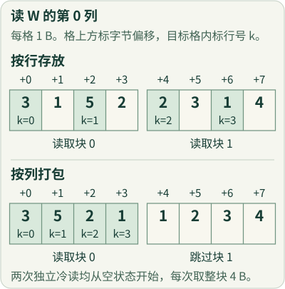

# 同一组数据怎样安排布局和驻留，才能减少搬运？

[C01 的第一轮](c01-tensor-mapping.md#space-and-time)里，P0 要算左上角的 21，P1 要算左下角的 17。两个点积开头都用权重 W[0,0] = 3。设备究竟要从共享存储器里取几次这个 3？

这取决于软件怎样安排这两次使用。两个单元可以各取一份，也可以从共享存储器取一份，再送往两处。等到下一轮，同一个单元又会用到上一轮的输入，那一行是否还留在它手边？下面沿着这两条路径数搬运量。

## 同一份数据，第二次会在哪里用到？ {#who-reuses-what}

沿用 Y = XW。X 的两行是 (2, 1, 3, 4)、(1, 2, 1, 2)，W 的两列是 (3, 5, 2, 1)、(1, 2, 3, 4)。每个输出仍按 k 从 0 到 3 累加。输入只读，四个结果写到独立的输出矩阵。

先按行分工。P0 负责 X 第 0 行，P1 负责第 1 行。第一轮各算第 0 列，第二轮各算第 1 列。跟踪 k=0 的这一步，就能看见两种不同的用法。

| 计算单元 | 第一轮，取 W 第 0 列 | 第二轮，取 W 第 1 列 |
| --- | --- | --- |
| P0 | 2 × **3** 加进 Y[0,0] | 还是用这个 **2**，乘 1 加进 Y[0,1] |
| P1 | 1 × **3** 加进 Y[1,0] | 还是用这个 **1**，乘 1 加进 Y[1,1] |

竖着看第一列，两个 3 都是 W[0,0]。横着看 P0，那两个 2 都是 X[0,0]。复用要追踪到同一个张量索引。表里还有几个数恰巧等于 1，它们可能来自不同位置。

## 怎样把 32 份源端取数减到 16 份？ {#residency-and-sharing}

先从共享 SRAM 数到计算单元。X、W 已经在 SRAM 中。沿用 C01 的四位无符号数值，这里给每个输入元素一个字节的存储槽。这里只数 SRAM 向单元提供的有效元素，每个计 1 B。后面再看装入一列 W 时，外层存储实际交付几个整块。

如果每次 MAC 都向 SRAM 取一份 X、一份 W，16 次 MAC 就取 16 份 X、16 份 W。每个单元的累加器仍在本地更新四次才交出一个输出。下面各方案都交出四个输出，表中只统计 X 和 W。

**先让 X 留下来。** 给每个单元四个本地输入槽，开始时为空。第一轮，P0 将 X 第 0 行的四个值依次装入槽，每装入一个就从该槽取数计算。P1 同样处理第 1 行。第二轮换 W 列，每个单元都能从自己的四个槽再读一遍 X。两轮合起来，SRAM 只需提供 8 份 X。

这就是**驻留**。位置是每个单元的本地缓冲，保留时间从第一轮取得该值直到第二轮用完。每个单元要预留 4 B，两个单元共 8 B。如果只有两个槽，一行四个值便留不全，仍缺的值要再取或改变分块。

**再让两个单元共用一次 W 读取。** 第一轮的 k=0，从 SRAM 取一次 W[0,0] = 3，经目标支持的广播通路交给 P0 和 P1。其余三个 k 也这样做，第一列只需取四次。第二轮换另一列，再取四次。

<figure markdown="1">

[![按行分工时，一次读取的 W[0,0] 在第一轮送到两个单元。P0 本地的一份 X[0,0] 跨过两轮，用于同一行的两个输出。](assets/c02-reuse-paths.svg)](assets/c02-reuse-paths.svg)

<figcaption>图中只跟踪 k=0。同一轮的两个目的地各收到一份 W。同一单元在两轮中分别读取本地保存的 X。</figcaption>
</figure>

| 按行分工的方案 | SRAM 提供 X | SRAM 提供 W | 源端合计 | 两个 MAC 实际使用的 X、W |
| --- | ---: | ---: | ---: | ---: |
| 每次各取一份 | 16 B | 16 B | 32 B | 32 份 |
| 每个单元留下自己的 X 行 | 8 B | 16 B | 24 B | 32 份 |
| 留下 X 行，同一份 W 广播到两处 | 8 B | 8 B | 16 B | 32 份 |

最后一行中，SRAM 提供了八个 W 元素，两个目的地合计仍收到十六份 W。少掉的是重复的源端读取。要算片上链路流量，还需要知道沿哪条路径传送、在哪里复制。[存储系统：怎样按接口统计流量](../../storage/01-memory-hierarchy/04-npu-case/npu-memory-hierarchy.md#traffic)

## 如果改成按列分，还应当保留 X 吗？ {#choosing-dataflow}

现在让 P0 固定算输出第 0 列，P1 固定算第 1 列，两轮分别算两行。P0 在第一轮读 W 第 0 列，第二轮仍读这四个权重。这时可把四个本地槽改留 W。第一轮两个单元需要的同一份数据，则变成了 X 第 0 行。

选择要保留的对象、保留的层级，以及其他输入和部分和的传递方式，就是软件在为这次映射选择**数据流（Dataflow）**。本例沿行或沿列分工时，部分和都留在当前单元的累加器里。变化的是外围四个输入槽和共享通路的用途。

假设这个目标的两个本地缓冲都能存 X 或 W，而广播通路只接 W 端口。按行方案可以做到源端 16 B。按列方案能把 W 留下，使它只读 8 B。两个单元要的 X 却须分别取得，共读 16 B，合计 24 B。若 X 端口也能广播，两种分工都能做到 16 B。

由此可见，写下“保留权重”还不够。选方案前要检查另一输入实际怎样到达，以及硬件是否提供所需通路。微架构 D02 展开了阵列内部支持驻留、转发和归约的结构。Timeloop 则展示如何在给定目标上按层统计映射产生的访问。[计算微架构 D02](../../microarchitecture-v2/04-compute-arrays/d02-stationary-dataflows-and-reuse.md#traffic) · [Timeloop 原论文，第 V–VI 节](https://people.csail.mit.edu/anurag_m/papers/2019.timeloop.ispass.pdf#page=6)

## 只要权重的一列，外层存储要交付几个块？ {#weight-layout}

回到按行方案。共享 SRAM 可以把 W 第 0 列广播给两个单元，但这一列先要从外层存储装入 SRAM。把观察点移到这个接口。假设每次只能读取一个对齐的 4 B 块，W 的首地址也按 4 B 对齐。

为 W 在 SRAM 中留一个四元素的列缓冲。装一列时，每个涉及的块读一次，从返回的块里挑出所需元素。另一列随块带来的数随即丢弃。第一列用完才装第二列。下面只算这条外层接口上的 W 流量。

若外层按行存 W，元素 W[k,j] 的字节偏移是 2k+j。第 0 列的偏移为 0、2、4、6，前两个落在块 0（偏移 0–3），后两个落在块 1（偏移 4–7）。读两个块共 8 B，当前用到 4 B。

若保持逻辑形状 (4, 2)，把同一列的四个数在存储中排在一起，W[k,j] 的偏移变为 4j+k。第 0 列恰好占满块 0，第 1 列恰好占满块 1。读任意一列都只需一个块。

<figure markdown="1">

<figcaption>每一格占 1 B。看同一个 W[1,0] = 5：按行存时在偏移 2，按列存时在偏移 1。两种布局交给点积的值相同。</figcaption>
</figure>

两轮都装完，按行存 W 要读 4 块，共 16 B。按列存只读 2 块，共 8 B。两种布局都向列缓冲交付八个有效元素。如果 SRAM 能把第一次读回的两块全部留下，两列都能从这 8 B 中取出，按行存也只需读两块。

这里做的是**布局选择**。把旧数据的步长直接改成列序会读错。例如去旧存储的偏移 1 找 W[1,0]，那里是 1，要用的权重却是 5。可以让生产者一开始就写出列序，也可以另做一份按列排列的副本。[A03：视图与实际复制](../01-foundations/a03-tensor-representation.md#view-and-copy)

## 先花 16 B 重排权重，何时能省回来？ {#conversion-cost}

假设收到的 W 已按行存好，后面要用一批不同的 X 连续调用矩阵乘法。W 在这些调用中保持不变。每次调用都从空的列缓冲开始。沿用刚才的 4 B 接口，只比较外层读写 W 的字节数。

若要建立列序副本，假设转换时有足够的临时空间，可完整读两个旧块，再完整写两个新块。建副本要读 8 B、写 8 B，还要有 8 B 目标空间。在副本建好后，每次调用只读 8 B。直接沿用原布局则每次读 16 B。

| 同一份 W 用几次 | 直接用行序 | 先重排再用列序 |
| --- | ---: | ---: |
| 1 次 | 16 B | 16 + 8 = 24 B |
| 2 次 | 32 B | 16 + 16 = 32 B |
| 3 次 | 48 B | 16 + 24 = 40 B |

因此，在这组条件下，第二次用完刚好抵平**外层读写字节数**，第三次才开始节省。若 W 更新，旧副本就不能继续代表新权重。若上游本来就能交出列序，建副本的 16 B 也可以省去。至于哪种方案耗时更短，还要知道读写带宽和转换耗时。

实际软件也要在相邻算子间作这个决定。oneDNN 的格式传递示例先比较已有数据和消费者要求的内存描述符，格式匹配便直接复用，不匹配时才准备重排。只转换布局时，每个逻辑索引处的值都应保留。[oneDNN：格式传递示例](https://uxlfoundation.github.io/oneDNN/v3.14/page_memory_format_propagation_cpp.html#determine-if-source-and-destination-need-to-be-reordered) · [oneDNN：Reorder](https://uxlfoundation.github.io/oneDNN/v3.14/dev_guide_reorder.html#general)

## 一列权重到底取了几次？ {#next}

取按列存储、按行计算的第一轮。外层存储交付一个 4 B 块，四个权重装进共享 SRAM。SRAM 向广播通路逐个提供这四个权重，两个单元各收到四个值。最后，W 第 0 列参与了八次 MAC。每个数字都对应同一列权重经过的一个位置。

现在已经知道要搬哪一列、放在哪里、哪些点积要等它。若想在第 0 列仍被使用时提前装入第 1 列，哪些位置已经可以写？搬运和计算能否同时占用各自的资源？这是 C03 将要安排的时间表。[返回专题阅读顺序](README.md#计划阅读顺序)
