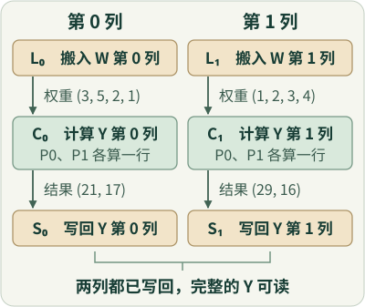
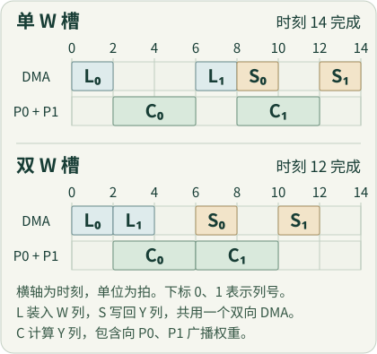

# 计算与数据搬运怎样安排在同一张时间表上？

[C02](c02-layout-and-dataflow-planning.md#next) 沿着一列权重数过搬运量。先把 W 的一列搬进共享 SRAM，再让两个单元一边读这列权重，一边算两个点积。第 0 列刚开始计算，搬运引擎已经空了。现在能让它去搬第 1 列吗？

要回答这个问题，软件得把“谁需要哪份数据”变成一张时间表。**静态调度**是在执行前选定任务的资源、顺序和等待条件。下面一起排两列矩阵乘法，看看同一批任务怎样从 16 拍排到 14 拍，又在什么条件下可以排到 12 拍。

## 先说清楚，一列要经过哪些任务？ {#column-tasks}

沿用 C01 的按行分工。P0 算 X 第 0 行，P1 算第 1 行。W 按列存放，每列四个权重各占 1 B。第 0 列 (3, 5, 2, 1) 广播给两个单元，得到 (21, 17)。换上第 1 列 (1, 2, 3, 4)，得到 (29, 16)。

本篇从两行 X 已在各自单元本地、两列 W 还在外层存储时开始计时。终点是两列 Y 都写回外层，指定的消费者可以读取。W 和 Y 分开存放。为写回方便，Y 也按列存，每个结果用 2 B 保存，足以精确容纳 C01 的十位累加结果。

每列都要先装入、再计算、最后写回。装入和写回由一台 DMA（直接内存访问）引擎轮流承担。下表用 j 表示列号，各任务的服务时间是教学假设。任务一旦开始，连续占用所需资源直至结束。

| 任务 | 从哪里来，到哪里去 | 占用什么、多久 | 结束时交出什么 |
| --- | --- | --- | --- |
| Lⱼ · 装入 | 从外层读取 W 的第 j 列，写入共享 SRAM 的一个 4 B 权重槽 | DMA 搬运引擎，2 拍 | 整列权重对计算单元可读 |
| Cⱼ · 计算 | 从该槽逐个广播权重，与 P0、P1 本地的 X 分别相乘并累加 | 两个计算单元及广播通路，4 拍 | 两个结果进入该列自己的片上结果槽 Rⱼ |
| Sⱼ · 写回 | 从 Rⱼ 取出两个结果，写到外层 Y 的第 j 列 | 与装入共用一台 DMA，2 拍 | 外层该列的 4 B 结果可读 |

以 C₀ 为例，每拍从权重槽读一个值，广播到 P0 和 P1，各完成一次乘加。四拍做完八次乘加。通信规划在这里明确了源槽、两个目的地、发送次序和所需通路。广播与乘加合在这四拍内计时。

如果目标只有一条每拍交付一份数据的单播通路，又没有预存的权重副本，四个值送给两个目的地至少要八拍。即使两个 MAC 都空闲，也不能直接照用表里的四拍。[C02 的广播与分发算例](c02-layout-and-dataflow-planning.md#residency-and-sharing)

下面固定先算第 0 列。R₀ 和 R₁ 各有 4 B，交出结果后累加器就能开始下一列。

Lⱼ 开始前必须取得一个可写的完整权重槽，整个装入期间占用它。Cⱼ 从开工到最后一次读取都持有整槽。不同槽之间暂按可并行读写处理，忽略命令开销。

## 有了任务依赖图，为什么还不能直接读出时间？ {#task-dag}

C₀ 要用 L₀ 产生的 W 第 0 列，S₀ 要用 C₀ 产生的 Y 第 0 列。沿第 1 列也能画出同样的两条边。把任务画成节点，把这些“前一项交出数据，后一项才能用”的关系画成有向边，就是此处的**任务依赖图（Task DAG）**。两列各向前推进，图中没有环。

<figure markdown="1">

<figcaption>箭头表示后一项需要前一项交出的数据。两条链之间没有值的传递。X 已就绪，具体使用哪个槽、同一引擎先做哪一项，都还没有画进图里。</figcaption>
</figure>

如果只看值，L₀ 和 L₁ 在时刻 0 都能请求开始。但它们要用同一台 DMA，这台引擎一次只服务一项搬运。即使给它们两个不同地址，也要排出先后。反过来，DMA 空闲时也要检查目标槽能否写入。

排一项任务时，可以从所有前驱都结束的时刻开始向后找，取第一个能**连续**容纳整项工作、所需资源都可用、读写位置也安全的区间。这里用 [2,6) 表示从时刻 2 开始，占用四拍，到时刻 6 才允许后继使用结果。[OR-Tools：前置关系与独占资源](https://developers.google.com/optimization/scheduling/job_shop)

## 只有一个权重槽，时刻 6 先搬哪一列？ {#single-slot}

先试一份完全串行的日程。装入 W 第 0 列、算完、写回，再处理第 1 列。两列总共 2 × (2 + 4 + 2) = 16 拍。按这个顺序执行可以得到正确结果，但 DMA 在计算期间闲着，能否让它提前做一点工作？

先排 L₀ 到 [0,2)，C₀ 到 [2,6)。时刻 2，DMA 已空闲。此时若把 L₁ 指向同一个权重槽，C₀ 却还要读旧值。假如 P0 的前三项已正确累加到 17，最后本应加 4×1。若此时误读了新列的末项 4，结果就变成 17 + 4×4 = 33。

所以单槽计划要补上一条边 C₀ → L₁。C₀ 最后一次读取结束，L₁ 才能开始写。这个先后来自两项任务共用一处存储。若分别给它们放置权重，这条因覆盖而加的约束也随之消失。[B04：先读后写的依赖](../02-frontend-and-optimization/b04-dependency-and-alias-analysis.md#memory-dependences)

到时刻 6，C₀ 交出了结果，权重槽也腾出来了。DMA 既可以做 S₀ 写回第一列结果，又可以做 L₁ 搬入第二列权重。看一看哪项工作能让两个计算单元更早开工。

| 时刻 6 的决定 | DMA 接下来做什么 | 第二列计算 C₁ | 两列全部写回 |
| --- | --- | --- | --- |
| 先写回 S₀ | [6,8) 写结果 0，[8,10) 装权重 1 | [10,14) | 时刻 16 |
| 先装入 L₁ | [6,8) 装权重 1，[8,10) 写结果 0 | [8,12) | 时刻 14 |

第二行让 S₀ 的两拍写回与 C₁ 的计算重叠。S₀ 从 R₀ 读，C₁ 从权重槽读、向 R₁ 交结果，这些位置和服务通路允许并行。S₁ 在 [12,14) 写回第二列，到时刻 14 两列才都可读。

在这个单槽模型里，L₀、C₀、L₁、C₁、S₁ 必须依次完成，仅这条链就占 2 + 4 + 2 + 4 + 2 = 14 拍。刚才排出的第二行达到这个下界。

## 再给一个权重槽，哪些等待真正消失了？ {#double-slot}

现在把权重槽从一个增加到两个，容量从 4 B 增到 8 B。L₀ 写 A 槽，L₁ 写 B 槽。时刻 2，C₀ 从 A 读的同时，DMA 就能开始向 B 写。时刻 4，W 第 1 列已经可读，却仍要等到时刻 6，因为 P0、P1 和广播通路还在计算第 0 列。

<figure markdown="1">

<figcaption>每个小区间是 2 拍，同一竖线上下对齐表示两种资源同时工作。L 装权重，C 计算，S 写结果。数字表示列号，空白表示该资源没有承担这六项任务中的工作。</figcaption>
</figure>

双槽计划里，C₀ 在 [2,6)，C₁ 紧接在 [6,10)。S₀ 可排进 [6,8)，最后的 S₁ 在 [10,12)。算术工作仍为 16 次 MAC，DMA 仍搬入 8 B 权重、写回 8 B 结果。省下的两拍来自 L₁ 与 C₀ 重叠。

第一列能开算前至少要装入 2 拍。随后两次计算独占同一组单元，共需 8 拍。最后一列算完还得写回 2 拍。因此即使有更多权重槽，这个模型的总时间也不能短于 2 + 8 + 2 = 12 拍。

## 两个地址不同，为什么时间表还会失效？ {#port-conflict}

只改一个硬件条件。假设 A、B 两个权重槽接在同一独占端口上，每次装入的两拍都占着它，每次计算的四拍也都需要它。结果槽仍走独立端口。回看双槽方案的 [2,4)，L₁ 要写 B，C₀ 要读 A，两个任务同时要这个端口。

这个目标上可以恢复图中的 14 拍排法。四项权重装入和计算共占端口 2 + 4 + 2 + 4 = 12 拍，最后一次计算后还有 2 拍写回。即使硬件保留双槽，总时间也至少是 14 拍。若实际 SRAM 允许一读一写并行，就应该按实际端口重新排。[计算微架构 F01：共享端口怎样限制重叠](../../microarchitecture-v2/06-resource-cooperation/f01-overlap-and-buffer-reuse.md#shared-port)

## 写下“时刻 6 开算”，设备就一定能准点吗？ {#plan-and-readiness}

假如外层存储发生等待，L₁ 到时刻 7 才真正完成。即使 P0 和 P1 在时刻 6 已经空闲，C₁ 也必须等到 B 槽的权重对它们可读。软件可以预先决定“C₀ 之后算 C₁”，同时给 C₁ 保留“L₁ 完成才放行”的条件。[A05：完成与消费者可见](../01-foundations/a05-task-and-resource-lifecycle.md#completion-and-visibility)

例如 MLIR 的 GPU 方言能用异步复制的 token 表达这次依赖。运行时提交复制后可以继续提交其他工作，带有该依赖的设备操作仍要等待对应操作完成。具体机制取决于目标接口，图中的拍数只是上述服务时间和资源约束下的推导。[MLIR：gpu.memcpy 的异步依赖](https://mlir.llvm.org/docs/Dialects/GPU/#gpumemcpy-gpumemcpyop)

再看双槽表的时刻 6。第 0 列权重已被读完，A 槽现在可以写入下一份权重。同一时刻，R₀ 中的 21 和 17 才刚产生，S₀ 还要读取它们。面对更多任务，软件怎样找出哪些缓冲区可以共用一片空间？下一篇用这张时间表推导实际地址分配。[C04 · 已经使用过的缓冲空间，什么时候可以交给下一项任务？](c04-static-buffer-allocation.md)

[返回专题阅读顺序](README.md#计划阅读顺序)
