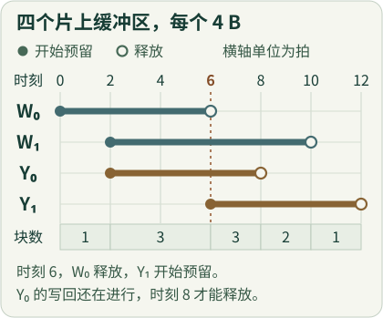
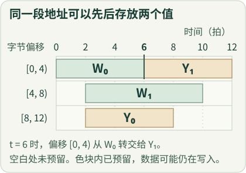

# 已经使用过的缓冲空间，什么时候可以交给下一项任务？

[C03 的 12 拍方案](c03-static-execution-planning.md#double-slot) 有两份权重、两份片上结果，每份占 4 B。如果给它们各自划出一段空间，一共需要 16 B。但第一列权重读完之后就不需要了。这 4 B 能不能留给第二列的计算结果？

**静态 Buffer 分配**根据各项任务对存储空间的需求和使用期限，提前决定每份数据存在哪里。例如提前确定各缓冲相对存储区域起点的字节偏移，区域的实际基址可在执行时绑定。下面保持 C03 的计算与搬运不变，试着把四份数据放到更小的空间内。

## 计算结束时，哪些空间真的可以归还？ {#buffer-lifetimes}

沿用 C03 的两列矩阵乘法。Lⱼ 搬入 W 第 j 列，Cⱼ 让 P0、P1 分别算出该列的两个输出，Sⱼ 将结果搬回外层。W 每列 4 B，Y 每列也为 4 B（两个结果各占 2 B）。

这里先只研究共享片上存储中四份数据的空间。两行 X 已经放在各自计算单元的本地存储，累加器仍在单元内部，外层的 W、Y 也各有自己的空间。这些空间单独计算。

要数片上需要多少字节，先把任务表中的每次读写关联到一份数据。我们把保存两列权重的逻辑缓冲区记为 W₀、W₁，把保存两列结果的缓冲区 R₀、R₁ 改用数据名 Y₀、Y₁ 标记。它们暂时只有逻辑名称，还没有指定地址。

为延续 C03 的整列交接模型，给结果增加一项分配约定。计算任务开工前，必须取得足以保存整个输出列的空间。即使四拍后才交出结果，它也一直保留这份空间。

| 逻辑缓冲 | 首次预留 | 之后的使用 | 最后释放 | 需要占用的区间 |
| --- | --- | --- | --- | --- |
| W₀，4 B | L₀ 从时刻 0 开始装入 | C₀ 在 [2,6) 读取 | 时刻 6，C₀ 读完 | [0,6) |
| W₁，4 B | L₁ 从时刻 2 开始装入 | C₁ 在 [6,10) 读取 | 时刻 10，C₁ 读完 | [2,10) |
| Y₀，4 B | C₀ 在时刻 2 预留 | 时刻 6 交出，S₀ 在 [6,8) 读取 | 时刻 8，S₀ 完成 | [2,8) |
| Y₁，4 B | C₁ 在时刻 6 预留 | 时刻 10 交出，S₁ 在 [10,12) 读取 | 时刻 12，S₁ 完成 | [6,12) |

表中的最后释放时刻使用保守的完成约定。直到相应读任务成功结束，并保证不再访问这段空间，才把空间交给下一项工作。

**生命周期（Lifetime）**在本例中指从取得独占的缓冲空间到最后释放这段空间的区间。Y₀ 从时刻 2 就占据空间，但到时刻 6 才能读。数据可读和空间可用是两件不同的事。[A05：资源所有权与生命周期](../01-foundations/a05-task-and-resource-lifecycle.md#ownership-and-lifecycle)

<figure markdown="1">

<figcaption>横条表示空间被某一份数据保留的时间，包含写入、等待、读取和结果尚未产生的预留阶段。左端包含，右端不包含。</figcaption>
</figure>

## 哪两份数据可以使用同一段地址？ {#interference}

先看时刻 4。W₀ 还在为 C₀ 供数，W₁ 已装好，Y₀ 的空间也已预留。三份数据需要同时占据空间。若给 W₀ 与 W₁ 指定相同的地址，L₁ 写入后就会破坏 C₀ 尚未读完的权重。

在这个模型里，两份独立缓冲区的占用时间有交集，就要求它们的字节范围互不重叠。这种不能分配到相同空间的关系称为**干涉（Interference）**。逐对比较四条横条，可以得到下面的关系。

| 与 W₀ 相比 | 是否同时占有空间 | 可以共用同一段空间吗？ |
| --- | --- | --- |
| W₁ | [2,6) 同时占用 | 不可以 |
| Y₀ | [2,6) 同时占用 | 不可以 |
| Y₁ | 时刻 6 恰好交接 | 可以，须先释放 W₀ |

W₁、Y₀、Y₁ 又在 [6,8) 同时占用空间。把每份数据看成一个节点，两份数据有干涉就连一条边，这样得到的图称为干涉图。在本例中，四个节点只有 W₀ 与 Y₁ 之间不用连边。

软件可以在这里做一次分配。把四份数据放进同一个允许权重和结果通用的 SRAM 区域。假设这一区域的起点满足 4 B 对齐，含三个 4 B 段，均具备 C03 对并发访问的要求。

| SRAM 内的字节偏移 | 什么时候为谁保留 |
| --- | --- |
| [0,4) | [0,6) 给 W₀，随后 [6,12) 给 Y₁ |
| [4,8) | [2,10) 给 W₁ |
| [8,12) | [2,8) 给 Y₀ |

<figure markdown="1">

<figcaption>纵向是 SRAM 中不同的字节区间，横向是预留区间。时刻 6 先确认 W₀ 已读完，再取得这段地址作为 Y₁ 的输出空间。图中空白处没有为这四份数据保留空间。</figcaption>
</figure>

这张表就是可以交给后续代码生成的静态地址计划。例如 C₀ 的读权重偏移为 0，结果偏移为 8。C₁ 的读权重偏移为 4，结果偏移为 0。它们仍会得到相同的四个输出，日程也仍为 12 拍。

在 [2,6) 和 [6,8) 内都有三份 4 B 缓冲同时占用，故这份日程至少需要 12 B。上面的分配恰好能放进 12 B，比四段固定专用空间少占 4 B。

XLA 的 Buffer Assignment 也会把逻辑值及别名关系对应到实际分配中的字节切片，并借助生命周期判断哪些切片可以重用。[OpenXLA：Buffer Assignment](https://openxla.org/xla/hlo_to_thunks#buffer_assignment)

## 如果另一个任务还持有 W₀ 的视图呢？ {#aliases-and-last-use}

[A03](../01-foundations/a03-tensor-representation.md#storage-offset) 介绍过切片可以只记录原缓冲区的偏移。假设另有一个任务持有 W₀ 的后两个元素的视图，并在时刻 6 之后还需要读这两个元素。

如果只沿着名称 W₀ 找使用者，会以为 C₀ 完成后就可以释放 W₀。但这个视图指向原来的 [2,4) 字节，读取的是同一份权重。Y₁ 若覆盖 [0,4)，它就可能读到已经被改变的内容。

静态分配需要根据 [B04 的别名与访问范围](../02-frontend-and-optimization/b04-dependency-and-alias-analysis.md#alias-and-access-ranges) 找到所有会访问这些字节的任务。两个视图本来共享同一份数据时，只需要为底层数据保留一份空间，并将这些实际访问纳入生命周期。

[B05 的活跃性分析](../02-frontend-and-optimization/b05-dataflow-analysis-and-optimization.md#live-values) 通过后续是否还会使用一个值来找出它的活跃范围。设备任务还需跟踪实际读写是否结束。例如 S₀ 的命令提交了，DMA 也可能仍在读取 Y₀。释放条件须保证它不再访问旧地址。

若仍按整个槽分配，就要等 C₀ 和视图的读任务都结束，或者让 Y₁ 使用另一段不重叠的地址。

回到原先没有额外读者的计划，时刻 6 的交接依赖 C₀ 的实际最后读取已结束。若 C₀ 比预计的四拍更晚完成，C₁ 也要推迟取得偏移 0 的空间。当计划加入了新的共享地址关系，就要保证任务执行契约能维持相应的先后顺序。

## 有 12 B 的空间，为什么还是可能放不下？ {#capacity-and-alignment}

刚才的 12 B 是在三个独立缓冲均占 4 B 且起点允许按 4 B 对齐时得到的。现在改变目标的约束。假设每次搬运的片上地址必须按 8 B 对齐，SRAM 区域的起点也按 8 B 对齐，其他服务时间保持不变。

三个同时存在的 4 B 缓冲，最紧密的合法起点可以取偏移 0、8、16。它们分别占 [0,4)、[8,12)、[16,20)，三个对象合计仅申请 12 B，却需要覆盖 20 B 地址范围。这个例子只约束每份数据的起点，末尾若还要求对齐，则需继续留出空间。

容量检查还要看计算单元和 DMA 能访问哪些存储区。例如 W 和 Y 各有一片独立 SRAM，权重槽不能接收输出写入，那么让 W₀ 和 Y₁ 共用偏移 0 的方案便无法实施。不同地址之间还可能共享一个端口，重叠执行须重新检查。[计算微架构 F01：共享端口](../../microarchitecture-v2/06-resource-cooperation/f01-overlap-and-buffer-reuse.md#shared-port)

对更大的程序，可以把待放置的缓冲按开始时刻排列，逐个找满足容量、对齐和可达性的空闲字节区间。到期区间可重新使用。缓冲大小不同时，剩余空间也可能分散在多个间隙中，所以同时活跃的字节数只是所需容量的一个下界。[IREE：切片布局与对齐](https://iree.dev/reference/mlir-passes/Stream/#-iree-stream-layout-slices)

## 如果实际只有 8 B，能否调整原来的计划？ {#capacity-feedback}

回到 4 B 对齐的通用 SRAM。假设它只提供 8 B 供这四份数据使用，也就是两个 4 B 段。显然原先的 12 拍日程无法放下。找一个不同的日程，看看能不能在 8 B 中完成。

C₀ 开工时，第一段存 W₀，另一段已为 Y₀ 预留，L₁ 没有空间可写。即使等 C₀ 读完后立即装入 W₁，也还要等 S₀ 结束，才能为 C₁ 取得另一段的输出空间。用两段存储可以排出如下日程。

| 拍区间 | 执行任务 | 偏移 [0,4) | 偏移 [4,8) |
| --- | --- | --- | --- |
| [0,2) | L₀ 装入 | W₀ | 空闲 |
| [2,6) | C₀ 计算 | W₀ | Y₀ |
| [6,8) | S₀ 写回 | 空闲 | Y₀ |
| [8,10) | L₁ 装入 | W₁ | 空闲 |
| [10,14) | C₁ 计算 | W₁ | Y₁ |
| [14,16) | S₁ 写回 | 空闲 | Y₁ |

在本例的整列预留规则下，C₀ 和 C₁ 计算时各需要两段空间。两次计算之间必须完成 L₁ 与 S₀，同一台 DMA 需要四拍。因此 16 拍是这个 8 B 模型的下界。这份串行时间表恰好达到它。

现在有两个合法方案。12 B 允许提前搬入第二列、重叠第一次写回，总时间 12 拍。8 B 需要等待上一列交付后才能算下一列，总时间 16 拍。确定了分块、布局、日程与地址之后，软件仍需要在许多合法候选中作选择。C05 将把这些数据变成可以比较的代价。[返回专题阅读顺序](README.md#计划阅读顺序)
