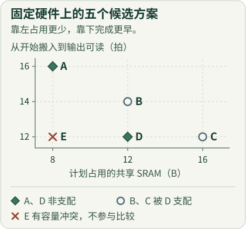
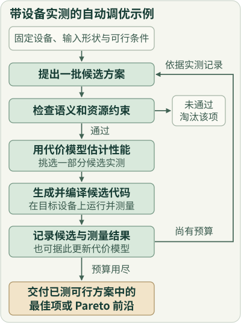

# 许多方案都能正确执行，怎样找到更好的一个？

[C04](c04-static-buffer-allocation.md#capacity-feedback) 找到了两个方案。同一项矩阵乘法，可以占用 8 B 片上空间执行 16 拍，也可以占用 12 B 执行 12 拍。如果芯片允许这两种做法，软件应该选哪一种？

编译器需要评估不同执行方案的**代价**，例如完成时间、流量和空间占用。它还要有办法产生候选方案，在符合语义及目标约束的范围内寻找代价更小的做法。本篇从几份已算过的计划出发，推导搜索和自动调优需要解决的问题。

## 先明确，哪些方案有资格参加比较？ {#legal-candidates}

沿用 C01–C04 的矩阵，X 为 2×4，W 为 4×2，Y 的两列分别为 (21, 17)、(29, 16)。每列装入 Lⱼ、计算 Cⱼ、写回 Sⱼ 的服务时间分别为 2、4、2 拍。两个单元按行分工，逐拍广播权重。

固定目标提供至少 16 B 的通用 SRAM 可用空间，起点及各槽按 4 B 对齐，端口支持 C03 的重叠日程。两行 X 已在本地，W 已在外层按列排好。时间从装入第一列权重开始，至两列结果均写回且可读为止。

只数该共享 SRAM 区域的空间。每列权重与结果各占 4 B，且结果在计算开始前取得完整的可写槽。我们可以从前两篇的日程和地址方案组合出下表。

| 候选 | 日程和地址方案 | 所需空间 | 完成时间 |
| --- | --- | ---: | ---: |
| A | 逐列串行，两列共用一个权重槽、一个结果槽 | 8 B | 16 拍 |
| B | 单权重槽、两结果槽，优先搬入下一列 | 12 B | 14 拍 |
| C | 双权重槽，四份数据各有专用地址 | 16 B | 12 拍 |
| D | 双权重槽，第一列权重与第二列结果共用地址 | 12 B | 12 拍 |
| E | 照用 D 的日程，却只提供两个槽 | 8 B（限额） | 12 拍（目标值） |

候选 E 在时刻 2 到 6 之间，同时需要 W₀、W₁、Y₀ 三个 4 B 缓冲。只有 8 B 就必然有一份没有独立的空间。这个日程和容量的组合无法满足 [C04 的干涉约束](c04-static-buffer-allocation.md#interference)，表中的 12 拍还不能作为有效结果参加比较。

这里要做两类检查。先用 [B04 的依赖规则](../02-frontend-and-optimization/b04-dependency-and-alias-analysis.md#memory-dependences) 和 [B06 的数值及循环变换规则](../02-frontend-and-optimization/b06-legal-transformation.md#numeric-semantics) 检查计算语义，例如每个乘积归入正确的输出，浮点求和次序的变化也须符合算子的约定。然后检查目标资源是否能按计划执行，例如地址、容量、访问权限和端口。

只有通过这些条件的方案，才有进一步比较代价的意义。

## 运算量相同，为什么代价仍然不同？ {#cost-model}

A、B、C、D 各完成 16 次 MAC。只统计外层 W 的读和 Y 的写，各方案也都装入 8 B、写出 8 B。该统计从 X 已在本地开始，因此不含 X 的预装成本，也不含权重预重排成本。

如果只告诉软件“完成 16 次 MAC 和 16 B 传输”，便看不到这些任务能否重叠。两个 MAC 每拍共做两次乘加，乘加需要八拍。同一台 DMA 服务四项搬运，每项两拍，合计也占八拍。

取两个资源服务时间的较大值，只能得到八拍的下界。即使是 D，也要先装入两拍，再做两轮共八拍的计算，最后写回两拍。这三段不能重叠，所以在本例中至少需要十二拍。

实际排序还取决于资源空闲的时刻和数据能否交接。把 C03 的依赖、服务时间和占用区间交给模型，就能排出 A 的 16 拍、B 的 14 拍和 C、D 的 12 拍。

**代价模型（Cost Model）**就是用计算规模、内存访问、目标资源和执行安排等信息，估计某个方案的代价。上述日程推导便是一种很小的时间模型。也可以按不同接口的传输量、访问次数与相应能耗估计能量。

真实设备的 DMA 可能要承担命令启动或等待时间，模型的两拍只是教学假设。较复杂的模型可以考虑这些因素，也可以通过性能数据修正参数和排序。怎样测量和校准由本系列 K 专题继续讲解。[计算微架构 H01：资源与依赖给出的下界](../../microarchitecture-v2/08-performance/h01-task-time-and-bottlenecks.md#lower-bound)

若某个候选还需要把权重转换成专用布局，就要把那笔转换代价也计进去。[C02 的算例](c02-layout-and-dataflow-planning.md#conversion-cost)中，一次重排花费 16 B 外层读写量，第三次使用才开始节省累计流量。比较的时间边界和重复使用次数也会改变选择。

## 少占空间和更快，怎样确定哪个方案更好？ {#pareto}

如果只追求完成时间，C 和 D 都是十二拍，二者并列。但 D 比 C 少占 4 B。若同时希望时间短、占用小，就没有必要保留 C 作为更优候选。D 同样支配 B，因为二者同占 12 B，D 却少用两拍。

A 和 D 的关系不同。A 只占 8 B，D 少用四拍。没有一个方案在这两项指标上都比另一个好。

<figure markdown="1">

<figcaption>横轴是计划使用的 SRAM 字节数，纵轴是完成时间。越靠左下越好。E 只表示一个未通过约束检查的目标，无法参加代价比较。</figcaption>
</figure>

在多项目标都要尽量小的情况下，若一个候选相对于另一个，在所有目标上均不差，且至少一项严格更好，就称它**支配**另一个候选。当前候选中没有被其他候选支配的那些方案，构成相对于所选目标的 **Pareto 前沿**。

现在可以给本次任务另定空间上限。若只能为它预留 8 B，四个合法候选中只有 A 放得下。若允许预留 12 B 且要求尽量快，就选 D。若上限为 16 B，先选最快的，再在同速方案中选占用最小的，仍选 D。

这里比较的是同一个目标设备上的软件计划占用，并非四种不同大小的芯片。若加入能耗等其他目标，或发现了更好的地址与日程组合，就需要重新检查哪些方案被支配。[计算微架构 H02：Pareto 关系](../../microarchitecture-v2/08-performance/h02-microarchitecture-design-tradeoffs.md#什么是-pareto-关系)

## 软件怎样想到表里还没有的方案？ {#search-space}

回顾四篇文章，每次其实都在选择一个或几个参数。C01 选择按行分工还是按列分工，C02 选择数据布局和所在位置，C03 改变 DMA 服务顺序，C04 改变逻辑缓冲区对应的字节偏移。

这些可以成为搜索变量。例如固定按行分工及列序布局，只让搜索程序决定下面三件事。

- 是否让 L₁ 在 C₀ 结束前搬入。
- 当 DMA 有多个可执行的工作时，下一项安排哪个任务。
- 哪些缓冲区可以共用一个满足对齐与访问条件的地址段。

取不同的值就会得到不同计划。若提前装入 L₁，又把两列权重放在同一地址，便产生冲突。相反，若把它们放在不同地址，但把 S₀ 放在 C₁ 结束后，结果也可能正确，只是 DMA 的重叠机会少了一些。

**设计空间（Design Space）**就是在给定计算和目标上允许探索的这些选择及其组合。软件可以逐个生成组合，检查必要条件，再估算合法组合的代价。像 E 这样违反容量约束的分支，可以提前排除，以减少后续评价的工作。

小空间可以穷举。随着分块维度、算子数量、设备数量增加，组合会快速增多。常用办法还有按经验生成候选、随机采样，以及在已有较好候选附近修改几个变量，继续探索。

Timeloop 是一个面向 DNN 加速器映射分析的例子。它将分块和循环顺序等组织成可搜索的映射空间，依据目标约束排除不可行映射，然后利用模型评估候选。原论文分别使用穷举与随机采样来探索不同规模的空间。[Timeloop 原论文，第 V-E、VI 节](https://people.csail.mit.edu/anurag_m/papers/2019.timeloop.ispass.pdf#page=5)

## 估算比较好，为什么还要上设备试一次？ {#auto-tuning}

假设模型没有考虑某次并发访问实际会发生的等待。它可能仍把 D 估成十二拍、B 估成十四拍，但实际设备上的等待也许改变二者的排序。因而模型很适合帮助筛选，并且需要留意它在真实设备上排序的准确性。

一种自动调优（Auto-tuning）方法是让软件反复提出方案，从通过约束检查的候选中挑出一部分，生成可执行实现并在目标上计时。利用测量结果调整后续选取的候选，也可以更新用来预测代价的模型。

<figure markdown="1">

<figcaption>一种结合代价模型和设备实测的自动调优流程。模型更新是可选的。测量预算决定能探索多少候选。</figcaption>
</figure>

测量的是一致的任务范围，输出也得符合数值约定。仅靠几个输出样例不能证明一般情形的变换合法性。候选之间若包含测量噪声，也需要用一致的条件多次测量才能比较。

Ansor 的一种实现是先用学习得到的模型引导演化搜索，选少量候选编译和计时，再用实测数据更新模型。有限时间内通常只能得到当前探索过的较优方案，全局最优需要额外的证明。[Ansor 原论文，第 5 节 Performance Fine-Tuning](https://www.usenix.org/system/files/osdi20-zheng.pdf)

调优本身也需要付出编译和测量成本。若一次调优多花了时间 T，选出的方案每次能节省 Δt，则使用 n 次后总共节省 n×Δt。只有节省量超过额外成本，按这笔时间账才会有收益。因此预计执行多少次，也会影响投入多少调优时间。

## 输入多一列，原来找好的方案还能用吗？ {#shape-specialization}

仍令 X 有两行四列，W 有四行。但 W 的列数 N 可以变化。取 N=1，只有一组装入、计算、写回，只需 8 B 和八拍。取 N=2，再用前面的 D 方案。两个权重槽让下一列可以提前到达。

再回到 [C01 中增加一列的例子](c01-tensor-mapping.md#tail-tile)（现在仍按行分工）。第三列的 W 全为 1，结果是 (10, 6)。C₁ 在 [6,10) 计算时，Y₀ 到时刻 8 已写回，空出的槽正好可在 [8,10) 搬入第三列。时刻 10 再把刚读完的 W₁ 空间交给第三列结果。

| W 的列数 N | 每次使用的 SRAM 空间 | 执行计划 |
| --- | ---: | --- |
| 1 | 8 B | L₀、C₀、S₀ 顺序做，8 拍 |
| 2 | 12 B | 采用 D，12 拍 |
| 3 | 12 B | 在 D 的安排中插入 L₂ [8,10)，再接 C₂ [10,14)、S₂ [14,16)，16 拍 |

三列方案仍只有一台 DMA，S₁ 在 [10,12) 完成，与 C₂ 重叠。第三列装入和结果预留都在对应槽释放之后。三种方案的服务时间与空间来自同样的整列交接约定。

为 N=2 写死的计划如果拿到 N=1 的输入，就可能访问不存在的第二列。拿到 N=3 又可能漏算最后一列。**Shape 专门化（Specialization）**是编译时利用已知形状条件，为这些输入生成专门的执行版本，例如固定循环次数，提前排好 DMA 和缓冲区地址。

因此，交付计划时要附带它适用的条件。例如 N=2、两行 X、K=4、要求的类型和布局、地址对齐及资源可用等。一个带检查和尾块处理的通用版本也可以覆盖多个形状。

B03 已介绍用 Guard 表达版本的适用条件。[B03：形状约束](../02-frontend-and-optimization/b03-graph-capture.md#shape-guards) · [PyTorch：Dynamic Shapes Core Concepts](https://docs.pytorch.org/docs/2.15/user_guide/torch_compiler/compile/dynamic_shapes_core_concepts.html#guards)

软件还可以根据常见输入形状生成少量专门版本，保留通用版本处理其余输入。版本越多，可能需要更多编译时间和产物空间。运行时怎样用实际输入选择可用版本，是后面 F 专题的工作。

## 选好一份方案之后，还要交付什么？ {#plan-output}

从 C01 到 C05，我们逐步把一项矩阵乘法变成可以检查和比较的执行方案。例如候选 D 已确定以下信息。

| 计划中的信息 | 候选 D 的选择 |
| --- | --- |
| 计算分工 | P0 负责第 0 行，P1 负责第 1 行 |
| 数据布局与驻留 | W 按列组织，X 在单元本地驻留，W 广播 |
| 静态执行顺序与资源 | 两列按序计算，L₁ 提前，S₀ 与 C₁ 重叠，共用一台 DMA |
| 地址分配 | W₀ 与 Y₁ 共用偏移 0，W₁ 偏移 4，Y₀ 偏移 8 |
| 执行条件与评价 | 满足形状、对齐及读写约束，模型估计占 12 B、用 12 拍 |

这些信息可以写进编译器内部的计划表示，供后续代码生成阶段读取。接口形式会因目标而异，某些决策也可能分散在不同层的 IR 中。接下来要解决的是如何将这样的选择变成循环、显式内存操作、内核或设备命令。

[继续阅读 D 专题 · 算子实现与代码生成](../04-code-generation/README.md) · [返回资源映射与执行规划导读](README.md)
