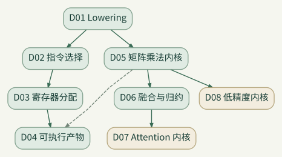

# 算子实现与代码生成

执行方案确定之后，还需要把它变成目标设备能理解的指令、命令或内核。不同层次的 IR 使这种转换能够逐步完成。

## 贯穿算例与阅读边界

从 A03 的 2×3 int32 张量加法开始，降低到循环、缓冲区和显式访问。机器代码分支回到 A01/B01 的标量表达式；AI 内核分支沿用 C 的矩阵分块，逐步引入归约、融合及低精度执行。

D02–D04 与 D05–D08 是两条分支。内核工程师不必先学完整寄存器分配；已有产物也可直接进入 D04。D07、D08 为深化。

## 知识关系

<figure class="micro-v2-map" markdown="1">

<figcaption>图中实线表示本专题内的主要前置关系，虚线表示按场景参考；跨专题先修知识见下表。 点击可查看大图。</figcaption>
</figure>

## 阅读顺序 {#计划阅读顺序}

本专题规划 8 篇正文，其中 2 篇为深化或案例。 未发布条目为阅读计划，标题与范围可在编写时根据认知目标调整。

| 编号 | 文章（暂定标题） | 读完应理解什么 | 主要前置知识 | 状态 |
| --- | --- | --- | --- | --- |
| D01 | [一句张量计算，怎样逐步变成循环和内存操作？](d01-lowering-and-bufferization.md) | 分层 Lowering、Tensor IR、Loop IR、Bufferization、显式读写与转换合法性。 | A01–A03、B04 的必要知识 | 已发布 |
| D02 | [一个 IR 操作怎样变成目标机器的指令？](d02-instruction-selection.md) | 类型与指令合法化、指令选择、Machine IR、目标调用约定。 | D01 中低层 IR、A04 | 已发布 |
| D03 | [临时值比硬件寄存器多，编译器怎样处理？](d03-register-allocation-and-scheduling.md) | 活跃区间、寄存器分配、Spill/Reload、机器指令调度与相互约束。 | D02、B05 | 已发布 |
| D04 | [生成的代码怎样成为可加载、可调用的程序？](d04-executable-artifacts.md) | 汇编、目标文件、符号、重定位、静态与动态链接、Kernel 元数据及产物兼容。 | D02、D03 或已有目标代码 | 已发布 |
| D05 | [分块方案确定后，怎样生成可执行的矩阵乘法内核？](d05-matrix-multiplication-kernels.md) | 循环代码生成、SIMD/SIMT/NPU 实现、边界处理、地址计算、Kernel 库与生成。 | D01、C01、C02、A04 | 已发布 |
| D06 | [两个算子已经决定融合，怎样真正减少中间数据搬运？](d06-fused-kernels.md) | 融合循环、Epilogue、归约、Softmax、同步与中间状态保留。 | D05；B06、C05 的相关知识 | 已发布 |
| D07 | [Attention 为什么可以不将完整的分数矩阵写入显存？](d07-attention-kernels.md) | 分块 Attention、在线 Softmax、因果掩码与 IO 复杂度、Prefill/Decode 内核差异、split-KV、分页 KV 访问。 | D06、Attention 基础 | 已发布 |
| D08 | 低精度数据怎样变成设备可以直接处理的输入？ | 权重/激活/KV 的低精度执行路径、Q/DQ、Packing、Scale 应用、融合反量化、混合精度累加与输出转换。 | D05、数值格式及量化基础 | 未发布 |

## 从哪里来，接下来往哪读

主要衔接：[软件执行共同基础](../01-foundations/README.md)、[编译前端与程序优化](../02-frontend-and-optimization/README.md)、[资源映射与执行规划](../03-mapping-and-planning/README.md)。

硬件机制参考[计算微架构](../../microarchitecture-v2/README.md)、[存储系统](../../storage/README.md)和[芯片与系统互连](../../interconnect/README.md)。

模型计算原理参考[算法与模型](../../workload/README.md)。重构期间也可查阅[旧版推理运行时](../../inference-runtime/README.md)。

后续方向：[通用执行运行时](../06-execution-runtime/README.md)、[模型执行与生成控制](../07-model-execution/README.md)、[性能分析、建模与验证](../11-performance/README.md)。

更多阅读路线见[编译器与运行时系统系列首页](../README.md)。
