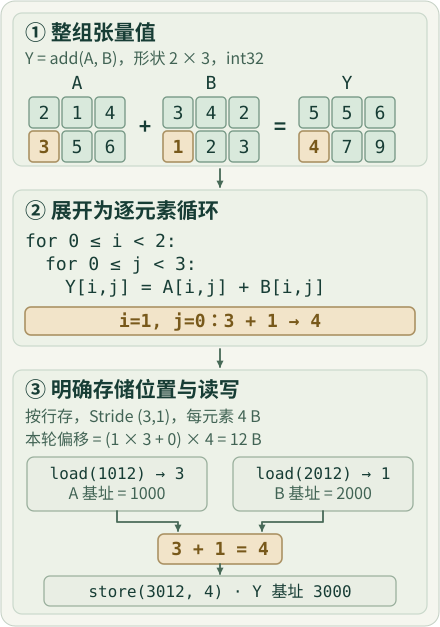

# 一句张量计算，怎样逐步变成循环和内存操作？

在 [A03](../01-foundations/a03-tensor-representation.md) 中，我们将两个 2×3 的整数矩阵 A、B 对应位置相加，得到 Y。只写一句 `Y = A + B`，就能表达六次加法。

但如果目标是一台只提供标量运算和内存读写指令的 CPU，机器没有一条名为“两个 2×3 张量相加”的指令。怎样把这项计算变成机器能完成的一连串操作？

**降低（Lowering）**是将较抽象的程序表示转换为更接近实现的表示。在本例中，我们需要补充遍历元素的方式、数据所在的存储位置，以及怎样读取、计算和写入。每次转换都应实现原来规定的计算行为。

本篇沿用 A03 的矩阵加法。我们先固定一种简单的串行实现，不比较分块或映射方案，暂时也不选择具体机器指令。

## 一条张量操作还缺少什么信息？ {#tensor-ir}

先回到 A03 的六个元素。三组张量都是 Shape (2, 3)，数据类型为 int32。本例只使用能精确表示的小整数；没有其他执行者在计算期间修改数据。

| 位置 | A | B | Y = A + B |
| --- | --- | --- | --- |
| 第 0 行 | 2，1，4 | 3，4，2 | 5，5，6 |
| 第 1 行 | 3，5，6 | 1，2，3 | 4，7，9 |

沿用 [A02 的 IR](../01-foundations/a02-program-representation.md#levels-of-representation)，可以用一项操作描述这六次加法。以下是教学 IR，其中 `%A`、`%B` 和 `%Y` 分别引用三个张量值。

```text
%Y = tensor_add(%A, %B) : tensor<2x3xi32>
return %Y
```

它规定 Y 的每一个有效位置应满足 Y[i,j] = A[i,j] + B[i,j]，原来的逻辑输入值 A、B 保持不变。但它既没有说明六次加法按什么顺序执行，也没有指定 Y 存在哪块内存。

这样的表示便于编译器观察整组计算。例如从操作的类型和语义，可以判断两个操作是否使用了形状相符的张量，而不需要从大量标量读写中重新识别它们。

实际 IR 也能表示这样的计算。[StableHLO 的 add 操作](https://openxla.org/stablehlo/spec#add)定义了逐元素加法和相应的类型约束。[A03 的张量类型](../01-foundations/a03-tensor-representation.md#dynamic-shape)已经区分了逻辑形状与实际存储布局。

## 怎样确定六次加法分别取哪些数？ {#element-computation}

如果我们决定依次计算第 0 行和第 1 行，每一行从第 0 列到第 2 列，就可以把整组计算展开成两个嵌套循环。

以下使用教学伪代码。这里的 A、B、Y 仍然是逻辑张量。写法中的 Y[i,j] 表示定义结果在该位置的值，暂时不表示对具体内存地址的写入。

```text
Y = 未构造完成的 2×3 张量
for i = 0 .. 1:
    for j = 0 .. 2:
        Y[i,j] = A[i,j] + B[i,j]
return Y
```

跟踪第二行的第一项。i 从 0 变成 1 后，内层循环重新从 j = 0 开始。这次需要 A[1,0] = 3 与 B[1,0] = 1，产生 Y[1,0] = 4。

两个循环遍历的索引范围来自张量形状，而循环体中的取数关系来自逐元素加法的语义。本例的各个输出互不依赖，所以可以选择这样的串行顺序。

编译器也可以先明确“遍历哪几个维度、怎样通过索引选择操作数、每个位置执行什么计算”，而不立即构造具体的循环。这样仍保留完整的算子结构，可供后续分块或映射使用。

例如 MLIR 的 Linalg 方言可以通过迭代维度、索引映射和标量运算区域表达这类结构化计算。这里两个维度都是可独立处理的维度，三个张量都使用同样的 (i,j) 索引，标量运算为整数加法。

[MLIR：Linalg 方言](https://mlir.llvm.org/docs/Dialects/Linalg/)

## 张量产生了一个新值，是否必须为它分配新内存？ {#bufferization}

CPU 要读取 A[1,0]，还需要知道这个数存在哪里。而产生 Y[1,0] = 4 后，也要有办法保留它，供后续计算或调用者读取。

**缓冲区化（Bufferization）**将这种对张量值的计算转换为对存储区域的操作。它要确定哪些缓冲区承载输入和输出，哪些位置需要被读取或写入，以及是否需要新增存储或复制数据。

先选择一个容易验证的方案：调用者已准备三个普通内存缓冲区，均按行紧密存放，不互相重叠。输入区只读，输出区可以写入，地址均为教学示例中的软件可见字节地址。

| 缓冲区 | 起始地址 | Shape | 元素步长 | 容量 |
| --- | ---: | --- | --- | ---: |
| a | 1000 | (2, 3) | (3, 1) | 24 B |
| b | 2000 | (2, 3) | (3, 1) | 24 B |
| y | 3000 | (2, 3) | (3, 1) | 24 B |

此时可以用写满 y 的方式交付张量 Y。计算接口从返回逻辑张量变为写入调用者提供的结果缓冲区；调用者的相应接口也需适配，才能取得同样的结果。缓冲区由调用者管理。这是本例选择的执行契约，而非所有编译器自动采用的方式。

为什么 y 不必先填满 0？本例每个位置都直接由两个输入的对应元素计算，写结果时不会读取 y 的旧内容。若改成矩阵乘法的累加实现，就要另行保证累加器或初始输出的值正确。

在 MLIR 中，`tensor<2x3xi32>` 表示一个张量值的类型；`memref<2x3xi32>` 可以表示具有该形状、元素类型和默认连续布局的内存引用类型。MemRef 还可以描述其他布局和存储空间，并非一个裸地址。

Tensor 层的值表达不要求为每个新值都建立一份独立存储。假如编译器之后不再需要 A 的旧值，接口允许覆盖输入缓冲区 a，且不存在会受覆盖影响的其他访问，就可以考虑让 Y 使用 a。

对这个逐元素加法，读出 A[i,j] 和 B[i,j] 后即可写回对应的 A 位置。在 A、B 互不重叠且各个元素位置独立的假设下，不会破坏下一次迭代所需的输入。

但是将原来的张量程序改成返回 `(%Y, %A[1,0])` 会怎样？原程序应交付新张量 Y 与旧 A 中的 3。如果直接覆盖 a，之后再从该位置取数，就读到了 4。

<figure markdown="1">

[![分别使用独立输出缓冲区和复用输入缓冲区。独立缓冲区保留 A[1,0]=3，并写出 Y[1,0]=4；直接复用 a 会把原位置覆盖为 4，之后读取旧 A 便得到错误的值。](assets/d01-buffer-reuse.svg)](assets/d01-buffer-reuse.svg)

<figcaption>能否复用一块内存，取决于覆盖前的内容是否还需要被观察到，以及接口是否允许写入。本例没有其他并发访问。</figcaption>

</figure>

这是一次典型的读写冲突。[B04 的别名与访问范围](../02-frontend-and-optimization/b04-dependency-and-alias-analysis.md#alias-and-access-ranges)说明了为什么即使另一个读操作使用不同名称，也可能访问被覆盖的位置。

编译器需要确认原来的读写关系仍能成立。在本例中，若旧 A 只需要这一个元素，也可以提前保存 3。如果不能证明覆盖安全，可以保留独立输出区；对于某些需要在旧内容基础上修改少量元素的操作，也可能需要复制原内容再修改。

这里不讨论怎样为整个计算图求出最省空间的分配方案，那是 [C04 的静态 Buffer 分配](../03-mapping-and-planning/c04-static-buffer-allocation.md)所解决的问题。

MLIR 的 One-Shot Bufferize 是一种具体实现：利用张量的 SSA 使用关系和操作的别名、读写信息判断哪些输出可原地缓冲区化，哪些会发生冲突。分配后的释放与所有权管理也可以由后续步骤处理。

[MLIR：Bufferization](https://mlir.llvm.org/docs/Bufferization/) · [Tensor 方言](https://mlir.llvm.org/docs/Dialects/TensorOps/) · [MemRef 类型](https://mlir.llvm.org/docs/Dialects/Builtin/#memreftype)

## 怎样把每一次元素运算变成显式内存访问？ {#explicit-memory-operations}

回到三个缓冲区独立的方案。确定 a、b、y 的内存表示之后，就能将循环里的逻辑元素操作具体化。每次迭代需要两次读取、一次标量加法和一次写入。

```text
for i = 0 .. 1:
    for j = 0 .. 2:
        %x = load(a, i, j)
        %z = load(b, i, j)
        %v = add_i32(%x, %z)
        store(y, i, j, %v)
```

如果用 MLIR 表达这两个循环，可以写成下面的教学片段。假设 `%a`、`%b`、`%y` 是符合上述条件的 MemRef。循环索引是 index 类型，循环上界不包含在迭代范围内。

```mlir
%c0 = arith.constant 0 : index
%c1 = arith.constant 1 : index
%c2 = arith.constant 2 : index
%c3 = arith.constant 3 : index
scf.for %i = %c0 to %c2 step %c1 {
  scf.for %j = %c0 to %c3 step %c1 {
    %x = memref.load %a[%i, %j] : memref<2x3xi32>
    %z = memref.load %b[%i, %j] : memref<2x3xi32>
    %v = arith.addi %x, %z : i32
    memref.store %v, %y[%i, %j] : memref<2x3xi32>
  }
}
```

现在可以继续降低内存访问。按 [A03 的地址计算方法](../01-foundations/a03-tensor-representation.md#stride-and-address)，本例任意位置的元素偏移为 3i + j，字节地址为 base + 4 × (3i + j)。

还是只追踪 i = 1、j = 0 这次迭代：

| 操作 | 地址或数据变化 |
| --- | --- |
| 读取 A[1,0] | 从 1000 + 12 = 1012 读出 3 |
| 读取 B[1,0] | 从 2000 + 12 = 2012 读出 1 |
| 整数加法 | 3 + 1 = 4 |
| 写入 Y[1,0] | 向 3000 + 12 = 3012 写入 4 |

<figure markdown="1">

[](assets/d01-lowering-stages.svg)

<figcaption>三个层次都跟踪同一个计算。低层表述补充了如何实现它的信息；箭头表示表示层次的变化，不表示硬件运行的时间顺序。</figcaption>

</figure>

整个程序完成六次迭代后，结果区保存 [5, 5, 6, 4, 7, 9]。这里的地址都是为讲解设定的，并非真实物理地址。IR 中的每项读写也不等于一次片外 DRAM 访问，实际请求会受到存储层次和硬件执行方式影响。

[MLIR：MemRef Load / Store](https://mlir.llvm.org/docs/Dialects/MemRef/) · [计算微架构 B01：从内存取数](../../microarchitecture-v2/02-cpu/b01-instructions-and-architectural-state.md#load-store)

## 为什么不直接从张量操作生成机器指令？ {#multiple-levels}

现在我们已经获得了明确的标量运算与内存访问。为什么要让这些表示处于不同抽象层次，而不一次性把 `tensor_add` 翻译为 CPU 指令？

如果直接进入机器指令，就必须在这时决定大量细节。如果稍后发现目标支持向量加法，还要从许多读写和标量操作中识别出哪些是同一组独立的元素运算。

保留较高层的结构，可以先利用整组计算的语义安排分块、复用和融合，再逐步明确元素操作、内存访问以及目标指令。后面的步骤可以在前一步已经确定的信息基础上工作。

具体以 MLIR 为例，它允许在一份 IR 中同时使用多个**方言（Dialect）**，每种方言定义一组操作、类型等表示规则。例如 Linalg 描述结构化计算，SCF 描述结构化循环和条件，MemRef 描述内存访问，Arith 描述基础算术。

一条可行的路线是先将整组张量加法转换成带张量输入输出的 Linalg 操作，再 Bufferization 成缓冲区上的 Linalg 操作，随后展开成 SCF 循环及 MemRef、Arith 操作。

MLIR 的 `convert-linalg-to-loops` 就采用先缓冲区化、再生成循环的方式。

| 转换阶段 | 增加或明确了什么 | 必须保留什么 |
| --- | --- | --- |
| 张量算子 → 结构化计算 | 迭代维度、索引关系、每个元素的运算 | 每个输出与对应输入的计算关系 |
| 张量表示 → 缓冲区表示 | 读写的存储对象、布局及必要的复制 | 逻辑输入与结果的值、可观察的状态 |
| 结构化计算 → 循环与内存操作 | 迭代次序、具体标量计算和元素读写 | 有效范围以及所需先后关系 |
| 内存操作 → 更低层表示 | 地址计算、更具体的低层操作 | 访问同一逻辑元素，执行相同的算术语义 |

以上是一条示例路线。前面先用逻辑循环解释迭代含义，是为了方便理解；IR 在编译器中真正经历的转换次序可以不同。某些编译器还会直接把高层算子降低成已有 Kernel 的函数调用或设备命令，而非展开所有元素。

[MLIR：Toy 教程第 5 章](https://mlir.llvm.org/docs/Tutorials/Toy/Ch-5/) · [SCF 方言](https://mlir.llvm.org/docs/Dialects/SCFDialect/) · [convert-linalg-to-loops Pass](https://mlir.llvm.org/docs/Passes/#-convert-linalg-to-loops)

## 怎样知道这一轮转换已经完成？ {#dialect-conversion}

假设目标后端只能继续处理低层循环、内存和标量算术操作，而不识别整组张量加法。在交给这个后端之前，编译器需要找到尚未被支持的操作，并以目标能够处理的操作替换它们。

MLIR 的 **Dialect Conversion（方言转换）**提供了一种组织转换的方法：

| 转换所需的信息 | 在本例中的用途 |
| --- | --- |
| 转换目标（Conversion Target） | 规定本阶段允许哪些操作，例如低层循环、读写、算术 |
| 重写规则（Rewrite Pattern） | 规定如何将不受支持的操作改写为允许的操作 |
| 类型转换（Type Conversion，按需） | 规定输入输出类型、操作数或函数签名需要怎样改变 |

如果目标不允许保留张量加法，而转换结束后它仍然存在，那么这次转换还没有满足目标要求。某些阶段只需完成部分转换，可以保留由其他阶段负责、且符合当前转换规则的操作。

这里要区别两种“合法”。一种是程序语义正确，例如新程序仍然产生六个规定的和，并保留需要的旧 A 值；另一种是新 IR 满足本阶段允许的操作及类型条件。

即使 IR 中只剩目标允许的操作，如果重写规则将 B[1,0] 错改为 B[0,1]，结果还是会出错。转换框架检查目标要求，不代替对重写规则语义、索引范围及读写关系的检查。

[MLIR：Dialect Conversion](https://mlir.llvm.org/docs/DialectConversion/)

## 从共同的低层操作走向两条代码生成路线 {#next}

到这里，我们已经把整组加法转为循环、索引、内存访问和标量加法。但是这些仍然是软件表示。目标处理器能用什么宽度的操作、怎样传递参数、有限数量的寄存器够不够，都还没有确定。

对于原本就是标量的程序，无需先构造张量或执行张量缓冲区化。回到 [B01 的 int32 标量程序](../02-frontend-and-optimization/b01-compiler-frontend.md#initial-ir)，它沿用了 A01 的 (a + b) × c。其算术部分已经可以用两条标量 IR 操作表达。

```text
%t = add_i32(a, b)
%y = mul_i32(%t, c)
return %y
```

怎样将这些低层运算实现为目标机器的指令，是 D02 要继续解决的问题。

对于 AI 算子，编译器也可以使用选定的分块与映射方案，生成多个单元执行的循环、向量运算或设备命令。[C01 的小型矩阵乘法](../03-mapping-and-planning/c01-tensor-mapping.md)已经确定了怎样将 i、j、k 的工作交给计算单元。D05 将接着解释怎样实现这样的分工。

这两条路线共享的是逐步补充实现信息、保持程序语义的降低过程，而非必须经过同一套中间表示或相同的机器指令。

[返回专题阅读顺序](README.md#计划阅读顺序)
