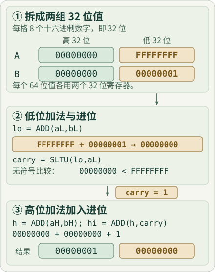
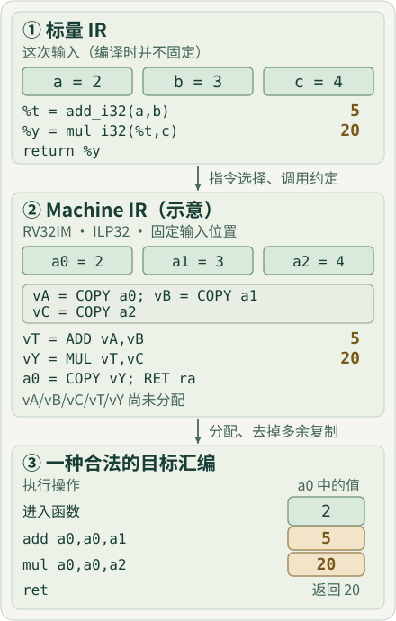

# 一个 IR 操作怎样变成目标机器的指令？

[D01](d01-lowering-and-bufferization.md#next) 将张量计算逐步变成循环、内存读写和标量运算。对于一个原本就是标量的程序，我们已经可以直接得到加法、乘法等低层 IR 操作。

假设编译器现在需要实现一次整数乘法。目标 CPU 如果提供乘法指令，这项操作可能只需要一条指令。如果没有乘法指令，编译器又该怎样完成同样的计算？

**指令选择（Instruction Selection）**负责将 IR 中的操作及其组合转为目标机器可以实现的指令或指令序列。若原来的操作或数据类型无法直接实现，还需要将其改写为目标支持的形式，这称为**合法化（Legalization）**。

下面站在编译器一侧，沿着同一个短程序，观察怎样依据目标指令集、寄存器和函数调用约定，产生可以继续交给机器代码后端的表示。

## 为什么确定了 IR 的操作，还要知道目标机器？ {#target-instructions}

回到 [B01](../02-frontend-and-optimization/b01-compiler-frontend.md#initial-ir) 中的 Go 函数 `evaluate`，用三个 int32 参数计算 (a + b) × c。D01 将它的计算写成下面的教学 IR。

```text
evaluate(a: i32, b: i32, c: i32) -> i32
    %t = add_i32(a, b)
    %y = mul_i32(%t, c)
    return %y
```

取输入 a = 2、b = 3、c = 4，两个运算依次产生 5 和 20。这些数字用于验算；编译时三个参数的值仍然未知，不能提前把程序改成直接返回 20。

本例延用 Go int32 的定宽整数语义：加法和乘法得到结果的低 32 位，再按有符号补码解释。即使发生溢出，也需要保留这种行为。[Go 语言规范 · 整数溢出](https://go.dev/ref/spec#Integer_overflow)

沿用 [A04 的 RISC-V 执行契约](../01-foundations/a04-execution-contract.md#isa)，假设目标 CPU 支持 RV32IM 指令集。RV32I 提供基础整数指令，M 扩展提供整数乘除法指令。该目标的整数寄存器宽度为 32 位。

现在可以比较 IR 的语义和目标指令的语义：

| IR 操作 | 规定的计算 | 可用的目标指令 |
| --- | --- | --- |
| `add_i32(a, b)` | 取加法结果低 32 位 | ADD |
| `mul_i32(%t, c)` | 取乘法结果低 32 位 | MUL |

这两条指令可以计算本例所需的结果。还要确定每条指令使用哪个寄存器，以及函数返回时怎样把结果交还给调用者。这些问题稍后会依次解决。

若原程序要求溢出时停止并报告错误，仅取低位就不再满足要求。编译器还须实现检查与异常处理。能否使用同一条目标指令，首先取决于它是否满足原操作的完整语义。

[RISC-V RV32I 规范](https://docs.riscv.org/reference/isa/v20240411/unpriv/rv32.html) · [M 扩展规范](https://docs.riscv.org/reference/isa/v20240411/unpriv/m-st-ext.html) · [计算微架构 A02：定宽整数与溢出](../../microarchitecture-v2/01-foundations/a02-number-representation-and-arithmetic.md#overflow)

## 如果机器根本没有这项操作呢？ {#operation-legalization}

只改变目标设备。假设现在要为只有 RV32I 的 CPU 生成代码，没有 M 或提供乘法指令的其他扩展。加法仍然有 ADD，但不能再发出 MUL。

对于本次输入，前一项加法产生 %t = 5。乘以 c = 4，从数学上等于将 5 左移两位，结果仍为 20。换一个 c，例如 3 = 2 + 1，也可以把 5 左移一位，再加上原来的 5。

更一般地，可以检查 c 的 32 位比特模式，针对每个为 1 的位，把 %t 左移相应位数并累加，保留低 32 位。这些基础操作可以用 RV32I 指令实现。

于是编译器有两个选择：生成一段用基础指令完成乘法的代码，或调用执行环境已经提供的整数乘法辅助函数。即便没有乘法指令，程序仍可以要求做乘法。

这种将目标不能直接支持的操作转换成可实现的操作，称为**操作合法化**。这里的“合法”指满足目标的实现约束；改写后的计算仍要符合原语义。这与 [D01 的转换目标](d01-lowering-and-bufferization.md#dialect-conversion)以及 [B06 的变换合法性](../02-frontend-and-optimization/b06-legal-transformation.md)相互关联，但不是同一个判断。

实现者可能利用更多已知信息缩短序列。例如如果 c 在编译时确定为 4，便有条件直接使用移位。本例中的 c 是函数参数，不能根据一次测试输入选择只适用于 4 的代码。

LLVM 后端可以将不支持的操作展开、变换或降低为运行库调用，具体决策取决于目标配置和后端实现。[LLVM Code Generator：LegalizeDAG](https://llvm.org/docs/CodeGenerator.html#selectiondag-legalize-phase) · [GlobalISel Legalizer](https://llvm.org/docs/GlobalISel/Legalizer.html)

## 如果有加法指令，但操作数放不进一个寄存器呢？ {#type-legalization}

现在只观察 `%t = add_i32(a, b)` 这项加法。假设输入改为 64 位整数，IR 要求产生低 64 位的结果。目标仍然是 RV32，就不能用一个 32 位寄存器保存整个操作数。

一个办法是将每个 64 位值拆成高、低两个 32 位部分。先计算低位，若低位相加产生了越过第 31 位的进位，再将它加进高位。这与手工进行多位整数加法的原理相同。

例如，取以下两组 64 位比特。下划线只用于分隔高、低 32 位。

| 操作数 | 高 32 位 | 低 32 位 |
| --- | --- | --- |
| a | `0x00000000` | `0xFFFFFFFF` |
| b | `0x00000000` | `0x00000001` |
| 所需结果 | `0x00000001` | `0x00000000` |

单独使用 ADD 计算低位，它只能交出低 32 位，即 0。那一位进位没有直接留在结果里，怎样用目标指令求出它？

把低位视为无符号整数。如果两个低位相加发生回绕，截断后的结果就会小于原来的低位 aL；如果没有回绕，结果不会小于 aL。RV32I 的 SLTU 可以比较两个无符号寄存器值，产生 0 或 1。

于是可以生成下面四项目标运算。这里还没有选择具体的寄存器编号，aL、aH 和 bL、bH 分别表示两个输入的低位与高位。

```text
lo    = ADD(aL, bL)
carry = SLTU(lo, aL)
h     = ADD(aH, bH)
hi    = ADD(h, carry)
```

<figure markdown="1">

[](assets/d02-wide-add.svg)

<figcaption>将一个 64 位加法实现为两个 32 位部分的计算。低位求和时超出的进位由比较指令恢复，高位求和继续保留低 32 位。</figcaption>

</figure>

这就是**类型合法化**的一种方式。原来 IR 的 64 位值，现在用目标能够处理的多个较窄值来表示，并相应修改使用这些值的操作。得到的 64 位比特结果仍应与原来相同。

也可能发生相反的情况。例如目标主要使用 32 位寄存器，而 IR 操作只要求 8 位结果。可以扩大运算宽度，但需要在适当的位置截断或扩展结果，保证后续操作仍按原来的宽度和有符号性解释。

所以合法化不是任意修改数据类型。改变的是目标对值的表示和实现方式，不是源程序规定的结果。LLVM 的整数类型合法化就包含扩大整数位宽和拆分宽整数等处理。

[RISC-V RV32I 规范 · 整数寄存器间运算](https://docs.riscv.org/reference/isa/v20240411/unpriv/rv32.html#_integer_register_register_operations) · [LLVM SelectionDAG 类型合法化](https://llvm.org/docs/CodeGenerator.html#selectiondag-legalizetypes-phase)

## 指令选择只是逐条替换 IR 操作吗？ {#select-patterns}

回到 RV32IM 上的 int32 计算。加法和乘法都有直接对应的指令。但选择指令不仅需要知道操作名称，还要检查操作数来自哪里。

例如将原程序改成 (a + 3) × c，这时 3 是编译时常量。RV32I 的 ADD 要求两个输入来自寄存器，ADDI 则允许把带符号的 12 位整数直接写入指令。编译器可以选择 ADDI 来计算 a + 3，而不必专门准备一个保存 3 的寄存器。

但如果加的是 3000，就不能直接使用一条 `addi ..., ..., 3000` 来实现。ADDI 使用的立即数范围是 −2048 到 2047，需要其他合法的指令组合。

再回到 [D01 的地址计算](d01-lowering-and-bufferization.md#explicit-memory-operations)。读取 A[1,0] 时，基址为 1000，字节偏移为 12。假设偏移已经被确定为常量，低层 IR 可能包含两项操作：

```text
%addr = address_add(base, 12)
%v    = load_i32(%addr)
```

若目标寄存器 x10 中保存数组基址，RV32I 的 LW 可以同时表达带常量偏移的地址计算与取数：

```asm
lw x11, 12(x10)
```

这里的 12 是字节偏移，在 LW 可编码的 12 位带符号立即数范围内。假设 %addr 没有其他使用者，就不必单独形成并保存这个地址。这是两项 IR 操作可以用一条目标指令实现的例子。

编译器可以查看相互连接的操作、数据类型、常量和其他约束，寻找目标支持的指令模式。例如 LLVM 的 SelectionDAG 用带依赖边的节点表示操作，再匹配目标指令的模式。不同组合可能有多个可行的实现。

因此，指令选择不一定是 IR 与机器指令的一一翻译。前面的合法化可能将一项运算展开为多项操作；选择时也可能将多项操作合进一条指令。合法化和选择可以分阶段完成，也可以交织进行。

[RISC-V RV32I 规范 · 寄存器与立即数运算](https://docs.riscv.org/reference/isa/v20240411/unpriv/rv32.html#_integer_register_immediate_instructions) · [加载与存储](https://docs.riscv.org/reference/isa/v20240411/unpriv/rv32.html#_load_and_store_instructions) · [LLVM SelectionDAG 指令选择](https://llvm.org/docs/CodeGenerator.html#selectiondag-instruction-selection-process)

## 函数的参数和返回值具体在哪些寄存器？ {#calling-convention}

我们已经知道 RV32IM 可以如何实现原来的 (a + b) × c。但 `a`、`b`、`c` 只是 IR 中的参数名。如果调用者和函数分别编译，函数怎样知道它们实际从哪里取得？

回忆 [A04 的 ABI](../01-foundations/a04-execution-contract.md#abi)。这里约定使用 RISC-V 标准 ILP32 整数调用约定。示例使用与 B01 相同的算术语义和 IR，展示一个遵循此 ABI 的独立编译函数，不假定 Go 内部也采用同样的调用约定。

| 函数入口与出口 | 约定的位置 | 本次调用的值 |
| --- | --- | ---: |
| 参数 a | a0（x10） | 2 |
| 参数 b | a1（x11） | 3 |
| 参数 c | a2（x12） | 4 |
| 返回值 | a0（x10） | 20 |

调用者还通过调用指令将返回地址置于 ra（x1）。函数结束时，必须按约定返回到该地址，并将结果留在 a0。这里不需要为三个参数从内存取数，因为调用者已将值放到约定位置。

调用约定也会决定哪些寄存器可以被函数临时使用、哪些必须在返回前恢复原值。RISC-V 标准整数 ABI 中，a0–a7 和 t0–t6 不保证跨调用保持；s0–s11 属于被调用者需要保留的寄存器。

这并不表示编译器可以随意覆盖所有其他寄存器，例如栈指针和返回地址仍然承担特定职责。本例不调用其他函数，也不需要栈上临时空间，因而不必修改它们。

[RISC-V psABI：寄存器及整数调用约定](https://riscv-non-isa.github.io/riscv-elf-psabi-doc/#_integer_calling_convention)

## 为什么选完指令，仍然可能没有指定所有寄存器？ {#machine-ir}

假如先确定 ADD、MUL 的形式，却还没决定 %t 和 %y 各自存在哪个寄存器，可以给这些值使用编译器内部的编号。

下面是一段 **Machine IR（机器中间表示）**。它来自 LLVM 19.1.7 为 RV32IM 生成代码时，指令选择完成、寄存器分配前的实际打印结果。这里摘取机器基本块中的操作，不是完整的 MIR 文件。

```text
  %2:gpr = COPY $x12
  %1:gpr = COPY $x11
  %0:gpr = COPY $x10
  %3:gpr = ADD %0:gpr, %1:gpr
  %4:gpr = MUL killed %3:gpr, %2:gpr
  $x10 = COPY %4:gpr
  PseudoRET implicit $x10
```

前三行从 ABI 指定的 x12、x11、x10 取得参数，分别交给 %2、%1、%0。它们是编译器内部的**虚拟寄存器**。gpr 表示该值需要通用整数寄存器；%0 等编号还没有确定最终使用哪个架构寄存器。

ADD、MUL 已是目标操作，而 COPY 和 PseudoRET 仍是机器级伪指令。killed 标记 %3 在这里被最后一次使用；implicit 记录返回操作对结果寄存器 x10 的隐式使用。

与 D01 的低层 IR 相比，现在不仅有值之间的依赖，还有目标指令的操作数约束、入口和出口的固定寄存器要求。

为什么不立刻把所有虚拟寄存器都替换为真实编号？程序可能产生许多暂存值，真实寄存器却只有有限数量。还需要检查每个值之后会不会用到、是否可以和其他值共用寄存器。

在 LLVM 中，机器指令可以带有虚拟寄存器、目标寄存器及其读写约束，也可以包含编译器内部的伪指令。不同目标和实现可能采用不同的 Machine IR 及指令选择、调用降低的顺序。

[LLVM：Machine IR](https://llvm.org/docs/MIRLangRef.html) · [GlobalISel：InstructionSelect](https://llvm.org/docs/GlobalISel/InstructionSelect.html)

<figure markdown="1">

[](assets/d02-ir-to-machine.svg)

<figcaption>跟踪同一组值从低层 IR 到 Machine IR，再到一种合法的目标汇编。图中的 vA、vB、vC、vT、vY 分别对应上文的 %0、%1、%2、%3、%4。箭头表示表示层次的变化，不代表硬件执行时序。</figcaption>

</figure>

对于本例，一种合法的最终实现如下。这里先展示已经选定寄存器的结果，不展开寄存器分配算法。

```asm
evaluate:
    add a0, a0, a1
    mul a0, a0, a2
    ret
```

第一条指令直接将 a0 里的原值 2 覆盖为 5。原程序后面已不再需要那个 2，因此不必另外保存它。第二条将 5 与 a2 中的 4 相乘，a0 变为 20。结果已在约定的返回位置，所以不需要额外复制。

`ret` 是汇编伪指令，在此对应 `jalr x0, 0(ra)`。它使用 ra 中已有的返回地址改变执行位置，不承担返回值的搬运。

这里所说的目标机器寄存器是 ISA 可见的架构寄存器，如 x10。CPU 内部还可能使用其他物理寄存器进行重命名，属于另一层实现。[计算微架构 B05：寄存器重命名](../../microarchitecture-v2/02-cpu/b05-register-renaming.md#rename-map)

## 换一个目标，真实编译器会生成什么？ {#compiler-example}

把前面的计算写成 LLVM IR（不添加限制整数溢出的标志）：

```llvm
define i32 @evaluate(i32 %a, i32 %b, i32 %c) {
  %t = add i32 %a, %b
  %y = mul i32 %t, %c
  ret i32 %y
}
```

使用 LLVM 19.1.7 的目标代码生成接口，目标为 `riscv32-unknown-elf`、CPU 为 `generic-rv32`，采用默认代码生成优化级别（CodeGenLevelDefault）。开启 M 扩展（+m）时，生成的函数体就是前面的三行汇编。

只关闭 M 扩展（纯 RV32I）时，同一份 IR 生成：

```asm
evaluate:
    add a0, a0, a1
    mv a1, a2
    tail __mulsi3
```

为什么额外移动一次 a2？这里的实现把乘法交给 `__mulsi3` 辅助函数。它接受两个 32 位参数，因此根据同样的调用约定，应在 a0 中取得 5、在 a1 中取得 4，再把乘积留在 a0。

`tail` 是尾调用的汇编伪指令。辅助函数沿用原来的返回地址，直接向 evaluate 的调用者返回。要真正执行这个程序，还必须提供与目标兼容的辅助函数，并按链接规则解析对它的引用，这是 D04 的研究对象。

以上是特定版本与配置的实际代码生成结果，而非所有 RISC-V 编译器必须采取的方案。LLVM 对无 M 扩展的 RV32 提供的 compiler-rt 实现可参见其 [mulsi3.S 源码](https://github.com/llvm/llvm-project/blob/main/compiler-rt/lib/builtins/riscv/mulsi3.S)。

这也说明了为什么同一份低层 IR 可以为不同目标生成不同代码：程序语义保持不变，但可用的指令、辅助函数和寄存器约束不同。

## 下一步还要解决什么？ {#next}

D01 将原程序降低为更具体的操作，D02 根据目标支持的类型和指令来实现这些操作，并将函数的入口、出口与调用约定相联系。

此时还有一个关键问题没有展开。刚才的五个虚拟寄存器可以复用少量架构寄存器，但更长的程序可能同时保留许多仍需使用的值。编译器怎样安排它们？当寄存器不足时，又怎样用内存临时保存数据？

D03 将继续沿此机器代码路线，从 [B05 的活跃值](../02-frontend-and-optimization/b05-dataflow-analysis-and-optimization.md#live-values)出发，解释寄存器分配、溢出保存与机器指令调度。

[返回专题阅读顺序](README.md#计划阅读顺序)
