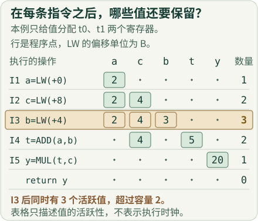
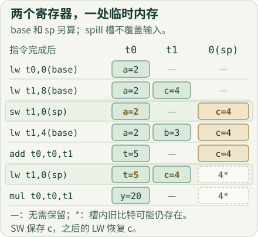

# 临时值比硬件寄存器多，编译器怎样处理？

[D02](d02-instruction-selection.md#machine-ir) 中，整数表达式 (a + b) × c 已经变成目标机器的 ADD 和 MUL，但每个中间值仍使用虚拟寄存器编号。最后生成的汇编只用了部分架构寄存器。

如果一段程序中有许多还需使用的值，而目标能提供的寄存器不够，编译器怎样保证这些值不会被提前覆盖？

**寄存器分配（Register Allocation）**负责为程序中的值安排可用的目标寄存器，必要时生成额外的内存读写来保存和恢复数据。编译器还可以调整指令顺序，改变同时需要保留的值，以及等待数据的时间，这属于**机器指令调度（Instruction Scheduling）**。

下面仍沿用 (a + b) × c，先找出哪些值必须同时保留，再看怎样利用有限的寄存器完成计算。

## 五个虚拟寄存器，真的需要五个架构寄存器吗？ {#live-values}

在 D02 的 Machine IR 中，%0、%1、%2 分别接收入参 a、b、c，%3 保存加法结果，%4 保存乘法结果。为便于阅读，下面仍使用 a、b、c、t、y 追踪这些值。

取 a = 2、b = 3、c = 4，得到 t = 5、y = 20。按顺序经过两个运算时，有哪些值以后仍要使用？

| 程序位置 | 之后仍需使用的值 |
| --- | --- |
| 三个参数已取得，尚未相加 | a = 2，b = 3，c = 4 |
| 执行 ADD 后 | t = 5，c = 4 |
| 执行 MUL 后 | y = 20 |
| 返回值交付后 | 无本函数还需保留的算术值 |

回忆 [B05 的活跃性分析](../02-frontend-and-optimization/b05-dataflow-analysis-and-optimization.md#live-values)：从某个程序点出发，若后续可能继续使用某个值，它在该处就是活跃的。

ADD 读取 a 和 b 之后，原程序不再需要这两个值。只要目标允许结果覆盖操作数，就可以使用原来保存 a 的寄存器来保存 t。MUL 同样可以让 y 覆盖 t。

这就是上一篇最终汇编能连续写 a0 的原因：

```asm
add a0, a0, a1
mul a0, a0, a2
ret
```

虚拟寄存器的数量描述程序中有多少个这样的名称，并不表示全部值必须同时存放。要判断需要多少寄存器，应先观察它们何时产生、何时被最后一次使用。

## 怎样找出哪些值不能使用同一个寄存器？ {#live-intervals}

为看清寄存器不够时的情况，改变参数的获取方式。让调用者传入一个地址，指向连续存放的三个 int32 整数 a、b、c。它们仍然分别为 2、3、4，占 12 B。

目标仍采用 D02 的 RV32IM 和标准 ILP32 调用约定。假设地址有效、按 4 B 对齐，输入是普通非 volatile、非原子的只读内存，整个计算期间内容稳定。只考虑正常完成的情况。

暂时固定下面这份已经选择过指令的教学 Machine IR。它先读取 a 和 c，再读取 b，完成加法和乘法。

```text
I1: a = LW [base + 0]
I2: c = LW [base + 8]
I3: b = LW [base + 4]
I4: t = ADD a, b
I5: y = MUL t, c
return y
```

这次原程序只要求交付 y。给定上面的指令顺序，可以从后往前找每个值要保留到哪个程序位置：

| 程序位置 | 活跃值 |
| --- | --- |
| I1 之后 | a |
| I2 之后 | a，c |
| I3 之后 | a，c，b |
| I4 之后 | t，c |
| I5 之后 | y |

这里暂不统计地址 base、栈指针、返回地址等固定用途的寄存器，只跟踪计算所需的五个值。

<figure markdown="1">

[](assets/d03-live-intervals.svg)

<figcaption>横纵位置标记指令及其间的程序点，不表示真实的执行周期。I3 后的 a、b、c 都还要参与后续计算。</figcaption>

</figure>

对这段没有分支的代码，可以用从值产生到最后一次使用的范围描述该值必须保留的范围。这称为**活跃区间（Live Interval）**。a、b、c 的三个活跃区间在 I3 后相交，说明三个值在这里都需要保存。

如果三个不同的值都打算保留在寄存器中，它们在这一点必须有三个不同的寄存器位置。若两个值在整个使用期间都不同时活跃，又符合各项操作数约束，就可能复用同一位置。

在含分支、循环的程序中，还要跨基本块分析各条可能路径上的使用关系。实现也可以用多个活跃片段来表达中间的空闲位置，不必把所有值从首次定义一直保留到最后一处文本使用。

[LLVM：Live Intervals](https://llvm.org/docs/CodeGenerator.html#live-intervals) · [B02：循环携带的值](../02-frontend-and-optimization/b02-control-flow-and-ssa.md#loop-carried-values)

## 有三个同时需要的值，为什么不能随便选两个保存？ {#allocation}

先假设目标能够提供三个用于计算的整数寄存器 t0、t1、t2。沿上述顺序分配，可以让 a 用 t0、c 用 t1、b 用 t2；t 复用 t0，y 继续使用 t0。所有计算值都能交付。

现在增加限制：只允许分配 t0 和 t1 给这些值。RV32 实际有更多架构寄存器，这是为了观察压力而人为设置的教学条件。a0 保存输入基址，sp 保存栈指针，ra 保存返回地址，均不参加本例的临时值分配。

当 I2 完成后，两个可分配寄存器已分别保存 a 和 c。I3 想产生 b，却找不到可以覆盖的位置。无论直接覆盖哪个值，后面的 ADD 或 MUL 都会缺少输入。

编译器可以借助这种冲突关系组织分配。像 [C04 的 Buffer 干涉图](../03-mapping-and-planning/c04-static-buffer-allocation.md#interference) 一样，把需要不同存储位置的值用边连接起来。例如 a、b、c 在此处两两干涉。

如果将每个可用寄存器看作一种颜色，就可以寻找使相邻节点颜色不同的分配。这称为**图着色（Graph Coloring）**。此处三个两两相连的节点无法只使用两种颜色。

还有一种思路是沿指令顺序扫描活跃区间。新值出现时寻找空闲寄存器，旧值不再活跃时收回位置；如果没有空闲位置，就决定暂时放弃哪个值的寄存器位置。这是**线性扫描（Linear Scan）**分配的基本思路。

真实机器还需要考虑寄存器类别、特殊指令的固定操作数、函数调用保存规则等约束。假如 c 在一次函数调用前产生，调用结束后还要使用，便不能任由被调用函数覆盖 c 所在的寄存器。

一种做法是将 c 安排到 ABI 规定的保留寄存器，并遵守该寄存器的保存与恢复约定；也可以将 c 暂存到内存。仅检查同时活跃值的数量，还不足以在一般情况下保证可以完成分配。

[Chaitin 等：Register Allocation via Coloring（1981）](https://doi.org/10.1016/0096-0551(81)90048-5) · [Poletto 与 Sarkar：Linear Scan Register Allocation（1999）](https://doi.org/10.1145/330249.330250) · [LLVM：Register Allocation](https://llvm.org/docs/CodeGenerator.html#register-allocation)

## 如果没有空闲寄存器，怎样让旧值在以后还能使用？ {#spill-and-reload}

回到只有 t0、t1 的条件。假设采用原来的指令次序，并决定让 c 暂时离开寄存器。I2 已取得 c = 4，I5 才需要它。

在执行 I3 之前，可以先将 c 写到一块额外的存储空间，再把 t1 交给 b。完成 I4 后，b 已用完，于是可以把 c 从内存重新读入 t1，交给最后的乘法。

编译器引入的这种临时保存称为 **Spill**，需要数据时重新装入寄存器称为 **Reload**。这里的 Spill 是寄存器空间不够引起的保存操作，与整数算术溢出不同。用于保存该数据的空间称为 Spill Slot，通常可以放在当前函数的栈帧中。

<figure markdown="1">

[](assets/d03-spill-reload.svg)

<figcaption>值 c 仍然是最终计算所需的值，只是在一段期间从寄存器转到内存。恢复之后，栈槽中可能仍保留 4，但这次计算不再需要从槽中读取它。</figcaption>

</figure>

把这份分配结果写成 RV32IM 汇编，可以得到下面的教学实现。假设入口 sp 满足标准 ILP32 的 16 B 对齐要求，并有足够的栈空间；本函数新分配的栈槽与输入缓冲区不重叠。

```asm
evaluate_buffer:
    addi sp, sp, -16
    lw   t0, 0(a0)      # a
    lw   t1, 8(a0)      # c
    sw   t1, 0(sp)      # spill c
    lw   t1, 4(a0)      # b
    add  t0, t0, t1     # t = a + b
    lw   t1, 0(sp)      # reload c
    mul  t0, t0, t1     # y = t * c
    mv   a0, t0         # 交付返回值
    addi sp, sp, 16
    ret
```

这里分配 16 B 栈空间以符合调用约定，只使用其中 4 B 保存 c。函数返回前恢复 sp。其余诸如栈帧中其他局部变量、需要保存的寄存器等，可按实际程序的要求安排。

原来的计算顺序仍被保留，增加了一次 SW、一次 LW 和必要的栈空间管理操作。c 没有因为离开寄存器而成为死值，它仍需保留到乘法使用为止。

本例的输入内存稳定，若能利用该事实，编译器也可能直接重新从输入地址读取 c，而不生成这对 Spill/Reload。因此，上面的实现用于说明通用的保存机制，不是本例的唯一实现或最低成本方案。

面对多个可选择的值，编译器可以参考距离下一次使用的位置、使用频率、保存与恢复的代价。例如让很快就要使用的值离开寄存器，可能很快又要装回来；某些常量则可以用低成本指令重新生成。

[RISC-V psABI：标准整数调用约定和栈对齐](https://riscv-non-isa.github.io/riscv-elf-psabi-doc/#_integer_calling_convention) · [LLVM：寄存器分配及溢出代码](https://llvm.org/docs/CodeGenerator.html#register-allocation)

## 不改变计算结果，能否改变同时需要的寄存器数量？ {#pressure-and-order}

再看最初的三次读取。c 是最后一次乘法的输入，与前面的整数加法没有数据依赖。在本文约定的普通稳定输入条件下，可以把读取 c 的指令移到 I4 之后。

```text
a = LW [base + 0]
b = LW [base + 4]
t = ADD a, b
c = LW [base + 8]
y = MUL t, c
return y
```

现在先读取 a、b，用完二者后只保留 t = 5，再读取 c = 4。每个程序点最多需要两个算术值同时保存在寄存器中。

因此，在给定的两个可用寄存器条件下，可以生成：

```asm
evaluate_buffer:
    lw   t0, 0(a0)
    lw   t1, 4(a0)
    add  t0, t0, t1
    lw   t1, 8(a0)
    mul  t0, t0, t1
    mv   a0, t0
    ret
```

栈槽已经不再需要。并不是目标突然多出了一个寄存器，而是指令顺序变化后，c 不必在 ADD 之前就占据一个寄存器。

编译器用**寄存器压力（Register Pressure）**描述某个位置对相应寄存器资源的需求。本例每个值占用一个同类寄存器，因此可以直接用同时活跃的值数比较压力。

更一般地，宽值可能需要多个寄存器，向量与标量可能使用不同的寄存器类，还可能存在不能同时使用的重叠寄存器。压力需要按具体目标资源计算。

## 为什么不将所有读取都尽量推迟？ {#instruction-scheduling}

上一种改动减少了寄存器压力。但如果每次内存读取都需要等待较长时间，推迟读取 c 也可能使乘法更晚开始。

假设有一个简单的顺序发射目标模型：每拍最多发射一条指令，独立指令可重叠；LW 结果在发射后 3 拍可用，ADD 为 1 拍，MUL 为 3 拍。假设不同访存可流水重叠，没有额外资源冲突。

先给提前读 c 的方案三个计算寄存器，避免插入 Spill/Reload。对比只有两个计算寄存器的延后读取方案。只追踪从第一项读取发射到 y 可用的过程，不计入返回。

| 指令 | 提前读取 c | 延后读取 c |
| --- | ---: | ---: |
| LW a | 0 | 0 |
| LW b | 2 | 1 |
| LW c | 1 | 5 |
| ADD t | 5 | 4 |
| MUL y | 6 | 8 |
| y 可用 | 9 | 11 |
| 峰值计算寄存器需求 | 3 | 2 |

<figure markdown="1">

[](assets/d03-schedule-pressure.svg)

<figcaption>教学时序：一个发射位置每拍最多发射一条指令，等到所需结果可用才能发射其消费者。时刻差表示本模型中的拍数，不是 RISC-V 真实处理器测量结果。</figcaption>

</figure>

提前读 c 时，等待 a、b 可用的期间也在推进 c 的读取。因此 MUL 不必在 ADD 之后再等待完整的读取延迟，但 c 要更早占用一个用于结果的寄存器。

这正是**机器指令调度**要解决的问题之一：利用目标提供的资源和延迟信息，安排满足依赖关系的指令次序，减少等待并控制资源需求。

刚才只比较两种无额外保存的方案，未对插入 Spill/Reload 后的提前读取方案计时，也未寻找最优指令次序。只有两个可用寄存器时，最终取舍还需计入额外指令、访存延迟及实际目标约束。

真实编译器还需要尊重内存依赖、控制流、异常及可观察效果。若 c 来自可能被中间操作修改的地址，便不能仅凭没有普通 SSA 值依赖就移动读取。[B04：依赖与别名](../02-frontend-and-optimization/b04-dependency-and-alias-analysis.md)

[计算微架构 A08：调度](../../microarchitecture-v2/01-foundations/a08-dependencies-and-scheduling.md#scheduling)解释的是硬件如何发射就绪操作。本篇关注的是编译时指令顺序的选择；动态乱序处理器仍可根据实际运行状态进行发射。

## 寄存器分配与指令调度为什么会相互影响？ {#allocation-and-scheduling}

刚才调度改变 c 的定义位置，改变了活跃区间，也改变了需要的寄存器数量。如果先进行这样的调整，再分配寄存器，就可能少生成内存读写。

反过来，分配结束后，使用同一个架构寄存器的操作可能产生新的顺序约束。回到延后取 c 的代码，t1 先保存 b，再保存 c。读 b 的 ADD 尚未完成必要的取数之前，写 c 的 LW 不能直接覆盖旧 b。

这种因复用名称产生的读后写、写后写顺序约束，与原先由计算产生的真实依赖不同。若机器代码调度还想移动指令，要重新检查这些约束；Spill/Reload 插入的内存访问也会引入新的依赖和资源需求。

因此编译器可以在分配前利用虚拟寄存器进行调度，也可以在分配后利用确定的架构寄存器及额外指令继续调整。具体先后顺序、优化目标和是否反复调整，取决于后端实现。

LLVM 的机器调度器提供寄存器压力相关的调度机制，机器寄存器分配则可以拆分活跃范围、生成 Spill/Reload 等操作。[LLVM 目标无关代码生成器](https://llvm.org/docs/CodeGenerator.html) · [LLVM MachineScheduler 源码](https://llvm.org/doxygen/MachineScheduler_8cpp_source.html)

注意不要将编译器的寄存器分配与 CPU 的寄存器重命名混为一谈。前者决定机器指令引用哪些架构寄存器；后者在硬件内部为这些指令的不同版本安排位置。[计算微架构 B05：重命名映射](../../microarchitecture-v2/02-cpu/b05-register-renaming.md#rename-map)

## 选定寄存器后，代码已经可以运行了吗？ {#next}

D01 为计算补充循环和内存操作，D02 根据目标选出指令，D03 再决定这些指令怎样使用有限的寄存器，并调整合法的执行次序。

现在已经可以写出带有目标寄存器的汇编代码。但其中还可能存在伪指令、函数名和需要链接的辅助函数。例如 D02 的 RV32I 方案引用了 `__mulsi3`。这些名称并不直接给出机器能够执行的地址与编码。

D04 将沿着这些目标代码，解释汇编、目标文件、符号与重定位，直到软件得到能够交给加载器的程序或代码对象。

[返回专题阅读顺序](README.md#计划阅读顺序)
