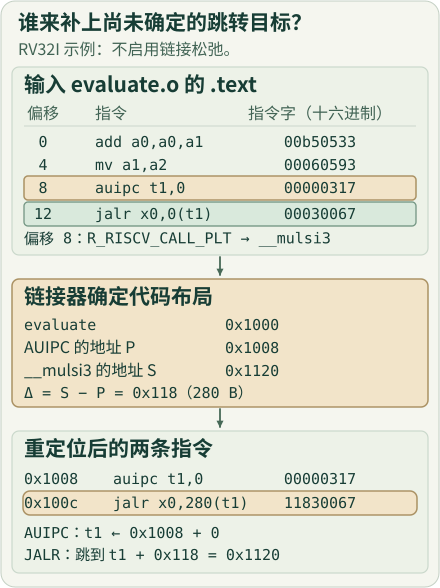
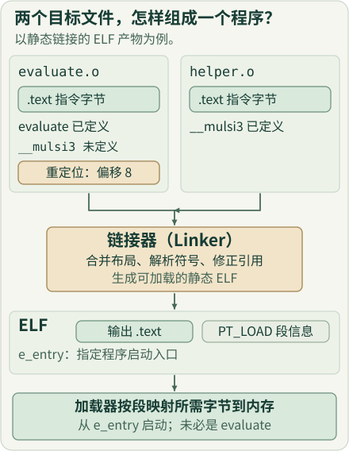
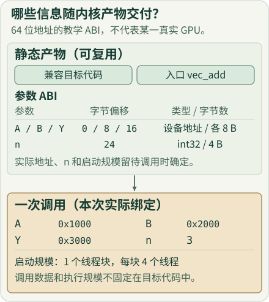

# 生成的代码怎样成为可加载、可调用的程序？

[D03](d03-register-allocation-and-scheduling.md#next) 已经将虚拟寄存器换成目标机器的架构寄存器。现在可以写出汇编代码，但如果我们只把这段文字交给 CPU，它还不能从中取出任何指令。

[D02](d02-instruction-selection.md#compiler-example) 还留有一个问题。没有乘法指令的 RV32I 目标需要调用辅助函数 `__mulsi3`。编译这段代码时，辅助函数可能在另一个文件中。机器怎样知道应该跳到哪里？

**汇编（Assembly）**将汇编表示转成指令编码以及后续处理所需的信息。**链接（Linking）**把分开生成的代码和数据组织起来，解析它们之间的引用。最终产物还需要满足加载环境与调用方的接口约定。

下面沿用 D02 的整数表达式，追踪一项尚未确定目标地址的跳转怎样变成可执行代码，再联系 A04 中的设备 Kernel。

## 为什么算出指令编码，还没有完成代码生成？ {#assembly}

回到 RV32I 的 `evaluate(a,b,c)`。它需要按 32 位整数规则计算 (a + b) × c。根据 D02 的标准 ILP32 调用约定，三个输入分别放在 a0、a1 和 a2，结果从 a0 返回。

LLVM 19.1.7 为只有 RV32I 的目标生成了下面的函数体：

```asm
evaluate:
    add a0, a0, a1
    mv a1, a2
    tail __mulsi3
```

第一条 ADD 指令的操作码和三个寄存器编号都已确定。按照 RISC-V 的指令编码规则，可以将它写成一个 32 位指令字 0x00b50533。[计算微架构 B01](../../microarchitecture-v2/02-cpu/b01-instructions-and-architectural-state.md#instruction) 解释过这些编码如何被硬件译码。

`mv` 则是一条伪指令。汇编器可以用 ADDI 表达这次寄存器复制，即把 a2 加上立即数 0 的结果写入 a1。

第三行的 `tail` 也是伪指令，但它需要引用另一个函数。在本例的 RV32I、小端配置下，它可以展开为 AUIPC 和 JALR 两条指令，暂时用 0 填入尚未确定的地址偏移。

| 原汇编 | 展开后的指令 | 此时的指令字 |
| --- | --- | --- |
| add a0, a0, a1 | add a0, a0, a1 | `00b50533` |
| mv a1, a2 | addi a1, a2, 0 | `00060593` |
| tail __mulsi3 | auipc t1, 0 | `00000317` |
| （同上） | jalr x0, 0(t1) | `00030067` |

这里使用 t1（x6）作为临时寄存器。JALR 的目的寄存器为 x0，所以不会修改 ra 中原调用者的返回地址。

但如果不修改两个立即数字段，就无法保证正确地跳到辅助函数。必须记录下来：哪处指令还没有得到最终编码，它需要引用哪个对象，以及应当如何修改它。

[RISC-V RV32I 指令集规范](https://docs.riscv.org/reference/isa/v20240411/unpriv/rv32.html) · [RISC-V psABI：Procedure Calls](https://riscv-non-isa.github.io/riscv-elf-psabi-doc/#_procedure_calls)

## 为什么目标文件不只保存指令？ {#object-files}

编译器可以调用汇编器，也可以在内部完成指令编码和目标文件生成。假设把 `evaluate` 单独编译，产生一个名为 evaluate.o 的文件。

这种可以继续交给链接器的产物称为**可重定位目标文件（Relocatable Object File）**。这里使用常见的 ELF 格式作为具体例子。

ELF 文件根据用途组织不同的内容。下面这些名称是工具链中的常见约定，不要求每个 ELF 文件都拥有所有这些节。

| 内容 | 常用节名 | 用途 |
| --- | --- | --- |
| 指令字节 | `.text` | 保存已编码的目标指令 |
| 只读数据 | `.rodata` | 保存常量等数据 |
| 已初始化的可写数据 | `.data` | 保存初始内容 |
| 零初始化存储空间 | `.bss` | 记录所需空间，通常不保存相应的一串零字节 |
| 符号表、字符串表 | `.symtab`、`.strtab` | 按名称和属性描述可定义或被引用的对象 |
| 重定位表 | `.rela.text` | 描述仍需修改的代码位置 |

在目标文件中，这些内容分别组织在**节（Section）**中。节表记录它们在文件内的位置、大小等信息。文件头还标记目标机器、位宽、字节序及产物类型。

使用 LLVM 19.1.7 的代码生成接口，以 `riscv32-unknown-elf`、`generic-rv32`、特性 `-m,-relax` 为目标，实际从 D02 的 LLVM IR 生成了 ELF32 小端 ET_REL 文件。用 readelf 查看其 .text：

```text
节内偏移     字节（按文件中的排列顺序）
0x00         33 05 b5 00
0x04         93 05 06 00
0x08         17 03 00 00
0x0c         67 00 03 00
```

这里关闭链接松弛（Relaxation），便于在后文追踪固定的四条指令。由于采用小端存储，每个 32 位指令字的低字节排在前面。

注意，这里的 0x08 是指令相对于 .text 起始位置的字节偏移，不是程序实际运行时的地址。整个 .text 只占 16 B；目标文件本身还包含各种描述信息，会比它大得多。

[ELF gABI：Sections](https://refspecs.linuxfoundation.org/elf/gabi4%2B/ch4.sheader.html) · [ELF Header](https://refspecs.linuxfoundation.org/elf/gabi4%2B/ch4.eheader.html)

## 怎样记录一个暂时找不到地址的函数？ {#symbols}

假设另一个目标文件 helper.o 定义了 `__mulsi3`，遵守同样的 32 位整数调用约定，并使用 RV32I 指令完成乘法。evaluate.o 并没有它的函数体。

链接器首先需要知道两个文件中各有哪些定义和引用。以 ELF 为例，**符号（Symbol）**可以表示函数、数据对象等，也可以表示尚未定义的引用。

真实的 evaluate.o 的符号表中有以下两项（省略无关字段和其他符号）：

| 名称 | 属性 | 位置 | 值 |
| --- | --- | --- | --- |
| evaluate | GLOBAL FUNC | .text | 0 |
| __mulsi3 | GLOBAL NOTYPE | UND（未定义） | 0 |

对于此处的已定义函数，值 0 表示它位于本目标文件 .text 的偏移 0。而第二行的 UND 表示这个文件尚未提供 `__mulsi3` 的定义，那个 0 不是辅助函数的运行地址。

如果 helper.o 中有符合要求的全局定义，链接器就可以将来自 evaluate.o 的引用与它关联起来。这称为**符号解析（Symbol Resolution）**。

如果找不到必需符号的定义，最终静态链接通常会失败。还需要注意，即使名称能成功关联，也不代表两个函数的参数类型和语义一定一致。ABI 与调用契约仍由相应的工具链和软件保证。

[ELF gABI：Symbol Table](https://refspecs.linuxfoundation.org/elf/gabi4%2B/ch4.symtab.html)

## 找到辅助函数之后，怎样修改原来的跳转？ {#relocation}

仅有符号表，还不足以完成修改。因为同一个函数可能从不同位置被引用，而不同指令对目标地址有不同的编码规则。

evaluate.o 的代码重定位节 .rela.text 中有这样一条真实记录：

| 节内偏移 | 类型 | 引用符号 | Addend（附加值） |
| --- | --- | --- | ---: |
| 0x08 | `R_RISCV_CALL_PLT` | __mulsi3 | 0 |

它要求链接器修改从偏移 0x08 开始的 AUIPC 与 JALR 指令对。该类型名含有 PLT，但对于本文在静态链接中解析到同一个输出文件的定义，并不需要生成 PLT 跳板。

接下来用一组固定布局追踪计算。我们用 LLVM MC 19.1.7 将相同汇编再生成目标文件，并用 LLD 19.1.7 链接。此实验的辅助函数目标文件名为 mul.o，使用自行编写的 RV32I 移位累加实现。

重新汇编时将各函数放进专用输入节，以便用链接脚本固定布局。evaluate 的四个指令字与前面 .text 中的内容相同。为便于验算，让链接器按给定的地址安排两个函数，关闭松弛，不改动前面四条指令的长度。

| 链接器确定的对象 | 地址 |
| --- | --- |
| evaluate | `0x1000` |
| AUIPC 指令（重定位位置 P） | `0x1008` |
| JALR 指令 | `0x100c` |
| __mulsi3（符号地址 S） | `0x1120` |

对于此处已静态解析的 RISC-V 函数调用重定位，所需的 PC 相对偏移为 S + A − P，A 是重定位记录中的附加值。本例 A = 0。

**偏移 = 0x1120 − 0x1008 = 0x118 = 280 B。**

AUIPC 将高位偏移加到它自身的指令地址上；JALR 则根据寄存器中的地址再加上带符号的低位偏移进行跳转。此处 280 能直接放入 JALR 的 12 位带符号立即数，高位部分为 0。

```asm
# 布局与重定位之后
0x1008:  auipc t1, 0
0x100c:  jalr  x0, 280(t1)
```

执行 AUIPC 后，t1 = 0x1008。JALR 使用的基址正是 t1，而不是它自己的指令地址 0x100c。0x1008 + 280 = 0x1120。JALR 还会将所得地址的最低位清零，本例地址已对齐，仍然得到辅助函数的入口。

<figure markdown="1">

[](assets/d04-relocation.svg)

<figcaption>追踪同一次尾调用的编码变化。相对偏移使用 AUIPC 的地址作为基准；本例不进行链接松弛。</figcaption>

</figure>

实际链接结果与上述计算一致：JALR 指令字变成 0x11830067，小端字节为 `67 00 83 11`。这就是**重定位（Relocation）**：根据最终布局和引用规则，填写代码或数据中尚不能在单独编译时确定的内容。

更远的偏移需要由两个立即数字段共同表示，计算高位时还要考虑低 12 位的符号扩展。允许链接松弛时，链接器也可能在满足距离等条件后，将指令对改成一条 JAL。

[ELF gABI：Relocation](https://refspecs.linuxfoundation.org/elf/gabi4%2B/ch4.reloc.html) · [RISC-V psABI：Procedure Calls](https://riscv-non-isa.github.io/riscv-elf-psabi-doc/#_procedure_calls) · [RISC-V psABI：Linker Relaxation](https://riscv-non-isa.github.io/riscv-elf-psabi-doc/#_linker_relaxation)

## 为什么链接后的文件还需要描述怎样加载？ {#linking-and-loading}

刚才我们观察了一个符号和一处重定位。实际链接器还需要组织多个输入文件的代码、常量和可写数据，安排对齐与地址，并生成输出文件所需的各种信息。

构造一份能够在约定的 RV32I 环境中运行的教学程序，除了 evaluate.o 和 helper.o，我们还加入 start.o。启动代码 _start 会准备 2、3、4，调用 evaluate，返回之后在教学环境约定的 ebreak 位置停止。

在 ELF 中，供加载环境使用的内容通常由**段（Segment）**组织。一个可加载段可以覆盖多个节。程序头表中的 PT_LOAD 项记录应将文件中哪段字节映射到什么地址、使用多大的内存区域以及访问属性。

例如，代码节可以位于允许执行的可加载段中；对于只需要预留零初始化空间的数据，内存区域还可以大于对应的文件字节范围。

<figure markdown="1">

[](assets/d04-object-to-load.svg)

<figcaption>链接器组织各目标文件并产生加载信息。节用于组织链接相关内容，程序头中的可加载段描述运行所需的内存映像；程序入口与普通函数入口是不同的概念。</figcaption>

</figure>

输出文件还可以提供程序入口（e_entry）。对于普通进程，这通常是启动代码的入口，不是任意一个接受普通函数参数的函数地址。

这个实验的最终文件是 ELF32 的 ET_EXEC。使用 readelf 检查，得到以下实际字段（只列出相关部分）：

| 字段 | 值 | 含义 |
| --- | --- | --- |
| e_entry | `0x1200` | _start 的地址 |
| PT_LOAD 的 p_offset | `0x1000` | 段在文件中的起始偏移 |
| PT_LOAD 的 p_vaddr | `0x1000` | 段的虚拟起始地址 |
| p_filesz / p_memsz | `0x218` / `0x218` | 这段对应的文件及内存长度 |
| p_flags | R E | 可读、可执行 |

这个 PT_LOAD 覆盖三个代码节，包括 evaluate、辅助函数及 _start。最终文件没有剩余的重定位记录。若在链接时省去提供 __mulsi3 的目标文件，LLD 则实际报告未定义符号。

使用简化的 RV32I 指令执行模型，按 PT_LOAD 载入真实文件字节，从 e_entry 开始执行，最后在 ebreak 处得到 a0 = 20。该停机点用于教学验证，不是普通 Linux 进程的退出约定，也不是硬件实测。

链接器给出地址和加载描述，并不意味着代码已经出现在机器的存储中。加载器需要依据目标执行环境建立相应的运行映像，才可能把执行控制交给入口。这些工作不一定由同一个软件组件实现。

[ELF gABI：Program Header](https://refspecs.linuxfoundation.org/elf/gabi4%2B/ch5.pheader.html) · [ELF Header](https://refspecs.linuxfoundation.org/elf/gabi4%2B/ch4.eheader.html)

## 链接时一定要把所有函数的代码放入同一个文件吗？ {#static-and-dynamic-linking}

前面的例子将辅助函数的实现组织进同一个输出产物，并在链接时确定它的相对地址。这属于**静态链接（Static Linking）**的典型用法。

如果一组常用函数已经编译成多个 .o 文件，可以把它们组织成静态库（常见扩展名 .a）。链接器通常按引用需求选取其中需要的目标文件，而不是要求应用从源代码重新编译整个库。

另一类方案是保留对外部共享库的依赖。多个程序可以分别引用同一库。生成产物时，链接器记录所需的共享库及必要的动态符号、重定位信息。执行环境在加载或后续需要时完成剩余绑定，这称为**动态链接（Dynamic Linking）**。

| 比较项 | 静态链接示例 | 动态链接示例 |
| --- | --- | --- |
| 函数实现 | 需要的目标代码进入输出产物 | 实现可以留在共享库中 |
| 符号与地址 | 许多引用在最终链接时解决 | 部分绑定和地址修正留到动态链接阶段 |
| 执行前的条件 | 需要兼容的加载与执行环境 | 还需要能取得并使用兼容共享库 |

静态链接与动态链接可以混合。静态链接也不意味着所有地址都是固定的绝对地址；使用位置无关代码的产物仍可能需要加载时重定位。

例如 ELF 的共享对象在链接之后仍可保留动态重定位。动态链接器根据实际加载位置及解析到的定义修改相关地址。某些函数引用还可以采用延迟绑定，而不是在程序启动时一次性解决。

这里仅建立两种生成产物的方式。库的搜索规则、PLT、GOT 及动态加载器实现由具体平台定义，不要求所有程序采用相同机制。

[ELF gABI：Dynamic Linking](https://refspecs.linuxfoundation.org/elf/gabi4%2B/ch5.dynamic.html) · [GNU ld：选取库中的目标文件](https://sourceware.org/binutils/docs/ld/Options.html)

## 交给计算设备的代码对象还需要什么信息？ {#kernel-artifacts}

回到 [A04 的向量加法 Kernel](../01-foundations/a04-execution-contract.md#kernel)。它计算 Y[i] = A[i] + B[i]，我们的模型有三个设备缓冲区和一个元素数量 n。

对于可编程计算设备，编译器也需要生成设备能够执行的代码，可能还需要进行设备代码之间的链接。一个设备**代码对象（Code Object）**可以承载目标代码以及加载、调用所需的信息。

为什么只提供一串完整指令还不够？如果对象中包含多个 Kernel，调用者需要区分各自入口。入口对应的参数规则也要明确，否则运行时可能将 B 的地址当作 A 的地址解释。

例如我们构造一个用于说明参数布局的教学 ABI：设备指针占 8 B、按 8 B 对齐，n 是占 4 B 的 int32。下面的偏移是该示例规定的参数布局，不代表真实 CUDA 或其他设备的统一格式。

| 参数 | 相对参数区起点的字节偏移 | 大小 |
| --- | ---: | ---: |
| A | 0 | 8 B |
| B | 8 | 8 B |
| Y | 16 | 8 B |
| n | 24 | 4 B |

这些参数共使用前 28 B，实际参数区还可能按目标要求增加末尾填充或隐式参数。编译器与调用方需要共享这个约定。

<figure markdown="1">

[](assets/d04-kernel-artifact.svg)

<figcaption>沿用 F01 的一次调用进行对照。左侧或上部是编译产物需要描述的固定执行契约，右侧或下部是调用时结合设备与数据准备的信息。</figcaption>

</figure>

除了参数布局，某些内核还需要固定数量的片上共享空间、每个执行实体的私有空间以及特定寄存器资源。代码生成结果应提供目标加载和执行接口所需要的描述。

例如 AMDHSA 代码对象的 Kernel Metadata 可描述 kernarg 参数区大小、group segment 的固定大小和 private segment 的固定大小，并包含参数的偏移及大小等信息。具体字段取决于代码对象版本。

CUDA 的实际启动接口也可从 Kernel 映像获得参数数量、偏移和大小。

[LLVM AMDGPU 后端：Code Object V3 Metadata](https://llvm.org/docs/AMDGPUUsage.html#code-object-v3-metadata) · [CUDA Driver API：cuLaunchKernel](https://docs.nvidia.com/cuda/cuda-driver-api/cuda_driver_api/group__CUDA__EXEC.html) · [F01 的参数绑定](../06-execution-runtime/f01-module-loading-and-dispatch.md#parameter-binding)

这些信息可能存在代码对象内的元数据、硬件使用的描述符或其他接口约定中，没有跨设备统一的格式。编译端负责交付与目标契约一致的产物；运行时则使用这些契约准备本次工作。

## 为什么同一个代码对象不能任意换一块芯片执行？ {#artifact-compatibility}

D02 的 RV32IM 产物包含 MUL 指令，只有 RV32I 的 CPU 无法解释这条指令。同样语义的程序，并不一定能共享完全相同的机器代码。

判断产物是否可用，至少要考虑这些层次：

| 兼容性层次 | 需要核对什么 |
| --- | --- |
| 目标 ISA 与特性 | 指令、地址位宽、所需硬件扩展或架构 |
| 文件格式与版本 | 加载器是否识别代码对象及重定位等信息 |
| ABI 与接口 | 参数、返回值、数据布局等约定是否匹配 |
| 运行环境 | 必要的库、设备特性与资源要求是否得到满足 |

例如 CUDA 可以生成面向特定 GPU 架构的 cubin，也可以保留 PTX 这种虚拟 ISA 表示。cubin 已包含目标机器代码，而 PTX 还需要进一步编译才能由目标 GPU 执行。

fatbin 可以封装多个架构的 cubin 和 PTX。这样在构建时可以准备多个目标版本，而无需要求一个二进制适用于所有 GPU。

兼容范围由具体平台规定。例如 NVIDIA 工具生成的普通 sm_86 cubin 可以用于计算能力为 8.6 或 8.9 的受支持 GPU，但不能用于 8.0 或 9.0。采用架构专用特性的产物可能受更严格限制。PTX 也要求设备特性及 JIT 编译器支持。

[CUDA Programming Guide：Cubins and Fatbins、Binary/PTX Compatibility](https://docs.nvidia.com/cuda/cuda-programming-guide/01-introduction/cuda-platform.html)

因此，编译产物缓存或版本管理不仅需要看原始计算是否相同，还需要覆盖影响生成代码、参数布局及执行契约的条件。如何在运行时选定产物、触发编译或处理不兼容，属于 F 专题。

## 从代码生成走到运行时 {#next}

从 D01 到 D04，我们已经沿一条通用路线完成了从程序表示到目标产物的认识：将计算降低为明确操作，选择目标指令并合法化，再分配寄存器和调度，最后完成编码、符号处理、链接以及产物描述。

如果想知道软件怎样使用这样的产物，可继续阅读 [F01：设备已经准备好了，运行时怎样启动第一次计算？](../06-execution-runtime/f01-module-loading-and-dispatch.md)。它追踪实际设备上的入口取得、参数绑定与工作提交。

如果研究 AI 算子的实现，则可以回到 D01 的循环和内存操作，并接上 C 专题已经确定的矩阵乘法分块方案。[D05：分块方案确定后，怎样生成可执行的矩阵乘法内核？](d05-matrix-multiplication-kernels.md) 将解释怎样为这些分块生成可执行内核，不要求先完成完整的 CPU 机器代码生成流程。

[返回专题阅读顺序](README.md#计划阅读顺序)
